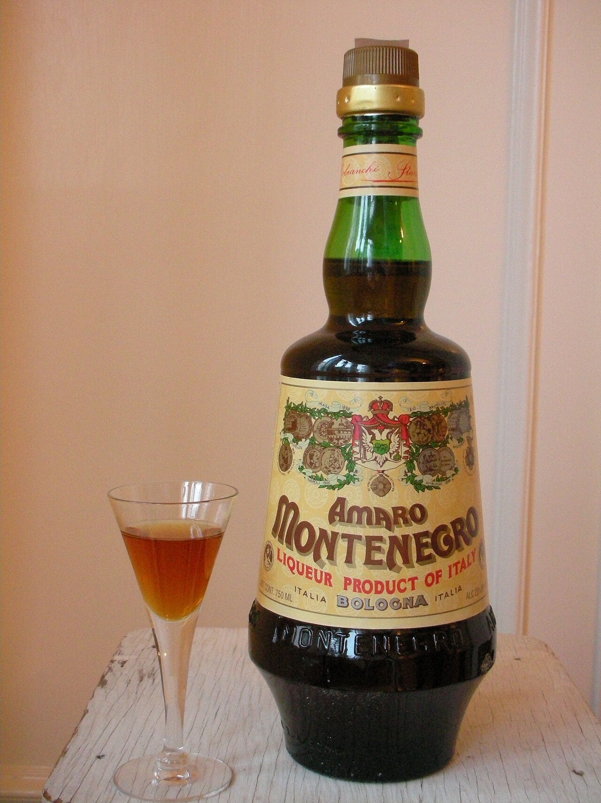

# Amaro

Amaro is the Italian family of herbal bitter [liqueurs](ref:liqueur). What they share is not one plant but a structure: herbs, roots, bark, flowers and citrus are macerated or distilled in alcohol to make a bitter base, then blended with syrup, water or spirit so that bitter and sweet balance. It can be very bitter, very sweet, herbal, citrusy, caramel-like or minty; the axes it cannot lose are bitterness and herbs.

Figure: A bottle of Amaro Montenegro and a glass of amber amaro, the label reading Amaro Montenegro and Product of Italy. Image: Shabbychef, CC BY-SA 4.0, via [source page](https://commons.wikimedia.org/wiki/File:Amaro_Montenegro.jpg).

## The definition of an Italian bitter liqueur

In EU law, amaro usually falls within "liqueur" or "bitter-tasting spirit drink" rather than a protected geographical indication. It has no single plant list, minimum age or fixed strength; each producer may work from a family recipe. Italians call the whole family amaro, literally "bitter", though the actual taste is usually bittersweet rather than simply bitter.

That creates a practical problem: the category is so broad that one sentence cannot describe the style. Some bottles are only 11% ABV and made for ice and a large glass; others approach 30% ABV, with heavy bitterness and a small after-dinner serve. Strength, sugar, plant description and origin tell the buyer more than the word amaro alone.

## Monasteries, pharmacies and family recipes

Amaro's roots are often traced to monasteries and pharmacies. Medieval monks steeped herbs in alcohol to make digestives and medicinal wines; in the nineteenth century, Italian city pharmacies and distilleries commercialised those recipes and created the brands we know. The formula was often held by a family or an apothecary and adjusted over generations, becoming part of local identity.

This "herb—medicine—liqueur" path explains why amaro labels often carry words such as digestivo, erbe amare or ricetta originale. It carries both folk-medicine memory and modern brand marketing; the two are not contradictory, but "aid digestion" should not be read as a medical claim.

## Maceration, sugar and age

Amaro production usually starts with maceration: dried or fresh plant material sits in alcohol or an alcohol-water solution for days to weeks, drawing bitterness, aroma and colour into the liquid; some recipes put part of the plants in the still so steam extracts a lighter aroma. The macerate is filtered, blended and sweetened, and sometimes aged.

Sugar is not simply a cover for bitterness. It gives viscosity, roundness and length, turning a sharp bitter into something drinkable; too little leaves the body thin, too much buries the plants. Ageing lets bitter and sweet settle together, and wooden vessels add vanilla, spice and a little oxidation. Sugar levels vary widely between producers, so sweetness alone does not measure quality.

## Layers of bitterness

Amaro's bitterness comes from many compounds: gentian, quassia, cinchona, artemisia, orange peel, rhubarb and artichoke can all contribute. The bitter sits in different places too: at the entry, in the middle, or at the finish; it can be clean like grapefruit peel or deep like bark and soil.

Taste in three layers: first the roundness of sugar and alcohol, then herbs, citrus, flowers and spice, then the length and texture of the bitter. A good amaro is not "the more bitter the better"; it has support for the bitter, sweetness that does not cloy, clear botanical layers and a clean finish. Temperature changes the balance: ice suppresses bitterness and aroma, while room temperature reveals detail.

## Representative brands and regions

Lombardy, Veneto, Piedmont and Calabria in the north, and Sicily in the south, all have representative brands. Averna comes from Sicily, with a recipe dating to 1868, and leans sweet with citrus and herbs; Fernet-Branca comes from Milan, founded in 1845, with strong bitterness and clear mint and saffron notes, the benchmark of the fernet category; Cynar uses artichoke as its symbol, launched in 1952, with a softer bitterness that suits ice or mixing.

These brands are an entry point, not the whole field. Italy also has many small producers using local herbs, wine alcohol or grain alcohol; some stress fresh plants, others long ageing. Region is not a quality guarantee, but it offers a style clue: the north is often more herbal and bitter, the south often sweeter and more citrusy.

## Digestif and cocktail ingredient

Amaro's most traditional role is the after-dinner digestif: a small glass at room temperature or over ice, sipped slowly. It also works as a highball with soda, tonic or ginger ale to lower sweetness and heat; in winter some drinkers add a little hot water to open the aroma.

In cocktails, amaro is a "bittersweet modifier". It can take part of the role of [vermouth](ref:vermouth) or [bitters](ref:bitters), adding herbal depth to a [Negroni](ref:negroni) or layers to an [Old Fashioned](ref:old-fashioned) variation. Use it with restraint: its sugar and bitterness are both strong, and too much will overwhelm the base spirit.

In Italy, amaro also appears with coffee, soda or orange peel as the final palate reset after a meal.

## Where amaro differs from bitters and vermouth

[Bitters](ref:bitters) are concentrated bitter flavourings, usually added in dashes or small amounts and not drunk in quantity; amaro is a sweetened liqueur that can be drunk neat or used as a main cocktail ingredient. Their bitter sources overlap, but concentration, sugar and use are completely different.

[Vermouth](ref:vermouth) is an aromatised fortified wine, built on wine and usually lower in alcohol than amaro; amaro is built on alcohol maceration or distillation and normally contains no wine. Confusing the three misses their separate jobs in a drink: vermouth brings wine acidity and aroma, bitters bring concentrated bitterness, and amaro brings bittersweet balance and herbal body.

**At a glance:** The Italian family of herbal bitter liqueurs, made by macerating or distilling herbs, roots, bark and citrus and blending with syrup; usually 11% to 30% ABV, bittersweet, and used both as a digestif and as a mixing ingredient in Negroni, Manhattan variations and highballs. 

For Amaro, begin with the production rule. Then look at the strength, and finally ask the usual serving. The answers point to different choices, not to a single score.

**Key facts.**

| Item | Detail |
| --- | --- |
| In one line | The Italian family of herbal bitter liqueurs, made by macerating or distilling herbs, roots, bark and citrus and blending with syrup; usually 11% to 30% ABV, bittersweet, and used both as a digestif and as a mixing ingre… |
| Parent style | Liqueur |
| Aroma family | herbal/bitter/citrus |

**Sources and limits.** The key claims about Amaro are checked against the following sources: European Union (the legal boundaries between liqueurs, bitter spirits and aromatised wines), Federvini (Italian spirits and liqueur categories and traditions), Amaro Averna (the 1868 recipe and Sicilian family production history) and 4 sources in total. Prices, batches and status change; the body is project-written and does not reproduce source text.
