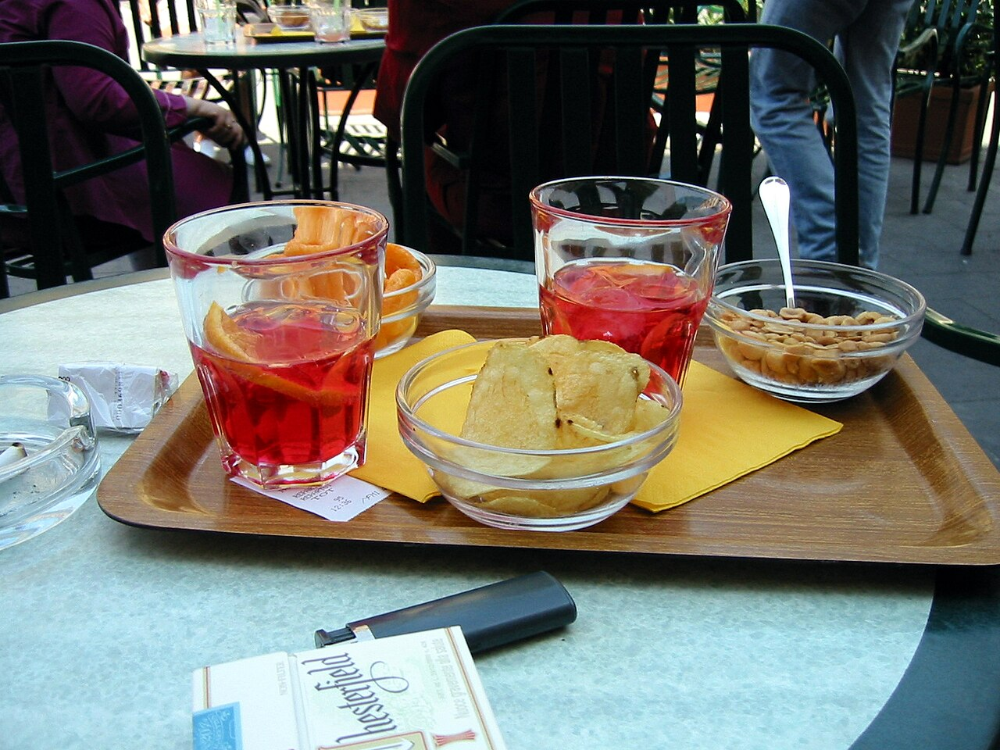

# Aperitif

An aperitif (aperitivo in Italian) is a drink consumed before a meal, whose main purpose is to stimulate the appetite with bitterness, acidity, bubbles or a dry structure rather than to deliver a lot of alcohol. It is defined by the occasion, not by raw material: vermouth, bitter drinks, anise spirits, dry fortified wines and low-alcohol cocktails can all belong to it.

Figure: Aperitif. Image: Wikimedia Commons contributor, Public domain, via Wikimedia Commons ([source page](https://commons.wikimedia.org/wiki/File:Aperitif_Campari_Soda.jpg)).

## Definition and boundaries

An aperitif is not a legal beverage category but a set of drinking habits. The same bottle can be an aperitif before a meal and a digestif after it; the difference lies in occasion, temperature, portion size and pairing. The Italian aperitivo emphasises a social ritual, with early-evening drinks and snacks in a bar, while the French apéritif emphasises the period before the meal.

Three dimensions help decide whether a drink suits the pre-meal slot: alcohol strength, sugar and bitterness. Too much alcohol numbs the palate, too much sugar suppresses appetite, while moderate bitterness and acidity promote salivation. An aperitif is not necessarily "low-alcohol": bitter drinks and fortified wines can be strong, and what matters is a small portion, a low temperature and a fresh profile.

Aperitifs and digestifs are often confused. Digestifs are usually drunk after a meal and lean towards higher alcohol, higher sugar or strong bitterness, with the aim of aiding digestion and closing the meal; aperitifs emphasise freshness and a light burden. The boundary is not fixed: the same bitter drink may be an after-dinner drink in Italy and a before-dinner drink in another market. Understanding this removes the need to attach a single label to every bottle.

## History

The word "aperitif" comes from the Latin aperire, meaning "to open". In the 18th century the European habit of drinking before a meal became established; in the 19th century, with the growth of city bars, cafés and the bitter-drink industry, the aperitif became a bourgeois urban ritual. Commercial production of modern vermouth appeared in Turin in 1786, and the combination of bitter plants with wine laid the foundation of the later aperitif structure.

In the 20th century the Italian aperitivo culture combined drinking with snacks and created an early-evening social occasion, while France developed the practice of diluting pastis with water. After the Second World War, cocktails such as the Spritz and the Americano extended the aperitif from neat drinking into mixing, and the Negroni combined bitterness, sweetness and juniper into a complete pre-meal drink. Low-alcohol and alcohol-free aperitifs are also growing today, but they still follow the functional logic of "small, fresh, appetite-opening".

## Common types

- Vermouth: an [aromatised fortified wine](ref:fortified-wine) base infused with bitter plants and spices, in dry, sweet and semi-sweet styles; dry vermouth works before a meal or in a martini.
- Bitter drinks (bitters / amaro): herbs, roots and citrus are macerated to a bitter-sweet balance; Italian amaro is often a digestif, but low-sugar, low-alcohol bitters also serve as aperitifs. See [liqueur](ref:liqueur).
- Anise spirits: French pastis and Greek ouzo cloud when water is added and are strongly flavoured, so they are usually drunk in small amounts.
- Aperitif cocktails: the Spritz, the Americano and the [Negroni](ref:negroni), which differ widely in strength and sweetness and should not be treated as one thing.

## Flavour structure

The shared flavour of an aperitif is a triangle of bitter, sour and aromatic. Bitterness comes from plant alkaloids, terpenes and polyphenols, lengthens the finish and checks cloying sweetness; acidity comes from wine or citrus and cleans the palate; aroma comes from herbs, roots, citrus peel and spices. Sugar exists to balance bitterness rather than to create a sweet drink, so aperitif sweetness is usually a "finishing sweetness" that quickly turns to bitter and aromatic notes.

Temperature and bubbles change perception. Low temperature suppresses sweetness and alcohol heat and makes bitterness clearer; carbonation adds freshness through bubbles and acidity and also speeds the release of aromas. Adding ice, soda or citrus peel to the same drink visibly moves the flavour centre, which is why aperitifs suit adjustment to the occasion.

Bitterness perception varies between people. Sensitivity is shaped by taste receptors and eating habits, so the same glass can taste completely different from one person to another. "This drink is too bitter" is therefore not an absolute judgment but the result of an individual threshold combined with temperature and sugar. For a first attempt, a low-bitterness, low-alcohol, sparkling product is easier than a high-intensity bitter.

## Serving and pairing

The classic pre-meal serve is a small glass, low temperature and little ice: vermouth with one ice cube and lemon peel; bitters with soda and orange peel; anise spirits diluted with water in the traditional way. Cocktails control sugar and dilution by recipe: a Spritz is usually sparkling wine, a bitter and soda; an Americano is a bitter, sweet vermouth and soda; a Negroni is equal parts gin, bitter and sweet vermouth.

Portions should be small. The point of pre-meal drinking is to open the palate, not to get drunk, and strong aperitifs especially need a limit on glasses. With snacks, choose salty items, olives, nuts, cheese and pickles, and avoid very sweet pastries, because sugar clashes with bitterness and suppresses appetite. Before a formal dinner, one glass is usually enough so that alcohol does not interfere with the tasting that follows.

## Common misconceptions

First, treating the aperitif as a legal drink type. It is an occasion category, and the same drink can appear in different settings.
Second, assuming an aperitif must be low-alcohol. Bitter drinks and fortified wines can be strong; portion and serving style are what matter.
Third, replacing an aperitif with a sweet drink. High sugar suppresses appetite, the opposite of the pre-meal aim.
Fourth, assuming more bitterness means more authenticity. Bitterness needs balance with sugar, acid and aroma, and products differ widely.
Fifth, ignoring temperature and dilution. Ice and soda markedly change the flavour, so the label alone cannot settle the question.

**Short definition:** A pre-meal drinks category defined by occasion rather than raw material, usually built around bitterness, dryness or freshness. 

For Aperitif, begin with the production rule. Then look at the strength, and finally ask the usual serving. The answers point to different choices, not to a single score.

**Sources and limits.** The key claims about Aperitif are checked against the following sources: European Union (the category definitions for vermouth and other aromatised wine products), International Bartenders Association (the place of aperitif-style cocktails in the classic cocktail categories), Oxford University Press (Consulted for entries on pre-meal traditions, bitter drinks and European aperitif culture; Migrated from the former reference list at the end of the article; access date not re-verified). Prices, batches and status change; the body is project-written and does not reproduce source text.

## Further reading

- [Liqueur](ref:liqueur): the category framework for bitter and sweet drinks.
- [Fortified wine](ref:fortified-wine): the base category for vermouth.
- [Negroni](ref:negroni): a classic cocktail built on an aperitif skeleton.

## Related images

Image: Fortified wine. Credit: Jon Sullivan, Public domain, via Wikimedia Commons ([source page](https://commons.wikimedia.org/wiki/File:Port_wine.jpg)). Related image for Aperitif.
