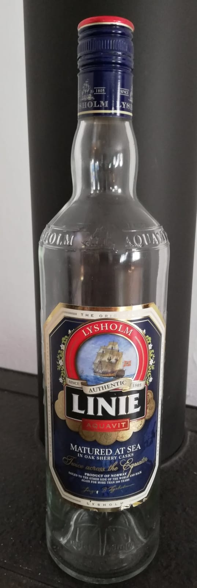
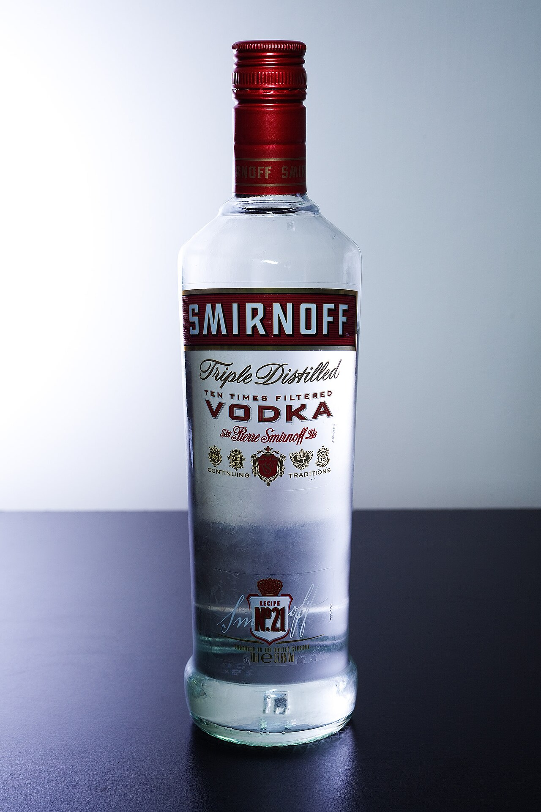

# Aquavit

Aquavit, written akvavit or akevitt in the Nordic countries, is a Scandinavian spirit built around caraway seed or dill. It may be clear and colourless or amber from oak ageing, and it usually starts at 37.5% ABV, with 40% a common bottling strength. It is not vodka with flavouring, nor a northern variant of gin: the caraway-dill pairing, the grain or potato base, and the snaps ritual at the Christmas table together define it.

Figure: A bottle of Lysholm Linie aquavit, the label reading LINIE AQUAVIT and Matured at Sea. Image: Mojmir Churavy, CC0 1.0, via [source page](https://commons.wikimedia.org/wiki/File:Lysholm_LINIE_Aquavit_bottle.jpg).

## The Nordic "Water of Life"

The name comes from Latin aqua vitae, "water of life". Medieval Europe treated distilled alcohol as medicine, and Nordic producers later added local spices such as caraway and dill, gradually shaping today's profile. Denmark, Norway and Sweden each have their own tradition, and German-speaking areas often write Aquavit or Akvavit. The spelling changes; the core definition does not.

In Norway it appears with Christmas dinner, pickled herring, smoked salmon and roast pork; in Denmark it belongs to lunch and snaps culture; in Sweden it marks midsummer and the Christmas table. It is usually served ice-cold in a small glass and drunk in one go, often with a toast or a song, making the occasion livelier than a quiet tasting.

## Regulation: The Caraway and Dill Minimum

EU spirit-drink law lists akvavit/aquavit as a separate category: ethyl alcohol of agricultural origin, flavoured with caraway seed and/or dill, with a minimum strength of 37.5% ABV. The rules require neither clarity nor a minimum sugar level, so the spirit can be colourless or golden from oak. It is not a sweet [liqueur](ref:liqueur), even though Scandinavians sometimes treat it as an after-dinner drink.

National traditions add detail. Norwegian akevitt often uses potato or grain and sits near 40% ABV, with some products aged in sherry casks; Danish and Swedish versions more often stay clear and taste more directly of spice. Labels such as "taffel" or "juleakevitt" are style and season cues rather than EU-wide legal grades.

## A Letter from 1531

One of the earliest Scandinavian written records is a letter sent in 1531 by Eske Bille, commander of Bergenhus fortress, to Archbishop Olav Engelbrektsson. Bille enclosed a bottle of what he called aqua vitae and described it as a remedy for many illnesses. The letter does not prove that modern caraway aquavit already existed, but it shows that distilled alcohol had reached elite and ecclesiastical circles in sixteenth-century Scandinavia.

Another much-told story dates to 1805. The Norwegian Lysholm family shipped a batch of potato-based aquavit to the East Indies, where it failed to sell, so the cargo returned home. Back in Oslo, people found that the liquid had grown rounder and more complex in the wooden casks and the motion of the sea. Since then, some Norwegian aquavits have been marketed as sea-aged, with ships crossing the equator twice, which gave Linie, "the line", its name.

## Grain, Potato and Spice

The base may be grain or potato. Grain spirit is usually cleaner and sweeter; potato spirit is fuller and more earthy. The base is [distilled](ref:distillation) to a high strength, then treated with spices: caraway, dill, fennel, coriander, citrus peel, clove and nutmeg are common. Caraway gives dry liquorice and bread notes, while dill adds a green, almost pickled freshness.

Spices can be added by maceration, steam distillation or direct compounding. Traditional producers steep or redistil them in a [pot still](ref:pot-still) so that aroma and spirit merge; large producers may use column distillation and precise blending for consistency. Either way, caraway and dill must remain recognisable, or the spirit loses its identity.

## Clear and Amber: Two Kinds of Ageing

Clear aquavit usually emphasises spice precision: caraway, dill, citrus and white pepper form a clean line. Oak-aged versions gain vanilla, caramel, nuts and sherry-like sweetness, with colours from pale gold to deep amber. Norway's Linie is known for sherry casks and sea motion; the ageing rounds the body and wraps the spice in wood, making it suitable for sipping.

Ageing is not a quality divide. Clear versions suit freezing, pickled fish and cocktail use; amber versions are better at room temperature, in a small glass, with roast meat or rich cheese. Oak adds sweetness and tannin but can hide some of the green dill note, so the choice depends on whether you want spice or roundness.

## Norway, Denmark and Sweden Diverge

Norwegian aquavit often uses potato, tastes fuller and includes a higher proportion of aged versions. Linie is the best-known export, while Gammel Opland stresses tradition and softness. Denmark's Aalborg and Brøndums more often stay clear and direct, suited to ice-cold snaps; Sweden's O.P. Anderson and Skåne versions are likewise clear and appear at midsummer and Christmas. Finland has its own anise-spirit tradition, but it is not usually called akvavit.

These differences come from raw material, distillation and ageing rather than law. Norway's oak and sea-shipping history made amber versions common; Denmark and Sweden's clear style suits the frozen snaps serve. Across the border the brand names change, but the caraway-dill backbone remains.

## The Christmas Table and Snaps

In Norway, Christmas dinner often opens with pickled herring, smoked salmon, roast ribs and sauerkraut, and aquavit is a fixture. The glass is small, the spirit is chilled until it thickens, and the table raises a "skål" before drinking. In Denmark, cold lunch plates and cheese also call for snaps; in Sweden, midsummer herring and new potatoes are inseparable from it. It is not there to intoxicate but to cut through curing, smoke and fat.

Neat, serve it cold but not so frozen that the aroma disappears; amber versions can warm slightly to release sherry sweetness. It also works in cocktails, replacing gin in a Nordic martini or pairing with ginger beer and citrus. With food, pickled fish, herring, smoked meat, hard cheese and rye bread are safest.

## The Difference from Gin and Vodka

Aquavit and [gin](ref:gin) both use botanicals, but gin is built on juniper while aquavit is built on caraway and dill; gin leans towards pine and citrus, aquavit towards bread, liquorice and pickled green notes. The difference from [vodka](ref:vodka) is simpler: vodka aims for neutrality, while aquavit must make its spices legible. It is not a liqueur unless sugar is added; most aquavit is a dry spirit.

Compared with absinthe or anise liqueurs, aquavit has less anise and more caraway and dill, and it does not normally cloud when water is added. Treating it as "Nordic vodka" misses the spice structure and misreads the food it is meant to accompany.

## Buying and Storage

Look for the category word and strength: a bottle labelled "akvavit/aquavit" must meet the caraway or dill requirement, and around 40% is typical. Clear versions suit freezing and mixing; amber versions suit sipping. "Juleakevitt" usually signals a Christmas-spiced style. Once opened, store away from light at room temperature, and refrigerate lower-strength bottles, finishing them within a year.

Aquavit is not meant for long cellaring at home; oak character does not keep developing in the bottle. If the aroma turns flat or visibly oxidised, it has passed its best. In cocktails, reduce the other spices, or caraway will quickly take over the glass.

## Related images

Image: Vodka. Credit: Ashley Pomeroy, CC BY 4.0, via Wikimedia Commons ([source page](https://commons.wikimedia.org/wiki/File:Smirnoff_Red_Label_8213.jpg)). Related image for Aquavit.
