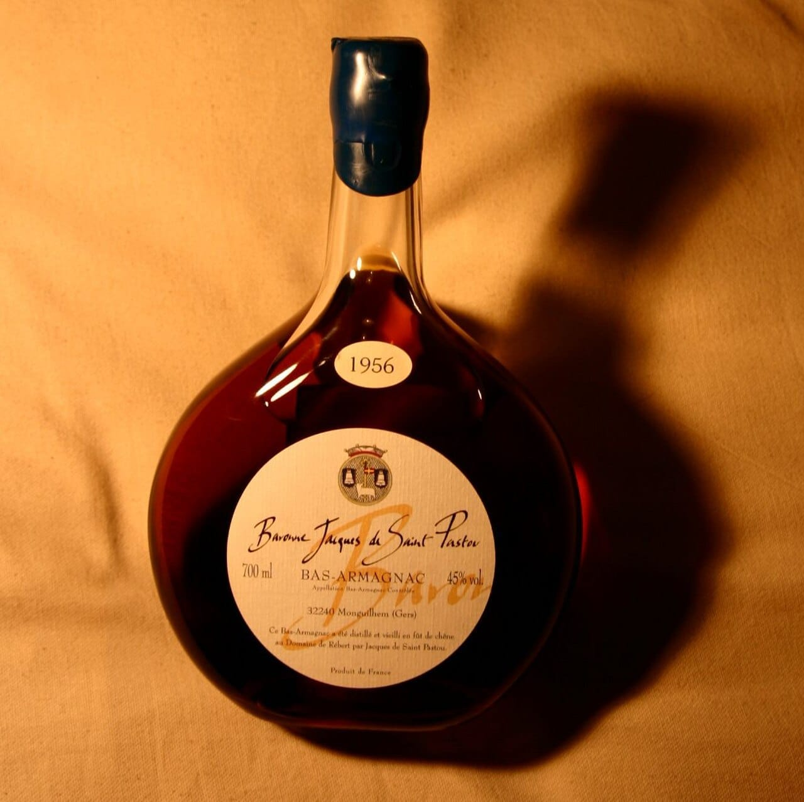
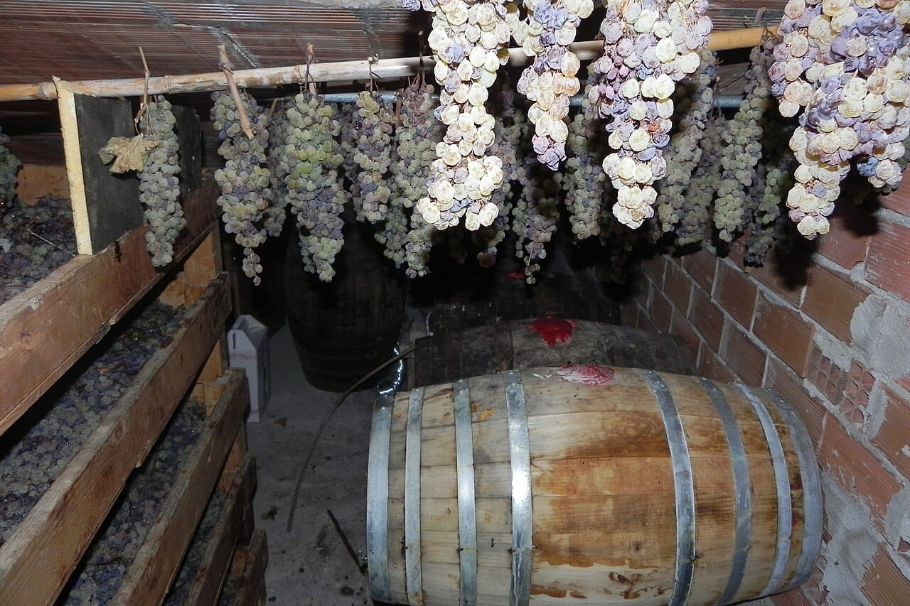

# Armagnac

The easiest thing to remember about Armagnac is its still: the wine passes through once, not twice as in Cognac. That single pass leaves more congeners behind, gives a lower-strength spirit, and makes the aroma broader, heavier and quicker to show itself. Around this "one pass" technique, Gascon producers built a tradition of bottling single vintages, so each year's weather can be preserved on its own.

Figure: Armagnac. Image: Rama, CC BY-SA 2.0 fr, via Wikimedia Commons ([source page](https://commons.wikimedia.org/wiki/File:Armagnac-img_0465.jpg)).

## A document from 1310

Local histories usually trace Armagnac to the fourteenth century. A Latin medical text of 1310 lists forty uses for "aygue ardente", or water of life, and is widely cited as the earliest written evidence of distilling in Gascony. The exact context can be debated, but the text at least shows that the area understood wine distillation in the late Middle Ages.

Trade with Dutch and northern merchants expanded distilling in the seventeenth and eighteenth centuries. Phylloxera devastated the vineyards in the nineteenth century, and replanting changed the mix of varieties, indirectly producing the Baco 22A that still marks Armagnac today. The AOC arrived in 1936, after which varieties, distillation and vintage labelling were standardised.

## Three sub-regions

Armagnac is divided into Bas-Armagnac, Ténarèze and Haut-Armagnac. Bas-Armagnac, on sandy and iron-bearing soils, gives fine spirit with clear fruit and long ageing potential, and is often treated as the core; Ténarèze, on clay and limestone, is weightier and more spicy, and often supplies the backbone of a blend; Haut-Armagnac, on a limestone plateau, is lighter and matures faster.

The three names may appear on the label, but they are not quality grades. "Bas" means lower ground, not lower rank; within one sub-region, distillation choices, barrel wood and cellar conditions still create wide differences.

## How the continuous still works

The traditional apparatus is the alambic armagnacais, a continuous still. Wine enters at the top of a column of plates and descends while rising vapour meets it again and again; alcohol and aroma are concentrated in one continuous pass, and the wine yields finished spirit in a single run.

The spirit usually comes off between 52% and 60% ABV, well below Cognac's 72.5% ceiling. Lower strength means more high-boiling compounds and oils survive, giving a denser, heavier and wilder profile. The appellation also permits the Charentais pot still with double distillation for a finer style; the two routes coexist rather than replace each other.

Distillation must be completed by 31 March after the harvest. For the general principle, see [distillation](ref:distillation).

## Baco 22A and the variety mix

The main varieties are [Ugni Blanc](ref:trebbiano), known locally as Saint-Émilion, together with Baco 22A, Folle Blanche and Colombard. Ugni Blanc supplies acidity and structure, Folle Blanche brings flower, and Colombard adds citrus and freshness.

Baco 22A is Armagnac's peculiar inheritance. A hybrid of Folle Blanche and Noah raised by François Baco at the end of the nineteenth century, it helped the region recover after phylloxera and was later kept in the permitted list. It adds plum, dried fruit and spice, and it makes the variety range wider than Cognac's.

## Single vintage: weather in a bottle

A vintage Armagnac (millésime) must come entirely from the grapes of the stated year and be matured in the producer's own cellar, with harvest and bottling records that can be traced. It is a parallel logic to VS, VSOP and other blends: one stresses a particular year and a producer's choices, the other stresses consistency.

Vintage bottling is not a marketing gimmick. Gascon houses keep stocks going back many years and release them year by year, letting drinkers compare vintages side by side. This is uncommon in Cognac and is one of Armagnac's clearest identities.

## Gascon oak

Maturation uses local oak, often called Gascon black oak and typically from forests around Monlezun. Grain, toast level and previous use change the aroma: new barrels give vanilla, caramel and tannin, while older ones let fruit and rancio come forward.

[Oak ageing](ref:oak-ageing) is often slower in Armagnac. The spirit starts at lower strength with more aromatic compounds, and long maturation tends towards dried fruit, tobacco, leather and the complex note called rancio. Cellar temperature and humidity, barrel size and position all matter, and colour alone cannot date a bottle.

## Grades and labels

Grades are set by the youngest spirit in the blend: VS at least 1 year, VSOP at least 4, XO at least 6 and Hors d'âge at least 10. These figures are lower than some Cognac grades, partly because Armagnac spirit is already aromatic when young and does not have to rely on long ageing for structure.

Three things matter when reading a label. The grade is a floor, not an average age. Vintage and blend are separate product logics and cannot be mixed. And the sub-region names are not a quality ranking.

## Drinking and food

Serve neat at room temperature in a tulip glass. Smell plum, fig and flowers first, then vanilla, tobacco and leather; check body, alcohol integration and finish on the palate. A drop of water opens the aroma, but the spirit is already lower in strength and rarely needs much dilution.

It works as a digestif with chocolate, dried fruit, nuts and cheese; in Gascony it is also served with duck breast and confit. Vintage bottles reward slow drinking, while VS or VSOP can go into cocktails. Excessive drinking is harmful to health, and minors should not drink.

## Common misconceptions

- Armagnac is a branch of Cognac: they are parallel AOCs with different regions, varieties and distillation traditions.
- Armagnac is always pot-distilled: the continuous still is the local tradition, and the pot still is the permitted alternative.
- Vintages can be labelled freely: a vintage must come wholly from the stated year and be traceable.
- XO is a fixed year: it is a minimum-age threshold.
- Bas-Armagnac is the low-grade area: "bas" refers to low ground, not rank.
- Armagnac must be served neat: it also works over ice, in cocktails or with food.

**Short definition:** A grape brandy from Gascony, protected since 1936, traditionally made in a continuous still that gives roughly 52% to 60% ABV spirit with a broad, weighty aroma; it is divided into Bas-Armagnac, Ténarèze and Haut-Armagnac and keeps a strong vintage tradition.

**Key facts.**

| Item | Detail |
| --- | --- |
| In one line | A grape brandy from Gascony, protected since 1936, traditionally made in a continuous still that gives roughly 52% to 60% ABV spirit with a broad, weighty aroma; it is divided into Bas-Armagnac, Ténarèze and Haut-Armagna… |
| Parent style | Brandy |
| Aroma family | fruit/floral/oak |

## Further reading

- [Brandy](ref:brandy): the wider distilled family.
- [Distillation](ref:distillation): continuous versus pot distillation.
- [Oak ageing](ref:oak-ageing): Gascon oak and long maturation.
- [Ugni Blanc](ref:trebbiano): one of the main Armagnac grapes.
- [Armagnac region](ref:armagnac): soils and styles of the three sub-regions.
- [Appellation](ref:appellation): the entry point to AOC and GI systems.

## Related images

Image: Tuscany Vin Santo (holy wine) dried Trebbiano grapes. Credit: Gabriele Cantini, CC BY 2.0, via Wikimedia Commons.. Credit: Gabriele Cantini, CC BY 2.0, via Wikimedia Commons ([source page](https://commons.wikimedia.org/w/index.php?curid=19365493)). Related image for Armagnac.
