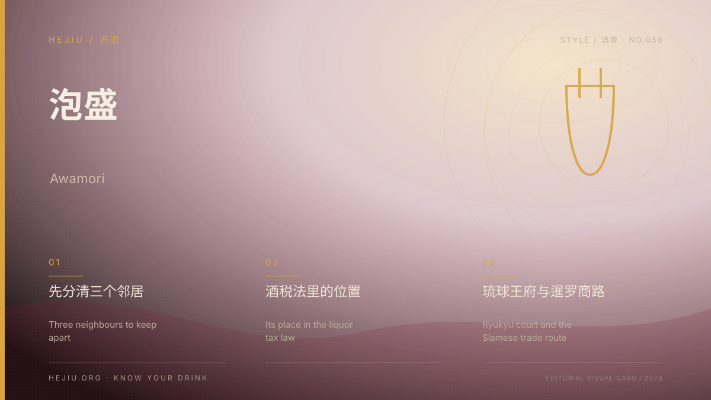

# Awamori

The recipe for awamori is startlingly short: rice, black koji, water, yeast. There is no second mash addition, no continuous still, no cool slow fermentation to build perfume. Yet this simple sequence has run in Okinawa's heat and humidity for centuries, and it produced a tradition few other Japanese spirits share: sealing the spirit in clay jars and waiting three, ten or thirty years for it to become kusu, "old sake".

Figure: thematic illustration for Awamori. Image: AI-assisted illustration generated with Doubao Seedream 5.0 (project-owned); not a photograph of the subject.

## Three neighbours to keep apart

Awamori is often mistaken for sake or for sweet-potato shochu. It is not sake: sake is fermented, awamori is distilled, and their strength and storage behaviour differ completely. It is not sweet-potato shochu either: honkaku shochu may be based on sweet potato, barley, buckwheat or brown sugar, while awamori's main material can only be rice and its koji can only be black koji.

A second confusion surrounds the word "black". Brown sugar is an Okinawan sugarcane product and can be a shochu material; black koji is a mould culture. The names overlap, the things have nothing to do with each other.

## Its place in the liquor tax law

Japanese liquor tax law divides shochu into continuous-distilled and single-distilled families. Awamori belongs to the single-distilled group, often called otsu-rui, with a legal ceiling of 45% ABV; most bottles are sold at 30%.

The word awamori is also tied to place of production: it must be made in Okinawa Prefecture from rice and black koji and distilled in a single-distillation apparatus. Japan additionally protects "Ryukyu awamori" as a geographical indication, separating local production from imitations made elsewhere. Place, materials and distillation together form its legal identity.

## Ryukyu court and the Siamese trade route

The technique behind awamori is usually traced to the trade routes linking the Ryukyu Kingdom with Southeast Asia. Knowledge of rice distillation arrived with merchants, and local brewers used black koji to cope with the tropical climate, gradually arriving at a spirit based on rice alone. The name awamori already appears in Ryukyu-period documents, and breweries were tied closely to court ritual, banquets and daily consumption.

After the 1879 abolition of the Ryukyu Kingdom, Okinawa entered the modern Japanese administrative system. Brewing was rebuilt amid shortages during the post-war US administration, and after Okinawa's return to Japan in 1972 the liquor tax law applied fully, bringing materials, distillation and labelling into one framework. Kusu then moved from local custom to a recognised product line.

## Black koji: citric acid in the fermentation tank

Awamori uses black koji, Aspergillus luchuensis, formerly called A. awamori. As it grows on steamed rice it releases large amounts of citric acid, dropping the pH of the mash quickly. In Okinawa this matters more than elsewhere: with high temperatures and fast-growing contaminants, acidity locks the environment down more reliably than cold.

Black koji does more than preserve. It affects saccharification speed, amino acid formation and aroma precursors, giving awamori its rice-like, lactic, mushroom and nutty notes. White or yellow koji can also make spirits, but black koji is part of what identifies the category; changing the mould changes the flavour route.

## All-rice koji and a single mash

Honkaku shochu normally uses a two-stage mash: a mother mash of water, koji and yeast, followed by steamed main material. Awamori turns all of its rice into koji, then adds koji, water and yeast together, so saccharification and [fermentation](ref:fermentation) happen in one operation.

All-rice koji is not cheap: the same quantity of rice must pass through the koji room, making room capacity and humidity control a bottleneck. Fermentation usually runs near 30°C for about two weeks, adjusted by brewery and season. Heat speeds fermentation but also raises the risk of a runaway aroma, so brewers rely on koji quality, water ratio and the temperature curve.

## Single distillation: why 30%

The finished mash goes into a single-distillation still, usually once. Separation is less efficient than in a continuous still, so more high-boiling compounds and raw-material aroma stay in the liquid and the body is heavier than that of continuous-distilled korui shochu. The fresh distillate is strong and is diluted before bottling, most often to 30% ABV, with 25%, 35%, 40% and 43% also common.

For the general principle, see [distillation](ref:distillation). The cut matters as much as the still: heads are sharp, tails carry off-flavours, and only the heart goes forward. Some breweries store separate batches and cut points and blend before bottling; blending does not change the category, only the style.

## Kusu: clay jars, shitsugi and time

Kusu is, by industry convention, awamori stored for three years or more. Colour moves from clear to amber, and aroma from sharp rice notes to dried fruit, honey, sandalwood and old wood. It is not a legal quality grade but the result of time and storage.

Not every awamori improves with age. With too little structure, long storage lets wood and bitterness take over, and temperature, humidity, container and strength all change the speed. The traditional shitsugi method tops up jars of old spirit with new, so the liquid keeps merging; over time each brewery's cellar floor develops its own character.

## Main island and outer islands

Awamori must be made in Okinawa Prefecture, and breweries cluster on the main island. Shuri and Tomari in Naha are the traditional brewing districts; Chinen, Nago and Yomitan also have breweries. Miyako, Ishigaki and other outer islands produce awamori too, and shipping and climate give their storage styles a different cast.

Origin is not a fixed style guarantee. On one island, breweries may choose different rice, mould strains, distillation strength and storage, and each sets its own ageing period. Equating "Ishigaki" with one flavour ignores those technical choices.

## How Okinawa drinks it

Neat is the best way to judge rice aroma, black-koji character and distillate cleanliness. Mizuwari is the most common serve, usually one part water to one or two parts awamori, softening the alcohol and opening rice and sweetness; maewari means adding the water in advance and letting it rest so the two integrate. Ice suppresses aroma and lengthens the entry; soda adds lift and suits food; hot water is common in cooler weather.

Okinawa also has koregusu, island chillies steeped in awamori and used by the drop in soup or noodles. It is a local seasoning habit, not a required serve. When tasting, smell the still spirit first, then take a small sip and note sweetness, bitterness, acidity and finish. Excessive drinking is harmful to health, and minors should not drink.

## Common misconceptions

- Awamori is sake: it is distilled, while sake is fermented.
- Awamori is sweet-potato shochu: it uses only rice and black koji.
- Black koji means brown sugar: one is a mould, the other a sugarcane product.
- Older is always better: kusu needs sound spirit and good storage.
- Awamori must be served with chilli: koregusu is one local habit.
- Higher strength is better: strength only shows dilution, not balance.

Start with the production rule. From there, consider the strength, then the usual serving. That is how a practical judgment about Awamori is built.

## Further reading

- [Shochu](ref:shochu): the parent category in Japanese liquor law.
- [Distillation](ref:distillation): how single distillation keeps raw-material aroma.
- [Rice](ref:rice): awamori's single main material.
- [Fermentation](ref:fermentation): black koji, all-rice koji and the single mash.
- [Japan](ref:japan): Okinawa and the geography of Japanese drinks.

## Related images

Image: Fermentation. Credit: Tjhackmann, CC BY-SA 4.0, via Wikimedia Commons ([source page](https://commons.wikimedia.org/wiki/File:Phylogenetic_tree_of_bacteria_and_archaea,_highlighting_those_that_carry_out_fermentation.png)). Related image for Awamori.
