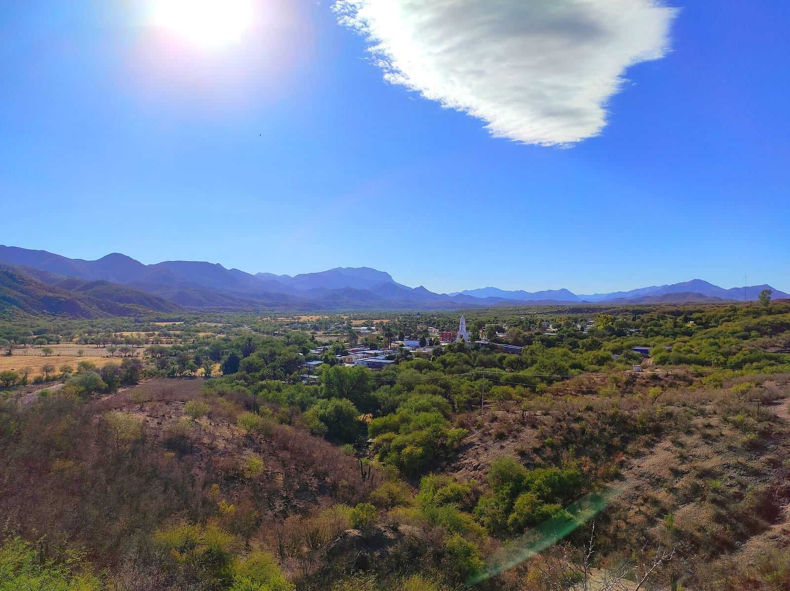

# Bacanora

Bacanora is an agave spirit from Sonora in north-western Mexico, made from Agave angustifolia Haw., locally called pacífica or yaquiana. The traditional method roasts the agave hearts in underground pits, crushes them with stone, ferments the juice and pot-distils twice. It received Mexican denomination-of-origin protection in 2000, covering 35 mountain municipalities, and is listed in the 1997 EU–Mexico spirit agreement.

Figure: Related photograph of Bacanora. Image: KousakaED, CC BY-SA 4.0, via Wikimedia Commons ([source page](https://commons.wikimedia.org/wiki/File:BacanoraCerros.jpg)).

## Definition and boundaries

Bacanora is a regional spirit protected by a denomination of origin (DO), regulated under NOM-168-SCFI-2004 and certified by the Consejo Sonorense Regulador del Bacanora. The legal zone covers 35 municipalities in Sonora's central sierra, the Río Sonora valley and the southern mountains, and takes its name from the town of Bacanora in the Sierra Centro east of Hermosillo. Only product made in these municipalities to the standard and certified may carry the name Bacanora.

Under the standard, the raw material is mature agave hearts (piñas): milled for juice, cooked to complete hydrolysis, fermented with yeasts, then distilled and rectified. The permitted [agave](ref:agave) is A. angustifolia Haw. from the Sonora sierra, known locally as pacífica or yaquiana. It should be separated from other agave spirits: tequila is based mostly on blue Weber agave and centred on Jalisco and neighbouring states; mezcal is a broad category; sotol comes from a different plant in other northern states.

In the EU market, Bacanora appears alongside Tequila, Mezcal, Sotol and Charanda in the Annex II of the 1997 EU–Mexico spirit agreement, with mutual recognition and protection. This provision predates recent free-trade negotiations; it is not a new protection granted in 2024.

## History and naming

Sonora mountain communities have a long tradition of home agave distilling, built on wild agave in the hills and household workshop practice. Early twentieth-century alcohol prohibition made the spirit illegal: from 1915 to 1992, bacanora could only be made secretly by generations of bootleg vinateros, and it was unavailable through legal commercial channels. After legalisation in 1992, the regional association developed the standard and certification, and the Mexican government granted DO protection in 2000, registering the name internationally under the Lisbon system.

The name comes from the town of Bacanora, though the traditional production area stretches well beyond it across the 35 municipalities. The story of a spirit is rarely the work of one person or family; mountain crops, household craft, tax regulation and border consumption shaped it together. What has survived is the palate tradition of roasted, distilled Sonora agave.

## Materials and process

Agave hearts are harvested when mature, trimmed of outer leaves and left as solid piñas. In traditional workshops the hearts go into underground cylindrical clay and volcanic-stone ovens fired with mesquite wood, roasted slowly for 4–6 days until the starches convert and caramel aromas penetrate the flesh. A tahona stone crushes the roasted hearts and separates the fibre; the juice ferments in open vats, by natural or cultured yeast.

The fermented mash runs into copper pot stills in two passes: the first distillation gives a rough spirit, and the middle cut goes into smaller stills for a second distillation, rejecting the solvent heads and fusel-heavy tails. Some modern workshops keep the pit oven and stone mill while controlling other steps mechanically. Within the NOM framework, cooking hydrolysis, yeast fermentation and distillation and rectification are the required process stages.

Freshly distilled blanco is palest, with direct herbal and fruit notes; versions rested in wood or containers darken and take on caramel, vanilla and dried-fruit character. Ripeness, roasting time, fermentation temperature and distillation cuts all shift smoke intensity and cleanliness; stuck fermentation, contamination or poor cuts leave green vegetable notes, hot alcohol or acrid burnt smoke.

## Style and palate

A typical bacanora carries pit-roast smoke over an agave-sweet base, with herbal, citrus and mineral notes. Producers often place it between tequila and mezcal: one layer of smoke and mountain herb above tequila, yet smoother and easier than rough-hewn mezcal. Commercial bottlings sit around 43% ABV, and traditional small batches can be stronger.

Faults are easy to read: raw vegetable taste means under-cooking, hot alcohol and waxy texture come from poorly cut heads, and heavy acrid smoke from over-roasting or faulty fermentation. Young blanco suits light aperitif occasions, while rested versions' caramel and dried-fruit notes suit a slower after-dinner drink.

Differences between municipalities and workshops sit mainly in smoke weight, herbal-citrus and mineral expression. When comparing, fix agave variety, pit roasting and ageing status before talking about regional style.

## Representative regions and brands

Producers in the zone are mostly small distilleries and village cooperatives, generally low-volume. Market examples include Kilinga from the Álamos coastal-desert area, Aguamiel, Sunora, which uses spring water from the Rio Zanjón aquifer in local copper stills, and Puntagave; these represent coastal-desert, mountain and traditional workshop routes respectively.

Pricing reflects small-batch production, resting time and brand position: handmade small releases carry premium prices, while easier industrial entry bottlings reach export retail. A brand is only an entry point; raw-material grade, process route and freshness vary widely within the category, so label parameters matter more than names.

## How to drink and pair

Bacanora is usually drunk neat from a small glass, at room temperature or slightly cool. It also forms the base of a Sonora Mule with ginger and lemon. Food matches include grilled meats, salty nuts and spicy dishes, where smoke and agave sweetness answer char and chilli heat.

Neat, smell the herbs and citrus before sipping, letting smoke unfold on the finish. Ice dilutes the alcohol and opens sweetness; over-chilling suppresses mountain herbs and mineral. It does not need long decanting like wine, and an opened bottle should be finished within the short term.

## Buying, storage and misreadings

On the label look for the DO mark, municipality, NOM standard, agave variety and ABV: protected product must be made in the 35 municipalities to the standard. Colour depth is not an ageing measure, and pale blanco is the norm. "Handmade", "traditional" and "small batch" are marketing words, not legal terms.

Store away from light, heat and vibration, upright and sealed. The high-alcohol product keeps longer than low-alcohol drinks once opened, but herbal and smoke aromas fade over the years, so finish an opened bottle within about a year. Three common mistakes are treating bacanora as a mezcal brand when it is a separate DO; equating it with tequila, which differs in agave variety, region and roasting; and repeating the inaccurate claim of EU protection in 2024, whose basis is the 1997 agreement annex.

## Further reading and see also

- Related: [mezcal](ref:mezcal), [agave](ref:agave), [distillation](ref:distillation), [peat](ref:smoke), [liqueur](ref:liqueur).
- To map the category, start with one blanco bacanora and one rested version, compare smoke weight, herbal-citrus and caramel-dried fruit notes, then compare a mezcal side by side for roasting-process differences.

## Related images

Image: Peat. Credit: David Stanley from Nanaimo, Canada, CC BY 2.0, via Wikimedia Commons ([source page](https://commons.wikimedia.org/wiki/File:Peat_(49302157252).jpg)). Related image for Bacanora.
