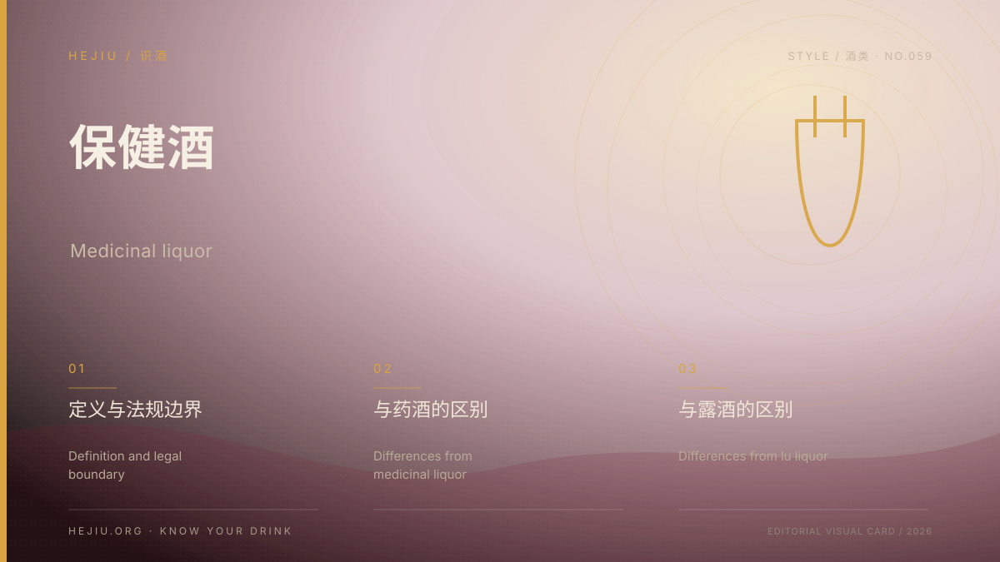

# Medicinal liquor

"Health liquor" usually means a compounded liquor made with a distilled spirit or [yellow wine](ref:yellow-wine) as the base, plus food-medicine ingredients, edible medicinal herbs or extracts. It belongs to the food or health-food category, not to medicine. In China, a health-function claim must meet health-food registration or filing rules, and ordinary compounded liquor may not claim to treat disease.

Figure: thematic illustration for Medicinal liquor. Image: AI-assisted illustration generated with Doubao Seedream 5.0 (project-owned); not a photograph of the subject.

## Definition and legal boundary

"Health liquor" is not a statutory liquor category but a popular name for compounded drinks sold on a health appeal. A product may fall into three different regulatory tracks: ordinary food, health food, or medicine. The track is decided not by the wording on the package but by the approval or filing number and the product category on the label.

Health foods must be registered or filed, carry the "blue hat" mark, and state the suitable group, unsuitable group, health function and daily amount on the label. Ordinary compounded liquor may not claim a health function, let alone treat disease. The Advertising Law adds restrictions for liquor and health-food advertising, and wording that implies disease treatment is an explicit red line.

## Differences from medicinal liquor

Medicinal liquor traditionally means a preparation made by steeping medicinal herbs in alcohol. Some medicinal liquors are regulated as drugs, with defined indications, dosage and adverse-reaction information; others circulate as ordinary food or health food. Medicinal liquor and health liquor are often confused in everyday language, but they must be kept separate in regulatory terms.

The key differences are evidence and responsibility: drugs need review and carry clinical evidence requirements; health foods may claim only an approved health function; ordinary foods may make no functional claim at all. Phrases such as "ancestral formula" or "court secret" are marketing narratives, not a basis for regulatory classification.

## Differences from lu liquor

Lu liquor is a broad category made by blending a distilled spirit, fermented wine or edible alcohol with edible ingredients, and its scope is wider than health liquor. It may be fruit-flavoured, floral, herbal or based on food-medicine ingredients, but it does not automatically acquire health-food status. Conversely, a health liquor may use a lu-style blending process.

"Lu liquor" is therefore a process and product concept, while "health liquor" is a regulatory and claim concept. Buyers should read the product category and approval information first, then the recipe and strength, and avoid equating "contains herbs" with "has a health function".

## Ingredients and recipe

The base is commonly [baijiu](ref:baijiu) or yellow wine, and some products use edible alcohol. Recipe ingredients often come from the food-medicine catalogue or edible medicinal herbs, such as goji berry, Chinese yam, longan, poria and angelica; the species and amounts vary by product. Some products add sugar, honey or juice to adjust the taste.

A recipe is not a therapeutic effect. Whether the ingredients are permitted, whether the amounts comply, and whether allergens and unsuitable groups are declared are questions for the label and regulatory information. When a package talks about "many precious herbs", return to the ingredient list and approval information rather than judging by impression.

## Production

Health-liquor production usually includes material preparation, maceration or distillation, blending, filtration, resting and filling. Maceration lets soluble components of the herbs enter the liquid; distillation carries some volatile components into the distillate. Blending adjusts strength, sweetness and aroma balance, and filtration and resting stabilise the body.

Process differences affect taste and the distribution of components but do not change the legal nature of the product. However elaborate the process, whether a product may claim a health function still depends on registration or filing, not on a process narrative. Hygiene in production and label compliance often matter more than a recipe story in deciding whether a product is compliant.

## Labels and health claims

A lawful label usually includes the product name, ingredient list, strength, net content, producer information, production date and standard, plus the health-food mark and approval number where applicable. A health food should also state the health function, suitable group, unsuitable group and method of use.

Wording to treat with caution includes "cure", "root cause", "replaces medication" and "no side effects". Such claims exceed the boundary for health foods and may also violate advertising rules. When a functional claim cannot be verified, the safest step is to check the regulator's public database rather than trust a sales pitch.

## Drinking and safety

Health liquor still contains alcohol, and it should be taken in the amount suggested on the label rather than consumed as an everyday drink in large quantities. Pregnant people, minors, people with liver disease, people taking medication and anyone who needs to avoid alcohol should not drink it; alcohol can interact with some medicines, so anyone on prescription drugs should ask a doctor first.

It must not be used as a substitute for medical treatment. When symptoms appear, see a doctor rather than relying on a liquor product. If drinking causes discomfort, stop, keep the product and label information, and report to the regulator where necessary.

## Common misconceptions

First, treating health liquor as medicine. At most it is a health food and cannot treat disease.
Second, treating "food-medicine" as "risk-free". Ingredient safety, dosage and alcohol-drug interactions all need consideration.
Third, reading marketing copy but not approval information. The blue hat, approval number and suitable group are the compliance clues.
Fourth, assuming all lu liquor is health liquor. Lu liquor is a broader product concept and does not automatically carry a health function.
Fifth, ignoring the risk of alcohol itself. However low the base strength, it is still an alcoholic drink.

**In brief:** A Chinese infused liquor made with a distilled or yellow-wine base and food-medicine ingredients; it is food, not medicine.

Start with the production rule. From there, consider the strength, then the usual serving. That is how a practical judgment about Medicinal liquor is built.

**Read alongside.** Put Medicinal liquor next to Baijiu, Yellow wine, Lujiu: the first fixes identity and boundary, the others provide a region, process or peer comparison. Read this style first, then return to those entries; the links become coordinates, not decoration.

**Sources and limits.** The key claims about Medicinal liquor are checked against the following sources: State Administration for Market Regulation (registration, filing, labelling and health-claim rules for health foods; no legal text is reproduced), Standing Committee of the National People's Congress, State Administration for Market Regulation; Standardization Administration of China (Searchable by standard number in the National Standards Full-Text Public System) and 4 sources in total. Prices, batches and status change; the body is project-written and does not reproduce source text.

## Further reading

- [Baijiu](ref:baijiu): one of the most common base spirits for health liquor.
- [Yellow wine](ref:yellow-wine): another common base with a different flavour and strength.

Further reading: [Lujiu](ref:c-extra-1).

## Related images

Image: Qu making. Credit: Uranassbandit, CC BY-SA 3.0, via Wikimedia Commons ([source page](https://commons.wikimedia.org/wiki/File:Hongqu_3.jpg)). Related image for Medicinal liquor.
