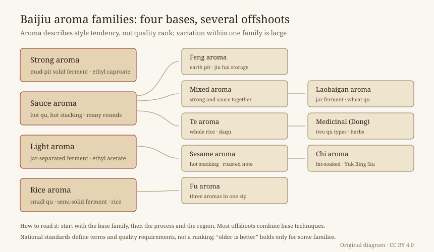
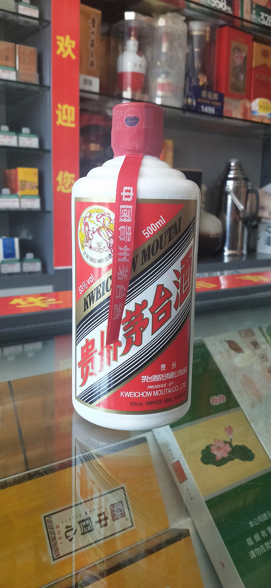

# Baijiu

Baijiu is a category of traditional Chinese distilled spirit. Under GB/T 15109-2021, Terminology of baijiu industry, it is generally made from grains as the main raw material, using daqu, xiaoqu, fuqu, yeast cultures or similar agents for saccharification and fermentation, followed by cooking, saccharification, fermentation, distillation, ageing and blending. This definition identifies the drink at the level of process and category, not the quality grade of a particular bottle.

Figure: the four base aroma families of baijiu and their main offshoots. Original diagram, CC BY 4.0.

## Definition and boundaries

“Baijiu” answers “what kind of drink is this”. For a specific bottle on a shelf, further distinctions are needed: style, brand, producer and product. One brand may cover several products, and one style can have many expressions. GB/T 17204-2021, Terminology and classification of alcoholic beverages, places baijiu in the wider beverage framework and distinguishes it from fermented and compounded beverages; GB/T 15109-2021 then sets terminology within the baijiu industry.

Baijiu, shochu, sake, whisky and vodka are all distilled or distilled-type drinks, but they differ in raw materials, fermentation agents, fermentation methods and flavour goals. They are not the same thing just because they are clear, strong spirits. Likewise, baijiu is not synonymous with one aroma family; aroma family is only one way of classifying baijiu internally.

## Raw materials and qu

Baijiu raw materials are mainly grains. Sorghum is one of the most common; wheat, rice, glutinous rice, maize, barley and peas may also be used in the mash or in qu production. Different raw materials bring different starch structures, protein levels and aroma precursors, which in turn affect fermentation and distillation. A more complex recipe is not automatically better; what matters is whether it matches the process and target style.

Qu is central to baijiu. Daqu uses wheat, barley, peas and similar materials, processed through qu making, microbial cultivation and storage, and is rich in microbes and enzymes. Xiaoqu usually uses rice flour or rice husk as a carrier, is smaller in size and concentrated in saccharifying and fermenting power. Fuqu uses wheat bran as a raw material and is associated with specific process routes. Yeast culture is an expanded yeast preparation. The type of qu determines the microbial basis of saccharification and fermentation and influences aroma formation.

## The main process

Baijiu processing can be summarised as cooking, saccharification, fermentation, distillation, ageing and blending. Cooking gelatinises the starch so enzymes can use it; qu or yeast culture converts starch into fermentable sugar, and yeast converts sugar into ethanol and carbon dioxide; distillation separates and concentrates ethanol and aroma compounds from the fermented mash; ageing lets the liquid stabilise in clay jars, wooden vessels or stainless-steel tanks; blending combines base liquors of different batches, rounds and styles to reach the target flavour and consistency.

By fermentation state, the industry often distinguishes solid-state, semi-solid-state and liquid-state methods. Solid-state fermentation uses a substrate with low moisture, with microbes growing in the grain mash; the process is complex and the flavour layers are rich. Semi-solid and liquid methods are more efficient and follow different flavour paths. Each route has its own product standards and quality requirements, and “solid-state is always better than liquid-state” is too absolute, but process differences do affect aroma and mouthfeel.

## Aroma families

Aroma family is the most common classification lens for baijiu. The industry often treats strong aroma, sauce aroma, light aroma and rice aroma as the four basic families, alongside feng aroma, jian aroma, fuyu aroma, sesame aroma, special aroma and laobaigan aroma. Aroma family describes a combination of aroma and process; it is not a quality ranking and does not replace region, raw material, vintage or product information.

Take [strong-aroma baijiu](ref:strong-aroma) as an example: it is often associated with mud-pit solid-state fermentation, continuous mash replenishment and mixed steaming and boiling. Sauce-aroma styles often emphasise high-temperature qu, multiple fermentation rounds and long storage; light-aroma styles emphasise clean steaming, jar fermentation and a fresh profile. Boundaries between families are not absolute, and composite aroma families explicitly combine several aroma characteristics.

## Regions and brands

Baijiu production spans many Chinese provinces. Sichuan, Guizhou, Shanxi, Jiangsu, Anhui, Shandong, Shaanxi and Hunan all have long-established industrial belts and stylistic traditions. Regional narratives often emphasise climate, water, microbial environment and craft heritage, but these factors need to be verified through specific producers, raw materials and processes rather than inferred from a place name alone.

Brand, producer and product are three different levels. A brand is a market identity, a producer is a production entity, and a product is a specific drink. [Moutai](ref:moutai), [Fenjiu](ref:fenjiu) and [Wuliangye](ref:wuliangye), for example, correspond to different regions, aroma families and product systems; an article should not turn brand recognition into a quality conclusion about a specific product.

## Strength and labels

Baijiu strength is usually expressed as % vol and covers a wide range from lower to higher strengths. Strength is determined by fermentation, distillation and blending, not by a single raw material or vintage. The strength, volume, aroma family, raw materials, standard code and producer information on a label should correspond to one another. If a label emphasises marketing terms such as “vintage” or “original liquor” but lacks verifiable information, caution is warranted.

Terms such as “vintage”, “aged” and “original liquor” do not have one uniform meaning across contexts. The industry has self-regulatory norms for vintage claims, but consumers should still check the specific product's label, standard code and producer statement rather than treating marketing words as a legal grade.

## How to drink and common misconceptions

Baijiu is often drunk slowly from small cups, at room temperature or slightly chilled according to preference and style. High-strength spirits should not be gulped; for food, choose dishes with moderate richness and fat rather than very spicy or very sweet food that overwhelms the drink. Aged baijiu changes in flavour, but not every baijiu improves with age; storage conditions, vessel and structure all matter.

Common misconceptions include treating aroma family as a quality ranking, treating solid-state fermentation as the only lawful method, equating high strength with quality, confusing brand recognition with a specific product evaluation, and treating “vintage” as a legal grade. A more reliable approach returns to standard definitions, label information and verifiable producer materials.

**In brief:** A traditional Chinese distilled spirit made mainly from grains, saccharified and fermented with qu or yeast cultures, then distilled, aged and blended; aroma family is a common lens, not the only one.

Start with the production rule. From there, consider the strength, then the usual serving. That is how a practical judgment about Baijiu is built.

## Decision table: aroma, strength and occasion

| Aroma family | Typical aromas | Texture | Common strength | Best for |
| --- | --- | --- | --- | --- |
| Sauce aroma | soy sauce, toasted grain, lingering empty cup | thick, long finish | often 52–53% | business dinners, slow drinking |
| Strong aroma | cellar, grain, sweet | mellow, clean finish | often 38–52% | family banquets, gifting |
| Light aroma | clean grain, gentle | crisp, light | often 42–53% | light dishes, beginners |
| Rice aroma | rice, honey | soft, short | often 38–52% | southern gatherings, gentle palates |

Strength is label information, not a quality grade; the same aroma family can have high- and low-strength products. Choose the occasion and food first, then a complete label from a clear channel within budget.

## Related images

Image: Moutai. Credit: 毕明明, CC BY-SA 4.0, via Wikimedia Commons ([source page](https://commons.wikimedia.org/wiki/File:Kweichow_Moutai_2023_Part_1.jpg)). Related image for Baijiu.

## Frequently asked questions

### How do I choose an aroma family?

Start with food and occasion, not brand. Rich braises, roasts and grilled meat suit sauce or strong aroma; steamed, blanched and cold dishes suit light or rice aroma. If unsure, buy a small bottle or taste at a shop rather than stocking a case.

### Which strength is better?

High-strength baijiu has more aroma and body but also more burn; low-strength is softer but can taste watery and short. Around 50% is common for many traditional products, but suitability depends on aroma, process and your tolerance. The label is the final reference.

### Why does one brand vary so much in price?

A brand can have several product lines, batches, strengths and channel policies. Check the execution standard, raw materials, producer, volume and invoice rather than claims such as “internal supply” or “special edition”; avoid cheap bottles with no traceable source.

> **Next:** Read [strong-aroma baijiu](ref:strong) for the most common family, compare the product stories of [Moutai](ref:moutai) and [Wuliangye](ref:wuliangye), then use [Fenjiu](ref:fenjiu) to understand the light-aroma route.

## Further reading

- [Strong-aroma baijiu](ref:strong-aroma): a specific style within the wider category.
- [Moutai](ref:moutai): a specific sauce-aroma product.
- [Fenjiu](ref:fenjiu): a specific light-aroma product.
- [Wuliangye](ref:wuliangye): a specific strong-aroma, multi-grain product.
