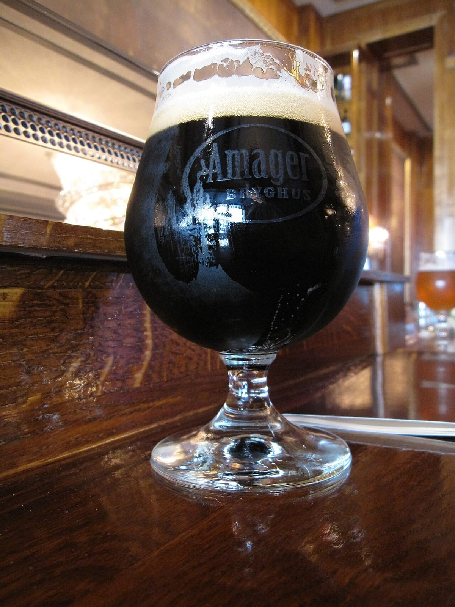

# Baltic Porter

A dark, high-gravity beer brewed with lager yeast around the Baltic, with dark chocolate, caramel, dried fruit and liquorice; it shares porter ancestry but is closer to imperial stout in process.

Figure: Baltic Porter: Amager Rugporter (4941931513) (Wikimedia Commons). Image: Bernt Rostad from Oslo, Norway, CC BY 2.0, via Wikimedia Commons ([source page](https://commons.wikimedia.org/wiki/File:Amager_Rugporter_(4941931513).jpg)).

## Definition and boundaries

Baltic Porter is the Baltic adaptation of British porter: a dark, strong beer fermented with lager yeast and matured cold for weeks or months. The usual range is 7–9.5% ABV, with a full body, low-to-medium hop bitterness and a malt profile built on dark chocolate, caramel, roasted bread, dried fruit and liquorice. It shares porter’s roasted-malt ancestry but is not the same legal or commercial category, and it is generally less bitter and less hop-forward than imperial stout.

Labels may use Baltic Porter, Bałtycki porter, Baltijas porteris or Ostsee-Porter. No single EU or national rule fixes the name, so two bottles can differ widely in residual sugar, hopping and strength. The practical boundary is yeast and process: a dark ale called porter is not a Baltic Porter unless it has been fermented cool with lager yeast and given a long cold maturation.

## History and naming

Eighteenth-century London porter reached Baltic ports through trade, and nineteenth-century breweries in Poland, Lithuania, Latvia and Russia began to copy the style with local malt. Cool cellars and lager yeast made fermentation easier to control, so the British barrel-aged ale was gradually rebuilt as a bottom-fermented, long-matured beer. German ports used the name Ostsee-Porter, and the style spread with shipping rather than belonging to one country.

During the Soviet period, state breweries in Lithuania, Latvia and Poland continued to make dark, strong beer for export and domestic consumption. From the 1990s, small breweries revived the category with chocolate and caramel malt, longer maturation and occasionally oak. Today it is both a historical trade beer and a technical showcase for Central and Eastern European breweries.

The name is a trade and migration story, not a protected appellation. That matters when reading a label: “Baltic” describes a regional adaptation, while “porter” describes a broad dark-beer family. The two words together narrow the field, but they do not guarantee a specific yeast, gravity or sweetness level.

## Materials and process

The grist is usually pale malt with Munich, caramel and roasted malts; some brewers add chocolate malt, rye or oat malt. Hops play a supporting role, enough to balance malt sweetness without turning the beer into a hop showcase. Carbonate-hard water can blunt the acidity of dark malt, so breweries often adjust mash pH or treat the water before brewing.

Mashing is followed by a 60–90 minute boil, cooling to 8–12°C and inoculation with lager yeast. Primary fermentation lasts one to two weeks, then the beer matures at 0–4°C for several weeks to several months. Cold maturation settles yeast, tightens carbonation and lets roasted and caramel notes integrate. Traditional versions avoid coffee, vanilla or fruit additives; oak-aged and flavoured versions exist but sit at the edge of the style.

The strongest clue on a technical sheet is not colour but gravity and attenuation. A beer that starts at 18–20° Plato and finishes with moderate residual sugar will taste full and sweet; a leaner grist and higher attenuation produce a drier, more porter-like finish. Alcohol alone does not define the style.

## Style and palate

In the glass it is deep brown to black with a fine, persistent tan head. Aroma leads with dark chocolate, caramel, toasted bread, dried fruit and liquorice; hops remain in the background. The first sip is malty and often sweet, followed by roasted bitterness and alcohol warmth. The finish can be dry or sweet depending on residual sugar and maturation.

Compared with British porter, Baltic Porter is usually sweeter, fuller and more carbonated in a fine-bubbled way. Compared with imperial stout, it is generally less bitter and less charred, with alcohol a little lower. A useful check is to ask whether the dark malt reads as chocolate and dried fruit or as ash and burnt coffee; both can be present, but the balance tells you which branch of the family you are drinking.

## Representative regions and brands

Poland’s Żywiec Porter is the most common export benchmark, with Okocim Porter and Kormoran’s dark beers as stable alternatives. Lithuania’s Švyturys, Latvia’s Tērvete, Estonia’s Saku and Russia’s Baltika have all produced bottom-fermented porters. These are reference points, not a ranking: freshness, batch and market version matter more than the brand list.

Small breweries often release Baltic Porter as a seasonal beer with oat, rye or coffee. Such variants widen the style but should not replace the base comparison. When building a first set, choose an origin-country bottle at 8–9.5% ABV with medium bitterness, then place it beside a British porter to see the yeast and maturation difference.

## How to drink and pair

Serve at 10–13°C rather than ice-cold; warmth releases chocolate and dried-fruit aroma without pushing alcohol forward. A tulip glass or snifter and a 150–200 ml pour are enough. Smoked pork, roast pork, hard cheese, dark chocolate and caramel desserts work well; high-alcohol versions reward slow sipping and do not suit delicate seafood.

If a bottle is not finished, seal it, refrigerate it and drink within two or three days. Carbonation and aroma fade, and reheating above 14°C makes the beer taste flatter and sweeter. In Poland and Lithuania the style is often a winter beer, but the pairing logic is texture and weight rather than season.

## Buying, storage and misreadings

Read the back label for yeast type, gravity, alcohol, ingredients and best-before date. Dark glass, darkness and a steady 10–15°C storage temperature slow oxidation. A higher price may reflect ageing or packaging rather than quality; Baltic Porter has no universal grading, and brewery variation matters more than a notional grade.

Three misreadings are common: treating dark colour as proof of high bitterness; treating “Baltic” as a protected region; and treating high alcohol as imperial stout. The style can be sweet or dry, and the key is the grist, yeast and maturation, not the colour alone.

## Further reading and see also

For a compact study set, compare a Polish, a Lithuanian and a British porter at similar strength. Record yeast type, gravity, bitterness and residual sweetness rather than only tasting notes. The style becomes clearer when the process variables are fixed.

- [Porter](ref:porter): the British family and its roasted-malt history.
- [Beer](ref:beer): fermentation families and production.
- [Lager](ref:lager): bottom-fermenting yeast and cold maturation.
- [Barley](ref:barley): malt and cereal raw material.
- [Oak ageing](ref:oak): the effect of barrel maturation.

## Related images

Image: Barley. Credit: Cliff from Arlington, Virginia, USA, CC BY 2.0, via Wikimedia Commons ([source page](https://commons.wikimedia.org/wiki/File:Barley_(Hordeum_vulgare)_-_United_States_National_Arboretum_-_24_May_2009.jpg)). Related image for Baltic Porter.
