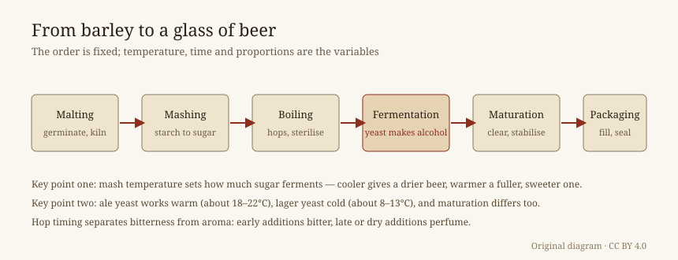

# Beer

Beer is made from cereal, usually barley malt but also wheat, corn or rice, through mashing, boiling and fermentation. Most modern beer is hopped during the boil for bitterness, aroma and stability. Its [alcohol by volume](ref:abv) is usually modest, but the range of styles is enormous.

Figure: the six basic stages from barley to a glass of beer. Original diagram, CC BY 4.0.

## Definition and boundaries

The basic structure is mash, boil, ferment. In beverage-alcohol classification it is a fermented drink, distinct from distilled spirits. Not every alcoholic cereal drink is beer: fermenting grain and then distilling it gives whisky-type spirits; fermenting fruit juice gives fruit wine; fermenting honey and water into a low-alcohol drink may give mead.

Legal definitions differ between countries, but they usually share cereal raw material, fermentation and the use of hops. Alcohol-free and low-alcohol beer is a growing category, made by dealcoholisation or restricted fermentation, and the strength on the label is authoritative rather than the word "beer".

## Ingredients

Water, malt, hops and yeast are the basic ingredients. Malt supplies fermentable sugar and the flavour base, and specialty malts bring biscuit, caramel, coffee or chocolate notes depending on the roast. Hops supply bitterness and aroma, with clear differences between varieties: citrus, pine, floral and spicy. Yeast decides fermentation by-products and is at the heart of the difference between ale and lager.

Adjuncts include wheat, oats, corn, rice and sugar. Wheat gives a soft texture and slight haze, oats add smoothness, and corn or rice make the body lighter and cleaner. The "purity law" describes one legal tradition; it does not mean every good beer must use only four ingredients, and modern beer permits a much wider range.

## Fermentation and style families

The most useful broad split is **ale** and **lager**. Ales ferment warm with brewer's yeast and often show fruity esters and richer aroma; lagers ferment cool and usually taste cleaner with a crisper finish. Lager is matured cold for a period, a process called lagering.

Other families include wheat beer, stout, porter, sour beer, IPA, Belgian styles and mixed-fermentation beers. The BJCP guidelines divide these further into specific styles with parameter ranges. Style labels are descriptive tools, not quality grades: whether a beer is good depends on whether it is balanced and complete within its intended style.

## Production

The process usually runs: malting, milling, mashing, lautering, boiling, hopping, cooling, pitching yeast, primary fermentation, secondary fermentation or lagering, filtration or centrifugation, and packaging. Mash temperature decides the fermentable-sugar profile and body; boil time affects hop bitter-acid isomerisation and protein coagulation; fermentation temperature affects esters and higher alcohols.

Dry hopping adds hops late in fermentation or during conditioning to extract aroma rather than bitterness. Barrel-aged beer uses wood for microbial and oxidative effects, bringing vanilla, acidity or complex aged notes; the principle is related to [oak ageing](ref:oak-ageing) in general, but beer is usually barrel-aged for less time and at higher risk. Oxygen control at packaging decides shelf-life flavour.

## Flavour and tasting

Tasting starts with appearance: foam retention, clarity or haze and colour depth all give information, but cannot replace the aroma judgment. Smell the malt base first, then hops and fermentation: lagers are often grainy and herbal, ales often fruity with esters, IPAs lean citrus, tropical fruit and resin, and stouts lean coffee and chocolate.

On the palate, judge the quality of bitterness rather than only the intensity: good bitterness is clean and supported, balanced against malt sweetness. Body, carbonation and finish matter too. Temperature changes perception markedly: too cold mutes aroma, too warm pushes alcohol forward. In comparative tasting, fix the style target first and then judge completeness.

## Drinking and pairing

Lager, wheat beer and most pale ales are best well chilled. Stouts, barley wines and barrel-aged beers can be served warmer so the aroma is more complete. Glass shape affects foam and aroma concentration, but the rules need not be mysterious. Keep a foam layer when pouring, which helps release aroma and slows carbon-dioxide loss.

At the table, crisp lager suits fried and spicy food, wheat beer suits salads and light dishes, IPA bitterness cuts through fat, and stout suits grilled meat and dessert. The principle is matching intensity: a drink heavier than the dish buries it, and a drink lighter than the dish tastes thin.

## Packaging and storage

Beer fears light, heat and oxygen. Clear and green glass are light-sensitive, while brown glass and cans protect better. Store away from light in a cool place, and unpasteurised craft beer usually needs refrigeration. Finish an opened bottle soon, because carbon dioxide escapes and oxidation changes the flavour quickly.

"Fresher is better" applies to most hop-forward styles, but not to all beer: barrel-aged, sour and high-strength beers can be cellared under suitable conditions. Check the production date and storage conditions rather than the packaging design when judging actual condition.

## Common misconceptions

First, that darker means stronger. Colour comes from roasted malt and has no necessary link to strength.
Second, that lager means "industrial bland beer". Lager is a fermentation method, covering both light commercial lagers and carefully made craft lagers.
Third, that an IPA is better the more bitter it is. Bitterness needs balance and support, and high bitterness alone is not quality.
Fourth, treating the "purity law" as the only standard. It is a specific legal tradition and does not cover all good beer.
Fifth, ignoring glassware and temperature. The same beer behaves very differently at different temperatures and in different glasses.

**Short definition:** A low-to-moderate-strength drink made by mashing and fermenting cereal, usually with hops, spanning a vast family of styles.

Begin with the production rule, move on to the strength, and finish with the usual serving. That order keeps the reading of Beer practical.

Start with [Oak ageing](ref:oak-ageing) for legal definition, then read [GB/T 17204-2021 Terminology and classification of alcoholic beverages](ref:gbt-17204) for materials and process. Seeing both keeps Beer from being confused with a neighbouring idea.

**Sources and limits.** The key claims about Beer are checked against the following sources: Beer Judge Certification Program (style families, fermentation methods and the descriptive boundaries of representative styles), Brewers Association (US craft-brewing definitions and style discussion; no text is reproduced), Industry body (beer's position in beverage-alcohol classification and related terminology) and 4 sources in total. Prices, batches and status change; the body is project-written and does not reproduce source text.

## Further reading

- [Oak ageing](ref:oak-ageing): the process background for flavour change in barrel-aged beer.
- [Alcohol by volume](ref:abv): the basic measure when comparing beer strengths.
- [Beverage alcohol terms and classification](ref:gbt-17204): where beer sits in the classification system.
