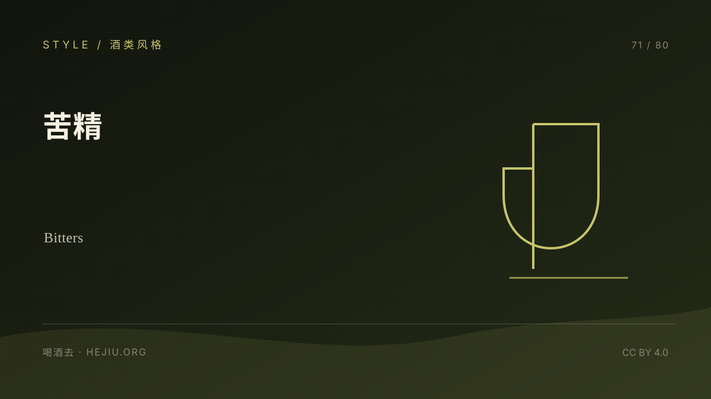

# Bitters

Bitters is a highly concentrated alcoholic flavouring built around bitter plants. It is rarely drunk in quantity; it goes into a cocktail by the dash or by a few millilitres, adjusting aroma, bitterness and length the way a cook uses salt and pepper. Its strength is usually high and its flavour heavily concentrated. To understand bitters, the key question is not "how bitter is it" but "what does it do to the whole drink".

Figure: thematic illustration for Bitters. Image: AI-assisted illustration generated with Doubao Seedream 5.0 (project-owned); not a photograph of the subject.

## A bottle of concentrated bitterness

The base may be alcohol, water or an alcohol-water solution, and the plant material includes gentian, cinchona, quassia, orange peel, cinnamon, clove, cardamom, anise and various barks. Producers extract aroma and bitterness by maceration, distillation or both, then filter, blend and rest. The finished liquid is usually clear, ranging from pale yellow to dark brown, and often 35% to 45% ABV.

The biggest difference from amaro is concentration and use. Amaro is a sweetened liqueur that can be drunk neat; bitters is a concentrated flavouring used a few drops at a time. Bitters usually has little or no sugar, so bitterness and aroma are more direct and sharper. It is not "a bitter drink" but "a bitter spice".

## From medicine to the bar

The nineteenth-century pharmacy was bitters' cradle. Apothecaries steeped herbs in alcohol to make digestives, fever remedies or tonics; the Angostura story begins in 1824, when Dr Johann Siegert in Venezuela made a stomach tincture for soldiers, later developed into a global brand in Trinidad. The official account also notes that the first cocktail recipe calling for Angostura appeared in 1831.

Peychaud's in New Orleans also came from pharmacy tradition, blended by Antoine Peychaud in the 1830s and later central to the Sazerac cocktail. During Prohibition, bitters stayed on sale because it was classified as a flavouring, and many classic recipes kept their bitters. The cocktail revival of the twentieth century turned bitters from medicine into a bar ingredient and brought orange, aromatic and tropical bitters back into fashion.

## Maceration, distillation and formula

There is no single template. Cold maceration extracts aroma and bitterness over days or weeks; hot maceration is faster but can lose delicate notes; distillation gives a cleaner aroma but may leave some bitterness behind. Many formulas blend macerate and distillate to keep both aroma and bitterness.

The formula is the producer's core asset. Angostura's recipe remains secret, and the official line is that it has changed little since 1824; Peychaud's is known for anise, cherry and bitter herbs; orange bitters lean on orange peel, cinnamon and clove. The same "type" can differ greatly between brands, so a bartender must taste, not just read the name.

Bitters is not only aromatic. Orange bitters, built on peel, suit gin and rye; celery bitters bring savoury herb notes and often go into a Bloody Mary; chocolate or mole bitters add cocoa, chilli and spice to dark spirits; tropical bitters stress citrus, flowers and spice. Type changes both dose and pairing.

## A few dashes are enough

Bitters is measured in dashes, roughly a few drops depending on the bottle mouth and the pour. It is not measured in ounces like syrup because the aroma is too concentrated; too much makes a drink bitter, astringent or even dominated by the seasoning. The "2 dashes" of a classic recipe is a historical habit rather than exact science, and modern bartenders adjust for brand and bottle.

Start small and build up. Bitters keeps releasing aroma during stirring or shaking, so do not take the drink to the limit on the first taste. Temperature also changes it: cold suppresses bitterness and aroma, while room temperature opens them; the same drink feels different before and after the ice dilutes.

Bitters changes with time. Once opened, the aroma slowly oxidises, and citrus bitters lose brightness first; dark, spicy bitters keep longer. Store them away from light, sealed and cool, not necessarily refrigerated, but not next to the stove. If a bottle has been open for years, smell it first and check for cardboard or vinegar. A bottle lasts a long time, but its flavour fades with time, which is another way it differs from ordinary spirits; do not stock too many, and try to finish an open bottle within a year.

## Its role in classic recipes

In the [Old Fashioned](ref:old-fashioned), bitters ties the sweetness and oak of whiskey together and adds spice, citrus and bitterness; in the [Manhattan](ref:manhattan), it balances the sweetness of vermouth and cleans the finish; in the [Negroni](ref:negroni), it is not essential, but a small amount deepens the herbal and bitter layers. The Sazerac is almost defined by bitters, with Peychaud's anise and cherry notes shaping the drink directly.

Bitters also works in highballs, sours and desserts. Its difference from [vermouth](ref:vermouth) is concentration: vermouth is a wine-based aromatised drink that can be consumed in quantity, while bitters is a concentrated flavouring used sparingly. Its difference from [amaro](ref:amaro) is sugar and volume: amaro is a liqueur, bitters is a spice.

## Where bitters differs from amaro and liqueurs

Amaro is an Italian herbal [liqueur](ref:liqueur), with sugar, volume and a neat serve; bitters is a concentrated bitter liquid with little sugar, a tiny dose and no neat serve. Both use herbs and roots, but their goals differ: amaro pursues bittersweet balance and a drinking experience, bitters pursues aroma intensity and seasoning efficiency.

Liqueur is the wider family, covering fruit, cream, coffee and herbal types; bitters is one functional branch. Treating bitters as "a very bitter liqueur" misleads the user: it should not fill a glass, and it should not be judged by sweetness. It is a cocktail seasoning, and small, precise, well-matched use is its proper place.

For Bitters, begin with the production rule. Then look at the strength, and finally ask the usual serving. The answers point to different choices, not to a single score.

The comparison with [Liqueur](ref:liqueur) and [Vermouth](ref:vermouth) runs through legal definition and materials and process. Each answers a different question.

**Short definition:** A concentrated alcoholic flavouring made from bitter herbs, roots, bark and citrus, usually 35% to 45% ABV and used by the dash or a few millilitres; it carries the legacy of nineteenth-century medicine and is the salt-and-pepper seasoning of the Old Fashioned, Manhattan and Negroni.

**Key facts.**

| Item | Detail |
| --- | --- |
| In one line | A concentrated alcoholic flavouring made from bitter herbs, roots, bark and citrus, usually 35% to 45% ABV and used by the dash or a few millilitres; it carries the legacy of nineteenth-century medicine and is the salt-a… |
| Parent style | Liqueur |
| Aroma family | bitter/herbal/spice |

**Sources and limits.** The key claims about Bitters are checked against the following sources: Angostura (the 1824 recipe origin, Trinidad production and the 1831 cocktail reference), Sazerac Company (New Orleans bitters and nineteenth-century cocktail tradition), European Union (the bitter-spirit category and the 15% ABV legal threshold) and 4 sources in total. Prices, batches and status change; the body is project-written and does not reproduce source text.
