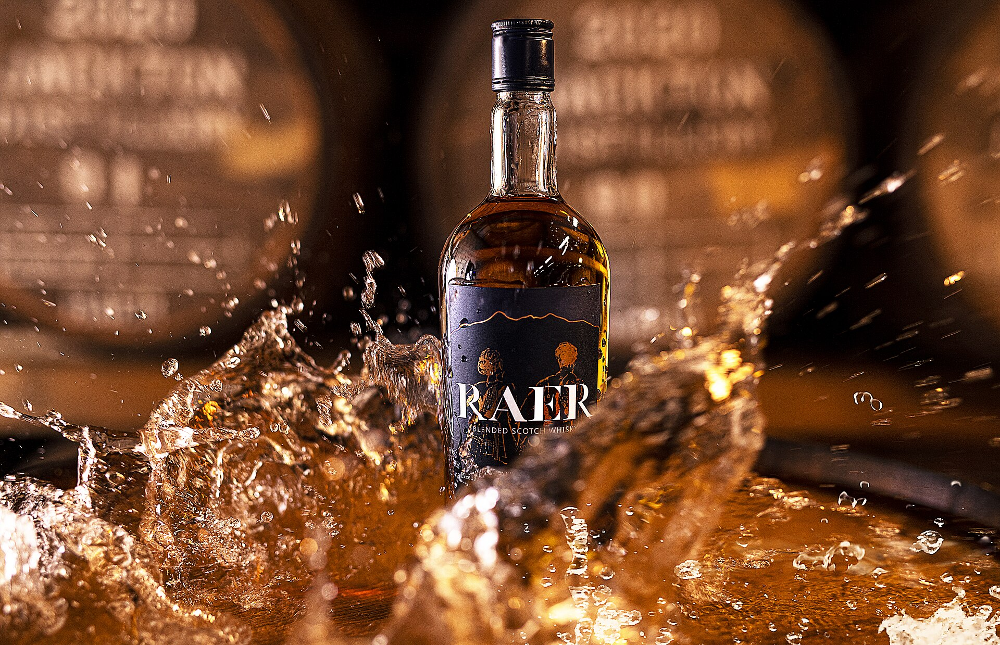

# Blended Scotch Whisky

Blended Scotch Whisky is the largest category of [Scotch whisky](ref:scotch) by volume: single malt from one or more distilleries is combined with single grain from one or more distilleries to produce something consistent enough to bottle at scale. It is not a loose marketing phrase but a legal category written into the Scotch Whisky Regulations 2009. Blended malt and blended grain, which also carry the word "blended", are two different categories.

Figure: Related photograph of Blended Scotch Whisky. Image: WhiskyLass, CC BY-SA 4.0, via Wikimedia Commons ([source page](https://commons.wikimedia.org/wiki/File:RAER_Original_Blended_Scotch_Whisky.jpg)).

## Three blended names, three recipes

The [regulations](ref:swr) split the blended family into three. Blended Malt Scotch Whisky is a blend of single malts from two or more distilleries, with no grain whisky added. Blended Grain Scotch Whisky is a blend of single grains from two or more distilleries. Blended Scotch Whisky is the malt-and-grain combination, in any proportion.

The names are not interchangeable. Calling a blended malt "blended scotch" is legally inaccurate, and describing blended Scotch as an "all-malt blend" confuses the two raw materials. The older phrase "vatted malt" has also been replaced by blended malt in the current rules.

## Grain whisky: the other distillation route

The second half of blended Scotch is single grain whisky. It too comes from one distillery, but the mash may use wheat, maize or unmalted barley, and production usually runs through a continuous column still. Compared with pot [distillation](ref:distillation), the column is more efficient, reaches a higher strength and gives a more neutral spirit, which makes it useful as a frame rather than a lead voice.

Grain spirit is not "flavourless alcohol". Its sweetness, vanilla and cereal aroma decide whether the base of a blend feels solid. Some distilleries also make grain whisky in pot stills, or mix column and pot spirit, so "grain equals neutral" is a rough impression rather than a definition. Either way, every component must still meet the general Scotch conditions: distillation below 94.8% ABV, at least three years in oak, and bottling at no less than 40% ABV.

## What a blender actually does

[Blending](ref:blending) is not tipping liquids into a tank. The blender builds a flavour archive, selects samples from different distilleries, ages and cask types, and tests ratios until the same house style can be reproduced batch after batch. A large blended brand may manage dozens of malt and grain components at once, each with a job: one supplies flowers, one supplies oil, one supplies smoke, one merely ties the texture together.

[Blend](ref:blend) is therefore a craft of proportion and compensation. If a parcel of malt is dry, a rounder grain component fills the gap; if sherry casks are short in a given year, other cask types rebuild the dried-fruit and spice direction. Recipes are usually not published and are not required to be; the law governs category and label, not formula.

## Why consistency is the core

Single malt sells a distillery's personality; blended Scotch sells predictability. A drinker in Tokyo, London and São Paulo should get almost the same aroma and texture from the same expression of the same brand. That consistency rests on three things: a large inventory of matured stock, a rigorous sample library, and a blender with the authority to reject a batch.

[Johnnie Walker](ref:johnnie-walker) is a clear example of the logic: a fixed house style sold across markets, with a range that moves from entry level to premium through age, malt proportion and rare casks rather than through simple additives. Consistency is not mediocrity; holding a style steady at large volume is a technical achievement in its own right.

## Division of labour with single malt

Single malt answers "what is this one distillery like"; blended Scotch answers "what is this brand like". The first suits exploration, the second suits everyday drinking, mixing and large tables. Both draw on the same stock: most of a distillery's malt may go into blends, with only a small share bottled as single malt. Without blending demand, much of the industry's capacity could not be absorbed.

Treating blends as "low end" mistakes market segmentation for a quality hierarchy. A premium blend can be deeply complex, and an entry-level single malt can be simple and direct. Price reflects rarity, age and brand positioning far more than the category itself.

## Age, casks and labels

Age on a blended Scotch means the youngest whisky in the bottle. A blend of 12, 18 and 21 year old components may only state the lowest figure; adding a splash of very old whisky does not raise the number. No-age-statement bottlings are not illegal; they simply decline to disclose the minimum age.

The influence of [oak](ref:oak-ageing) on a blend is often underestimated. Cask type in the malt component sets the fruit and spice direction, while cask type in the grain component sets the sweetness and the woody background. The blender already accounts for wood when fixing the recipe, so the same formula can shift slightly with each year's cask supply. Bottling strength, chill filtration and caramel colouring further change the impression in the glass.

## Six misreadings of blended Scotch

First, that blended Scotch is "cut" or fake. It is a legal category, and every component must mature for at least three years. Second, that blended malt and blended Scotch are the same thing. Third, that grain whisky is simply neutral alcohol, ignoring its sweetness and wood character. Fourth, that older is always better, regardless of recipe and cask. Fifth, that every brand under one owner uses the same formula. Sixth, that single malt is necessarily superior.

When buying, confirm the category name first, then look at strength and whether the whisky is chill filtered. Neat drinking reveals the frame and the balance, while a little water opens the aroma; in a Highball, the bubbles amplify sweetness and cereal notes. The general rules for [whisky](ref:whisky) apply too: drink slowly, in moderation, and adults only.

**In brief:** A Scotch whisky made by combining single malt from one or more distilleries with single grain from one or more distilleries; it sits alongside blended malt and blended grain as three distinct legal names, with grain providing the frame and malt providing the character.

**Key facts.**

| Item | Detail |
| --- | --- |
| In one line | A Scotch whisky made by combining single malt from one or more distilleries with single grain from one or more distilleries; it sits alongside blended malt and blended grain as three distinct legal names, with grain prov… |
| Parent style | Scotch whisky |

**Sources and limits.** The key claims about Blended Scotch Whisky are checked against the following sources: UK Government (legislation.gov.uk), Scotch Whisky Association (Used to check the category system and export structure of Scotch whisky), Johnnie Walker (Used to check the product structure and presentation of a blended brand) and 4 sources in total. Prices, batches and status change; the body is project-written and does not reproduce source text.
