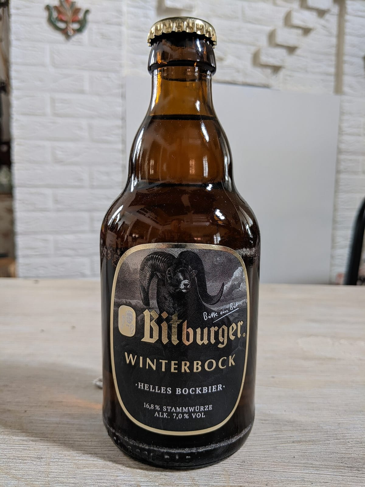

# Bock

Bock is a dark, malt-forward strong lager from Germany: full-bodied, low in bitterness and sweet at the finish, associated with late winter and spring. It is not a single recipe but a family descended from the brewing tradition of Einbeck and reinterpreted in Munich, including traditional bock, doppelbock, maibock and eisbock. Within the wider framework of [lager](ref:lager), bock represents the combination of a high-gravity wort, cool fermentation and long storage rather than a particular shade of brown.

Figure: Bock. Image: Sorennelson, CC BY-SA 4.0, via Wikimedia Commons ([source page](https://commons.wikimedia.org/wiki/File:Bitburger_Winterbock_Bottle_Front.jpg)).

## From Einbeck to Munich

The prototype came from Einbeck, a small town in Lower Saxony between Hanover and Kassel. In the Middle Ages it was a major brewing and export centre; after joining the Hanseatic League in 1368, it shipped strong beer to Scandinavia, Russia, Britain and Flanders. That beer was not necessarily the dark lager known today, but the profile of high gravity, transportability and malt sweetness was already established, with [barley](ref:barley) and kilning the key variables.

In the 17th century Munich brewers took over the style and adapted it to local lager practice: dark malt, cool fermentation and long lagering. The Bavarian pronunciation of Einbeck became "ein Bock", a billy goat, and the name stuck; the goat on the label became the emblem of the style. The Bavarian Purity Law of 1516 defined permitted ingredients but did not prescribe bock strength, and the two should not be conflated.

## How malt builds the body

Bock flavour comes mainly from malt rather than hops. Alongside base malt, brewers use Munich and Vienna malts and a longer kilning schedule to create bread crust, caramel and nutty notes; a little dark malt may adjust colour. Decoction mashing, in which part of the mash is boiled and returned, produces Maillard compounds that make the body fuller and the finish sweeter.

[Fermentation](ref:fermentation) remains bottom-fermenting, with a cool primary stage followed by weeks or months of storage near freezing. Cold and time smooth out rough fermentation notes and round the malt aroma. Hop rates are restrained, providing only the minimum bitterness for support; too much bitterness cuts through the malt sweetness and the style drifts away. Carbonation is low to medium, so the beer feels soft on entry.

## The bock family

Traditional dark bock commonly shows about 6.3%–7.2% alcohol, [bitterness](ref:ibu) mostly 20–27 IBU and an [original gravity](ref:original-gravity) around 16–18 °P; these ranges vary by source and brewery and are not a legal standard. The colour runs from deep amber to dark brown, with good clarity and fine foam.

Doppelbock pushes gravity higher, usually 7%–10% alcohol, with dates, figs, caramel and bread crust and still very low bitterness. Many breweries use names ending in "-ator", after Paulaner's Salvator in Munich. Maibock is paler with a little more hop and bitterness, suited to spring. Eisbock concentrates the beer by freezing out some water, reaching 9%–14% alcohol, with a thicker body and more obvious warmth. Treating these as simply stronger versions of one beer is inaccurate: their malt bills and fermentation goals differ.

## A brewery map of northern Germany

Einbecker Brauhaus still uses its Ur-Bock range as a historical reference, in pale and dark versions; these beers emphasise clean malt sweetness and restrained hops. Munich and its surroundings concentrate the doppelbock tradition, with Paulaner Salvator, Ayinger Celebrator and Spaten Optimator as common examples. Bavarian pubs hold a Bockanstich in late winter, tapping the new beer from the cask, which ties bock to seasonal ritual.

Outside [Bavaria](ref:bavaria), other German regions also brew bock, but the stylistic centre of gravity remains in the south and in Einbeck. American craft breweries treat bock as a playground, adding chocolate malt, coffee or barrel ageing; these variations can be enjoyable but should not be used to define the traditional style.

## Boundaries with neighbouring styles

The easiest confusions are with stout and abbey dubbel. Stout uses roasted barley, showing coffee and a dry, bitter finish; bock takes its colour from kilned malt while avoiding char, so sweetness stands out. Abbey dubbel relies on Belgian yeast esters and added sugar, with more fruit and spice and a lighter body. English old ale brings oxidation and aged notes, often nuts and sherry.

Another boundary is lager versus ale. Bock is bottom-fermented at low temperature with restrained esters; calling it a dark ale misreads its cleanliness. [Wheat beer](ref:wheat-beer) gets banana and clove from its yeast, which bock does not have, while [Pilsner](ref:pilsner) is built on hop bitterness and a dry finish with far lower gravity. Nor is bock simply a synonym for strong beer: eisbock and doppelbock are indeed strong, but traditional bock stays within an everyday drinking range.

## Temperature, glassware and the table

Bock is best served at 8–12°C; too cold suppresses the malt, too warm makes the alcohol prominent. A tulip or goblet gathers the aroma and makes a small pour of a strong beer feel more deliberate. In German pubs bock is often served in small glasses for the same reason: the aroma is concentrated, but alcohol and residual sugar are high, and a large glass turns cloying as it warms. Drink it soon after opening, since malt sweetness and aroma fade with oxidation.

With food, the sweetness and toasted character suit roast pork, duck, braised beef, bread dumplings and onion tart; smoked or caramelised dishes also echo it. As an after-dinner beer it works with hard mountain cheese and nuts. Against spicy food, its low bitterness cannot cut fat or heat, and [Pilsner](ref:pilsner) does the job better. Finally, a reminder: bock is not low in alcohol, so the pour should be smaller than for an ordinary lager.

**Short definition:** A malt-driven strong lager from Einbeck that Munich brewers reshaped into a dark Bavarian specialty, spanning traditional bock, doppelbock, maibock and eisbock.

Begin with the production rule, move on to the strength, and finish with the usual serving. That order keeps the reading of Bock practical.

[Lager](ref:lager) and [Wheat beer](ref:wheat-beer) answer different questions about Bock: legal definition and materials and process. Read them as a pair, not as alternatives.

**Key facts.**

| Item | Detail |
| --- | --- |
| In one line | A malt-driven strong lager from Einbeck that Munich brewers reshaped into a dark Bavarian specialty, spanning traditional bock, doppelbock, maibock and eisbock. |
| Parent style | Lager |
| Aroma family | Malt |

**Sources and limits.** The key claims about Bock are checked against the following sources: Beer Judge Certification Program, Einbecker Brauhaus AG (public information on Einbeck brewing history and the Ur-Bock range; no original text is reproduced), Deutscher Brauer-Bund e.V. (public statements on German beer variety and brewing tradition; no original text is reproduced) and 4 sources in total. Prices, batches and status change; the body is project-written and does not reproduce source text.
