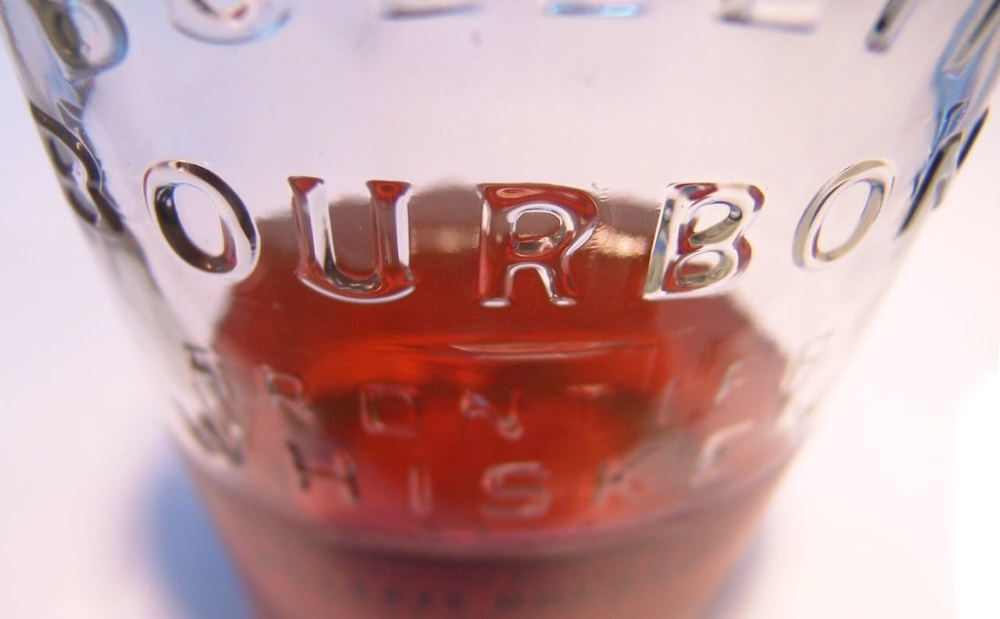
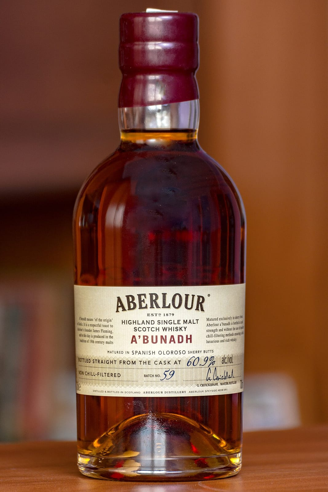

# Bourbon whiskey

“Bourbon whiskey” is the English name of a spirit category and also a commercial name used around the world. This style is about the name: how it is built, where it gets misapplied, and how it relates to neighbouring categories and label vocabulary. The grain recipe, distillation and maturation mechanics belong to the [bourbon](ref:bourbon) entry and are not repeated here.

Figure: A glass of bourbon, its wall embossed BOURBON FRONTIER WHISKEY and filled with amber liquid. Image: Markyboy81, CC BY 2.0, via [source page](https://www.flickr.com/photo.gne?id=1001040958).

## How the name is built

Bourbon comes from Bourbon County, Kentucky; whiskey is the category word. US federal regulations spell the category whisky, while the American market and most brands write whiskey. Ireland also uses whiskey, whereas Scotland, Canada and Japan generally use whisky. The spelling difference has no single international legal force; it is industry habit and an identity marker.

Chinese renders bourbon phonetically as "Bo-ben" and then adds "wei-shi-ji" (whisky), producing a four-character name. Strictly, "bourbon" already implies the category, so the addition is redundant. In Chinese retail language, however, the repetition helps separate the category from a place name or a brand name. The variant "Bo-pang wei-shi-ji" is only a different transliteration.

## A name is not the same as a legal category

Four numbers settle whether the name may be used: corn must make up 51% or more of the mash; the still may not push past 80% ABV; the barrel may receive no more than 62.5% ABV; and the bottle may not fall under 40% ABV. New charred oak is the fifth, non-numeric condition. These are entry requirements for the name, not tasting notes.

The reverse is also true: a product that meets the figures may choose not to say “bourbon”. Some American distilleries sell comparable spirit as “American whiskey” or under a house style name; others are legally straight bourbon but lead with the brand. A name is an identification tool, not proof of quality and not proof of origin.

## Three layers of label vocabulary

Label words fall into three rough layers. The first is the legal category: bourbon, straight bourbon, blended bourbon, rye whiskey, Tennessee whiskey. The second is a regulated claim: age, place of origin such as Kentucky, or bottled-in-bond. The third is trade and marketing language: small batch, single barrel, barrel proof, small craft.

Buyers often read the third layer as if it were the first. Small batch has no single definition, single barrel only says that the bottling came from one cask, and barrel proof only says that no water was added to reach a fixed strength. These words can inform, but they cannot replace the category name and the age statement. Treating “single barrel” as a grade is the same error as treating “small batch” as a legal class.

## The division from Tennessee whiskey

Tennessee whiskey is the market category most often folded into bourbon. It uses the same grain logic and new charred barrels, but adds a Tennessee origin requirement and the Lincoln County process of maple-charcoal filtration, and it is sold under its own name. For drinkers, the flavour gap between the two may be smaller than the gap between brands; for labels and trade, they are two names.

Rye whiskey is rye-led, corn whiskey is overwhelmingly corn-based and uses uncharred or used barrels, and wheat whiskey is wheat-led. They share the wider idea of American whiskey with bourbon but cannot swap names. The boundaries exist so that a buyer can make a comparable choice on a shelf.

## Geographical indications and trade

“Bourbon” is treated in major export markets as a name associated with the United States. EU spirit-drink law provides protection for geographical indications, and EU–US arrangements on spirit names recognise a set of American names. In practice, a product not made in the United States cannot freely use “Bourbon” as a generic style word in the European market.

Protection targets the name, not the recipe. A distillery elsewhere may make a corn-led, new-oak whiskey, but it may not label it bourbon. Keeping this distinction in mind separates “similar in style” from “the same category”, and it explains the recurring “generic name” arguments in transatlantic trade disputes.

## Market use: from base spirit to flavoured products

In the United States, bourbon is first of all a cocktail base. The Old Fashioned, Whiskey Sour and Manhattan keep it behind most bars. Its sweetness and barrel character sit easily with bitters, syrup and citrus, which makes it a more accommodating mixing backbone than heavily peated Scotch.

The second group is flavoured whiskey — honey, cinnamon, apple and similar products. These usually take bourbon or another whiskey as a base and add spice and sugar; the label must show “flavoured” or the specific flavour and cannot simply say bourbon. The third group is crossover goods: beer, maple syrup or coffee beans aged in “bourbon barrels”. Here the phrase describes the barrel's previous contents, not the legal identity of the liquid.

## The Chinese naming problem

Chinese retail uses three common forms: the full four-character name, the variant transliteration and the short "Bo-ben". The first two are transliterations of the same name and the third is an abbreviation. The difficulty is not the translation itself but its use as a substitute for the category: calling every American whiskey bourbon, or treating bourbon as a synonym for sweet whiskey, both mislead.

A Chinese back label should correspond to the category on the original label. If the original says straight bourbon whiskey, a Chinese label that says only “whiskey” is not wrong but loses key information; if the original says blended whiskey and the Chinese says “bourbon”, that is misleading. Comparing the back label with the original category word is more useful than reading the front label alone.

## Common misconceptions

First, that “bourbon whiskey” names two different drinks. Second, that bourbon must be made in Kentucky. Third, that bourbon describes sweetness. Fourth, that flavoured whiskey is a sub-category of bourbon. Fifth, that the spelling whiskey or whisky proves origin. Sixth, that single barrel is a quality grade.

All six share one root: market language is mistaken for regulatory language. The fix is simple — confirm the category, then the age and [alcohol by volume](ref:abv), and only then consider marketing words and brand stories.

## Buying guidance

Read the category first, then age and strength, then the marketing terms. Neat drinking may justify cask strength or a single barrel; mixing may favour a standard expression with better value. Flavoured whiskey suits particular occasions but cannot be used to judge bourbon style. For the meaning and calculation of [cask strength](ref:cask-strength), see the term entry; for the wider classification, return to [whisky](ref:whisky).

Further reading: [Abbey beer](ref:c-extra-1).

**In brief:** A page about the name and its market use: how bourbon whiskey layers spelling, geographical indications and label vocabulary on one category, and where it borders Tennessee, rye and blended bourbon.

## Related images

Image: Cask strength. Credit: Paweł Mazurek KRK, CC BY-SA 4.0, via Wikimedia Commons ([source page](https://commons.wikimedia.org/wiki/File:Aberlour_A%27bunadh_Batch_59.jpg)). Related image for Bourbon whiskey.
