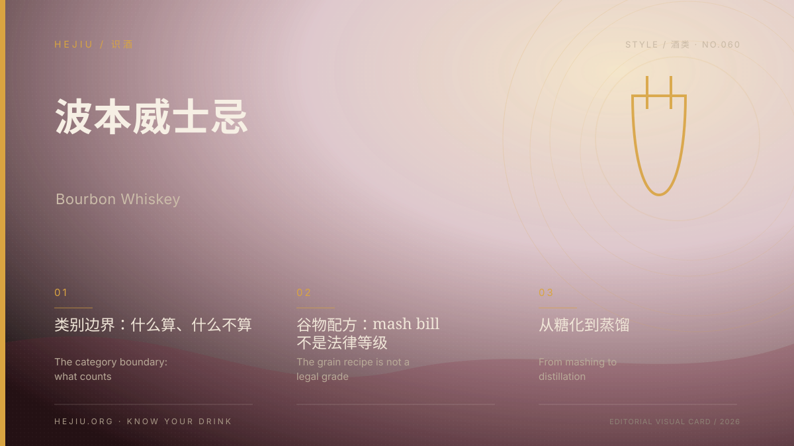
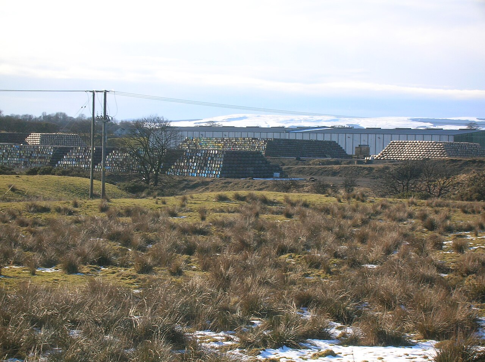

# Bourbon Whiskey

Bourbon is the American whiskey category built on a corn-led grain recipe and maturation in new charred oak. [Whisky](ref:whisky) is the wider family; bourbon is one subset with a precise federal definition, and not every American whiskey qualifies. This style deals with the style itself — its rules, raw materials and process — rather than with the commercial use of the name “bourbon whiskey”, which is covered separately.

Figure: thematic illustration for Bourbon Whiskey. Image: AI-assisted illustration generated with Doubao Seedream 5.0 (project-owned); not a photograph of the subject.

## The category boundary: what counts

27 CFR 5.22 imposes four hard constraints. The fermented mash must contain at least 51% corn; the distillate may not exceed 160 proof (80% ABV); the spirit may not enter the barrel above 125 proof (62.5% ABV); and it must be stored in new charred oak containers and bottled at no less than 80 proof (40% ABV). No colouring or flavouring may be added, and the style may not be “corrected” by blending in other spirits.

The decisive point is that “new charred” and “corn majority” must hold at the same time. A corn whiskey matured in used barrels is a corn whiskey, not a bourbon; a rye-led spirit is a rye whiskey even when it also uses new barrels. Bourbon has no general statutory minimum age, but once it enters the straight sub-category, additional rules apply.

## The grain recipe is not a legal grade

Beyond the 51% corn requirement, the other grains are free. A common structure is 60%–80% corn, 10%–25% rye or wheat, and 5%–10% malted barley. Malted barley supplies the saccharification enzymes, rye brings pepper, mint and dry spice, and wheat makes the texture rounder and softer.

Terms such as high-rye, wheated and high-corn are trade and consumer language, not legal categories. They describe a recipe direction and cannot replace the category name on the label. More corn usually means a sweeter, fuller body, but yeast, distillation cuts and barrel condition can rewrite that expectation.

## From mashing to distillation

Bourbon begins with milling the grain, mashing it with water to convert starch into fermentable sugar, and pitching yeast for [fermentation](ref:fermentation). Fermentation time and yeast strain shape the esters and higher alcohols that later read as aroma. The wash then goes to [distillation](ref:distillation): most large producers use continuous column stills, while smaller plants may use pot stills or a hybrid flow.

Distillation must stay below 160 proof. That ceiling is a category boundary rather than a target: distilling too high strips away grain and fermentation character. The new spirit is then reduced with water to no more than 125 proof before barrelling, and the entry strength changes how quickly and in which direction the wood is extracted.

## New charred oak and maturation

Bourbon must use new charred oak containers, the opposite of the Scottish preference for reused casks. Fire chars the inner staves, converting wood sugars and lignin into vanillin, guaiacol and caramel compounds; the char layer also adsorbs some sulphur compounds and cleans up the new spirit. A common barrel holds 53 gallons (about 200 litres), and char levels run from light to heavy in several grades.

Maturation is extraction, oxidation and evaporation at once. Seasonal temperature swings in Kentucky warehouses push spirit into and out of the wood pores, while the [angel's share](ref:angels-share) removes a portion of alcohol and water each year. Warehouse position, floor and barrel placement create differences within a single production run, which is what makes single-barrel releases possible. New wood is powerful, and very long maturation can let oak and coconut notes overwhelm the grain.

## Age statements and label grades

Straight bourbon must mature for at least 2 years in new charred barrels and may not contain added colouring, flavouring or other spirits. Whiskey aged less than 4 years generally has to carry an age statement; the rule applies to whiskey broadly, not to bourbon alone.

Bottled-in-bond is a separate voluntary claim: one distillery, one distillation season, at least 4 years in a government-supervised warehouse and bottling at 100 proof (50% ABV). Small batch, single barrel and barrel proof have no single legal definition. They describe batch size or bottling strength, not a quality grade.

## Kentucky is not a legal precondition

The name is often traced to Bourbon County, Kentucky, but federal rules do not require Kentucky production. Any US state can make bourbon if the category requirements are met. Kentucky straight bourbon satisfies both a geographical statement and the straight rules, so it carries one more constraint than plain bourbon.

Equating bourbon with Kentucky is the most common consumer simplification. Limestone water, climate and a dense local industry genuinely shape the regional style, but a place name describes tradition and concentration, not a quality rating.

## A stylistic map

Three broad flavour directions are useful. High-rye recipes are spicier and drier on the finish, suiting neat drinking and the Old Fashioned; wheated recipes are softer, often with bread, honey and cream; high-corn recipes are sweeter and fuller in body.

Representative producers include Buffalo Trace, Maker's Mark, Wild Turkey, Four Roses, Heaven Hill and Jim Beam. Their core ranges span different recipes and price points, but specific expressions change in recipe, age and batch, so the label remains the guide. This style does not rank brands.

## Boundaries against neighbouring categories

Rye whiskey takes rye as its main grain (at least 51%) and tastes spicier and drier. Tennessee whiskey adds a Tennessee origin requirement and the Lincoln County process (maple-charcoal filtration) to a bourbon-style recipe, and is sold as a separate name. Corn whiskey requires at least 80% corn and uses uncharred or used barrels; wheat whiskey is wheat-led; blended bourbon takes straight bourbon as its base and is mixed with other whiskey or spirit, and must say blended.

All of these are American grain spirits; they differ in the lead grain, the barrel type and whether blending is allowed. Calling them all “bourbon” makes the label information meaningless.

## Common misconceptions and disputes

First, that bourbon must come from Kentucky. Second, that its corn sweetness means added sugar; the sweetness comes from corn and oak. Third, that older is always better, when new-wood extraction eventually turns overly woody. Fourth, that small batch is a legal grade. Fifth, that every bourbon is maple-charcoal filtered; that is a Tennessee whiskey feature.

Live disputes concern international protection of the name, whether flavoured whiskey dilutes the category's reputation, and how transparently barrel-proof products are labelled. These are trade and market questions; they do not change the federal definition.

## How to drink it

Neat is the best way to judge the relationship between grain, wood and age. A little water lowers the alcohol sting and opens the aroma; ice cools and dilutes at the same time and suits stronger products. Bourbon is the base of the [Old Fashioned](ref:old-fashioned) and appears in the Whiskey Sour and many other recipes. For the general mechanics of [oak ageing](ref:oak-ageing), see the process entry; for the difference between pot and column distillation, see [pot still](ref:pot-still).

**In brief:** An American whiskey category made mainly from corn and matured in new charred oak; a 51% corn minimum, distillation and barrel-entry limits, and the straight-ageing rules define its legal boundary.

## Related images

Image: A whisky bond warehouse in Ayrshire; cask type, age and warehouse conditions are the flavour variables. Credit: Rosser1954 Roger Griffith, Public domain, via Wikimedia Commons ([source page](https://commons.wikimedia.org/wiki/File:Balgray_Bond,_whisky_barrels,_Barrmill,_Ayrshire.JPG)). Related image for Bourbon Whiskey.
