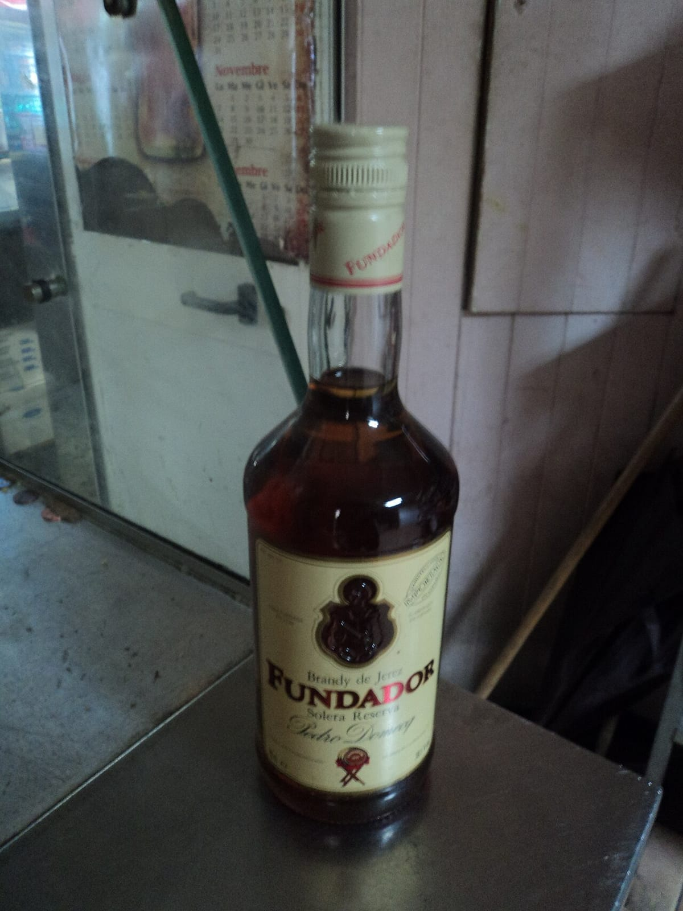

# Brandy de Jerez

Brandy de Jerez is a protected geographical-indication wine brandy from the Jerez region of Andalusia, Spain. Wine is distilled and then aged under the dynamic solera system in American oak casks that previously held Sherry. The range runs from young, fruity Solera expressions to complex aged Solera Gran Reserva bottlings, with vanilla, dried fruit, citrus, tobacco and nutty notes.

Figure: Brandy de Jerez: Fundador - Brandy de Jerez (Wikimedia Commons). Image: Nicholas Gemini, CC BY-SA 3.0, via Wikimedia Commons ([source page](https://commons.wikimedia.org/wiki/File:Fundador_-_Brandy_de_Jerez.JPG)).

## Definition and boundaries

Brandy de Jerez is a protected geographical indication whose production and ageing are confined to the municipalities of Jerez de la Frontera, El Puerto de Santa María and Sanlúcar de Barrameda within the Marco de Jerez. It is distilled from wine, which sets it apart from brandies based on marc, grain or cane sugar. The name is supervised by the Consejo Regulador; not every wine distillate may call itself Brandy de Jerez.

It shares the barrel-ageing tradition and region with Sherry, but the product type differs: Sherry is a fortified wine, while Brandy de Jerez is a distilled spirit. Membership depends on the distillation base, cask type, solera system and geographic scope, not colour depth. The indication constrains origin and process; it does not guarantee individual brand quality.

## History and naming

Wine distillation and barrel ageing in Jerez grew out of the Sherry trade that expanded from the eighteenth century onward. The solera and criaderas dynamic system was developed by local bodegas to keep a steady market supply; in Jerez it has run continuously since the 1700s and was later applied to Sherry, vinegar and brandy. Its core is the periodic draw and replenishment between cask tiers of different ages, so the bottled product always carries a blended, stable style.

On the brand side, Fundador was among the first commercial Spanish brandies. Its bodega lineage traces to Bodegas Fundador, founded in 1730 and the oldest bodega in the Jerez region; in 1874 Pedro Domecq Loustau created Fundador, said to be the first Spanish brandy. Osborne, Terry and Barbadillo and other houses around Jerez later joined brandy production, forming today's brand landscape.

## Materials and process

The distillation base uses healthy, clean wines separated from their lees, mostly Airén grapes, with the traditional Jerez variety Palomino also used. Roughly three litres of wine yield one litre of brandy, taking only the heart of the run. Distillation runs in column stills or copper alquitara pot stills, cutting heads and tails and retaining the middle spirit.

Distillates are graded by strength and volatile content. Holandas are below 70% vol, with 200–600 grams of volatiles per hectolitre of pure alcohol and the richest aroma; aguardientes sit between 70 and 86% vol, with 130–400 grams per hectolitre; high-strength destilados run 86–94.8% vol, under 100 grams per hectolitre and the purest in style. Brandies of each grade blend these distillates: a Solera is roughly 50% aguardiente and 50% holanda, while a Solera Reserva is about 25% aguardiente and 75% holanda.

The ageing vessel is a defining feature. Casks are American oak, 500–600 litres, and previously held Sherry for at least three years — fino, manzanilla, amontillado, oloroso or Pedro Ximénez. The envinado, or prior wine type, marks the brand difference: fino casks give paler brandies, amontillado or oloroso casks deeper ones, and PX casks the sweetest, darkest results. Residual Sherry character in the wood and slow oxidation together build the dried-fruit and vanilla layers.

## Style and palate

Ageing follows the criaderas and solera dynamic system. The bottom tier of casks is the solera; above it sit the first and second criaderas. Each time a portion is drawn from the solera for bottling (saca), it is replenished from the next younger tier (rocío), passing upward through the layers. Because every cask always holds a blend of ages, any bottle contains components older than its static-average age would suggest. The system has run continuously in Jerez since the 1700s and is part of the bodega culture of the region.

Under the rules, grades are set by average ageing time and volatile content. Solera averages more than six months, with volatiles above 150 grams per hectolitre of pure alcohol; Solera Reserva exceeds one year and 200 grams; Solera Gran Reserva exceeds three years and 250 grams. A separate Vejez Calificada long-age category covers expressions such as Solera 12 Years and Solera 15 Years; most Gran Reservas average around ten years of ageing, well beyond the three-year floor.

In flavour, young Solera is fruity and soft, with grape and light dried-fruit notes; Reserva adds caramel, nut and wood tones; Gran Reserva shows raisin, fig, tobacco, leather and oxidative nut complexity, with a full body and long finish. Oxidative dry-nut notes akin to Sherry or Port are allowed and expected here, a different route from the new-oak vanilla and toast of whisky.

## Representative regions and brands

Fundador is one of the most representative Brandy de Jerez brands, owned by Grupo Emperador, with bodega history to 1730 and the Fundador launch in 1874. Its line runs from entry-level Solera to long-aged expressions such as Supremo 18. Osborne is an established house around Jerez whose brandy sits alongside its Sherry and liqueur lines in Spain and export markets; Barbadillo is based in El Puerto de Santa María and produces brandy by the local traditional cask method.

These houses follow different blending philosophies: some lean young and soft for mixing, others emphasise long ageing and oxidative complexity. Between brands, cask tier, distillate blend and envinado choice often determine the glass more than the single name "Brandy de Jerez". When choosing, read the grade label first, then the producer's cask-ageing notes.

## How to drink and pair

The traditional serve is a neat after-dinner drink in a tapered brandy snifter or small nosing glass, at room temperature or slightly cool, sipped slowly. Young Solera can take ice or a little water to open the fruit; Gran Reserva and long-aged versions suit still, small slow sips alongside nuts, walnuts, dark chocolate, Iberian ham or dried-fruit platters. It can also go into coffee or classic brandy cocktails.

On the table, Brandy de Jerez complements salty, fatty food: cured meats, hard cheeses, roasted nuts and caramelised desserts all carry its dried-fruit and wood tones. Light seafood, salads or acidic dishes do not suit long-aged brandy, which would push alcohol and oxidation forward. Neat at room temperature is standard; ice dilutes concentration and narrows the aged aroma.

## Buying, storage and misreadings

Common misreadings: treating dark colour as long ageing — colour can also come from PX casks or caramel colouring; assuming every Spanish brandy is Brandy de Jerez — only products distilled and solera-aged within the three municipalities may use the indication; and treating the grade label as a quality guarantee — grades set minimum ageing and volatile thresholds only.

When buying, read the back label: whether the indication name, grade, producer, alcohol strength and cask-ageing notes are all present. Large front lettering is usually brand marketing. An unopened bottle keeps away from light and heat, standing upright. Once opened, finish within a year or two. A high price may reflect ageing, brand or distribution rather than a more typical style.

## Further reading and see also

Brandy de Jerez shares process and region with neighbouring categories: [brandy](ref:brandy) is the broad distilled-spirit family it belongs to, [sherry](ref:sherry) supplies the ageing casks and envinado tradition, [solera](ref:solera) is the core mechanism of its dynamic ageing, [oak-ageing](ref:oak) shapes vanilla, oxidation and wood layers, and [spain](ref:spain) is the national background of the Andalusian region. To learn a brandy style, start with the standard benchmark, then a variant that changes grade or cask type, then a long-aged extreme; after those three steps the boundary is clearer than from definitions alone.

- Related: [brandy](ref:brandy), [sherry](ref:sherry), [solera](ref:solera), [oak-ageing](ref:oak), [spain](ref:spain).

## Related images

Image: Brandy. Credit: Didier Descouens, CC BY-SA 3.0, via Wikimedia Commons ([source page](https://commons.wikimedia.org/wiki/File:Cognac_glass.jpg)). Related image for Brandy de Jerez.
