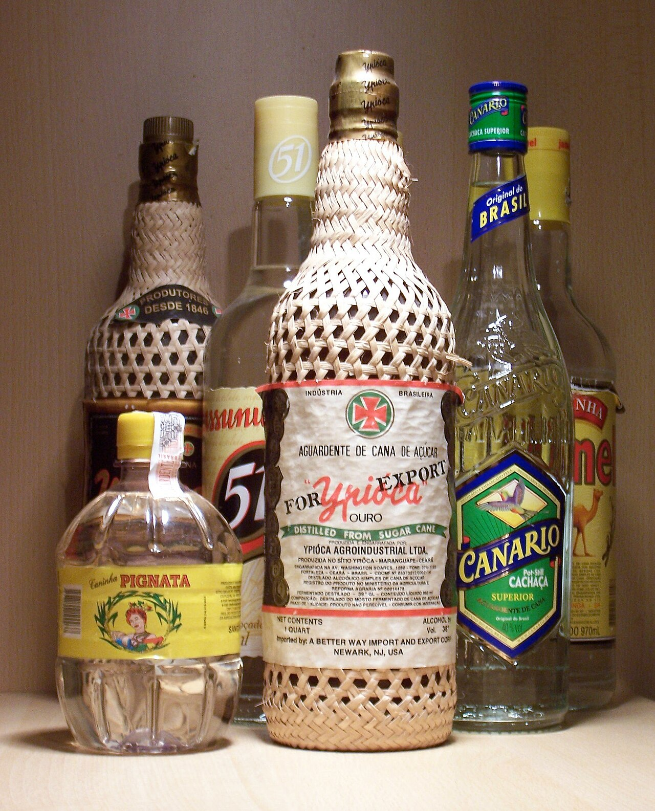
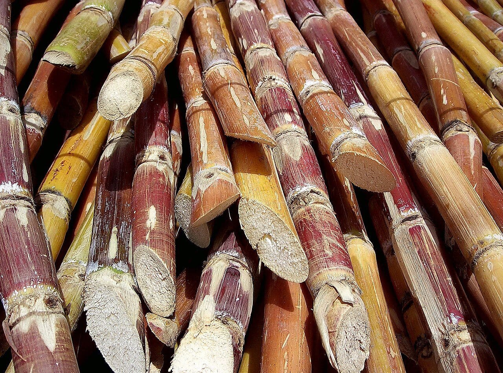

# Cachaça

Cachaça is Brazil's sugarcane spirit: juice is pressed from cane, fermented and distilled. It shares a raw material with rum, but not a rulebook. Rum is mostly made from molasses, a by-product of sugar refining; cachaça is mostly made from fresh cane juice. In Brazil, cachaça is a legally defined and geographically protected category in its own right, not a local word for rum.

Figure: Cachaça. Image: Tom Tom at German Wikipedia, CC BY-SA 3.0, via Wikimedia Commons ([source page](https://commons.wikimedia.org/wiki/File:Cachaca.JPG)).

> **Quick verdict**
> **In one line:** This style places Cachaça on the flavour map, and helps you choose and serve it.
>
> - **Best for:** Anyone comparing Cachaça with other styles before buying or ordering.
> - **Not for:** If you want want a single “best” ranking and reject stylistic difference.
> - **Check first:**
>   - The Portuguese brought sugarcane to Brazil in the sixteenth century, and plantation agriculture spread quickly along the coast and in the north-east.
>   - For young cachaça, use a tulip glass.

## Definition and regulation

Brazilian Decree 4,851 of 2003 defines cachaça as the typical and exclusive name for aguardente de cana produced in Brazil, obtained by distilling fermented cane must at 38–48% ABV at 20°C. Those figures are hard boundaries: below 38% it cannot be called cachaça, and above 48% it is something else.

Production must take place in Brazil. The Brazilian National Institute of Industrial Property (INPI) recognises Cachaça as a geographical indication, and traditional regions such as Paraty and Salinas have their own GI specifications. A GI ties a name to a place and a process, but the detailed rules differ from region to region. On a label, origin and GI names carry more information than words such as "artisanal" or "traditional".

## The line between cachaça and rum

Cachaça and [rum](ref:rum) are easily confused. Both start with sugarcane and both pass through fermentation and [distillation](ref:distillation). The raw material is the main difference: rum is predominantly molasses-based, cachaça predominantly fresh juice. Juice keeps more green, herbal and fresh-cane notes; molasses brings a darker, more caramelised weight.

Their legal identities also differ. Rum is a broad international category; cachaça is a Brazilian name with a protected definition. Labelling cachaça as "Brazilian rum" erases that identity. In practice, cachaça is traditionally made in copper pot stills (alambiques), while rum uses both pot and column stills; this is not an absolute rule, but it helps explain the usual flavour split.

## History

The Portuguese brought sugarcane to Brazil in the sixteenth century, and plantation agriculture spread quickly along the coast and in the north-east. Cane juice and molasses ferment readily, and distillation offered a way to preserve these perishable sweet liquids. Records of cane spirit production in the São Paulo coastal region date from the mid-sixteenth century, and by the seventeenth century cachaça was an everyday drink and trade good in the colony.

In the seventeenth and eighteenth centuries, the Portuguese Crown repeatedly tried to restrict cachaça in order to protect Portuguese wine and brandy, but the drink took root anyway. Steam power and continuous stills reached the sugar industry in the nineteenth century, and production scaled up. In the twentieth century, industrialisation and urban consumption carried cachaça across Brazil, while the Caipirinha made it internationally recognisable. The twenty-first century has brought renewed interest in pot stills, single-origin cane and tropical-wood ageing.

## Cane and fermentation

The raw material is [sugarcane](ref:sugarcane). Cane should be pressed soon after harvest, usually within 24–48 hours, to limit oxidation and microbial spoilage. The juice may be fermented fresh or concentrated first; traditional cachaça favours fresh juice.

Fermentation may rely on wild yeast from the cane and the press, or on a selected culture. Wild fermentation is slower, more complex and more variable from batch to batch; selected yeast is cleaner and more consistent. Temperature, duration and yeast strain set the aromatic base: cool, slow fermentation preserves fruit and flower, while hot, fast fermentation can push heavier esters and solvent notes. See [fermentation](ref:fermentation).

## Distillation and ageing

Copper pot stills and column stills are both used. Pot distillation usually runs twice, with heads and tails cut away and only the heart kept; it retains more esters and cane character and is the classic equipment of artisanal cachaça. Column stills are efficient and produce a stronger, cleaner spirit, common in large-scale production. Copper helps remove sulphur compounds and keeps the aroma tidy.

Ageing is optional but important for style. Unaged cachaça rests in stainless steel or inert tanks, stays clear and tastes direct; it is sold as "prata" (silver) or white cachaça. Aged cachaça uses oak, amburana, balsa, jequitibá or cabreúva. Oak gives vanilla and spice, amburana gives coconut, cinnamon and sweetness, and balsa is lighter. In a tropical climate, maturation moves quickly, and a few years can bring noticeable colour and texture.

## Categories and labels

Brazilian rules set categories by the proportion aged and by sugar content. "Cachaça envelhecida" requires at least 50% of the volume to be aged for at least one year in suitable wooden casks no larger than 700 litres. "Premium" and "Extra Premium" add further requirements for sugar and the proportion aged; the exact thresholds are set in the Ministry of Agriculture's product standard.

Common trade terms include "cachaça de alambique" (pot-still cachaça), "cachaça artesanal" (artisanal cachaça), "ouro" (gold) and "prata" (silver). Some are legal categories and some are trade usage. "Ouro" may come from ageing or from caramel colouring, so colour alone cannot prove time in wood.

## Sensory profile

Young cachaça smells of fresh cane, grass, green banana, citrus peel and white flowers. It is dry, medium-bodied and warm, but it should be clean. Pot-still versions often show more esters, tropical fruit and a faint earthy note; column versions are more neutral and lighter, which makes them useful in mixed drinks.

Aged cachaça develops vanilla, caramel, coconut, chocolate, coffee and spice. Amburana is especially associated with coconut and cinnamon; oak moves closer to the vanilla-and-tannin structure of whisky. Sweetness is a poor guide to age: cachaça can be dry, and any sweetness may come from wood, caramel colouring or added sugar. The category and label are the reliable evidence.

## Regions

Cachaça is made across many Brazilian states. São Paulo has a long history of cane growing and distillation; Minas Gerais is known for pot stills and small producers, with Salinas as a well-known traditional centre; Paraty in Rio de Janeiro state has a coastal climate and its own local style; Pernambuco, Bahia, Goiás, Paraná and Ceará also have production traditions.

A region name signals climate, cane variety and craft tradition, but it does not guarantee quality. Within one region, fermentation, still type, wood and ageing time vary widely. Treating "Salinas" as a quality stamp ignores the choices of individual producers.

## Representative products

Representative types include pot-still white cachaça, aromatic and suited to sipping or a Caipirinha; amburana-aged cachaça with coconut, cinnamon and sweet spice; oak-aged cachaça with a structure closer to aged spirits; and single-origin or single-variety bottlings.

The Caipirinha is the best-known serve: cachaça, lime, sugar and ice. Proportions change the balance dramatically, and a stronger cachaça needs more dilution and acidity. Aged cachaça can be tasted neat in small glasses, much like whisky.

## Tasting and serving

For young cachaça, use a tulip glass. Smell for cane, grass and citrus, then check whether the alcohol is sharp. On the palate, watch sweetness, acidity and body, and judge the cleanliness of the finish. With aged cachaça, compare woods: amburana's sweetness, oak's vanilla and tannin, balsa's lightness.

Neat serving is best for judging style. Ice suppresses aroma but softens the alcohol; the Caipirinha, Batida and cachaça sour are common mixed serves. Stronger bottlings should be drunk in moderation; excessive drinking is harmful, and minors should not drink.

## Common misconceptions

First, that cachaça is a type of rum. The raw materials, rules and protected name differ. Second, that all cachaça is unaged white spirit. Aged cachaça has a full category and wood tradition. Third, that "ouro" proves ageing. The colour may come from caramel. Fourth, that every cachaça is best in a Caipirinha. Aged and pot-still bottlings deserve a glass of their own. Fifth, that "artisanal" is a legal grade. It describes production, not a certified quality level. Sixth, that older is always better. Wood, cask size and spirit structure matter just as much.

## Further reading

- [Rum](ref:rum): the other great sugarcane spirit, useful for comparing raw materials and rules.
- [Distillation](ref:distillation): how pot and column stills shape cachaça.
- [Sugarcane](ref:sugarcane): the crop and the importance of pressing quickly.
- [Fermentation](ref:fermentation): wild yeast versus selected cultures.

## Related images

Image: Harvested sugarcane stalks cut into sections, showing nodes and internodes.. Credit: ruurmo, CC BY-SA 2.0, via Wikimedia Commons ([source page](https://commons.wikimedia.org/wiki/File:Cut_sugarcane.jpg)). Related image for Cachaça.
