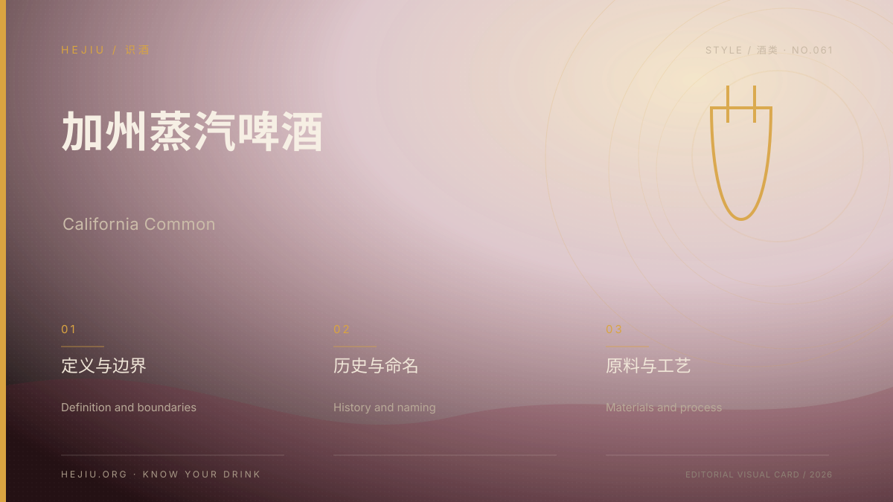
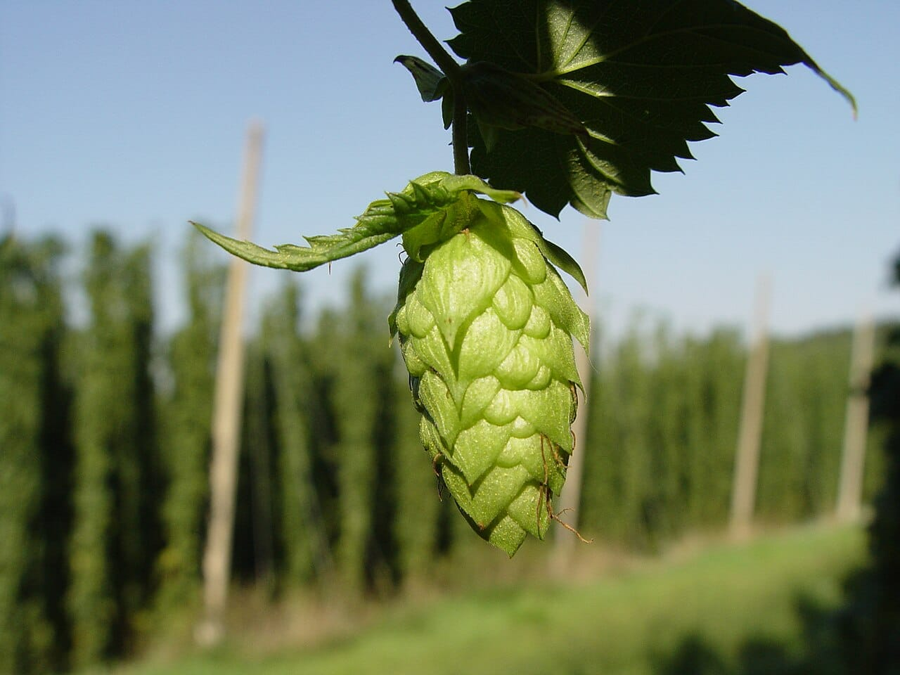

# California Common

An amber beer from California fermented with lager yeast at warmer temperatures, with malt sweetness, woody notes and hop bitterness; Anchor Steam is the commercial benchmark for the “steam beer” name.

Figure: Thematic illustration for California Common. Image: AI-assisted illustration (Doubao Seedream 5.0), project-owned; not a photograph of the subject, used as a thematic illustration only.

## Definition and boundaries

The defining process is lager yeast fermented at a warmish temperature: traditionally 55–60 °F (about 13–16 °C), above cold lager fermentation but below a typical ale. Historically, large shallow open fermenters (coolships) shed heat; modern breweries use closed vessels to hold the same temperature curve. The style sits between lager and ale: yeast cleanliness leans lager, while the warm fermentation allows a light ale-like ester note.

Naming needs care. "Steam Beer" is a registered trademark held by Anchor; the competition and generic style name is California Common. It differs from an American amber ale, which is usually top-fermented and uses modern citrus hops, whereas California Common is identified by lager yeast, traditional hops and a grainy malt backbone. It is also not an ordinary American pale lager: body, malt depth and hop expression are all more pronounced.

BJCP lists it as 7B California Common Beer with fixed ranges: OG 1.048–1.054, FG 1.011–1.014, 30–45 IBU, 10–14 SRM and 4.5–5.5% ABV. These ranges describe the traditional prototype; modern experimental versions may sit at the edges.

## History and naming

The style emerged in San Francisco during the mid-nineteenth-century Gold Rush. Without refrigeration, immigrant brewers used the cool Bay Area ambient climate, resting hot wort and fermenting beer in shallow open vessels; lager yeast strains were selected that fermented cleanly under the warmer conditions. "Steam" was the West Coast nickname for beer made without ice: one explanation points to vapour rising as hot liquid cooled in shallow vessels, another to the pressure release when a highly carbonated keg was tapped. The exact original process is not fully documented.

The Anchor brewery traces its roots to the Pacific Street brewery opened by German immigrant Gottlieb Brekle, who arrived in San Francisco in Gold Rush times. In 1896, German brewer Ernst F. Baruth and his son-in-law Otto Schinkel Jr. bought the old brewery at 1431 Pacific Street and named it Anchor. After Prohibition ended in 1933, Joe Kraus resumed brewing Anchor Steam after a thirteen-year hiatus; the brewery burned the following February and was rebuilt nearby with partner Joe Allen.

In 1965 Fritz Maytag bought 51% of the brewery for a few thousand dollars, saving it from closure, and purchased it outright in 1969. Bottling the modern steam beer version began in 1971, and in 1979 the brewery moved into an old coffee roastery on Potrero Hill. Maytag retired in 2010 and sold the brewery to Keith Greggor and Tony Foglio. The modern revival of the style rests on the version Anchor relaunched in the 1970s.

## Materials and process

The base malt is pale ale malt, with small amounts of toasted or crystal malts for pale amber colour and a caramel-toast backbone. Hops are traditionally non-citrusy American varieties such as Northern Brewer, showing woody, rustic herbal and light mint character; modern citrus-forward hops do not suit the style. The yeast is a lager strain that works at the warmer temperature, some strains with "California" in the name performing better; certain German strains produce an inappropriate sulphury character. Water should be low in sulfate and low to moderate in carbonate.

Historically fermentation ran in large shallow open vessels cooled by the Bay climate; modern versions replicate the warm fermentation curve in closed tanks and control carbonation. The challenge of warm lager fermentation is ester and diacetyl control: too high a temperature or a weak yeast state brings unwanted fruitiness, buttered notes or sulphur. Mashing, boiling and hopping are arranged around the balance of grainy malt and traditional hops. Breweries differ in malt recipe and hop dose: some foreground grain sweetness, others the herbal and woody traditional hops, and ester levels from the warm fermentation vary by strain.

## Style and palate

Appearance is medium amber to light copper, generally clear, with an off-white head. Aroma leads with Northern Brewer woody, rustic herbal and light mint notes, light fruitiness allowed, and low-to-moderate caramel and toast malt supporting the hops. The palate shows firm grainy malt, toast and caramel, a dry finish and a clear but not harsh hop presence.

Common faults are diacetyl butteriness, a mismatch between modern citrus hops and the traditional backbone, yeast-derived sulphur, excessive chocolate or roast leaning toward an American brown ale, and a thin body. When comparing, fix fermentation method, hop type and malt depth before talking about version differences.

## Representative regions and brands

The style's home is San Francisco and the American West Coast; modern examples come from North American craft breweries. The flagship prototype is Anchor Steam. Other commercial examples include Flying Dog Old Scratch Amber Lager, Schlafly Pi Common, Steamworks Steam Engine Lager, Southampton Steem Beer and Black Flannel Heavy Steam.

Pricing sits in the regular craft beer range, with a brewery's own expressions differing in malt depth, hop intensity and strength. A brand is only an entry point; read the label for fermentation method, hop variety and parameters rather than judging by name.

## How to drink and pair

California Common suits a chill of 7–10 °C in a pint glass or medium-bowl glass. Neat, it shows both malt backbone and traditional hops. Pair with American pub food: burgers, grilled sausage, smoked meats, cheddar cheese and salty nuts, where malt sweetness and hop bitterness answer the char and fat.

It should not be over-chilled, or herbal hops and toasted malt are suppressed; it does not need long settling like a heavy ale. Matching it with West Coast-style barbecue or cheese feels most natural.

## Buying, storage and misreadings

On the label check style name, ABV and brewery: products named "steam" are bound by the trademark, and the generic category name is California Common. A modern brewery's citrus-hopped amber ale is not a traditional California Common. Store away from light, heat and vibration, upright, and drink fresh; malt and hop aroma fade with time.

Common misreadings are treating it as a top-fermented ale; assuming "steam" means steam roasting; lumping every amber lager into the category; and taking the trademarked name for a generic style. These need to be judged alongside fermentation method, ingredients and the historical prototype.

## Further reading and see also

- Related: [beer](ref:beer), [lager](ref:lager), [barley](ref:barley), [hop](ref:hop), [usa](ref:usa).
- To map the category, start with an Anchor Steam prototype and a modern craft version, compare traditional hops, grainy malt and warm lager fermentation, then compare side by side with an American amber ale.

**Short definition:** An amber beer from California fermented with lager yeast at warmer temperatures, with malt sweetness, woody notes and hop bitterness; Anchor Steam is the commercial benchmark for the “steam beer” name.

For California Common, begin with the production rule. Then look at the strength, and finally ask the usual serving. The answers point to different choices, not to a single score.

## Related images

Image: Hops. Credit: LuckyStarr, CC BY 2.5, via Wikimedia Commons ([source page](https://commons.wikimedia.org/wiki/File:Humulus_Lupulus_Hopfendolde-mit-hopfengarten.jpg)). Related image for California Common.
