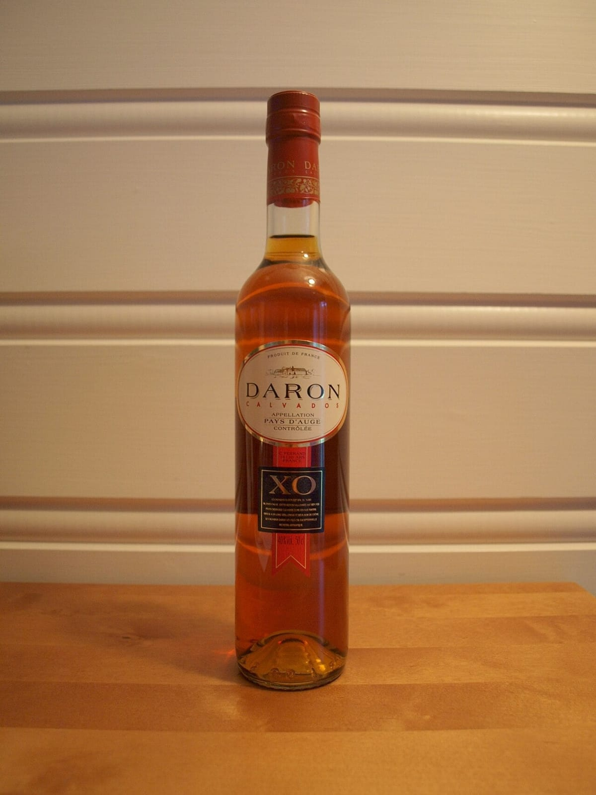

# Calvados

Calvados is a Norman [brandy](ref:brandy) distilled from cider, perry or a blend of the two. Its boundary is clear: the fruit must come from Norman orchards, it must first be fermented into an alcoholic cider, and that cider must then be distilled. It is neither a fortified cider nor an apple-flavoured brandy that anyone may make; the name is reserved for spirit produced in the defined area under appellation rules.

Figure: A bottle of Daron Calvados XO, labelled Appellation Pays d’Auge Contrôlée. Image: ChickenFalls, CC BY-SA 3.0, via [source page](https://commons.wikimedia.org/wiki/File:Daron_Calvados_XO.JPG).

## Three appellations, not one grade

The Calvados system contains three appellations: Calvados, Calvados Pays d'Auge and Calvados Domfrontais. They are parallel place names, not steps on a quality ladder. Calvados covers the wider Norman area and accounts for most production; Pays d'Auge lies on clay-limestone slopes in the east and requires stricter apple varieties and double pot distillation; Domfrontais leans on pears, whose share is clearly higher than in the other two.

Calvados received appellation control in 1942. That date is often misread as the beginning of its history, when it really wrote an existing local distilling tradition into law. Pays d'Auge and Domfrontais were later separated, producing the three-part map used today. When reading a label, start with the appellation, then look at strength and age wording; that tells you more than the brand name alone.

## Apples, pears and the cider chain

Norman orchards are not built on a single variety. Apples are sorted by role: sweet, sharp, bitter and bittersweet. Bittersweet fruit supplies structure and length, sweet fruit supplies alcohol and roundness, and sharp fruit keeps the blend fresh. The apples are pressed, fermented naturally into cider, and it is this fermented liquid, not the juice, that goes to the still.

The choice of [apple](ref:apple) varieties sets the backbone of the base wine, but the interval between fermentation and distillation matters just as much. Cider fermented too dry loses aroma; cider with too much residual sugar can make the distillate feel muddy. Domfrontais adds pear, bringing softer flower and pear-skin notes and making the phrase "apple brandy" sound too simple.

## Twice distilled, or once through

Pays d'Auge traditionally uses a pot still twice: the first run produces a low-strength base, the second concentrates it and cuts the heart. Double distillation gives a cleaner, more layered aroma and preserves apple and pear detail. Other Calvados zones often use a column still, where one continuous pass does the work, yielding a heavier body and more direct fruit.

[Distillation](ref:distillation) is not merely alcohol concentration. Copper binds sulphur compounds and softens reductive notes, while the distiller's cut between heads, heart and tails decides the final style. A wide cut gives a coarse spirit; a narrow cut leaves too little aroma. The difficulty with Calvados is that cider aroma is delicate, so the still must protect fruit and structure at the same time.

## At least two years in oak

Calvados must spend at least 2 years in oak before release. Age statements are based on the youngest spirit in the bottle: 2 years may be labelled three stars, VS or three apples; 3 years may be Vieux or Réserve; 4 years may be VO, VSO or Vieille Réserve; 6 years may be XO, Hors d'âge or Très Vieille Réserve. All are minimums, not averages.

[Oak ageing](ref:oak-ageing) slowly turns crisp apple into baked apple, caramel, vanilla and nuts. New barrels give more vanilla and tannin, while older ones let fruit and oxidative notes dominate. The damp Norman cellar slows alcohol loss and keeps the spirit rounder; the same base spirit, with different toast levels and barrel histories, can move in completely different directions within a few years.

## From green apple to baked apple

Young Calvados leads with green apple, pear, citrus peel and white flowers, with a crisp entry and direct alcohol. With age, the nose turns to baked apple, apple sauce, honey, vanilla, cinnamon and a light leather note; the body softens and the finish gains a bittersweet tannin. Good bottles keep tension between fruit and wood instead of letting vanilla take over.

Colour can be observed, but it is not proof of age: caramel colouring is permitted within the rules, and barrel toast also changes shade. Aroma and integration are more reliable: is the fruit clear, is the alcohol sharp, does wood cover the raw material, and is the finish clean?

## At the Norman table

The classic Calvados occasion is the Norman trou normand, a small glass between courses that resets the palate with alcohol and acidity. It also works as a digestif with apple tart, cheese, nuts and chocolate. Young bottles suit ice or mixing, while older ones reward a small tulip glass and time.

In cocktails, Calvados supplies apple and pear fruit while keeping the backbone of a brandy. It works with ginger ale, tonic, lemon and bitters, and in classic apple-brandy recipes it adds more layers than a neutral spirit. Note that strength is usually around 40% ABV; excessive drinking is harmful to health, and minors should not drink.

## Where Calvados ends and Cognac begins

[Cognac](ref:cognac) and [Armagnac](ref:armagnac) are made from grapes, while Calvados is made from apples and pears. The first two debate grape varieties, zones and distillation runs; Calvados debates orchard varieties, cider fermentation and barrel age. All belong to the wider brandy family, but they are not interchangeable.

"Apple brandy" is a broader phrase. American applejack may be distilled from cider or even blended with neutral spirit, with far fewer legal constraints than Calvados. Calvados draws its identity from the Norman zone, permitted varieties, cider as raw material and appellation rules, not from the word "apple". Once that is clear, it stops being just a fruit-flavoured spirit.

**Short definition:** A Norman apple brandy distilled from cider and perry, protected by appellation since 1942; Pays d'Auge uses double pot distillation while other zones usually use a column, and at least two years in oak take the spirit from green apple to baked apple, vanilla and spice.

**Key facts.**

| Item | Detail |
| --- | --- |
| In one line | A Norman apple brandy distilled from cider and perry, protected by appellation since 1942; Pays d'Auge uses double pot distillation while other zones usually use a column, and at least two years in oak take the spirit fr… |
| Parent style | Brandy |
| Aroma family | fruit/floral/oak |

**Sources and limits.** The key claims about Calvados are checked against the following sources: Calvados France (the names, areas, raw materials and distillation methods of the three AOCs), INAO (the official framework of French appellation control), European Union (the boundaries between marc, fruit spirits and geographical-indication spirits) and 4 sources in total. Prices, batches and status change; the body is project-written and does not reproduce source text.

## Related images

Image: Cognac. Credit: Didier Descouens, CC BY-SA 3.0, via Wikimedia Commons ([source page](https://commons.wikimedia.org/wiki/File:Cognac_glass.jpg)). Related image for Calvados.
