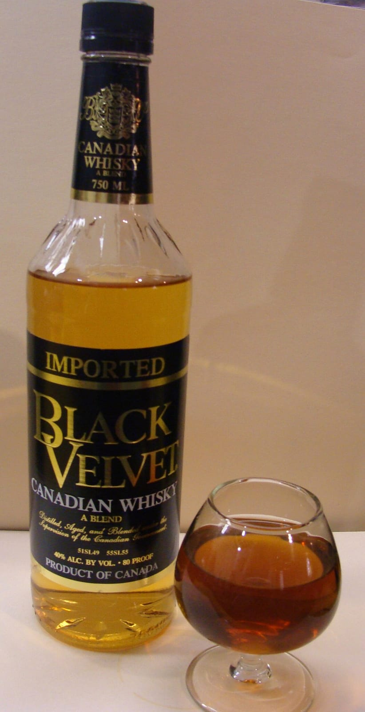
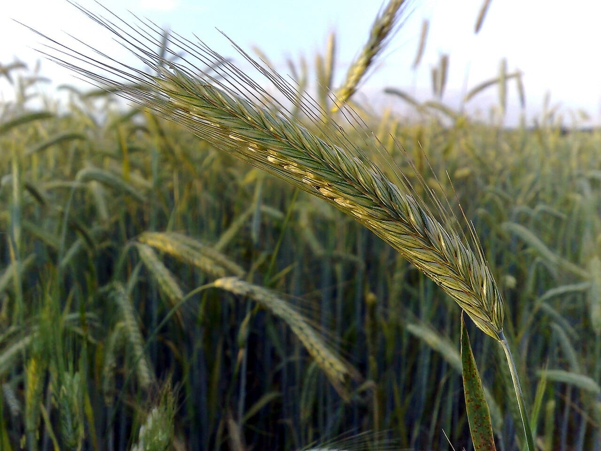

# Canadian Whisky

Canadian whisky distils grains separately—often corn, rye, wheat and barley—matures them apart, then blends. The style is soft and smooth, with caramel, vanilla and rye spice; the rules permit caramel colouring and flavouring spirit. The often-quoted 9.090% figure is a threshold for age claims and export certificates, not a general compositional cap.

Figure: Canadian Whisky: Black Velvet Canadian Whisky (Wikimedia Commons). Image: Craiglduncan at English Wikipedia, CC BY 3.0, via Wikimedia Commons ([source page](https://commons.wikimedia.org/wiki/File:Black_Velvet_Canadian_Whisky.jpg)).

## Definition and boundaries

Canada's Food and Drug Regulations set the conditions for Canadian Whisky, Canadian Rye Whisky and Rye Whisky: the distillate comes from a cereal-grain mash saccharified by malt diastase or other enzymes and fermented by yeast; it is aged at least three years in small wood, meaning casks no larger than 700 litres; mashing, distillation and ageing all take place in Canada; the finished strength is at least 40% ABV; and caramel and flavouring are permitted. Flavouring means another domestic or imported spirit or wine added for flavour.

Current rules also require whisky sold in Canada to be aged at least three years in small wood; any flavouring other than wine must itself have been aged at least two years in small wood before use. Age claims count only time held in small wood; after at least three years in small wood, up to six months in other containers may also count toward the age.

The 9.090% rule comes from the Certificates of Age and Origin Order (SI/2009-61) and must be read in the certificate context. Under section 3, where the absolute alcohol of the added flavouring spirit or wine does not exceed 9.090% of the total absolute alcohol of the finished blend, the product may carry the base whisky's age. Under section 2, if an exported whisky blend contains more than 9.090% imported spirits, the certificate must state the domestic and imported shares separately and may not call it Rye Whisky, Canadian Whisky or Canadian Rye Whisky. Section 5 requires that where an export label carries the word "Canadian", at least 75% of the finished absolute alcohol comes from domestic spirits.

## History and naming

Canadian distilling grew out of Ontario mills and surplus grain in the first half of the nineteenth century. In the 1830s Gooderham and Worts moved from flour milling into distilling in Toronto and was among Canada's largest whisky producers by the 1860s. In 1858 Hiram Walker founded Canadian Club at Walkerville, now Windsor, Ontario, originally as Hiram Walker's Club Whisky; after the United States required foreign whisky to label its country of origin, it became Canada's leading export whisky. Henry Corby began distilling at Corbyville in 1859, and Joseph Seagram bought the Waterloo distillery in 1883.

During US Prohibition, Canadian whisky figured prominently in rum-running across the Detroit River: distilleries produced legally in Canada and sold to smugglers who carried it into the United States. In 1939 Seagram's Sam Bronfman blended Crown Royal as a gift for the royal visit of King George VI and Queen Elizabeth to Canada, trialling more than 600 recipes for a blend of about 50 whiskies. The brand entered the US market in the 1960s and is now a top-selling Canadian whisky, produced at Gimli, Manitoba. The Canadian Mist distillery was established at Collingwood, Ontario, in 1967.

A common naming misunderstanding: a Canadian "rye" label does not legally require a high rye proportion. Early Canadian whisky often leaned on rye for structure, but today most products use corn as the base, with a small rye distillate for spice; "rye" survives largely as a historical style name.

## Materials and process

The base whisky usually uses corn for sweetness and a light body; rye adds spice and structure, wheat a smooth texture, and barley a malty depth. The traditional route makes single-grain distillates, distilling and maturing each grain separately before blending at maturity. Stills include both column and pot stills; high-rye versions often use copper pot stills in small batches to preserve spice. Ageing runs in small wood, and Canada's cold climate slows maturation, leaving a cleaner, lighter style.

The rules allow caramel for colour and permit flavouring spirit or wine within the stated limits, which differs from the tighter colouring and flavouring restrictions in Scotland and Bourbon. The blender's job is to balance corn-base sweetness, rye spice, wood and vanilla into a final whisky that is usually lighter than Bourbon and sweeter and rounder than most Scotch blends.

The Canadian tradition separates single-grain distillates through the full process and combines them only at maturity, which sets this branch apart within the [whisky](ref:whisky) family. Fermentation temperature, distillation cuts, oak age and cask history all shift the final aroma.

## Style and palate

The typical Canadian whisky is soft and smooth, opening on caramel, vanilla and light wood, finishing with rye spice. Market bottlings are commonly 40% ABV. High-rye examples show more obvious spice: Lot 40 uses 100% rye in copper pot still batches at about 43% ABV, while corn-forward mainstream blends are sweeter and easier to drink.

Compared with Bourbon, Canadian whisky does not require new charred oak, so wood and vanilla notes are more restrained; compared with Scotch blends, it carries little peat smoke and puts sweetness forward. Faulty examples show hot alcohol, cloying caramel, thin oak or cardboard oxidation; good samples finish clean between fruit, grain sweetness and spice.

Product-line differences come mainly from base composition, rye share and ageing time rather than brand name. When comparing, fix the corn-versus-rye balance, strength and pot-versus-column still before judging typicality.

## Representative regions and brands

The Hiram Walker distillery in Windsor, Ontario, dates to 1858 and is among the oldest still operating in the province, producing Lot 40, Pike Creek, Gooderham and Worts and J.P. Wiser's. Crown Royal is made at Gimli, Manitoba; Canadian Club comes from the Walker system; Forty Creek ages rye, barley and corn separately before double-barrel blending; Canadian Mist was founded at Collingwood in 1967, and Black Velvet is another familiar market name.

Price spreads reflect base-whisky grade, rye share, ageing time and brand position. Entry blends are widely distributed at steady prices, while high-rye pot-still and long-aged expressions cost more. A brand is only an entry point; process and ingredient differences need to be read from the label parameters.

## How to drink and pair

Canadian whisky suits neat, on ice or a highball, and works in whisky cocktails such as the Manhattan and Old Fashioned; sweet, round expressions make easy cocktail bases. Pair with smoked or grilled meats and salty nuts, where caramel and vanilla answer the char; lighter versions also go with cheese and dried fruit.

Neat, use a medium-bowl whisky glass, smell grain sweetness and spice before sipping; ice dilutes the alcohol and opens sweetness. Too much warmth lets the alcohol take over, while over-chilling suppresses oak and spice together.

## Buying, storage and misreadings

On the label check the age statement, grain composition and strength: age counts small-wood time only, and "rye" does not mean high rye content. The 9.090% rule governs age and export certificates, not a general share limit for flavouring in the bottle; the "Canadian" export label carries the 75% domestic-alcohol threshold.

Store away from light, heat and vibration, upright. The high-alcohol, caramel-finished product keeps longer than low-alcohol drinks once opened, though aroma fades slowly over the years. Common mistakes are equating Canadian whisky with Bourbon—raw materials, cask rules and style direction all differ—and treating "handmade" or "traditional" as legal terms.

## Further reading and see also

- Related: [whisky](ref:whisky), [rye](ref:rye), [oak-ageing](ref:oak), [canada](ref:canada), [liqueur](ref:liqueur).
- To map the category, start with one corn-base mainstream blend and one high-rye pot-still version, compare sweetness, spice and wood structure, then try a double-barrel or long-aged sample.

## Related images

Image: Rye. Credit: LSDSL, CC BY-SA 3.0, via Wikimedia Commons ([source page](https://commons.wikimedia.org/wiki/File:Ear_of_rye.jpg)). Related image for Canadian Whisky.
