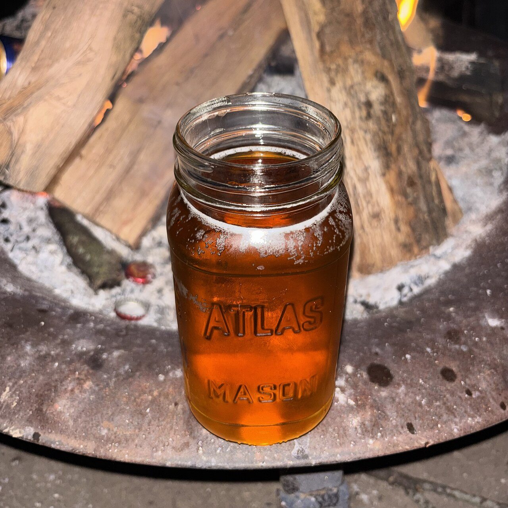

# Cider

Cider is an alcoholic drink made by [fermentation](ref:fermentation) of [apple](ref:apple) juice. The ingredients are simple, but the range is wide: from tannic, slightly earthy dry cider in western England to sweeter, sparkling farmhouse cider in Normandy, and further to ice cider made from concentrated apple juice in Quebec. Like [beer](ref:beer) and [wine](ref:wine) it is a fermented drink, but its raw material and fermentation logic are different.

Figure: Cider. Image: ChuckDabs, CC BY 3.0, via Wikimedia Commons ([source page](https://commons.wikimedia.org/wiki/File:Midwest_hard_cider.jpg)).

## The boundary: what counts as cider

The core of cider is apple juice fermented with yeast. The simplest recipe is juice and yeast; products that add sugar, water, spice or juice may still be called cider but usually carry a more specific name. It is not beer, because it is not grain-based, and not wine, because it is not grape-based.

What does not count: unfermented apple juice, apple vinegar, spirit-based drinks built on apple brandy or neutral alcohol, and alcoholic drinks with only apple flavouring. The US market calls fermented cider “hard cider” to distinguish it from unfermented apple cider; the Chinese “苹果酒” normally means the fermented product already.

## Apple classes and tannin

Cider apples are usually grouped by acidity and tannin: sweet (low acid, low tannin), sharp (high acid, low tannin), bittersweet (high tannin, low acid) and bittersharp (high in both). [Tannin](ref:tannin) gives structure, astringency and ageing potential; acidity gives freshness and protection.

Dessert apples usually lack both acidity and tannin and ferment into a thin drink. Traditional blends in western England and Normandy combine the classes to balance acid, tannin and sugar. Variety choice says more about quality than a claim of “pure juice”.

## Pressing and fermentation

Apples are washed, milled and pressed to juice. Traditional producers let wild yeast start a slow, cool fermentation for more complex aroma; modern producers often pitch commercial yeast for consistency and predictability. Fermentation is usually cooler than for wine, to keep the fresh apple note.

During fermentation, sugar becomes alcohol and carbon dioxide. Whether [malolactic fermentation](ref:mlf) takes place changes the acidity: it softens sharp malic acid and gives a rounder texture, but can also cost freshness. Some producers practise keeving, removing pectin and nutrients before fermentation so that some sugar remains and a naturally sweet style forms.

## Sweetness, bubbles and stability

Sweetness is set by [residual sugar](ref:residual-sugar). Dry cider ferments to the end; sweet cider is made by stopping fermentation early, adding unfermented juice or sweetening later. Sweet products need enough acidity and tannin for balance or they taste cloying.

Bubbles can come from a second fermentation (traditional method or tank method), carbonation, or carbon dioxide retained from the first fermentation. Traditional UK “real cider” is often still or only lightly sparkling, while French cidre bouché gains a fine bubble from a bottle second fermentation. Bubbles are a style choice, not a grade.

## Regulation and duty

The EU has no single category definition for cider, and member states regulate it nationally. The UK taxes cider and perry as a separate alcohol class, with duty banded by strength: cider from 1.2% to 8.5% vol falls under the cider rate, while products above 8.5% are usually handled as wine or another class. That threshold is a tax boundary, not a style definition.

Normandy and Brittany have protected traditional cider regions, Asturias in Spain has rules for sidra, and Quebec sets separate labelling and process requirements for ice cider. China's GB/T 17204-2021 supplies terminology within its drinks classification. Read origin, strength and sweetness on the label rather than only the word “cider”.

## A stylistic map

Western England (Somerset, Herefordshire, Devon) is known for bittersweet and bittersharp apples, higher tannin and dry styles; Kent and East Anglia lean fresher and more fruit-forward. Normandy and Brittany ciders are usually lower in alcohol, sparkling and softer, often paired with crêpes and cheese.

Asturian sidra natural is high in acidity with natural bubbles, poured from a height to wake them up; Basque sagardoa is similar. Quebec ice cider ferments juice concentrated by freezing, usually between 7% and 13% alcohol, with high sweetness and high acidity.

## Key parameters

Most cider runs from 2% to 8.5% alcohol; UK duty singles out 1.2% to 8.5% vol as the cider class. Ice cider is usually 7% to 13%. Serving temperature is around 8 to 12 degrees Celsius, a little warmer for tannic dry styles and cooler for sweet or sparkling ones.

These figures are style and tax references, not a single regulation. Apple variety, fermentation temperature, malolactic fermentation and residual sugar all change strength and texture. High alcohol is not high quality, and sweetness is not low quality.

## Difference from neighbouring drinks

Cider and beer both sparkle and suit food, but cider ferments fruit juice and beer ferments grain; cider is normally gluten-free, though cross-contamination in production still matters. Cider and wine both ferment fruit, but cider is usually lower in alcohol and has a different tannin structure.

Perry is made from pear juice with a similar process but different tannin and aroma; Calvados is a distilled apple spirit, not cider. Mixing these names leads buyers to misjudge strength and serving style.

## Common misconceptions and disputes

First, that cider is apple juice. Second, that cider must be sweet. Third, that all cider is gluten-free, ignoring cross-contamination. Fourth, that cider is only for cold drinks. Fifth, that perry is a sub-category of cider. Sixth, that “real cider” has a legal definition.

Disputes centre on the definition boundary (whether water, sugar and flavour may be added), protection of traditional regional names, and the effect of industrial sweet products on the category's image. These are regulatory and market questions; the core of fermented apple juice does not change.

## How to drink it

Dry cider suits pork, roast chicken, cheese and rich dishes; sweet cider suits dessert or a solo serve; high-acid sidra suits seafood and fried food. Too cold closes the aroma, too warm pushes alcohol and sweetness forward. Once opened, keep it cold and finish it promptly, especially low-alcohol, low-tannin styles.

Cider can be mixed, but its acidity and bubbles change a recipe's balance. As an everyday drink, watch the strength and the amount; minors should not drink.

**In brief:** A fermented apple-juice drink; apple tannin and acidity build the frame, wild yeast, malolactic fermentation and residual sugar decide the style, and UK duty treats cider from 1.2% to 8.5% vol as its own class.

**Sources and limits.** The key claims about Cider are checked against the following sources: State Administration for Market Regulation, Standardisation Administration of China, National Association of Cider Makers (UK) (Used to check UK cider raw materials, regions and style categories), HM Revenue & Customs / HM Treasury (Used to check the UK system of strength-banded alcohol duty and the separate cider and perry class) and 5 sources in total. Prices, batches and status change; the body is project-written and does not reproduce source text.
