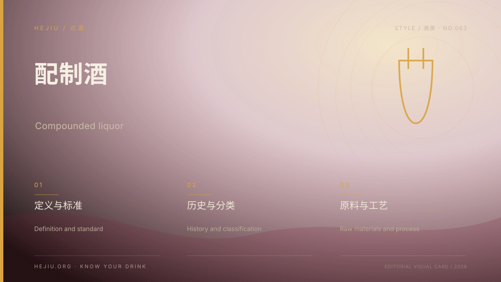

# Compounded liquor

Compounded liquor is a beverage made by blending, mixing or reprocessing a base of fermented wine, distilled spirit or food-grade alcohol with edible materials or additives. Its scope is wide, from flavoured fruit drinks to herbal lujiu. GB/T 17204-2021, Terminology and classification of alcoholic beverages, sets its terminology and classification.

Figure: thematic illustration for Compounded liquor. Image: AI-assisted illustration generated with Doubao Seedream 5.0 (project-owned); not a photograph of the subject.

## Definition and standard

By definition, the key is a spirit or wine base plus added materials and further processing. The base can be a fermented wine such as wine or yellow wine, a distilled spirit such as [baijiu](ref:baijiu), or food-grade alcohol. Added materials include juice, sugar, herbs and spices, introduced by steeping, blending or redistillation.

Compounded liquor is one class of alcoholic beverage, not a synonym for cheap blended spirit. The class describes materials and process origin and does not form a quality grade. Base, ingredients and alcohol content on the label are the direct information for judging a product.

## History and classification

The history of compounded liquor is tied to medicinal use, the spice trade and flavoured wine traditions. Vermouth in Europe and lujiu in China can both be read as adding plant or other materials to a base. After industrialisation, standardised recipes and food safety regulation made it a distinct category.

Common classifications divide by base (fermented wine, distilled spirit, food-grade alcohol), by process (steeping, blending, redistillation) and by flavour source (fruit, herbal, spice). Standards and industry usage do not always classify the same way, so the current texts and the label govern.

## Raw materials and process

Materials include the base, water, sugar or sweeteners, juice, herbs and spices. Steeping types extract flavour by soaking materials in the base; blending types mix base with juice, sugar syrup and spice extracts in proportion; redistillation types distil the steeped liquid to collect a cleaner aromatic fraction.

[Blending](ref:blending) is one of the core actions: different bases and flavour components are combined in proportion to form a stable recipe. Temperature, time and filtration affect extraction efficiency and clarity. Recipes and parameters belong to the producer, and public sources usually describe principles.

## Main types and lujiu

Lujiu is a major branch of compounded liquor. Under GB/T 27588-2011, Lujiu, it is made from a base of distilled spirit, fermented wine or food-grade alcohol with edible or medicinal-and-food materials, blended or reprocessed, and its base style has been changed. See [lujiu](ref:lujiu).

Other common types include flavoured wines such as vermouth, fruit-flavoured compounded drinks, spice-flavoured drinks and some aperitifs. Fortified wines such as sherry and port raise alcohol by adding grape spirit and sit next to this class in some systems while belonging elsewhere, so read the sources carefully.

## Flavour profile

The flavour of compounded liquor comes from the base and the added materials together. Fruit types stress the sweetness and freshness of juice; herbal types bring plant, root or bitter notes; spice types often show cinnamon, clove and citrus peel. The base style is partly masked but still affects body and finish.

Compounded liquor is often sweet, with sweetness from sugar, juice or sweeteners rather than residual sugar from fermentation. Sweetness and alcohol content are separate: high sweetness does not mean low alcohol, and low sweetness does not mean a strong spirit. Read the label rather than guessing from taste.

## Tasting and serving

Start with the aroma and judge whether the flavour source is fruit, herb or spice, then check whether base and added materials are integrated, whether sweet and sour are balanced, and whether the finish is clean. Temperature changes aroma release: fruit types suit chilling, herbal types room temperature or ice.

Compounded liquor is often used before meals, in cocktails or as an after-dinner sweet drink. High-sugar products suit small servings, high-alcohol products need portion control. Judge strength by the [alcohol by volume](ref:abv) on the label, not by sweetness or colour. Excessive drinking is harmful to health, and minors should not drink.

## Common misconceptions

First, equating compounded liquor with poor quality. Compounding is a legal category, unrelated to quality.
Second, equating compounded liquor with medicinal liquor. Medicinal liquor falls under drug regulation, while compounded liquor is a beverage.
Third, assuming sweet means low alcohol. Sweetness and alcohol content do not determine each other.
Fourth, believing darker colour means longer ageing. Colour mostly comes from materials and caramel, and is not evidence of age.
Fifth, ignoring the ingredient list. Ingredients and base are the key to judging the category.

Compounded liquor is a manufacturing category, not a quality grade. It starts from a fermented base, a distilled base or edible alcohol, then adds edible ingredients, flavourings or food additives and is blended or processed. Lujiu is an important branch, but compounding does not mean the drink is inferior or medicinal. Read the base, the added materials, the sugar level and the label category before judging the product.

**In brief:** A beverage made by blending, mixing or reprocessing a base of fermented wine, distilled spirit or food-grade alcohol with edible materials or additives; lujiu is a major branch, and the category is not a quality grade.

For Compounded liquor, begin with the production rule. Then look at the strength, and finally ask the usual serving. The answers point to different choices, not to a single score.

Setting [Lujiu](ref:lujiu)'s legal definition beside [Blending](ref:blending)'s materials and process makes the boundary between them visible.

A particular brand is not a safe shorthand for Compounded liquor. Check what it is, then what the label claims; where they diverge, prefer the specific source.

The entry on Compounded liquor draws on State Administration for Market Regulation, Standardization Administration of China, General Administration of Quality Supervision, Inspection and Quarantine, Standardization Administration of China, Oxford University Press.

**Sources and limits.** The key claims about Compounded liquor are checked against the following sources: State Administration for Market Regulation, Standardization Administration of China (Searchable by standard number in the National Standards Full-Text Public System; Used to check the scope, terminology and classification of GB/T 17204-2021; no text copied), General Administration of Quality Supervision, Inspection and Quarantine, Standardization Administration of China (Searchable by standard number in the National Standards Full-Text Public System), Oxford University Press (Consulted for entries on flavoured and fortified wines; no original text is reproduced; Migrated from the former reference list at the end of the article; access date not re-verified). Prices, batches and status change; the body is project-written and does not reproduce source text.

**Read alongside.** Put Compounded liquor next to Lujiu, Baijiu, Blending: the first fixes identity and boundary, the others provide a region, process or peer comparison. Read this style first, then return to those entries; the links become coordinates, not decoration.

For Compounded liquor, this style was last checked in 2026; prices, batches and availability change, so confirm them against the sources below.

## Further reading

- [Lujiu](ref:lujiu): the branch with the strongest Chinese identity.
- [Baijiu](ref:baijiu): a common distilled base.
- [Blending](ref:blending): recipe building and flavour balance.
- [Alcohol by volume](ref:abv): the basic concept behind label declarations.

## Related images

Image: Editorial illustration of a wine blending trial: base wines compared in beakers, with a pipette for bench trials; AI-assisted illustration, not a photograph.. Credit: Hejiu editorial team, AI-assisted with Doubao Seedream 5.5; project-generated editorial figure, not a photograph ([about](https://hejiu.org/about/)). Related image for Compounded liquor.
