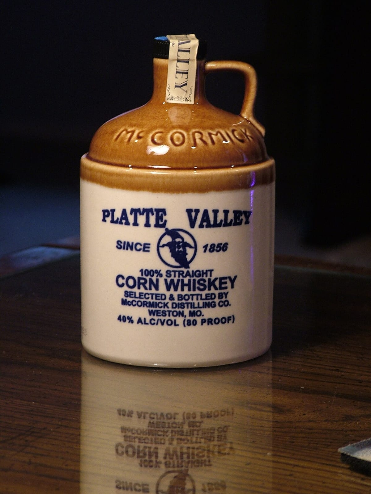

# Corn Whiskey

An American whiskey made from at least 80% corn, which may be unaged or briefly aged; the flavour is corn-sweet, grainy and lightly spicy.

Figure: Corn Whiskey: A jug of McCormick Platte Valley 100% straight corn whiskey (Wikimedia Commons). Image: Ken444444, CC BY-SA 3.0, via Wikimedia Commons ([source page](https://commons.wikimedia.org/wiki/File:A_jug_of_McCormick_Platte_Valley_100%25_straight_corn_whiskey.JPG)).

## Definition and boundaries

Corn whiskey is an American distilled-spirits category. Federal rules require at least 80% corn in the mash, distillation no higher than 80% ABV (160 proof), and maturation either none at all or in uncharred new oak or used barrels. The high corn threshold is what separates it from bourbon, which needs at least 51% corn and must be aged in new charred oak.

“Straight corn whiskey” is a narrower claim: the spirit must be aged for at least two years. A bottle simply labelled corn whiskey may be clear, lightly tinted or amber, and the word “straight” is the reliable signal that a minimum ageing period has been met. The category is defined by grain and barrel treatment, not by colour alone.

Corn whiskey is also not a synonym for moonshine. Legal distilleries make the same category under permit, pay tax and follow labelling rules; moonshine refers to untaxed or unlicensed production. A clear corn whiskey can be perfectly legal, and an amber one can still be a young product finished in a small barrel.

## History and naming

Maize was the dominant grain in much of the American South and Appalachia, and early settlers distilled corn with rye and malted barley at home. The unaged spirit overlapped with moonshine culture, but licensed producers also made corn whiskey as a commercial category. Its name followed the grain rather than a place or a protected region.

In the twentieth century, corn whiskey became a small entry in the American whiskey taxonomy. Prohibition and tax enforcement pushed much home distillation underground, while a few licensed brands kept the category alive. In the past two decades craft distillers have used it for white whiskey, short-barrel releases and experimental mash bills.

The modern category therefore carries two histories at once: a rural grain-distilling tradition and a regulated industrial class. A label that says “corn whiskey” tells you the legal minimum, not whether the spirit is old or new, sweet or dry, or made by a large or small distillery. Those questions require the age statement, mash bill and production notes.

## Materials and process

Corn starch gelatinises at high temperature. Distillers usually cook corn meal in a high-temperature vessel, then cool the mash and add malted grain for enzymes. With very high corn proportions, exogenous enzymes or careful temperature control may be needed because the malt fraction is limited. Fermentation typically runs three to five days before distillation to no more than 160 proof.

The distillate is either diluted to bottling strength and released clear, or filled into uncharred new oak, used barrels or small experimental casks. Ageing can last months or several years. The flavours move from corn sweetness, cream and grain toward vanilla, wood and light caramel, but the spirit should not take on the heavy char and coconut of a freshly charred bourbon barrel.

Mashing temperature is a practical variable: 90–100°C for gelatinisation, then 60–65°C after malt is added so the enzymes are not destroyed. High-corn mashes are viscous and can be hard to pump or filter; a small rye addition may improve lauter performance. Distillers balance yield, fermentability and the grainy texture that defines the category.

## Style and palate

Unaged corn whiskey shows corn sweetness, grain, cream and a light pepperiness. The body is medium and the aroma direct. Aged versions add vanilla, coconut, wood and dried fruit, but they should remain distinguishable from bourbon’s more heavily charred profile.

The difference from bourbon is not simply “more corn”. Bourbon’s new charred barrel contributes vanilla and caramel; corn whiskey’s uncharred or used cooperage puts the grain itself forward. Typicality is best judged from the category name, the corn percentage and the ageing method, not from colour.

Unaged versions are often bottled near 50% ABV. When water is added, a white haze can form as cereal fats and proteins come out of solution; this is not spoilage. Aged versions may use five-gallon through fifty-three-gallon barrels, with small casks accelerating colour and vanilla extraction.

“Straight” requires at least two years, but many craft producers avoid the term to keep a fresher grain profile. Aged and unaged are two stylistic routes, not a hierarchy. A clear bottle can be more expressive than a lightly barrel-treated one, and a dark bottle can still be young.

## Representative regions and brands

Mellow Corn from Heaven Hill is the most visible commercial corn whiskey, unaged and bottled at 50% ABV. Balcones Baby Blue uses 100% corn and has a sweeter, oilier profile; Stillhouse also produces corn-based spirits. These are reference points rather than a ranking.

Regional brands exist across the Midwest and South, but national distribution is limited. When looking for a bottle, search for “corn whiskey” rather than “bourbon”, then check whether “straight” and an age statement appear. A producer’s technical sheet is more useful than a shelf description.

A useful comparison is Mellow Corn beside a bourbon at similar strength and beside a 100% corn craft release. The first shows the category’s clear, grainy baseline; the second isolates barrel treatment; the third shows how mash bill and distillery style change the texture.

## How to drink and pair

Unaged corn whiskey is best at 18–20°C, either neat or with a few drops of water to open the aroma. High-strength versions can take ice, but excessive dilution flattens the grain. Aged versions suit a tulip glass and pair with barbecue, corn tortillas, smoked meat and salted nuts.

It also works in cocktails. A corn whiskey sour or a mix with apple juice can carry the sweetness and grain. When substituting for bourbon in an Old Fashioned, reduce the syrup because corn whiskey’s sweetness is more direct and the drink can become cloying.

The spirit’s texture is part of its appeal. Clear versions are not “flavourless”; they carry corn, cream and fermentation notes that barrel ageing can obscure. A bottle should be judged on the grain and distillate first, with oak as a secondary layer.

## Buying, storage and misreadings

Check the category and corn percentage first, then age and strength. Clear does not always mean unaged, and an aged corn whiskey can still be pale. A high price may reflect small-batch production or brand positioning rather than typicality. Keep bottles upright, away from light and heat.

Common misreadings include treating all corn whiskey as moonshine, treating bourbon as the same category, and assuming “unaged” means “no flavour”. Corn whiskey’s flavour begins with corn and fermentation; oak is optional. The legal category also allows an age statement to be omitted unless the word “straight” is used.

For imported bottles, EU spirit-drink labelling may classify or rename the product, and alcohol statements can differ from the US label. Read the category and strength on the bottle in front of you rather than relying on the American name alone.

## Further reading and see also

Compare one clear corn whiskey, one straight corn whiskey and one bourbon at similar strength. Record corn percentage, barrel type, age and distillation proof; those four variables explain most of the difference.

- [Whiskey](ref:whisky): the broad category of cereal spirits.
- [Distillation](ref:distillation): alcohol separation and proof.
- [Oak ageing](ref:oak): barrel type, char and flavour.
- [United States](ref:usa): regional and regulatory background.
- [Liqueur](ref:liqueur): the boundary with sweetened spirits.

## Related images

Image: Whisky. Credit: Guinnog, CC BY-SA 3.0, via Wikimedia Commons ([source page](https://commons.wikimedia.org/wiki/File:Whiskyhogmanay2010.jpg)). Related image for Corn Whiskey.
