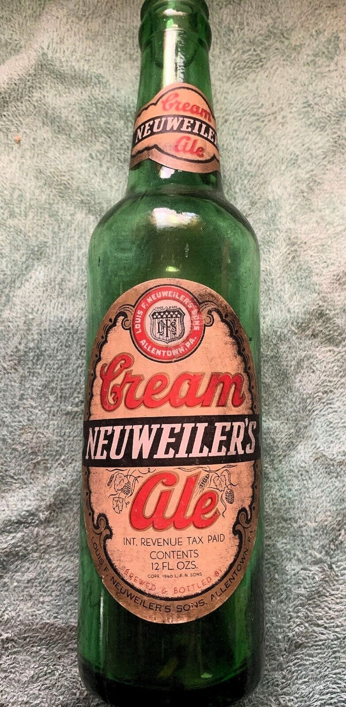

# Cream Ale

A pale American ale, often with corn or rice to lighten the malt body, crisp with fine foam and low bitterness; “cream” refers to texture, not cream flavour.

In the “Hejiu” style index, Cream Ale is not a fixed recipe but a set of checkable parameters: material, fermentation or distillation, sweetness, alcohol, ageing and occasion. First place it in a broad family, then check whether the producing country legally protects the name; the same name can mean different material ratios and alcohol limits in different countries. Finally, split the “typical style” into comparable samples: a benchmark, a variant and an extreme. Three bottles build a clearer boundary than ten definitions. Style names are also rewritten by marketing: sweetness becomes a style, packaging becomes tradition. Read the label for material, alcohol, sugar and origin before deciding whether it belongs. The biggest trap in style comparison is judging from one bottle. Within one style, material grade, fermentation temperature, distillation cuts, ageing vessel and sweetness all change the result; fix two or three variables before deciding whether a difference comes from style, producer or vintage. A useful note should record those variables, not only “liked” or “disliked”, and the same glass and temperature should be kept. Also record the batch or lot code and the date.

Figure: Cream Ale: 1934 - Neuweiler Cream Ale Bottle - Allentown PA (Wikimedia Commons). Image: Self Scanned, Public domain, via Wikimedia Commons ([source page](https://commons.wikimedia.org/wiki/File:1934_-_Neuweiler_Cream_Ale_Bottle_-_Allentown_PA.jpg)).

## Definition and boundaries

Cream ale originated in nineteenth-century America, where breweries used corn or rice adjuncts to imitate the crispness of popular lager while keeping top fermentation.

Cream Ale is a style defined by raw material, fermentation or distillation, sweetness, alcohol and ageing. It is not a single brand or place; the same style can be made in different countries with different materials and equipment.

For Cream Ale, beyond the style name, read the material list, alcohol, sugar and process notes. Many “styles” are market categories, not legal ones; the same name can mean different parameters in different countries.

## History and naming

It is pale yellow to gold, light-bodied, medium-high in carbonation and low in bitterness; malt sweetness and a light grain note, with a clean finish.

The history of Cream Ale is usually tied to a regional surplus, tax, religious festival or industrial change. The name may come from a container, process, place or brand; etymology is a clue, not a definition.

For Cream Ale, history often credits one person or one shop, but a style usually forms from material, tax, transport and consumption together. Treating an “inventor” as the only answer hides the more important social and economic conditions.

## Materials and process

The word “cream” refers to fine foam and smooth texture, not added cream; it is not a legal style, and recipes vary widely.

The core of Cream Ale is raw material preparation, fermentation or distillation, and ageing or adjustment before bottling. Temperature, yeast or culture, still shape, vessel and time all change aroma, texture and colour.

For Cream Ale, process details define the boundary: fermentation temperature, yeast or culture, distillation cuts, ageing vessel and time, water, sugar or acid adjustment all change the result. Read parameters, not only stories.

## Style and palate

Some versions are cold-conditioned and closer to lager in style; alcohol is usually 4–5.5%.

The taste of Cream Ale is a balance of sweetness, acidity, bitterness, alcohol, aroma and texture. It can be crisp, dry, sweet, rich or light; a single style contains a wide range and cannot be reduced to one word.

For Cream Ale, taste judgment separates sweetness, acidity, bitterness, alcohol, aroma and texture. One dimension standing out does not make a drink better; balance and length are usually harder to achieve than sheer intensity.

## Representative regions and brands

Representative brands include Genesee Cream Ale; Genesee is one of the most common cream ales in the northeastern US.

To find representative Cream Ale, start with the place of origin or traditional region, then compare a region using the same process with different materials. Keep sweetness, alcohol and vintage close to isolate process and material.

For Cream Ale, a representative product is an entry point, not the whole style. Under one name, material, origin, vintage, ageing and brand position vary enormously; fix the parameters before comparing brands.

## How to drink and pair

To drink Cream Ale, confirm sweetness, alcohol and bubbles or temperature, then choose glass and food. Dry high-acid styles suit salt and fat, sweet styles suit spice and desserts, high alcohol rewards slow sipping, bubbles suit starters and fried food.

Occasion shapes choice: aperitif, meal, dessert, solo drinking or mixing have different needs for sweetness, alcohol, bubbles and temperature. Choose the occasion first, then the style, and satisfaction is easier.

## Buying, storage and misreadings

For Cream Ale, begin with the production rule. Then look at the strength, and finally ask the usual serving. The answers point to different choices, not to a single score.

### Key dates and figures

- Typical grist: 70–80% pale two-row malt and 20–30% flaked corn or rice.
- Alcohol: ranges from 4% to 6% ABV; the style returned in the 1970s after the modern craft revival.

## Further reading and see also

To study Cream Ale, build a raw material–process–taste table, then compare origins. Do not collect too many brands at once; understand the structure of the style first, then add detail.

For Cream Ale, to learn a style, build a “benchmark–variant–extreme” sequence: taste the standard version, then a variant with changed material or process, then an extreme version. After three steps, the boundary becomes clear.

- Related: [beer](ref:beer), [barley](ref:barley), [fermentation](ref:fermentation), [usa](ref:usa), [hop](ref:hop).
- This style offers no brand ranking, prices or shopping channels; style is a classification tool, not a quality grade.

The comparison with [Beer](ref:beer) and [Fermentation](ref:fermentation) runs through legal definition and materials and process. Each answers a different question.

**Short definition:** A pale American ale, often with corn or rice to lighten the malt body, crisp with fine foam and low bitterness; “cream” refers to texture, not cream flavour.

Cream ale is an American pale beer brewed with lager yeast or a mixed fermentation and often with corn or rice; it is light, clean and slightly sweet, with low hops. The name refers to the smooth texture, not added cream. It was popular in the north-east before pale lager, and modern versions range from 4–5.5% ABV. A cream ale should be judged on freshness and balance, not on the absence of hops.

**Key facts.**

| Item | Detail |
| --- | --- |
| In one line | A pale American ale, often with corn or rice to lighten the malt body, crisp with fine foam and low bitterness; “cream” refers to texture, not cream flavour. |
| Parent style | Beer |

**Sources and limits.** The key claims about Cream Ale are checked against the following sources: Beer Judge Certification Program (beer-style definitions, parameters and typical characteristics), Brewers Association (US beer styles, ingredients and industry classifications), CAMRA (traditional British beer and ale styles) and 4 sources in total. Prices, batches and status change; the body is project-written and does not reproduce source text.

## Related images

Image: Barley. Credit: Cliff from Arlington, Virginia, USA, CC BY 2.0, via Wikimedia Commons ([source page](https://commons.wikimedia.org/wiki/File:Barley_(Hordeum_vulgare)_-_United_States_National_Arboretum_-_24_May_2009.jpg)). Related image for Cream Ale.
