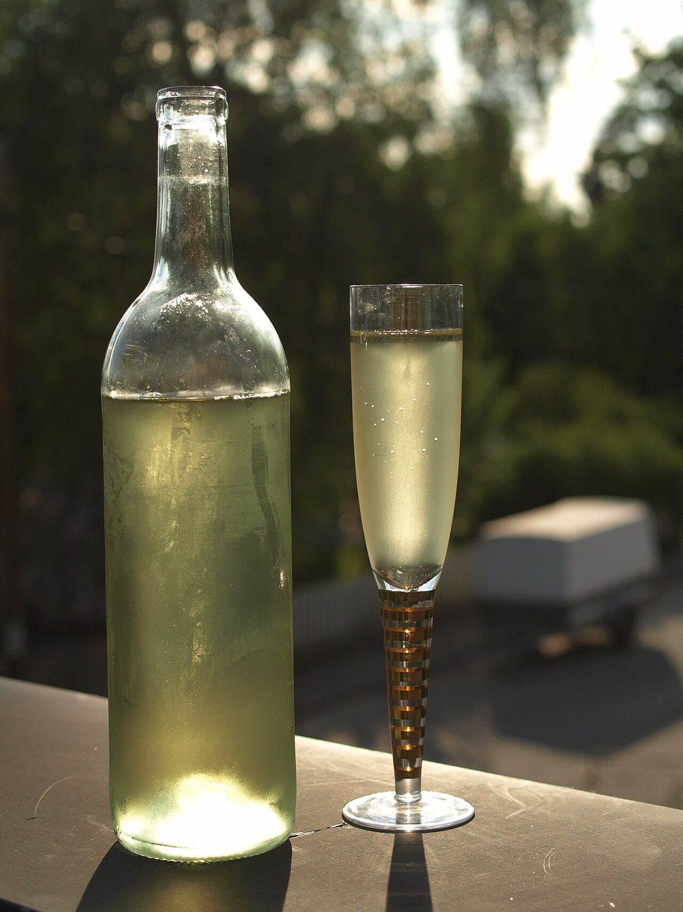

# Cyser

Cyser is a mead fermented together from honey and apple juice, sitting between mead and cider. Apple supplies acidity and fruit aroma, honey supplies sugar and floral notes, and finished versions range from dry to sweet and still to sparkling.

Figure: Cyser: Swedish Mead (Wikimedia Commons). Image: Grapetonix, CC BY 3.0, via Wikimedia Commons ([source page](https://commons.wikimedia.org/wiki/File:Swedish_Mead.JPG)).

## Definition and boundaries

In mead classification, a mead fermented with fruit is called a melomel; cyser is the melomel built around apples. It generally uses unfermented apple juice (cider must), though must from table or cider apples works too, and some recipes add other pome fruit such as pears or quince. It sits as a branch of mead (ref:honey-wine) while sharing apple material and an acid backbone with cider (ref:cider); the ratio between the two determines which end of the spectrum the finished drink leans toward.

To tell whether a product belongs to cyser, look at the sugar sources: honey and apple juice fermented together place it in this category. When honey is a minor proportion and the base is apple fermentation, competition and trade classification treat it closer to a specialty cider. A spiced apple-honey drink falls into fruit-and-spice mead, and one with non-pome fruit belongs to other fruit mead rather than plain cyser. The declared honey source, apple variety, sweetness and carbonation level are the key details for separating product directions.

## History and naming

Honey is among the oldest sweeteners of Europe and West Asia, while the apple was domesticated in Central Asia and spread along trade routes to the Mediterranean and northern Europe. Fermented drinks combining the two appear in regional village traditions in several places. Apple juice alone is not especially sugary and usually produces only a low-alcohol drink; before refined sugar was widespread, adding honey to raise alcohol strength and keeping power was a natural choice, and mixed drinks like cyser formed under that material constraint.

The English word cyser shares its root with cider, tracing back to medieval Latin sīcera, itself linked to a Hebrew term for strong drink. This is an etymological relation, not a documented single inventor. Before the modern era, honey was fermented with apples and berries in parts of northern England, Normandy and Scandinavia. After the twelfth century, sugar gradually replaced honey as the main sweetener in Europe, and everyday mead drinking contracted; cyser survived mainly in home brewing and festive settings. When craft mead makers revived the category in modern times, they brought cider methods and flavours back with it.

## Materials and process

Honey (ref:honey) supplies sugar, fermentation substrate and floral character; apple (ref:apple) juice contributes natural acidity, fruit aroma, some nutrients and tannin, with darker apples adding perceptible astringency and colour. The traditional method ferments honey straight into apple juice without extra water; modern recipes may also ferment a mead and a cider separately and blend them by proportion. Honey varietal, such as clover, orange blossom or chestnut, brings different florals and colour, while apple variety sets freshness, acidity and tannic strength.

Fermentation (ref:fermentation) needs controlled temperature and nutrient management. Apple juice carries pectin and haze that affect clarity, so producers rely on settling, racking or filtration. Yeast is usually a cultured wine or mead strain, and the final sweetness is set by stopping fermentation or leaving residual sugar. Apple aroma softens with bottle age; strong examples can develop a layered note approaching apple brandy, while dry versions read like a crisp white wine. Tannin makes a sweeter mead taste drier than it measures.

## Style and palate

Cysers range across dry, semi-sweet and sweet, with carbonation from still to sparkling; body moves from medium-light to full as sweetness and strength rise. Compared with most meads, its acidity is more marked, and apple acid must balance honey sweetness; a common structure picks up apple freshness first and honey sweetness on the finish. Aroma can be delicate and white-wine floral, like fresh sweet cider, or, in aged strong versions, close to mature apple brandy.

Alcohol strength falls into tiers: session hydromel is about 3.5–7.5%, standard mead about 7.5–14.0%, and sack-strength strong mead up to 14.0–18.0%. Low-alcohol fresh examples suit meals or casual drinking, standard versions are the most common, and strong versions show noticeable alcohol with spice and dried-fruit notes. Apple tannin, honey concentration and residual sugar together determine body; rough products may cloy with residual sugar, show abrupt acidity, or carry yeast and sulphur faults, which come from fermentation and clarification rather than the style itself.

## Representative regions and brands

Modern cyser is made mainly by craft meaderies and cideries, centred on the craft brewing circles of North America, Europe and New Zealand; there is no unified legal appellation. Competition guidelines list representative products including Brothers Drake Pollinator, Redstone Apple Nectar, Schramm's Mead Apple Reserve, White Winter Cyser and Williamson Idunn. These names indicate directions on the market rather than an official classification.

Producers differ most in honey-to-apple ratio, apple variety, sweetness level and whether the drink is sparkling. An entry point can be a standard-strength still dry or semi-sweet example to learn the skeleton; strong and sparkling releases suit comparing different fermentation and blending ideas. One brewery may also make dry, sweet and spiced versions at once, so filtering by labelled sweetness, carbonation and ABV works better than memorising brand names.

## How to drink and pair

Serving temperature follows sweetness: dry and semi-sweet bottles are chilled toward white-wine temperature to bring out apple acidity and freshness, while sweet and strong versions are enjoyed at a cooler room temperature so honey and dried-fruit aromas open. Sparkling versions work as aperitifs or between-course drinks; still dry examples suit the table. A white-wine glass or medium-bowl universal glass is enough; no specialist spirit glass is required.

Pairing follows the apple-and-honey sweet-acid structure. Dry cyser matches roast pork, poultry, sausages and soft cheese, with apple acid cutting through fat; semi-sweet and sweet versions go with fruit tart, honey cake, nuts and blue cheese, where honey sweetness echoes the dessert. Spiced versions suit winter stews and dried-fruit sweets; spicy food amplifies both acidity and alcohol, so a softer, low-alcohol fruity example is the safer pick.

## Buying, storage and misreadings

On the label, first separate whether the product leans mead or cider: high honey proportion with floral honey sweetness is the cyser direction, while high apple juice with a cider-like body is closer to a specialty cider. Then read sweetness, carbonation, ABV and the declared apple or honey varietal; competition entry rules require these parameters to be stated, and consumers can compare bottles along the same information.

For storage, low-alcohol and sparkling versions are freshness-first: keep away from light and heat, finish an opened bottle promptly. High-sugar, high-ABV strong examples keep longer, though opened aroma still declines over time. Unopened cyser belongs in a cool, steady environment; it does not need the long lying-down ageing of wine. A common misreading treats every honey-and-apple mixed drink as one style; differences in sweetness, carbonation, strength and apple tannin matter far more than the loose description "honey and apple".

## Further reading and see also

A good introduction starts with a standard-strength still semi-sweet example, then compares a dry and a sparkling version, and finishes with a strong aged release. Across those three tiers, the separate contributions of honey, apple and fermentation ageing become clear.

- Related: [honey-wine](ref:honey-wine), [cider](ref:cider), [honey](ref:honey), [apple](ref:apple), [fermentation](ref:fermentation).
