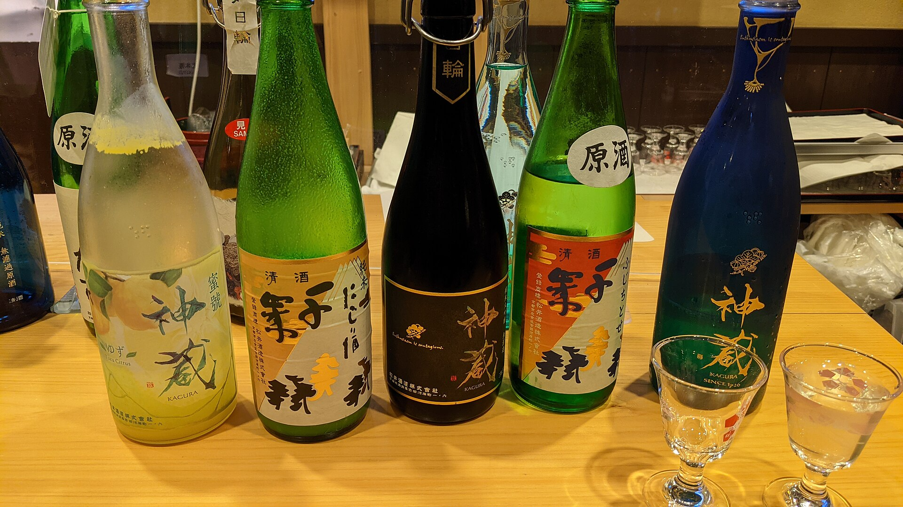

# Daiginjo sake

Daiginjo is the sake made from rice milled to half its weight or less. The law sets only two conditions: a polishing ratio of 50% or below and ginjo fermentation; brewing alcohol may be added up to 10% of the polished rice weight, and the version without it is junmai daiginjo. Below 50%, however, runs a steep cost curve, where every step fights broken grains, off-flavours and lost yield.

Figure: Related photograph of Daiginjo sake. Image: Nisiguti, CC BY-SA 4.0, via Wikimedia Commons ([source page](https://commons.wikimedia.org/wiki/File:Matsui_Sake_Brewery%27s_Sake_20211122.jpg)).

## The distance between 60% and 50%

On paper, daiginjo is only ten points away from ginjo. In the brewhouse it is another world. At half polish the starchy centre is almost exposed, the grain is small and weak, and a few seconds of steeping can overshoot the water target. Steaming must avoid a mushy outside and a hard core, so breweries set separate steeping times and steam pressure for highly polished rice.

The ten points also cut the yield. A tonne of brown rice gives more finished sake at ginjo level than at daiginjo level, where more raw material and milling hours go into each bottle. That, not the word "premium", is where the price gap begins.

## Two names, one boundary

Daiginjo may contain brewing alcohol; junmai daiginjo may not. In every other respect the polishing ceiling and process requirements are identical. Labels usually print the ratio as well, for example "junmai daiginjo 45%", so the name and the number should be read together.

It also helps to remember that daiginjo is not the highest legal rank in sake. It sits alongside ginjo, junmai ginjo and junmai daiginjo, with the four boundaries drawn by polishing ratio and alcohol addition crossed against each other. Calling daiginjo "the top tier" turns a set of categories into a ranking.

## The physical limit of milling

Milling is not simply grinding rice smaller. The grain heats and cracks, so rotation speed and humidity must be controlled; below 40% the broken-grain rate rises sharply and usable grains shrink. Rice that can reach 23% or lower usually needs a large, even starchy centre, which is why Yamada Nishiki dominates.

Extreme polishing is no guarantee of pleasure. Rice flavour and umami come from starch and protein in the centre, and the deeper the mill, the less material is left to transform. Breweries compensate with the sake mother, yeast, brewing water and maturation; when they cannot, the sake tastes hollow and thin, with aroma but no core.

## Competition sake: a technical showcase

The National New Sake Appraisal is where high-polishing technique is displayed most openly. Entry sake usually goes to about 35% polishing, uses aromatic yeast and ferments at very low temperature so that ginjo perfume is unmistakable in blind tasting.

Competition sake and commercial sake follow different logic. Competition entries chase aromatic intensity and typicity and are often not meant for room-temperature drinking; commercial daiginjo must survive shelf life, shipping and food. Judging everyday bottles by competition-winning style often leads to purchases that are over-aromatic and thin.

## Aroma concentration and balance

Daiginjo aroma is usually denser than ginjo's, described with apple, white peach, pear, banana and white flowers. Intensity is not quality. When the aroma is overblown, alcohol becomes more obvious, rice flavour is buried and the finish shortens.

A good daiginjo shows three things: a clear but not sharp aroma, a transparent texture on entry, and a finish that returns to rice. All three come from fermentation management rather than polishing alone. Warmth opens the fruit but also the alcohol, so 10 to 13°C is a safe range.

## Rice is not only Yamada Nishiki

Yamada Nishiki has a large centre and stable water uptake, making it the workhorse of high polishing. Gohyakumangoku has smaller grains and less centre, harder to polish deeply but capable of crisp acidity; Miyama Nishiki is cold-tolerant and common in the north-east; Omachi is large and clearly centred, giving a fuller style; old varieties such as Aiyama and Jinko have returned in highly polished products.

At the same polishing ratio, rice variety changes aroma type and body weight. When buying, read rice, yeast and sake mother together rather than staring at the number.

## Pasteurisation, maturation and freshness

Most daiginjo aims at fresh fruit and is pasteurised once or twice before bottling to stabilise it. Namazake and namazume skip heating, giving livelier aroma but demanding a cold chain; aged sake (koshu) takes the opposite road, turning fruit into dried fruit, honey and spice over time.

Daiginjo does not reward long keeping. Even unopened, the fruit fades within a year, and an opened bottle oxidises faster. Bottling date and storage conditions matter more than the hope of "ageing".

## Price and volume

Highly polished sake means low yields and long hours, so prices are often several times those of ordinary ginjo. The gap comes from yield, milling time, rice grade and maturation cost rather than brand markup alone. Expensive is not the same as suited to your palate, and cheap is not the same as coarse; spend on the category you actually drink.

## Serving

Use a tulip glass or a small wine glass at 10 to 13°C. Smell the still aroma, then swirl; on the palate check sweetness, acidity, umami and the cleanliness of the finish. Pair with white fish, shellfish, steamed seafood, sushi and light starters; heavy sauces, charcoal and strong chilli drown the delicate perfume.

Keep an opened bottle cold and finish it within weeks. Unpasteurised sake needs a stricter cold chain. Excessive drinking is harmful to health, and minors should not drink.

## Common misconceptions

- Daiginjo is junmai daiginjo: the first may contain brewing alcohol within the legal cap.
- The lowest polishing ratio is best: deep milling can thin the rice flavour, and balance matters more.
- Daiginjo improves with age: most is built for fresh fruit and declines in the bottle.
- Stronger aroma is better: over-intensity often brings alcohol burn and off-notes.
- Daiginjo must use Yamada Nishiki: Gohyakumangoku, Miyama Nishiki and Omachi can also reach high polish.
- Daiginjo ranks above ginjo: they are parallel categories divided by the polishing ceiling.

Daiginjo sake is best approached through the production rule, then the strength, and then the usual serving. One check alone will not settle it.

Put [Sake](ref:sake)'s legal definition next to [Fermentation](ref:fermentation)'s materials and process; the difference marks the boundary.

**Key facts.**

| Item | Detail |
| --- | --- |
| In one line | A named sake category with a polishing ratio of 50% or less and ginjo fermentation; brewing alcohol may be added within the legal cap, and the no-alcohol version is junmai daiginjo. High polishing concentrates aroma but … |
| Parent style | Sake |
| Aroma family | floral and fruity |

## Further reading

- [Sake](ref:sake): the category system and brewing framework.
- [Polishing ratio](ref:polishing-ratio): the 50% line and what yield means.
- [Fermentation](ref:fermentation): cool, long fermentation and ginjo aroma.
- [Rice](ref:rice): sake rice varieties and high polishing.
- [Japan](ref:japan): the regional and national background.
