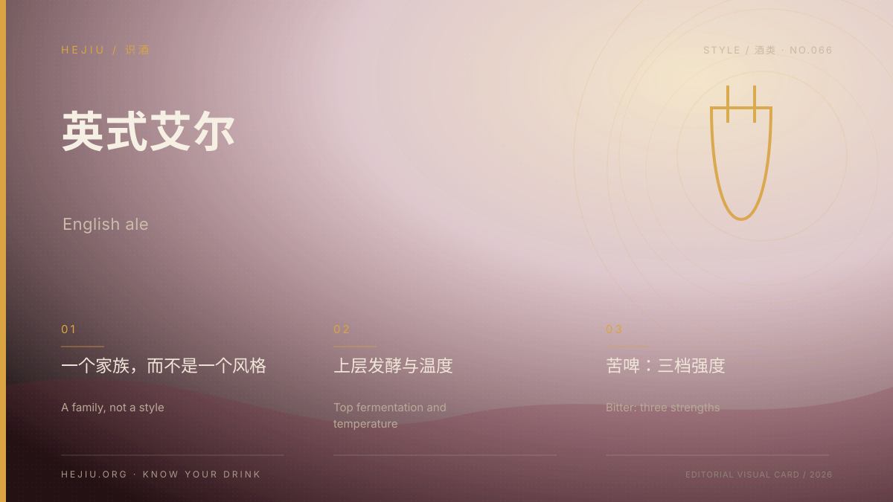
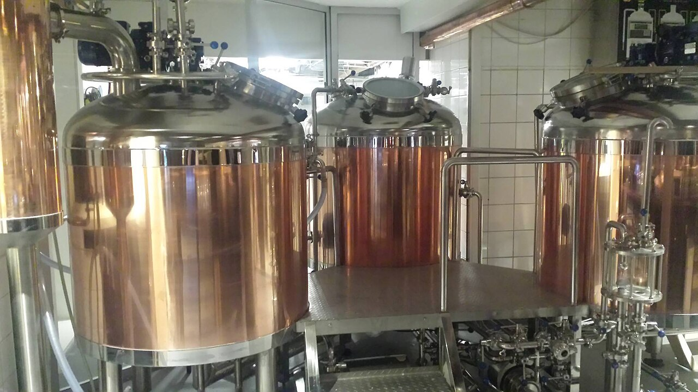

# English ale

English ale is a family, not a single beer. The bitter of everyday pub life, the paler pale ale, the historical English IPA, and the dark porter and stout families all sit under the name. They share top fermentation, a malt backbone, hops used for balance, and a pursuit of drinkability rather than extreme strength, while differing in colour, bitterness, strength and dispense.

Figure: thematic illustration for English ale. Image: AI-assisted illustration generated with Doubao Seedream 5.0 (project-owned); not a photograph of the subject.

## A family, not a style

Ale originally meant a fermented drink not heavily bittered with hops and later came to mean top-fermented beer. Its difference from lager lies in yeast and temperature, not quality. Treating ale as a superior kind of beer mistakes a process category for a quality order; treating English ale as one kind of bitter shrinks a family into a single beer.

What holds English ale together is history and market context rather than one recipe. Pub culture made small-batch, locally supplied, cask-served beer a tradition; transport and taxation after industrialisation shaped the strength of bitter, porter and IPA. English ale is best read as a family of styles plus a serving system, not as a word with one definition.

## Top fermentation and temperature

Ale uses brewer's yeast in a warmer environment, commonly around 18–22°C. The yeast works near the top of the fermenting liquid, fermentation is faster, and the esters produced bring apple, pear, banana or floral notes. [Fermentation](ref:fermentation) temperature strongly shapes aroma: a warmer run gives more esters and may bring solvent and fusel notes; a cooler run narrows the aroma and slows fermentation.

Top fermentation does not mean crude. Modern breweries use precise temperature control, yeast management and hygiene, they simply choose a different yeast and temperature range. Tradition and modern practice are not opposites; what matters is whether the process goal is executed well. English ale yeast often brings light fruitiness and low diacetyl, which are part of the style rather than faults.

## Bitter: three strengths

Bitter is the everyday English pub ale, ranging from copper to amber, with clear hop bitterness that does not overwhelm the malt. It is not a legal category or a bitterness grade but a habitual name. BJCP 2021 divides British bitter into three: Ordinary Bitter at 3.2%–3.8% ABV, Best Bitter at 3.8%–4.6%, and Strong Bitter at 4.6%–6.2%.

The difference is mainly strength and body, not simply "more bitter is better". Ordinary pursues easy drinking at low strength, Best is the pub workhorse, and Strong is fuller with more malt and ester. Bitters from different breweries vary widely in bitterness, colour and aroma. Read the label for strength, colour description and hop varieties rather than relying on the word bitter.

## Pale ale and English IPA

Pale ale is lighter in colour with a clearer malt sweetness, and hop aroma can run from herbal and floral to citrus. It has overlapped historically with bitter and is not a strict legal category. English IPA is the stronger, drier, more hop-forward branch of pale ale, with BJCP 2021 giving a strength range of 5%–7.5%.

IPA grew out of 18th and 19th century British demand for beer exported to India. To survive the voyage, hopping rates and alcohol were raised, producing a hop-forward, bitter style. Burton upon Trent was an important centre, and its sulphate-rich water accentuates hop bitterness. Modern IPA has split into English, American and many other variants. English IPA usually gives more weight to the malt backbone and herbal hops with restrained bitterness, while American IPA pushes citrus, pine and tropical fruit.

## Porter and stout

Porter became popular in London in the early 18th century, using dark and brown malts for roast, coffee and chocolate flavours with a medium-full body; BJCP 2021 gives English porter a strength range of 4%–5.4%. Stout began as stout porter, a stronger version of porter, and later became a style in its own right, with Irish Guinness as its best-known example.

Stout and porter are not opposites. They share a dark malt base and differ in strength, sweetness and roast level. Treating stout as a catch-all for black beer hides its internal variety, and treating porter as a weak stout is equally inaccurate. English porter is usually softer and more caramelly than American porter, with less hop presence; stout ranges from sweet stout and oatmeal stout to imperial stout.

## Cask real ale

Real ale is beer that undergoes a secondary fermentation in the container, contains live yeast, is not filtered or pasteurised, and is served by gravity or hand pump. The container is usually a cask of wood or metal. CAMRA promoted the term in the early 1970s to distinguish it from artificially carbonated keg beer, and CAMRA was founded in 1971 to protect traditional cask beer and pub culture.

Real ale describes a method of conditioning and serving, not a style name. The same bitter can be cask real ale, or bottled and canned. Cask real ale relies on continuing yeast fermentation to build a natural blanket of carbon dioxide; serving temperature is usually 11–13°C, which releases malt and hop layers better than deep chilling. Once the cask is open and exposed to air, shelf life is short and cellar and line management matter.

## Key parameters

- Fermentation: top fermentation, commonly 18–22°C.
- Bitter: Ordinary 3.2%–3.8%, Best 3.8%–4.6%, Strong 4.6%–6.2%.
- English IPA: 5%–7.5%.
- English porter: 4%–5.4%.
- Real ale serving temperature: 11–13°C, with live yeast and no extraneous carbon dioxide.
- CAMRA founded: 1971.

These figures come from style guidelines and published industry material. They describe style ranges and serving conventions, not scores. Strength, bitterness and colour cannot each stand for quality.

## Tasting and food

Start with colour and foam, then smell the biscuit, caramel or roast of the malt and the herbal, floral or citrus of the hops. On the palate, watch the balance of bitterness and malt sweetness, the body and the carbonation, then whether the finish is clean and whether bitterness lingers. Too cold suppresses aroma; too warm lets alcohol and esters run loose.

With food, bitter suits fish and chips, grills and hard cheese; pale ale suits chicken, salad and seafood; English IPA suits curry, spicy dishes and strong cheese; porter and stout suit chocolate, roast meat and oysters. Excessive drinking is harmful to health, and minors should not drink.

## Common misconceptions

First, treating ale as one style. It is a broad top-fermented family. Second, treating bitter as a bitterness grade. It is a habitual British pub name. Third, assuming stout is just porter. The two differ in strength, sweetness and recipe. Fourth, assuming IPA belongs only to Britain. It has diversified in the United States and worldwide. Fifth, treating real ale as a style. It describes fermentation, filtration and serving. Sixth, assuming cask beer is always better than bottled. Cask wins on freshness and texture, but poor cellaring can make a bottled version more reliable.

**Short definition:** An umbrella term for traditional British top-fermented beers, covering bitter, pale ale, English IPA, porter and stout, with an emphasis on malt-hop balance, lower carbonation and cask real ale serving.

## Further reading

- [Beer](ref:beer): the overall classification and process framework for beer.
- [United Kingdom](ref:uk): the home region and pub culture behind English ale.
- [Craft beer](ref:craft-beer): the American craft movement set against the British tradition.
- [Fermentation](ref:fermentation): top fermentation and how temperature shapes aroma.
- [Barley](ref:barley): the malt base of English ale body.

## Related images

Image: Craft beer. Credit: Bernt Rostad, CC BY 2.0, via Wikimedia Commons ([source page](https://commons.wikimedia.org/wiki/File:Zachariasbryggen_Microbrewery.jpg)). Related image for English ale.
