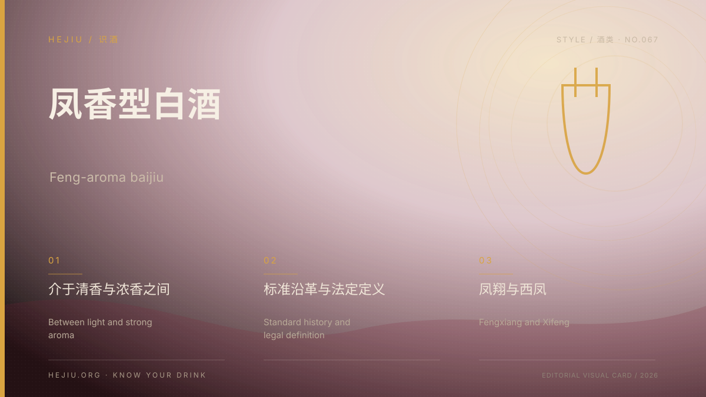
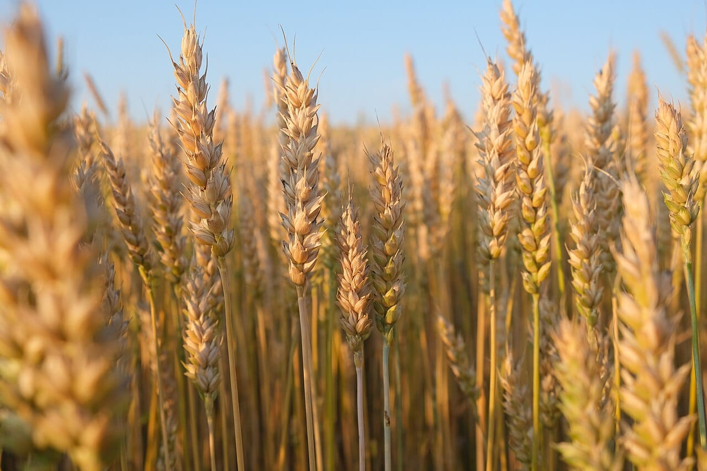

# Feng-aroma baijiu

Feng-aroma is often placed between light aroma and strong aroma: it has the cleanliness of light aroma and the pit character of strong aroma without belonging to either. That middle position is not blended; it comes from a very specific process - sorghum, barley, peas and wheat, daqu, loess mud pits, mixed steaming and distillation, and jiuhai storage. Take those elements apart and the boundary becomes clear.

Figure: thematic illustration for Feng-aroma baijiu. Image: AI-assisted illustration generated with Doubao Seedream 5.0 (project-owned); not a photograph of the subject.

> **Quick verdict**
> **In one line:** This style places Feng-aroma baijiu on the flavour map, and helps you choose and serve it.
>
> - **Best for:** Anyone comparing Feng-aroma baijiu with other styles before buying or ordering.
> - **Not for:** If you want want a single “best” ranking and reject stylistic difference.
> - **Check first:**
>   - The old standard was GB/T 14867-2007.
>   - Feng-aroma uses mixed steaming and distillation: grain and fermented mash are mixed in proportion and steamed and distilled together.

## Between light and strong aroma

Feng-aroma is led by ethyl acetate with ethyl hexanoate in support, so it has both the fruity cleanliness of light aroma and the pit depth of strong aroma. The entry is full, the finish clean, and the aftertaste carries a little woody aged note from jiuhai. It is not "light plus strong" but a composite formed naturally by one fermentation and storage process.

That middle position also makes identification harder. Some treat it as a branch of strong aroma, others as a heavier light aroma. Judge by pit, koji, distillation and storage vessel rather than by aroma intensity: the loess mud pit, mixed steaming and distillation, and jiuhai are the hard markers that separate it from both ends.

## Standard history and legal definition

The old standard was GB/T 14867-2007. The current standard is GB/T 10781.6-2025, Quality requirements for baijiu — Part 6: Fengxiangxing baijiu, published on 1 August 2025, implemented on 1 August 2026 and wholly replacing GB/T 14867-2007. The new standard brings the type into the unified "quality requirements for baijiu" numbering and updates terminology and physical-chemical requirements.

It defines feng-aroma baijiu as baijiu made from sorghum, barley, peas and wheat, with daqu as the saccharifying and fermenting agent, using loess mud pits as fermentation vessels and mixed steaming and distillation, through solid-state fermentation, solid-state distillation, jiuhai and other storage, and blending, without direct or indirect addition of edible alcohol or colour, aroma and flavour substances not produced by its own fermentation. The definition lists materials, koji, pit, distillation and storage in one sentence.

## Fengxiang and Xifeng

The representative region is Fengxiang in Baoji, Shaanxi, with Xifeng as the core producer. Fengxiang lies in the western Guanzhong plain, with a mild climate and distinct seasons suited to sorghum and koji grain, and to the microbiology of loess mud pits. Xifeng is known for jiuhai storage, which together with traditional brewing shapes the regional image of feng-aroma.

Region and brand should be kept apart. Xifeng is the representative brand, but feng-aroma is an aroma category, and other distilleries may produce it under the standard. Equating feng-aroma with Xifeng confuses brand and category; conversely, not every Xifeng product is necessarily feng-aroma, since a company's range may cover different types and grades.

## Materials and medium-high-temperature daqu

Feng-aroma uses sorghum, barley, peas and wheat. Sorghum supplies starch and tannin and forms the backbone; barley and peas support koji making, with pea protein and fat adding koji aroma; wheat adds cohesion and nutrition. The multi-grain mix gives aromatic layers, but ratio and grind remain with the distillery.

The koji is medium-high-temperature daqu. Its culture temperature is higher than low-temperature daqu and lower than high-temperature daqu, enriching moulds and yeasts while retaining some bacterial community. The temperature curve sets enzyme activity and aroma precursors: a hotter curve gives heavier koji aroma, a cooler one stronger saccharifying power. Feng-aroma's "clean but not thin, strong but not showy" character comes largely from this position.

## Loess mud pits

The fermentation vessel is a loess mud pit, built from loess with pit mud on the walls and floor. Acetic-acid and butyric-acid bacteria in the mud produce ethyl hexanoate and related compounds, supplying the strong-aroma side. Compared with the old mud pits of strong aroma, feng-aroma stresses fresh mud and renewal: traditionally the pit mud is replaced every year to avoid over-heavy pit aroma and off-notes from aged mud.

Annual renewal is not hygiene for its own sake but flavour control. Older mud has a more complex community and a denser pit aroma; fresh mud is lighter and lets sorghum and koji aroma show. Feng-aroma wants pit aroma without dominance, so it sacrifices some complexity to keep the pit fresh. This contrasts sharply with strong aroma's pursuit of old pits.

## Jiuhai: a breathing vessel

Jiuhai is the most distinctive storage vessel of feng-aroma. Under the standard definition, it is made from woven willow or wood, bonded with blood-based material, lined with layers of hemp paper and coated on the inner wall with beeswax, then dried for storing spirit. Its inner surface is not glass or stainless steel but a slightly permeable layered lining, so the spirit touches trace air during storage and undergoes slow oxidation and mellowing.

That slight permeability produces "jiuhai aroma": a woody aged note with dried fruit and light spice, a softer entry and less bite. Bigger or older is not automatically better; the condition, cleaning and care of the lining decide whether the vessel still works. Treating jiuhai as a marketing story ignores its real role in flavour formation.

## Mixed steaming, storage and blending

Feng-aroma uses mixed steaming and distillation: grain and fermented mash are mixed in proportion and steamed and distilled together, so grain aroma and mash aroma are released in the steamer at the same time. This differs from the clean steaming and clean distillation of light aroma, which separates grain and mash for cleanliness, and resembles the continuous mixed steaming of strong aroma, though the pit and koji pull feng-aroma away again.

New spirit is stored in jiuhai or clay jars so sulphides escape, the body softens and jiuhai aroma enters. Blending combines spirits of different rounds, years and vessels to balance the light and strong sides rather than pushing one to the fore. Blending is a skill, not "mixing"; the standard allows water to reduce strength but not edible alcohol or external flavouring.

## Key parameters

- Current standard: GB/T 10781.6-2025, implemented on 1 August 2026.
- Materials: sorghum, barley, peas and wheat.
- Koji: daqu.
- Fermentation vessel: loess mud pit.
- Process: mixed steaming and distillation, solid-state fermentation, solid-state distillation, jiuhai storage, blending.
- Strength: 25.0%–68.0% ABV.

These parameters come from the national standard and describe category boundaries. Strength, pit age and vessel size cannot each stand for quality; harmonious aroma, a full body and a clean finish are the real tests.

## Boundaries with light and strong aroma

The difference from light aroma lies in koji, pit and distillation. Light aroma uses low-temperature daqu, earthen jars and clean steaming and distillation, with ethyl acetate dominant and a clean, crisp profile; feng-aroma uses medium-high-temperature daqu, loess mud pits and mixed steaming and distillation, with ethyl acetate dominant but ethyl hexanoate in support, a fuller aroma and notes of pit and jiuhai. The difference from strong aroma lies in pit and ester ratio. Strong aroma uses old mud pits and medium-high-temperature daqu, with ethyl hexanoate dominant and dense pit aroma; feng-aroma renews its mud, keeps pit aroma lighter, retains ethyl acetate as the lead and adds jiuhai as another layer.

The difference from sauce aroma is clearer: sauce aroma uses high-temperature daqu, stone-walled pits with mud floors and multiple rounds, with sauce and scorch throughout; feng-aroma has no high-temperature multi-round sauce character and centres on the balance between light and strong. Treating feng-aroma as "Shaanxi strong aroma" ignores the difference made by jiuhai and mixed steaming.

## Common misconceptions

First, that feng-aroma is a blend of light and strong spirits. It is a composite formed by one process. Second, that older pits are always better. Feng-aroma values mud renewal, and the freshness of new mud is part of the style. Third, that jiuhai is an ordinary wooden barrel. It has a specific layered lining and waxed inner wall whose slight permeability shapes flavour. Fourth, that feng-aroma equals Xifeng. Brand and aroma category are not the same. Fifth, that mixed steaming simply means steaming everything together. The ratio of grain to mash, the steam and the cut all shape the result. Sixth, that heavier jiuhai aroma is better. Too much wood note hides grain and fruit.

## Further reading

- [Baijiu](ref:baijiu): the overall classification and process framework.
- [Sorghum](ref:sorghum) and [wheat](ref:wheat): the main material and koji material.
- [Koji making](ref:qu-making): culturing medium-high-temperature daqu.
- [Fermentation](ref:fermentation): loess mud pits and pit-mud microbiology.
- [Distillation](ref:distillation): mixed steaming and distillation and the cut.

## Related images

Image: Wheat. Credit: kallerna, CC BY-SA 4.0, via Wikimedia Commons ([source page](https://commons.wikimedia.org/wiki/File:Vehn%C3%A4pelto_6.jpg)). Related image for Feng-aroma baijiu.
