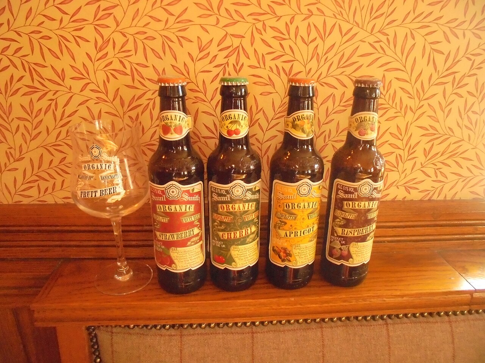

# Fruit Beer

Fruit beer is the broad family of beers whose flavour is shaped by fruit or fruit juice, spanning Belgian fruit lambics, German wheat-beer mixes, Anglo-American fruit ales and fruited sour beers. Fruit may be added at mashing, the boil, primary fermentation, secondary fermentation or before bottling, and the range runs from low-alcohol refreshing mixes to complex aged lambics.

Figure: Fruit Beer: Samuel Smith's Organic Fruit Beer glass and bottles, lounge, Railway Inn, Spofforth, North Yorkshire (4th May 2019) (Wikimedia Commons). Image: Mtaylor848, CC BY-SA 4.0, via Wikimedia Commons ([source page](https://commons.wikimedia.org/wiki/File:Samuel_Smith%27s_Organic_Fruit_Beer_glass_and_bottles,_lounge,_Railway_Inn,_Spofforth,_North_Yorkshire_(4th_May_2019).jpg)).

## Definition and boundaries

Fruit beer is not a single recipe but a group of beers in which fruit is the principal flavour source. Beer judging guidelines place beers that keep a base style and add fruit under the Fruit Beer category, while Belgian spontaneous-fermented products with fruit have their own Fruit Lambic category. In both, the fruit aroma, acidity or tannin must integrate with the beer base rather than overwhelm it.

Whether a drink belongs to fruit beer is decided by the ingredient list and the process, not by bottle colour or the word "fruit" on the label. The fruit may be whole fruit, purée, juice, concentrate or a natural extract, and the timing of addition changes how sugar, acidity and tannin enter the liquid. Drinks that are mostly juice or soda with little beer, and fruit sodas with no malt fermentation, sit outside the category. In most countries "fruit beer" is not a legally protected name; the fruit species, juice content and alcohol strength on the label are what show where a bottle sits.

## History and naming

The Belgian fruit lambic is one of the oldest fruited beer traditions. Around the Pajottenland west of Brussels, whole sour cherries (traditionally Schaarbeek cherries, with the pits) or raspberries are added to aged lambic and finish a second fermentation in oak, giving the kriek and framboise styles. The almond-pit note from the kernels layers over the lambic's acidity and funk, and that combination is the signature of the tradition.

The German fruit tradition developed along a different path. After the war, Germany matured a Biermischgetränk (beer mix) habit of blending wheat beer with juice-flavoured drinks at low strength. Schöfferhofer Grapefruit is a representative example: a blend of 50% wheat beer and 50% grapefruit-flavoured drink at 2.5% ABV. Since the later twentieth century, American craft brewing has carried watermelon, blood orange, passion fruit, cherry and guava into ales, stouts, goses and mixed-fermentation sours.

## Materials and process

Traditional lambics favour tart fruit. Sour cherries, raspberries and Muscat grapes are high in acidity and defined tannin; they add an acidic fruiting dimension rather than sweeten the beer. Modern products use peach, apricot, plum, Merlot grapes, watermelon and a range of berries. Skin, flesh and pits contribute different aromas, and kernel fruits carry a light almond-pit bitterness. Fruit sugar continues to be consumed by yeast, so traditional finished products are often dry and lighter-bodied than the base; residual sweetness comes either from unfinished sugar or later sweetening.

Parameters vary widely by base. For a fruit lambic, guideline ranges are ABV 5–7%, IBU 0–10, OG 1.040–1.060 and FG 1.000–1.010, with colour varying by fruit. Traditional products use roughly 10–30% fruit relative to the beer, around 25% for cherry versions. Fruit ales and fruit stouts follow their own base-style gravity, bitterness and colour ranges. Juice sugar can still trigger a second fermentation after bottling, so in-bottle pressure must be controlled; this is why some fruited beers carry a small risk of spraying when opened.

## Style and palate

In a balanced fruit beer, the fruit is recognisable, yet the drink still reads as beer: the malt, yeast or acid-microbe base is not buried under fruit character. Fruit often lightens the body and dries the finish; small dark berries can add tannic depth and a touch of astringency, though that roughness should not overpower the base. Colour comes from fruit and ageing together. Fruit lambic fades in fruit colour as it ages, while carbonation, acidity and malt sweetness are set by the base and the barrel microbiota.

In judging quality, the fruit should read close to fresh cherry, raspberry, watermelon or citrus rather than artificial flavouring. Syrupy mouthfeel, cardboard oxidation or solvent notes usually point to ingredient grade, hygiene or storage problems rather than the style itself.

## Representative regions and brands

The Belgian traditional camp includes 3 Fonteinen Schaerbeekse Kriek, Cantillon Fou' Foune (apricot), Cantillon Lou Pepe Framboise, Hanssens Oude Kriek and Boon Oude Kriek; Lindemans Framboise is a common entry point to the sweeter mass-market raspberry lambic. The German mix camp is led by Schöfferhofer Grapefruit, while Samuel Smith's Organic Fruit Beer from Britain follows a separate organic fruit-ale route.

The American craft camp spans a wide range: 21st Amendment Hell or High Watermelon, Anderson Valley Blood Orange Gose, Avery Liliko'i Kepolo, Ballast Point Grapefruit Sculpin, Bell's Cherry Stout and Founders Rübæus. Recipe differences between brands are often larger than the differences between style names: some stick to whole-fermented fruit with a dry finish, others use juice or extracts at higher sweetness. Reading the label's ingredients, ABV and residual sugar tells you more than a vague idea of a typical fruit beer.

## How to drink and pair

Light, refreshing fruit wheat beers and fruit ales are best served chilled at 4–8°C in a medium-bowl or tapered tulip glass that gathers the aroma. Complex, acidic fruit lambics can be left at 8–12°C; serving them too cold closes off the sour and oxidative layers. German-style mixes are usually drunk straight from the bottle or can, with no specialist glass required.

For food, light fruit wheats match salads, steamed seafood and soft cheeses; fruited sours suit cured meats, ham, blue cheese and sweet-sour pork dishes; fruit stouts or sweeter beers go with fruit desserts and dark chocolate. Bright, acidic versions also work in beer iced teas or sangria-style punches.

## Buying, storage and misreadings

Common misreadings include treating colour depth as sweetness; assuming "fruity" means low alcohol or healthier; expecting every fruit beer to be sweet; and mistaking an artificial-flavoured product for a traditional whole-fermented beer. In fact colour comes mainly from fruit variety and malt, sweetness depends on residual sugar, and alcohol strength follows the back label. When buying, read the back label first: where fruit or juice sits in the ingredient list, how much juice is declared, and who produced it and where. Large lettering on the front is usually brand marketing.

For storage, most fruit beer is meant to be drunk young, kept away from light and heat and standing upright. Bottled fruit lambic can continue to age under suitable conditions, developing more complex oxidative and funky notes. Once opened, beer loses carbonation and aroma quickly; high-acid, low-strength bottles do not keep, so finish them the same day. A higher price does not mean a more typical style; the premium may come from brand, ageing or packaging rather than the process itself.

## Further reading and see also

Styles close to fruit beer usually share ingredients or process rather than aroma: [lambic](ref:lambic) represents the spontaneous-fermentation sour tradition, [beer](ref:beer) is the base framework for all fruited products, [grape](ref:ingredient) appears directly in some fruit beers and grape ales, [fermentation](ref:fermentation) decides where the fruit sugar and acidity go, and [belgium](ref:belgium) is the background of the traditional fruit lambic. To learn a style, start with the standard benchmark, then a variant that changes an ingredient or process, then an extreme example; the boundary becomes clearer than from definitions alone.

- Related: [beer](ref:beer), [lambic](ref:lambic), [fermentation](ref:fermentation), [grape](ref:ingredient), [belgium](ref:belgium).
