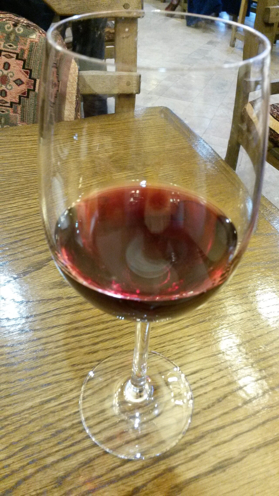

# Fruit wine

Fruit wine is an alcoholic drink made by fermenting fruit juice or fruit extract with yeast. It is usually lower in alcohol than a distilled spirit, and its flavour depends on the fruit variety, ripeness, fermentation and residual sugar. Cider, perry, cherry wine and blueberry wine belong here; Chinese industry standards also set requirements for fruit-wine ingredients and basic process.

Figure: Fruit wine. Image: Chaojoker, CC BY-SA 3.0, via Wikimedia Commons ([source page](https://commons.wikimedia.org/wiki/File:%D5%86%D5%BC%D5%A1%D5%B6_%D5%A3%D5%AB%D5%B6%D5%AB.jpg)).

## Definition and boundaries

The core of fruit wine is fermentation, not maceration or distillation. That separates it from several neighbouring categories: a spirit base with juice and added sugar is a fruit [liqueur](ref:liqueur); a fermented fruit liquid that is then [distilled](ref:distillation) becomes a fruit brandy, such as cherry or apple brandy, which belongs with [brandy](ref:brandy); and only fermented grape juice is called [wine](ref:wine), while other fermented fruit drinks usually fall under fruit wine.

In beverage-alcohol classification, fruit wine is neither a compounded drink nor a distilled spirit. It may be made from pure juice or from juice adjusted with water before fermentation, and the permitted range depends on the standard and the label. To tell which category a bottle belongs to, read the ingredient list, the process description and the strength rather than the fruit picture on the packaging.

## Raw materials and fermentation

Fruit wine uses fruit, water, sugar where needed, yeast and permitted additives. Apple, pear, cherry, blueberry, strawberry, kiwi, lychee and green plum can all be fermented. The fruit's acidity, sugar content, aromatic compounds and pectin level steer the fermentation: acidic fruit needs adjusted conditions, low-sugar fruit may need chaptalisation, and high-pectin fruit raises the risk of methanol formation.

Yeast turns sugar into alcohol and carbon dioxide. A cool fermentation retains more aroma and proceeds more slowly; a warm one is faster but may lose delicate aromas and produce more higher alcohols. Whether malolactic fermentation happens noticeably changes the acidity: malic acid converted to lactic acid tastes softer and creamier. For red fruit wines, fermenting on the skins also determines colour and tannin extraction.

## Main categories

- **Cider**: fermented apple juice, usually 4%–8% ABV; Britain, France and Spain all have mature traditions, with styles from dry to sweet.
- **Perry**: fermented pear juice, made much like cider, but the aroma is lighter and some pear varieties bring a distinct floral note.
- **Berry wines**: fermented blueberry, strawberry or raspberry, dark in colour, usually high in acidity and often left with some residual sugar to balance it.
- **Stone-fruit wines**: fermented cherry, plum or apricot; cherry wine may show almond-like stone-fruit notes from trace compounds in the kernel.
- **Other fruit wines**: regional products from lychee, green plum or kiwi, whose flavour depends even more on variety and origin.

What these categories share is fermentation; what separates them is the chemistry of the raw material and the process choices. Calling them all "fruit wine" is a classification convenience, not a claim that their flavours are interchangeable.

## Sweetness and style

Fruit wine can be dry, off-dry, semi-sweet or sweet. Sweetness comes from residual sugar or from sugar or concentrated juice added after fermentation, and the two are described differently on labels. Dry cider emphasises freshness and acidity, while sweet fruit wine is closer to a low-alcohol drink, suited to sipping or serving over ice.

Style is also shaped by carbonation. Still fruit wine feels flat on the palate, while sparkling fruit wine is lighter and lifts the aroma on the bubbles. Ageing and oak treatment change texture too: barrel ageing adds vanilla and toast but can cover the fruit detail. Before buying, decide whether you want clear fruit expression or structural complexity, then choose the category.

## Production

The public process is: select and wash the fruit, crush or press for juice, adjust sugar and acidity, add yeast and ferment, separate the liquid, carry out malolactic fermentation where intended, clarify, stabilise, filter and bottle. For sparkling fruit wine, carbon dioxide is retained in a closed vessel or a second fermentation is used.

Quality control has three key points: raw-material hygiene, to avoid off-flavours from mouldy fruit; fermentation temperature, which decides how much aroma is retained; and methanol control, which matters more with high-pectin raw materials. Commercial production keeps methanol within legal limits through process design and testing. Home fermentation lacks those testing conditions, and the risk should not be underestimated.

## Flavour and tasting

Fruit-wine aroma usually falls into three groups: the fruit itself, fermentation aromas, and aromas from ageing or process. Cider commonly shows green apple, pear, citrus and floral notes; berry wines show red berries, jam and spice; cherry wine may bring almond and the sweet aroma typical of cherry spirit. On the palate, judge acidity first, then whether sweetness and alcohol are balanced, then whether the finish is clean.

Temperature matters in tasting. Too cold mutes the aroma, too warm pushes the alcohol forward. Start at 8–12°C and adjust to the style. After pouring, wait a minute or two and watch whether the aroma moves from "fruit-led" to "fermentation-led"; that helps judge complexity and freshness.

## Drinking and pairing

Most fruit wines are served chilled; sweet styles can be served over ice or used in Spritz-style drinks. Dry cider suits pork, cheese and fried food; the acidity of berry wine cuts through fat and suits salads, poultry and mild cheese; sweet fruit wine suits dessert or sipping on its own.

At the table, consider the relationship between sweetness and acidity: a wine sweeter than the dish makes the food taste dull, and a wine more acidic than the dish makes it taste heavy. Refrigerate after opening and finish soon, especially low-alcohol, low-sulphite products, because both oxidation and microbial risk are higher. There is no need for a specialist glass; anything that gathers aroma will do.

## Common misconceptions

First, confusing fruit wine with fruit liqueur. The former is fermented; the latter is a spirit base with sugar.
Second, assuming fruit wine must be sweet. Dry cider and dry berry wines are common; sweetness is a process choice, not a category definition.
Third, believing "the stronger the fruit flavour, the purer". Excessive aroma may come from added flavouring rather than the fruit itself.
Fourth, ignoring methanol risk. High-pectin fruit can produce methanol during fermentation; commercial products test and control it, home fermentation does not.
Fifth, treating "no additives" as a quality guarantee. No additives is not the same as safe; hygiene and testing matter just as much.

Fruit wine is best read by starting with the production rule, moving to the strength, and ending with the usual serving.

[Distillation](ref:distillation)'s legal definition and [Liqueur](ref:liqueur)'s materials and process form a useful pair: the contrast shows where one ends and the other begins.

## Further reading

- [Wine](ref:wine): also fermented, but restricted to grapes.
- [Distillation](ref:distillation): the step that turns fermented fruit wine into fruit brandy.
- [Liqueur](ref:liqueur): the neighbouring category built on a spirit base with sugar and flavouring.
- [Brandy](ref:brandy): the broad family of fruit distillates.
