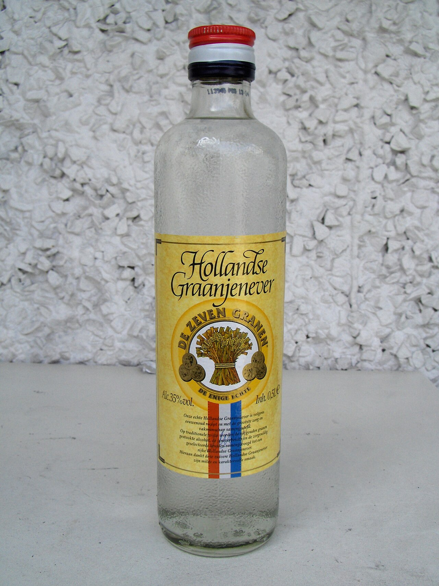

# Genever

Genever, or jenever in Dutch, is a grain spirit flavoured with juniper, made mainly in the Netherlands, Belgium and the northern French departments of Nord and Pas-de-Calais. It shares juniper with English [gin](ref:gin) but takes a different route through its raw material: traditional genever uses malt wine, a spirit distilled from mashed and fermented rye, maize, wheat or barley, then blended with neutral grain alcohol and botanicals including juniper. That malt-wine base is key.

Figure: Genever. Image: Wikimedia Commons contributor, CC BY-SA 3.0, via Wikimedia Commons ([source page](https://commons.wikimedia.org/wiki/File:Hollandse_Graanjenever_0495.JPG)).

## Juniper, malt wine and the word "genever"

The word genever is related to juniper. Early Europeans steeped juniper in alcohol as a medicine and digestive, and Dutch jenever means both the spirit and the plant. The first versions were not trying to be dry; they were sweetish, malty and herbal, closer to "grain spirit with juniper" than to today's London Dry.

[Juniper](ref:juniper) supplies pine, resin and a citrus-like aroma, but genever does not require juniper to dominate. The bread, grain and nutty notes of malt wine are the clearest border with English gin. For that reason, genever is often tasted more like whisky or aged grain spirit than judged by the single question of whether the botanicals are clear.

## From pharmacy to golden age

In the sixteenth century, pharmacists in the Netherlands and Flanders steeped juniper in alcohol to make a digestive and diuretic medicine. In the seventeenth century, Amsterdam distillers developed a commercial version based on malt wine, and genever travelled with Dutch ships and armies to England, becoming the prototype of "Dutch gin" or "Holland gin". English soldiers met it during the Thirty Years' War and brought it home, where it evolved into a drier, cheaper English gin.

The eighteenth century was genever's golden age and the age of its split public image. In Dutch taverns it was an everyday drink; in England, the cheap "gin craze" provoked social panic and legislation, but the target was more often poor English gin than Dutch genever. After the nineteenth century, continuous distillation and more stable conversion made genever lighter and cleaner.

## The ratio of malt wine to neutral spirit

Traditional genever is built on malt wine (moutwijn): grain is mashed, fermented and distilled into a flavourful spirit, then blended with neutral grain alcohol, water and botanicals. The higher the malt-wine share, the heavier the body and the stronger the malt and bread notes; the lower the share, the lighter the style and the closer it comes to vodka or young English gin. Korenwijn (grain wine) is the category with the highest malt-wine share, legally requiring at least 51% malt wine.

[Barley](ref:barley) and other grains supply malt sugar and protein, and fermentation and distillation decide the weight of the malt wine. Botanicals may be steeped before distillation or suspended in the still so that steam passes through them; juniper, coriander, angelica, citrus peel and liquorice are common. Blending and dilution after [distillation](ref:distillation) decide whether malt or botanicals lead.

## Oude and jonge are not ages

Oude (old-style) and jonge (young-style) are recipe styles, not periods of maturation. Oude uses more malt wine, more sugar and a darker colour, with a maltier, sweeter, heavier flavour; jonge uses less malt wine and less sugar, and is lighter, cleaner and closer to modern gin. Both may be clear, and oude is not necessarily older than jonge.

This is the most common misreading. "Oude" on a label does not mean time in oak but a recipe closer to the historical old style; jonge is not "new spirit" but a lighter recipe developed in the twentieth century. There are also subcategories such as graanjenever (grain genever) and korenwijn, which stress the grain base and the malt-wine share; read the category word, not just the colour.

## The geographical indication of 2008

Genièvre/Jenever/Genever received EU geographical indication protection in 2008, covering the Netherlands, Belgium and the northern French departments of Nord and Pas-de-Calais. The GI fixes place and basic raw material, not every producer's recipe; Dutch jonge, Belgian oude and northern French genièvre can therefore share one name while differing widely in style.

The GI also protects sub-names such as jonge and oude from being used as loose marketing terms. When buying, origin, category word and strength are the three key pieces of information; if a label says only "Dutch gin" or "Holland gin" without a category, do not assume it is traditional malt-wine genever.

## The glass, kopstootje and cocktails

The Dutch tradition is to fill a small tulip glass almost to the rim, serve it cold and sip it slowly. Amsterdam bars also favour the kopstootje ("headbutt"): a glass of genever with a glass of beer, the spirit first and the beer as a chaser or rinse. The point is the continuity of malt and grain, not cocktail decoration.

In cocktails, genever can replace gin, but the result is maltier and rounder. It suits stirred drinks in the Martinez family, Collins-style long drinks, and combinations with bitters, citrus and syrup. Compared with [Old Tom gin](ref:old-tom-gin), its sweetness comes from malt wine rather than added sugar; compared with [London Dry](ref:london-dry-gin), juniper is more restrained and grain is more prominent.

## Where genever and English gin part

English gin is built on neutral grain alcohol, with botanical flavour from redistillation or maceration, and usually aims for a dry, clear, juniper-led profile; genever treats malt wine as an essential component and aims for balance between malt, grain and juniper. The two share a name history but followed different technical routes after the nineteenth century.

Treating genever as "London Dry made in the Netherlands" misses its historical layers. It is one of gin's ancestors and also a separate GI category; it can be drunk neat or mixed, but its evaluation should include malt-wine weight, sweetness and grain aroma, not only juniper intensity.

To read Genever, start with the production rule, then the strength, then the usual serving; no single check settles it.

**Short definition:** A grain spirit flavoured with juniper from the Netherlands, Belgium and the northern French border, protected as an EU geographical indication in 2008; oude and jonge describe recipe styles rather than age, and its malt-wine body contrasts sharply with dry English gin.

**Read alongside.** Put Genever next to Gin, London dry gin, Old Tom Gin: the first fixes identity and boundary, the others provide a region, process or peer comparison. Read this style first, then return to those entries; the links become coordinates, not decoration.

**Sources and limits.** The key claims about Genever are checked against the following sources: European Union (the names, member states and jonge/oude sub-names of the Genièvre/Jenever/Genever GI; spirit-drink categories, GI protection and gin-related definitions), Oxford University Press (Consulted for entries on genever history, malt wine and Dutch-Belgian distilling), BJCP (the entry's background, terminology and regulatory context). Prices, batches and status change; the body is project-written and does not reproduce source text.

For Genever, this style was last checked in 2026; prices, batches and availability change, so confirm them against the sources below.
