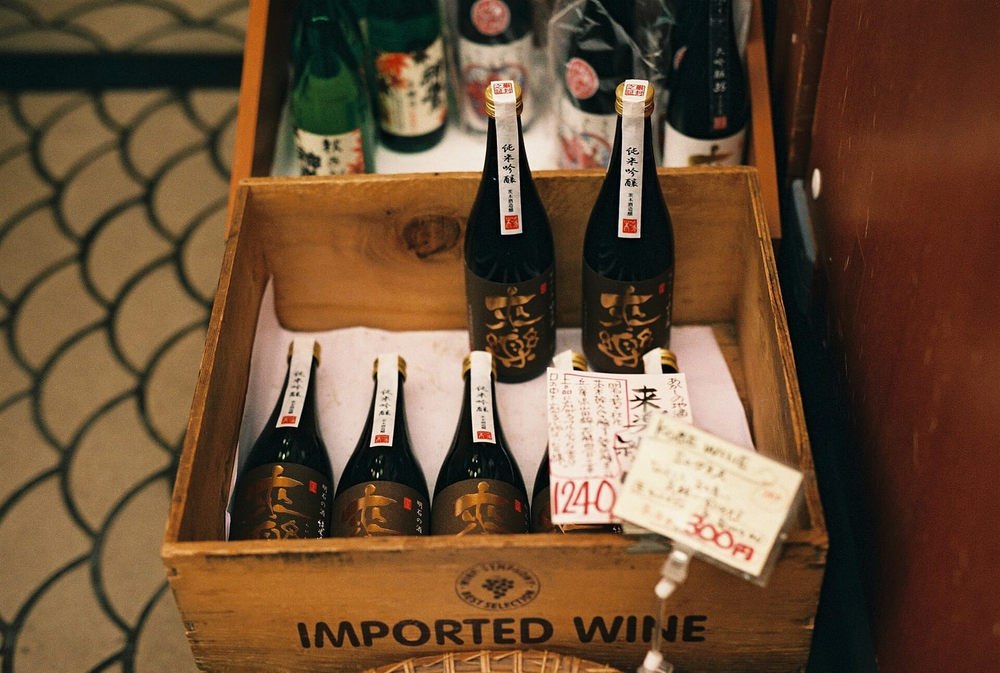

# Ginjo sake

When the word ginjo appears on a label, most drinkers think first of a strong aroma and a high price. It is above all a process name: the mash is held cooler than usual and kept there longer, so the esters made by yeast stay in the liquid. A polishing ratio of 60% is only the entry ticket. The temperature curve, the yeast and the sake mother decide the style.

Figure: Related photograph of Ginjo sake. Image: halfrain, CC BY-SA 2.0, via Wikimedia Commons ([source page](https://commons.wikimedia.org/wiki/File:%E7%B4%94%E7%B1%B3%E5%90%9F%E9%86%B8_(Junmai_Ginjo)_(15656231855).jpg)).

## Where the word comes from

Ginjo (ginjō) is not an ancient traditional term but a modern brewing expression. It describes brewers watching and "tasting out" the mash at low temperature, adjusting it day after day because fermentation is too slow to rush, in the way a poet polishes a line. Only later did the word enter the regulations and become a named sake category.

Ginjo therefore does not mean "premium sake". Honjozo and junmai can be made with great care; ginjo only says that the bottle took the cool, long fermentation route.

## Four legal doors

Under the National Tax Agency's labelling standard, a sake may carry the word ginjo only if four conditions hold at once. The materials are rice, rice koji and water. The polishing ratio is 60% or below. The mash is fermented in the ginjo style. Brewing alcohol added stays within 10% of the weight of the polished rice. Fail any one and the label has no right to the name.

The version with no brewing alcohol at all is called junmai ginjo. It shares the polishing ceiling and the process requirements; the only difference is the alcohol addition. Treating the two as separate polishing tiers is the most common mistake made when reading a label.

## How the 60% line is calculated

The [polishing ratio](ref:polishing-ratio) is the weight left after milling as a share of the original brown rice. Sixty percent means four tenths have been ground away. The bran, protein and fat removed would otherwise add off-flavours and sediment risk; what remains is the starchy centre, which the enzymes from koji can break down into sugar more easily.

Sixty percent is a ceiling, not a standard. Commercial ginjo usually sits between 50% and 60%, and junmai ginjo sometimes reaches 45%. Lower numbers raise the broken-grain rate, lengthen milling and reduce usable rice, so cost climbs quickly. Equating a low number with quality ignores whether the rice itself suits deep milling.

## The temperature curve is the core

The sharpest difference between ginjo and ordinary sake lies in mash management. Ordinary sake often ferments at 12 to 15°C; ginjo is pushed below 10°C, and daiginjo sometimes to 5 to 8°C. Cooler mash slows yeast growth and stretches fermentation from about twenty days to more than thirty.

Two things follow. First, aromatic esters formed by the yeast are less likely to be carried off by later fermentation. Second, the slow pace forces the brewery to measure sake meter value, acidity and amino acidity more often and adjust continuously. That demands far more from temperature control and experience than warm fermentation does.

## Aroma molecules: banana, apple, pear

The chemistry behind ginjo aroma is a family of esters. Isoamyl acetate gives banana and pear sweetness, ethyl caproate leans towards green apple, and ethyl caprylate moves towards pear and flowers. Their levels depend on yeast strain, mash temperature, amino acid concentration and the filtration method used later.

Different association yeasts differ clearly in ester production. Yeast No. 7 gives a tidy, widely usable aroma; No. 9 can produce more flamboyant fruit; No. 1801 and regional yeasts are often used to create a house signature. Breweries treat yeast, mash temperature and sake mother as one set of parameters rather than chasing "aroma" alone.

## Three routes to the sake mother

The sake mother is the starting point of fermentation, and ginjo commonly uses one of three routes. Sokujo mother adjusts acidity with lactic acid, is quick and low-risk, and is the choice for most ginjo. Kimoto relies on natural lactic acid bacteria, takes longer and adds complexity. Yamahai is a modified kimoto that skips part of the rice-pounding work and gives softer acidity.

The route alone does not decide quality. Sokujo can produce a delicate ginjo, and kimoto can develop off-flavours if managed badly. What matters is the acidity of the mother, the vigour of the yeast and whether the three-stage mash addition follows smoothly.

## The fork to junmai ginjo

A small addition of brewing alcohol is part of ginjo technique, not a shortcut. Alcohol dissolves some aroma compounds, making the ginjo perfume more visible, and it lightens and sharpens the body. Junmai ginjo adds no alcohol, so rice flavour and umami are fuller and the body usually thicker.

Neither route is superior. Drinkers who want a crisp, outgoing aroma often choose ginjo; those who want rice flavour and weight often choose junmai ginjo. Sake meter value and acidity are the direct guides to sweetness and texture; the category name describes materials and process only.

## Regions and bottles to know

Hyogo's Nada district brews with hard water and large equipment, giving full, steady bodies; Fushimi in Kyoto is known for soft water and gentler styles; Niigata built its reputation on cool, long fermentation and a light, dry profile; Yamagata, Fukushima and Akita in the north-east often use fruit and acidity as a signature. See [Japan](ref:japan) for the wider geography.

Bottles often cited include Dassai from Asahi Shuzo, Kubota from Asahi Shuzo in Niigata, Hakkaisan from Hakkaisan Brewery and Juyondai from Takagi Shuzo. They span price levels; whether a given bottle is ginjo, junmai ginjo or daiginjo has to be read from the named category and polishing ratio on the label.

## Temperature and glassware

Serve ginjo at 8 to 12°C. Colder locks the esters away; warmer lets alcohol cover the fruit. A tulip glass or a small wine glass gathers aroma, while a small cup suits casual drinking. Smell the still aroma, then swirl gently and judge the ratio of fruit, rice and koji.

Pair it with light food: white fish, shellfish, sushi, steamed dishes, tofu. Strong chilli, sharp acidity and heavy sauces bury the aroma. Keep an opened bottle cold and finish it within weeks; unpasteurised sake needs a cold chain throughout. Excessive drinking is harmful to health, and minors should not drink.

## Common misconceptions

- Ginjo is the same as junmai ginjo: the first may contain brewing alcohol up to the legal cap.
- A lower polishing ratio is always better: it raises aromatic potential but can thin the rice flavour.
- Ginjo aroma comes from added flavouring: yeast produces it during cool [fermentation](ref:fermentation).
- Ginjo must be dry: sweetness depends on the individual bottle.
- Ginjo must be served very cold: 8 to 12°C is usually more expressive.
- Daiginjo is an upgraded ginjo: the two are parallel categories separated by the polishing ceiling.

[Sake](ref:sake) and [Fermentation](ref:fermentation) answer different questions about Ginjo sake: legal definition and materials and process. Read them as a pair, not as alternatives.

**Short definition:** A named sake category requiring a polishing ratio of 60% or less and cool, long ginjo fermentation, with brewing alcohol capped at 10% of the polished rice weight; apple, banana and pear esters define the aroma. 

## Further reading

- [Sake](ref:sake): the category system and brewing framework.
- [Polishing ratio](ref:polishing-ratio): what the 60% line means.
- [Fermentation](ref:fermentation): how cool, long fermentation shapes aroma.
- [Rice](ref:rice): the difference between sake rice and table rice.
- [Japan](ref:japan): the regional and national background.
