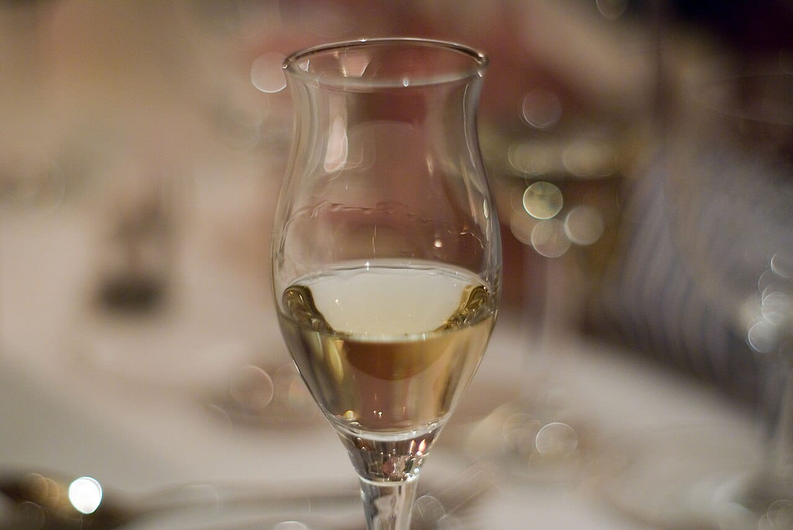
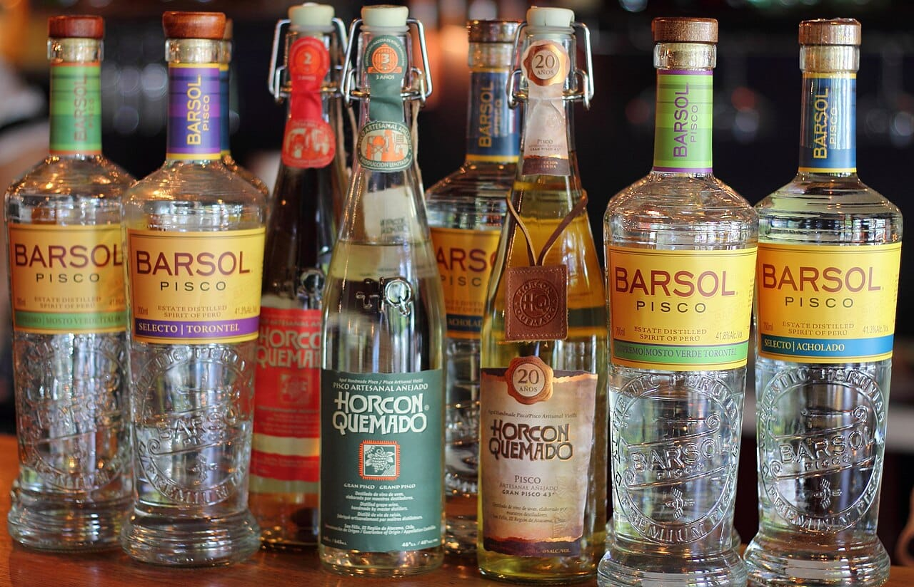

# Grappa

Grappa is Italy's pomace brandy: it is made from the skins, seeds and stems left after pressing grapes, fermented or partly fermented and then distilled directly, rather than from wine. That narrow definition explains its whole character. Grappa is not a synonym for "Italian brandy" and not wine run through a still a second time; it works with a by-product that would otherwise be discarded and pulls the grape aroma back out of it.

Figure: Grappa. Image: Carsten Tolkmit from Kiel, Germany, CC BY-SA 2.0, via Wikimedia Commons ([source page](https://commons.wikimedia.org/wiki/File:A_glass_of_tasty_grappa.jpg)).

## Pomace is not waste

After pressing, pomace still holds sugar, skin aroma and a little liquid. It once went to compost or feed, but farmers in northern Italy found that sealing damp pomace to ferment and then distilling it produced a fierce spirit with grape skin and green stem notes. The name may come from "graspo", the stalk of a bunch; the etymology is not fully settled, but the link to pomace is clear.

The [grape](ref:grape) variety, ripeness and pressing method all pass into the spirit. White pomace is lighter and more floral, red pomace darker with more tannin and berry character. Pomace must stay fresh and damp, never mouldy or badly oxidised; the shorter the time between pressing and distillation, the cleaner the fruit.

The water and sugar content of the pomace also affect yield: too dry and distillation is inefficient, too wet and unwanted microbes take over. Many distilleries seal the pomace immediately after pressing, limit oxidation and distill within hours. These details explain a clean bottle better than the number of years it spent in wood. That is why raw-material handling deserves more attention than the equipment.

## From marc to spirit

Traditionally the pomace is loaded into a still and steam is passed through the bed, carrying alcohol and aroma out. A pot still works in batches, letting the distiller adjust heat and cuts batch by batch; a continuous still is more efficient and suits larger production. Either way, the aim is to avoid scorching the pomace while keeping enough high-boiling aroma.

[Distillation](ref:distillation) cuts decide whether grappa is coarse or fine. Heads are solvent-like and sharp, tails cloudy and bitter, and the heart is the clean part. Some producers keep a little heads and tails for complexity, but a little too much makes the body rough. Compared with brandy distilled from wine in a [pot still](ref:pot-still), grappa's raw material is looser and steam is less evenly distributed, so the operator's experience matters even more.

## The Italian map

The name is protected as a geographical indication in the EU: the grapes must be grown and vinified in Italy and distillation must also take place there. It is not one small zone but a collective name covering the whole country; above it sit regional labels such as Grappa Veneta, Grappa Trentina, Grappa Friulana, Grappa Piemontese, Grappa Lombarda and Grappa Toscana, plus labels tied to a variety or wine, such as Grappa di Barolo and Grappa di Amarone.

These place names are clues to geography and tradition, not quality grades. Veneto and Trentino have deep pomace-distilling traditions, Piedmont is often linked to Nebbiolo and Barolo, and Tuscany to Sangiovese pomace. Read the label by separating place, grape variety and age wording; each describes a different dimension.

## Young and aged

Young grappa is usually clear, with direct aromas of grape skin, green pear, white flowers, anise and a herbal edge. The body is light to medium, alcohol is obvious, and the finish is clean with a bitter touch. It is not meant for a large glass and long oxidation; a small glass, cooler temperature and a quicker drink suit it better.

Aged grappa spends at least 12 months in wood, turns gold, and gains vanilla, caramel, cinnamon and dried fruit while the body rounds out. Bottles marked riserva or stravecchia must age for at least 18 months. More wood is not automatically better: heavy toast can bury grape skin, while tired barrels leave colour without structure. The legal minimum is 37.5% ABV, though many bottles are released above 40% ABV.

In Italy, unaged grappa is often called grappa bianca, stressing clarity and directness; grappa aromatica, made from aromatic varieties, stresses flower and fruit. A single-variety grappa must use pomace entirely from the named grape, while a blend may not carry that label. These categories show that grappa is not simply better with age; young and aged have their own standards.

## Beside the coffee cup and in cocktails

Italians drink grappa casually: after a meal in a small tulip glass or a small tumbler, at room temperature or slightly chilled; a splash in espresso makes caffè corretto; a final glass after coffee is an ammazzacaffè. It also takes ice, a twist of lemon, or tonic as a highball.

In cocktails grappa is not the most common base, but it adds grape-skin and herbal aroma. It works with lemon, honey, bitters and vermouth, and can take the place of some brandy or [pisco](ref:pisco). Watch its alcohol and bitter tail, which can overpower other ingredients.

## Where grappa ends and brandy begins

[Brandy](ref:brandy) is usually distilled from wine or fruit wine; grappa is distilled from grape pomace. That is the fundamental difference. Grappa is also not [vodka](ref:vodka): vodka aims for neutrality, while grappa aims to preserve the raw material. It differs from Italian brandy too, which is distilled from wine and sits closer to French brandy.

Grappa's value lies in extracting aroma from what is left over. It does not need to talk about vintages and vineyards like wine, but it still depends on fresh pomace, careful cuts and whether it has been aged. Treating it as cheap marc spirit misses its place in Italy's distilling tradition.

**At a glance:** An Italian pomace brandy whose name is protected as an EU geographical indication; the grapes must be grown and vinified in Italy and the spirit distilled there, with a 37.5% ABV minimum, a clear young style and a wood-aged style after at least 12 months.

For Grappa, begin with the production rule. Then look at the strength, and finally ask the usual serving. The answers point to different choices, not to a single score.

[Brandy](ref:brandy) and [Vodka](ref:vodka) are the nearest useful comparisons: one clarifies legal definition, the other tests materials and process.

**Key facts.**

| Item | Detail |
| --- | --- |
| In one line | An Italian pomace brandy whose name is protected as an EU geographical indication; the grapes must be grown and vinified in Italy and the spirit distilled there, with a 37.5% ABV minimum, a clear young style and a wood-a… |
| Parent style | Brandy |
| Aroma family | fruit/floral/herbal |

**Sources and limits.** The key claims about Grappa are checked against the following sources: Consorzio Nazionale Grappa (the legal raw material, Italian origin requirements and GI types for grappa; minimum strength, age wording and origin rules), European Union (the marc-spirit category and the GI framework), Italia — Presidenza del Consiglio dei Ministri (the 12-month ageing rule and the 18-month threshold for riserva and stravecchia). Prices, batches and status change; the body is project-written and does not reproduce source text.

## Related images

Image: Pisco. Credit: Cocktailmarler, CC BY-SA 4.0, via Wikimedia Commons ([source page](https://commons.wikimedia.org/wiki/File:Range_of_Pisco.jpg)). Related image for Grappa.
