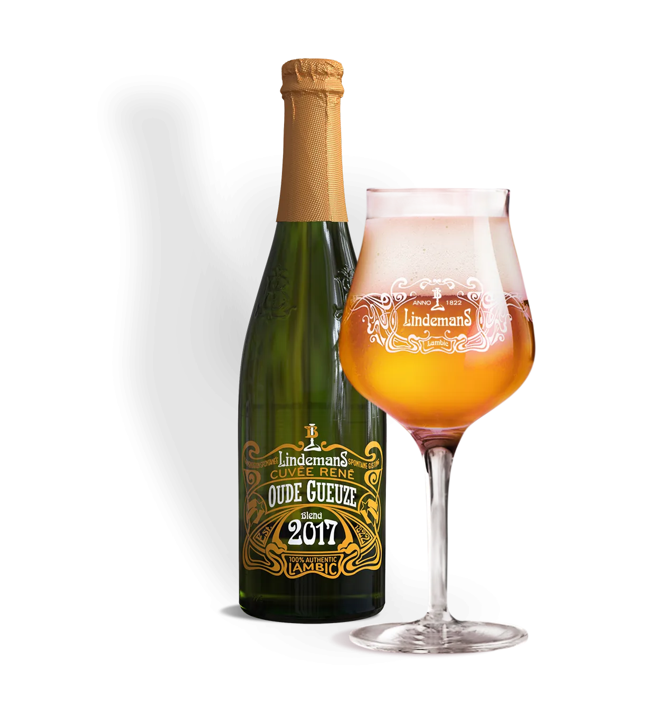
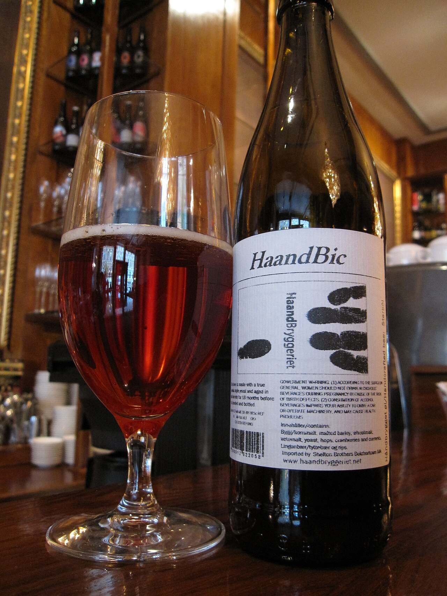

# Gueuze

Gueuze, also written geuze, is a type of [Belgian](ref:belgium) [beer](ref:beer) made by blending [lambic](ref:lambic) of different ages, bottling the blend and letting residual sugar referment in the bottle. It is not a beer with acid added; it joins the structure of young and old beer: the young supplies fermentable sugar and active yeast, the old supplies acidity, barnyard notes and complexity. The finished beer is dry, finely sparkling and brightly sour without being harsh.

Figure: Gueuze. Image: Strangerhappenings, CC BY-SA 4.0, via Wikimedia Commons ([source page](https://commons.wikimedia.org/wiki/File:Oude_Gueuze_bottle.png)).

## A blend on the edge of Brussels

Gueuze is tied to Brussels and the surrounding Pajottenland. In the 19th century Brussels publicans and brewers mixed lambic from barrels of different ages to stabilise quality and keep the beer sparkling after transport. The blender therefore became a distinct role: not necessarily a brewer, but someone who had to judge the acidity, aroma and fermentation potential of each barrel and then decide the proportions.

In the 20th century bottled lager and sweet drinks squeezed the traditional sour beer market and many blending houses closed. From the 1990s, small breweries and sommeliers turned their attention back to the tradition, and gueuze moved from a local drink to a reference point in craft beer.

## One, two and three years

The classic approach blends lambic of about one year with lambic of two to three years. The young beer's residual sugar drives the second fermentation in bottle, while the old beer provides acidity, a tannic feel and stable aroma. There is no fixed formula; a common approach lets young beer make up thirty to fifty per cent, with older beer of different barrel ages completing the blend. The exact figures vary with brewery, vintage and intended style.

Blending is not diluting a sour beer. Too much young beer gives a sweet, coarsely sparkling result with little complexity; too much old beer may leave too little fermentation power in bottle and make the acidity hard. The blender tastes repeatedly before bottling, judging whether the blend still has enough sugar and live yeast, and whether the acidity stays within a drinkable range.

## Open cooling, oak and a second fermentation in bottle

Lambic wort cools overnight in an open coolship, picking up wild yeast and bacteria from the air, then matures in [oak](ref:oak-ageing) for a long period. Barrel wood, barrel age and cellar temperature all shape the microbial community, so even one brewery's beer differs from year to year. Gueuze itself usually sees no new oak; its structure comes from blending and bottle fermentation.

At bottling a small amount of young lambic is added as a primer, so residual sugar drives a second [fermentation](ref:fermentation) that produces carbon dioxide in the bottle. Bottle conditioning usually takes months, after which the beer clears and the bubbles become fine. Gueuze commonly runs 5%–8% alcohol and is best served at about 6–10°C; these figures vary with source and brewery and are not a legal standard.

## The boundary of sourness, barnyard and citrus

Young gueuze shows lemon, green apple, gooseberry and wet stone, while older beer adds hay, leather, barnyard and nutty aged notes. The acidity is bright, the bubbles fine and taut, and the finish dry with a little grain and wood. Acidity should have layers rather than a single vinegar note; a sharp acetic smell, nail polish or obvious oxidative bitterness usually points to a storage or blending problem.

The body is light to medium and alcohol is usually modest, but acidity gives the beer great presence. Too cold suppresses aroma; too warm makes acetic notes stand out.

## A brewery map of the Pajottenland

The heartland of gueuze is the Pajottenland south-west of Brussels, including Lembeek, Beersel and Halle, along with a few breweries inside Brussels itself. Cantillon in Anderlecht still uses an open coolship and traditional oak barrels; Boon in Lembeek covers gueuze and fruit lambic; 3 Fonteinen in Beersel is known for blending and bottle ageing.

These breweries are small and vintage variation is obvious. When buying, note the bottling date, blend batch and alcohol content rather than relying on brand alone. Gueuze keeps well away from light in a cool place and may continue to change slowly in bottle, but not every version improves with long cellaring.

## Where gueuze ends and lambic, fruit lambic and sour beer begin

Lambic is the base beer, which may be unblended and still; gueuze is the blended version that completes a bottle fermentation. Fruit lambic adds cherries, raspberries or other fruit to lambic or gueuze, with fruit at the centre; gueuze emphasises the overall balance of acidity, grain and yeast. Compared with the wider category of [sour beer](ref:sour-beer), gueuze takes its acidity from spontaneous fermentation and long barrel ageing rather than late additions of lactic or acetic acid.

The key to this group is the source of fermentation and whether the beer is blended. Treating gueuze as a generic word for sour beer blurs the process differences between it, Berliner weisse and kettle-soured beer.

## Opening, temperature and the table

A bottle of gueuze may be livelier than expected, so open it slowly and pour in two stages to avoid stirring up sediment. Serve at about 6–10°C in a tulip or a white-wine glass. Young gueuze suits oysters, goat cheese, fried food and salads with acidity; older versions suit aged cheese, poultry and Asian spiced dishes.

The acidity magnifies salt and umami in food, so very sweet desserts are a poor match. If the beer shows a sharp acetic smell or cloudy sediment, decide whether it is normal yeast sediment or a storage fault; when unsure, follow the brewery's advice.

**In brief:** A traditional Brussels beer made by blending lambic of different ages and refermenting it in the bottle; young beer supplies sugar and vigour, old beer supplies acidity and complexity, and the result is dry, finely sparkling and marked by barnyard, citrus and green-apple notes.

For Gueuze, begin with the production rule, then the strength, and finish with the usual serving; that order keeps the account grounded.

[Lambic](ref:lambic) and [Beer](ref:beer) answer different questions about Gueuze: legal definition and materials and process. Read them as a pair, not as alternatives.

**Key facts.**

| Item | Detail |
| --- | --- |
| In one line | A traditional Brussels beer made by blending lambic of different ages and refermenting it in the bottle; young beer supplies sugar and vigour, old beer supplies acidity and complexity, and the result is dry, finely spark… |
| Parent style | Lambic |
| Aroma family | Sour and wild yeast |

**Sources and limits.** The key claims about Gueuze are checked against the following sources: Brasserie Cantillon, Beer Judge Certification Program, Brewers Association (Used to check public US craft industry categories for lambic and gueuze; no original text is reproduced) and 4 sources in total. Prices, batches and status change; the body is project-written and does not reproduce source text.

## Related images

Image: Sour beer. Credit: Bernt Rostad, CC BY 2.0, via Wikimedia Commons ([source page](https://commons.wikimedia.org/wiki/File:Norwegian_sour_beer.jpg)). Related image for Gueuze.
