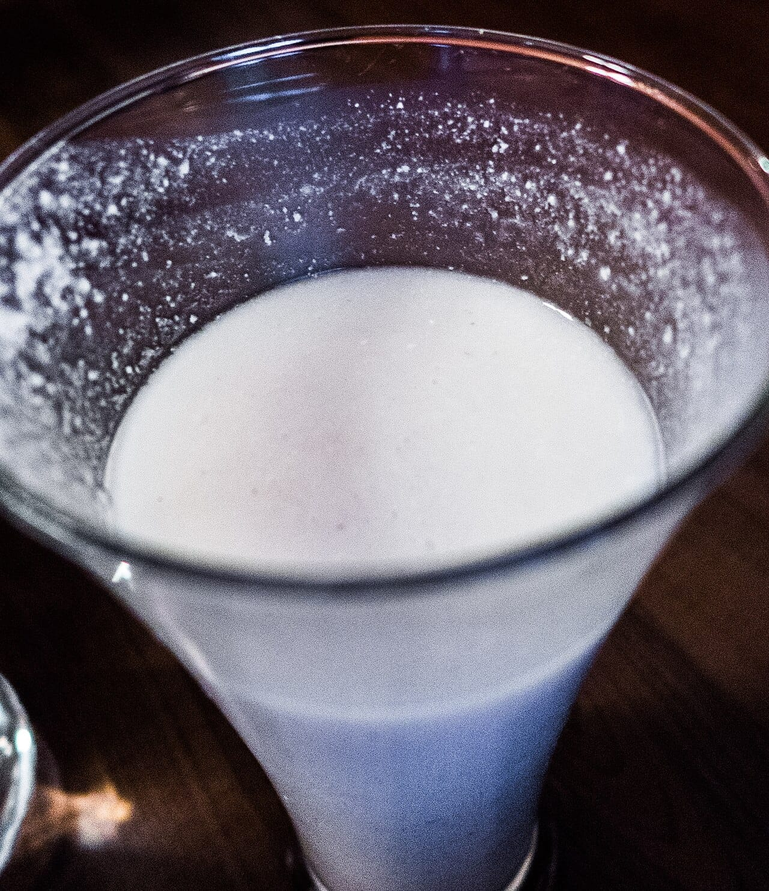

# Highland Barley Wine

Highland barley wine is an umbrella term for drinks made from highland barley on the Tibetan Plateau. It covers chang, the cloudy low-alcohol ferment drunk in Tibetan homes, and the distilled qingke liquor produced in Huzhu, Qinghai and elsewhere. Chang is sweet-sour and usually only 3% to 5% ABV; the distilled version is clear, often above 40% ABV, and follows a technique known as "steaming, clearing and burning four times". The same plateau grain thus leads to two very different drinking cultures.

Figure: Highland Barley Wine. Image: Sharada Prasad CS from Berkeley, India, CC BY 2.0, via Wikimedia Commons ([source page](https://commons.wikimedia.org/wiki/File:Chhyang_or_Chhaang_-_Fermented_rice_drink!_(8902831091).jpg)).

## Highland Barley, Tibet and Two Kinds of Drink

Highland barley is naked barley, cold-tolerant, early-ripening and one of the plateau's most important crops. In Tibetan, the fermented drink is called chang: barley is cooked, mixed with a starter, packed into jars or wooden barrels and left for a few days. It is neither filtered nor distilled, and the milky liquid carries sweetness, acidity and a light sparkle.

The distilled version heats the fermented mash and collects the alcohol vapour to make a clear strong spirit. Huzhu in Qinghai has turned this into an industry and secured a geographical indication for "Huzhu highland barley liquor"; Tibet, Aba in Sichuan, Gannan in Gansu and Diqing in Yunnan have their own traditions. Treating highland barley wine as a single drink hides these two technical routes.

## Not an Aroma Type of Baijiu

Chinese baijiu's aroma system is built on sorghum, wheat, maize and other grains, with distinct sensory descriptions for clean, strong, sauce and rice aromas. Highland barley wine is not on that list; it is named for its raw material, and both fermented and distilled forms exist. Folding it into "light-aroma baijiu" is inaccurate and obscures its plateau character.

The distilled qingke liquor of Huzhu has a national standard, GB/T 19331-2007, covering the geographical-indication area, raw materials, technique and quality requirements. The local "steaming, clearing and burning four times" distillation technique entered the national intangible cultural heritage list in 2021. Highland barley wine's identity therefore comes from raw material, place and method rather than from a baijiu aroma label.

## From Prehistoric Fields to Huzhu Distilleries

Highland barley cultivation and brewing on the plateau reach back thousands of years, and archaeology and texts often trace the Huzhu tradition to 4000 years ago. In Tibetan oral and religious practice, barley wine is tied to harvest, offerings and hospitality; monasteries, estates and villages all had their own methods.

The distilleries of Weiyuan town in Huzhu took shape in the Ming dynasty. A "Tianyoude workshop" is recorded in 1373, and more workshops followed. In the twentieth century, Huzhu barley liquor moved from folk mingliu distillation to industrial production, and today brands such as Tianyoude have made Huzhu the most concentrated production area.

## Steaming, Cooling, Inoculating, Fermenting

Whether the goal is chang or distillate, the first step is steaming the barley: soaking, cooking until the grain opens, cooling, then mixing with a starter. Tibetan households use home-made starter cakes or powder, while industrial producers use more stable cultures. The inoculated grain goes into jars, barrels or fermentation pits and is left to [ferment](ref:fermentation) at a moderate temperature.

Fermentation takes from a few days to two weeks, depending on temperature, starter and the desired sweetness. For chang, the upper liquid can be drunk directly; for distillate, the mash goes into a steamer or [pot still](ref:distillation) and the alcohol is collected in heads, hearts and tails. New spirit usually rests before release, and some products are stored in ceramic jars or wooden vats.

## The Fork Between Fermented and Distilled

Chang's appeal is that it is alive: unsettled grain and yeast remain in the liquid, acidity and sweetness balance, and the weak sparkle makes it feel like alcoholic rice pudding. It is low in alcohol and short-lived, usually drunk locally, and households top up the jar with more barley and starter so that fermentation continues and the flavour changes by the day.

Distilled qingke liquor aims for stability and strength. It is clear, led by the sweet grain aroma of barley, clean on entry, with a little starter spice and heat at the end. Huzhu's mingliu liquor sits between the two: a traditional folk distillate of medium strength, rougher in aroma, preserved as a local flavour.

## Aroma: Tsampa, Yoghurt and Green Grass

Fermented barley wine smells of tsampa, yoghurt and green grass: grain, lactic acid and a little yeast, sweet-sour on the palate, thin in body and lifted by bubbles. The distilled version is closer to a grain spirit: roasted barley, rice, faint starter aroma and a touch of earth, with high alcohol and a warmer mouthfeel.

Compared with [barley](ref:barley) whisky, the grain note is more "cooked grain" than "malt"; compared with baijiu, the aroma is plainer, with less of the ester complexity that comes from pits and long fermentation. Judging it does not require whisky or baijiu vocabulary: look for clean grain, natural acidity and alcohol that does not sting.

## Qinghai, Tibet and Western Sichuan

Huzhu in Qinghai is the core of distilled highland barley liquor, with Tianyoude and Huzhu brands promoting the geographical indication and the "four-times-clear" method. Lhasa and Shigatse in Tibet more often have household chang and small stills, with sweetness and acidity varying by family recipe; Aba and Garzê in Sichuan serve barley wine alongside butter tea and tsampa; Gannan in Gansu and Diqing in Yunnan have their own local versions.

Branding is strongest in Qinghai, while Tibet and western Sichuan remain more local. Check origin, raw material and standard: "Huzhu highland barley liquor" is protected by a geographical indication, whereas a bottle simply labelled "highland barley wine" may come from another area or method. Strength can run from 3% to more than 50%, so the name alone tells you little.

## Festivals, Toasts and Everyday Life

At Tibetan festivals and weddings, barley wine opens the hospitality. The host pours into a silver or wooden bowl; the guest dips a ring finger and flicks three times, honouring sky, earth and gods, then takes a sip. The host refills, and after three rounds the guest drains the bowl. The gesture matters more than the drink, linking guest, host and the order of the plateau.

Everyday chang accompanies tsampa, its acidity cutting the dryness of roasted barley flour; distilled barley liquor appears more at banquets, New Year and business occasions. It can be mixed with butter, sugar or hot water, but traditionally it is served neat in a small cup with meat, dairy and barley foods.

## The Difference from Baijiu, Huangjiu and Rice Wine

Highland barley wine differs from baijiu in raw material and method: baijiu usually relies on sorghum, wheat or maize, with starter, pits and long fermentation; barley wine is built on highland barley, the fermented form is not distilled, and the distilled form is closer to a clean-aroma route. It differs from huangjiu in grain and ageing: huangjiu uses glutinous and japonica rice, wheat starter and a medium strength, with an amber colour; barley wine is clearer and more direct.

It also differs from rice wine. Rice wine usually means a sweet fermented glutinous-rice drink, low in alcohol, high in sugar and short-lived; chang resembles it, but raw material, starter and the plateau environment give it more lactic acid and grain flavour. Confusing the three misses the diversity of [Chinese](ref:china) grain drinks.

## Buying and Storage

First separate fermented from distilled: the former is low in alcohol, short-lived and needs refrigeration; the latter is stronger and can be kept at room temperature. Check the raw material, origin and standard on the label; "Huzhu highland barley liquor" carries geographical-indication constraints, while a plain "highland barley wine" label requires you to judge the method yourself. Once opened, distilled spirit should be kept dark and sealed, ideally in ceramic or glass rather than plastic.

Fermented barley wine with a sour, mouldy or gassy smell should be discarded. Distilled spirit that turns flat or smells of cardboard has usually oxidised or been badly sealed. Neither form is meant for indefinite cellaring; their value lies in freshness, cleanliness and a sense of place.

Further reading: [Abbey beer](ref:c-extra-1).

[Barley](ref:barley) and [Distillation](ref:distillation) are the two useful reference points for Highland Barley Wine. [Barley](ref:barley) sets out legal definition; [Distillation](ref:distillation) brings in materials and process. Read them together.

## Related images

Image: Abbey beer. Credit: BLloydT, CC BY-SA 4.0, via Wikimedia Commons ([source page](https://commons.wikimedia.org/wiki/File:A_wall_of_Belgian_beer_bottles_at_the_Bruges_beer_experience.jpg)). Related image for Highland Barley Wine.
