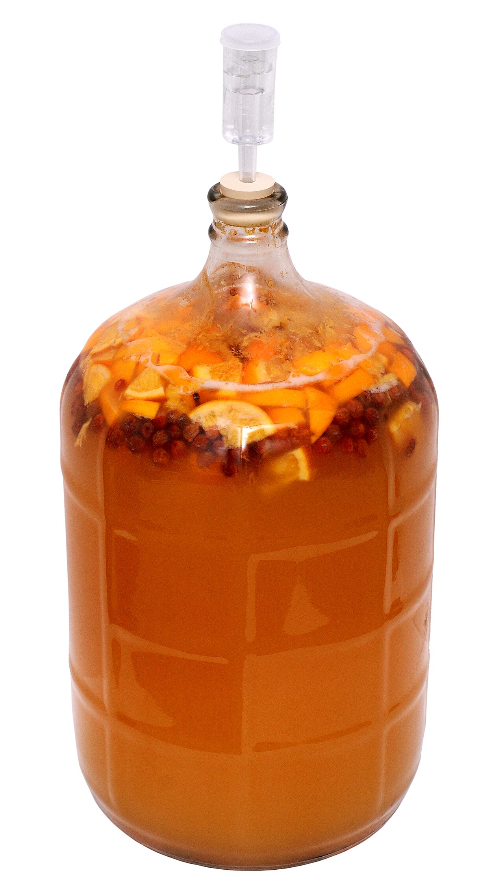

# Honey Wine

Honey wine (mead) is an alcoholic drink made by fermenting [honey](ref:honey) and water with yeast. When the only ingredients are honey, water and yeast it is called traditional mead; add fruit, spices, juice or caramelised honey and a whole family of styles appears. Mead is not beer and is not quite the same as [wine](ref:wine), but like [cider](ref:cider) it is a fermented farm product drunk alongside food or for leisure.

Figure: Honey Wine. Image: Evan-Amos, CC0, via Wikimedia Commons ([source page](https://commons.wikimedia.org/wiki/File:Honey-Fruit-Mead-Brewing.jpg)).

## The boundary: what counts as mead

The core of mead is that honey supplies the main fermentable sugar for [fermentation](ref:fermentation). Traditional mead uses only water and honey; adding sugar sources other than honey (juice, malt, grape juice) can still produce mead, but usually under a more specific sub-name. Alcohol normally falls between 3% and 18%, depending on how much honey is used and how far fermentation goes.

What is not mead: a “honey liqueur” built on baijiu, vodka or another neutral spirit with honey only for flavour; a honey beer where malt leads and honey is an adjunct; and a non-alcoholic drink with honey-flavoured syrup. Their raw-material structure and fermentation logic differ, and so do the category words on the label.

## Honey composition and the fermentation problem

Honey is roughly 80% sugar, mostly fructose and glucose, with about 17% to 18% water plus small amounts of organic acids, minerals and aromatics. The sugar concentration is so high that it inhibits yeast through osmotic pressure, so it must be diluted with water to a fermentable gravity. The dilution ratio sets both potential alcohol and body.

The second problem is nitrogen. Grape juice carries much more yeast-assimilable nitrogen; honey has almost none, so yeast can stall late in fermentation or produce sulphur off-flavours. Producers usually add yeast nutrients in stages and control temperature so fermentation does not overheat into solvent notes. Honey is also low in [acidity](ref:acidity), so a mead without added acid or juice can taste flat.

## Recipe and sugar estimation

A common starting point is about 1 kilogram of honey per 4 litres of must. Honey is around 80% sugar, so that is roughly 800 grams of sugar; in 4 litres it gives about 200 grams per litre and a potential alcohol of about 12%. This is a calculation aid, not a legal rule; real recipes adjust for target strength, sweetness and honey type.

Honey variety changes the aroma directly: acacia is light and floral, linden is intense, buckwheat brings malt and resin, and wildflower is more complex. Dark honey usually carries more minerals and flavour and may leave noticeable caramel or spice after fermentation; pale honey better supports fruit-and-flower styles.

## Yeast and fermentation management

The yeast strain decides fermentation speed, alcohol tolerance and aroma direction. Wine yeast suits dry, crisp styles; Champagne yeast tolerates higher alcohol; dedicated mead yeasts emphasise esters and flowers. Fermentation is usually held between 15 and 25 degrees Celsius, since higher temperatures lose delicate aromas.

Nutrient management is the difference between success and a stalled batch. Staged nutrient additions, good aeration before fermentation and avoiding a single huge sugar load all reduce the risk. After fermentation, producers may clarify, filter, cold-stabilise or age; a second fermentation, added sugar and oak all change the final style.

## The family of styles

Traditional mead uses only water and honey; melomel adds fruit such as berries, stone fruit or citrus; metheglin adds spices such as cinnamon, ginger and clove; cyser adds apple juice and sits close to the crossover between cider and mead; pyment adds grape juice and shares fruit and acidity with wine; bochet caramelises the honey before fermentation, bringing caramel, toffee and a slight bitterness.

Braggot, which adds malt, sits between mead and [beer](ref:beer): malt supplies grain and bitterness, honey supplies sugar and flowers. It is a reminder that style names describe a recipe structure, not a single raw material. The terms are not used consistently across regions, and the alcohol content and residual sugar on the label are more reliable than the name.

## Strength and sweetness

By strength, mead is often divided into low-alcohol hydromel, standard mead and stronger sack. Hydromel is usually below 7%, standard mead mostly 7% to 14%, and sack can exceed 14%. These are trade ranges, not a single regulation.

Sweetness is set by [residual sugar](ref:residual-sugar): fully fermented mead is dry, while mead stopped early or sweetened afterwards is sweet. Sweet mead needs enough acidity and bitterness for balance, or it tastes cloying. Dry mead puts more pressure on the honey's own aroma and on a clean fermentation.

## Regulation and classification

In China, GB/T 17204-2021, the terminology and classification standard for alcoholic drinks, provides the terminology and classification framework, within which a fermented honey drink falls under the fermented-drink group; labelling and strength requirements also depend on the product standard and food-safety rules. In the United States, mead is generally handled as wine rather than beer.

The same bottle may therefore face different labelling, duty and strength limits in different markets. A Chinese back label should give the real category, ingredients and strength rather than only the words “honey wine”. For how [alcohol by volume](ref:abv) is declared, see the term entry.

## Ageing and oxidation

Mead can age like wine, but not every style benefits. A stronger mead with moderate residual sugar and enough acidity will develop honey, dried fruit and spice in bottle; a low-alcohol, low-acid mead can oxidise into cardboard notes. Oak adds vanilla and tannin but may bury delicate floral aromas.

During ageing, the volatile floral notes of honey fade and give way to deeper beeswax, tea and dried-fruit tones. Producers sometimes keep a fresh batch for blending so that the brand style stays consistent.

## Common misconceptions and disputes

First, that mead must be sweet. Second, that mead is “honey mixed with alcohol”. Third, that honey liqueur is mead. Fourth, that older mead is always better. Fifth, that braggot is pure mead. Sixth, that every honey ferments equally well; highly mineral or strongly flavoured honey needs a more careful recipe.

Two arguments recur: whether “mead” should be limited to 100% honey as the sugar source, and how transparent industrial and traditional products should be on the label. The first affects classification, the second affects consumer expectations.

## How to drink it

Dry mead is best served chilled and pairs with cheese, roasted poultry and spiced dishes; sweet mead suits dessert or a small solo serve. Mulled mead, heated with spices, is a common winter drink, but heating volatile aromas means it should not be reheated repeatedly. Mead can also be a cocktail ingredient, though its sweetness and honey aroma easily overpower other materials.

Serve it cooler than room temperature but not ice-cold: too cold shuts down the flowers, too warm pushes the alcohol forward. Once opened, keep it cold and finish it promptly, especially low-alcohol, low-acid styles.

[Wine](ref:wine) and [Alcohol by volume (ABV)](ref:abv) are the nearest useful comparisons: one clarifies legal definition, the other tests materials and process.
