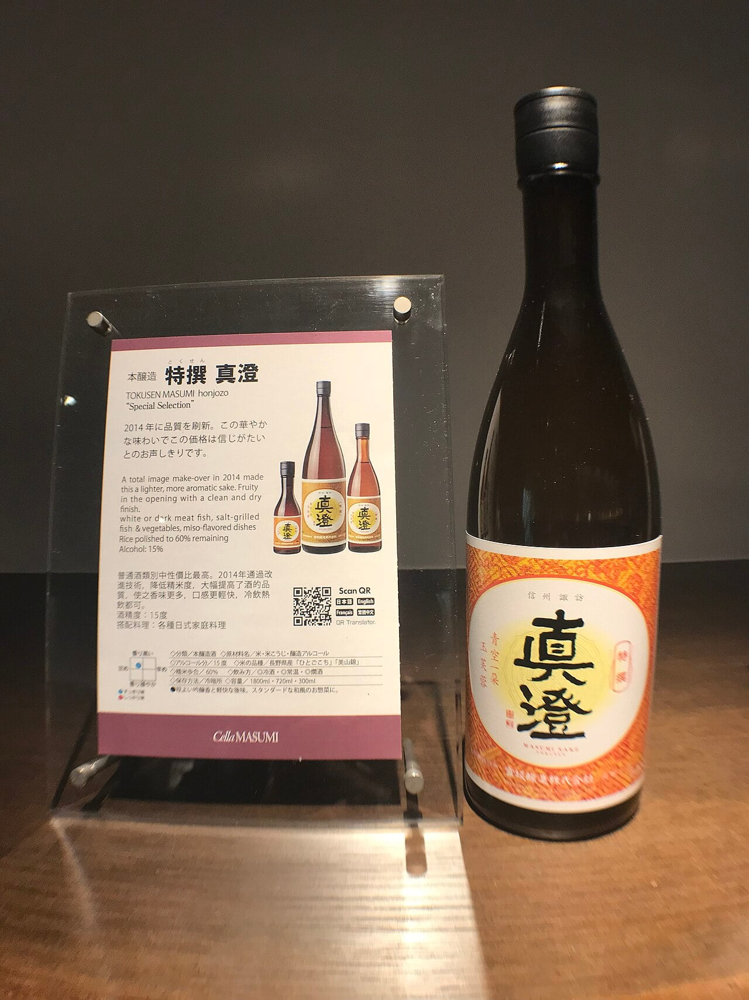
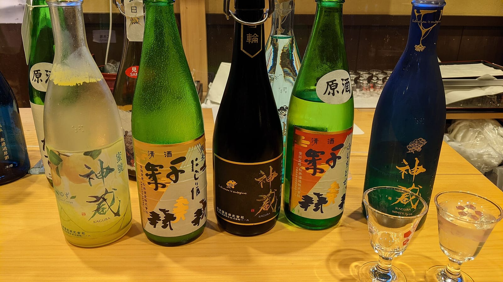

# Honjozo sake

Honjozo is one of the eight tokutei meisho categories of [sake](ref:sake), often summed up with the phrase "sake with added alcohol". That is only half the story. It does allow brewing alcohol, but the addition has a legal ceiling, and there are also thresholds for polishing and koji rice. Read the three conditions together and honjozo becomes a complete category rather than a watered-down junmai.

Figure: The bottle and shop display card for Tokusen Masumi honjozo; this sake is polished to 60% and has 15% alcohol. Image: At1973, CC BY-SA 4.0, via [source page](https://commons.wikimedia.org/wiki/File:TOKUSEN_Masumi_honjozo_%22Special_Selection%22.jpg).

> **Quick verdict**
> **In one line:** This style places Honjozo sake on the flavour map, and helps you choose and serve it.
>
> - **Best for:** Anyone comparing Honjozo sake with other styles before buying or ordering.
> - **Not for:** If you want want a single “best” ranking and reject stylistic difference.
> - **Check first:**
>   - Japan's tokutei meisho system divides sake into eight names: ginjo, daiginjo, junmai, junmai ginjo, junmai daiginjo, special junmai, honjozo and special honjozo.
>   - The first is the polishing ratio.

## Where honjozo sits

Japan's tokutei meisho system divides sake into eight names: ginjo, daiginjo, junmai, junmai ginjo, junmai daiginjo, special junmai, honjozo and special honjozo. The first five are defined by whether brewing alcohol is added and by polishing ratio; the last three add "special" conditions on top of a base category. Honjozo sits where alcohol is allowed but ginjo-level polishing is not required.

That position defines its market role. Ginjo chases the floral and fruity aroma of long, cool fermentation and costs more; junmai stresses a fuller expression of rice and water; honjozo uses a little alcohol to tighten the body and make a clean, crisp, food-friendly drink. These are parallel style routes, not steps on a ladder.

## The three legal conditions

The first is the [polishing ratio](ref:polishing-ratio). Honjozo is capped at 70%, meaning at least 30% of the brown rice is milled away and no more than 70% remains as white rice. A lower number means deeper milling and higher cost. Daiginjo is capped at 50%, ginjo and junmai ginjo at 60%, and honjozo at 70%. The old 70% requirement for junmai was removed in the 2004 revision, but honjozo kept its cap.

The second is the koji-rice share. Tokutei meisho sake must use koji rice at 15% or more of the weight of white rice. Koji rice is white rice grown over with koji mould, able to break starch into sugar; too low a share leaves saccharification underpowered and fermentation unbalanced. The rule applies to honjozo too and is often overlooked.

The third is the alcohol ceiling. Honjozo may add brewing alcohol, but no more than 10% of the weight of the white rice. Brewing alcohol is high-purity alcohol fermented and distilled from starch or sugar materials; it is not industrial alcohol and not any arbitrary liquor. The words "brewing alcohol" on a label point to a legal boundary with a number attached.

## Reading the polishing ratio

The polishing ratio is the weight of white rice as a share of brown rice, not the share removed. A figure of 70% means 70% remains and 30% is milled away; 60% means 60% remains and 40% is removed. The outer layers are rich in protein, fat and ash, so deeper milling removes sources of off-flavour but also some of the rice's savour. Lower is not automatically better; it must match the target.

Honjozo's 70% cap means it keeps more outer material than ginjo. More protein and fat make off-flavours more likely, so koji making, steaming, temperature and hygiene demand more skill, not less. Judging honjozo as crude because its polishing number is high mistakes a material standard for a process standard.

## What brewing alcohol changes

The National Tax Agency's explanation describes a suitable addition of brewing alcohol as making the aroma higher and the palate cleaner. The effect is not only dilution. A little alcohol changes how aroma compounds partition between liquid and headspace, making some esters easier to smell; it also makes the body thinner and drier, with a clearer dry impression. Alcohol also suppresses the growth of lactic acid bacteria (hiochi bacteria), which helps stability.

There are limits. Above 10%, the product can no longer be labelled honjozo; what is added is brewing alcohol, not water, sugar or flavouring. Equating "added alcohol" with adulteration confuses a permitted process with an illegal addition. Nor is honjozo a "better junmai": it simply chooses a different body.

## The fork from junmai

[Junmai](ref:junmai) uses only rice, rice koji and water, with no brewing alcohol. Its ingredient list is shorter and its flavour usually fuller, with more umami and sweetness. Honjozo allows a small addition, caps polishing at 70%, and more easily achieves a clean, dry, crisp style. The difference lies in the ingredient list and process route, not in rank.

Price bands may overlap, and one brewery may make both. Compare the category first, then polishing ratio, strength, sake mother and whether the sake is unpasteurised. Judging quality by the word junmai alone misses half the information. Junmai itself ranges from ordinary to special, ginjo and daiginjo, and honjozo has its own ordinary and special tiers.

## Special honjozo and the word special

Special honjozo tightens the base rules: a polishing cap of 60%, or a specified special production method explained on the label. It is not an "upgraded honjozo" but another set of legal conditions. When a label says special honjozo, look for the polishing figure or the process note; a category name alone is an incomplete label.

Other label words also carry meaning. Genshu is undiluted with water before bottling; namazake is heated not at all after production; namachozo is stored without heat and pasteurised once before shipping; taruzake is stored in a wooden cask and carries wood aroma. These describe handling, not the honjozo category, but they change flavour and shelf life markedly.

## Flavour range and representative products

Honjozo is led by rice and steamed-rice aroma with light esters, a clean entry, balanced acidity and alcohol, and a crisp finish. It is not one taste but a spectrum: ordinary honjozo for everyday drinking, special honjozo for a cleaner and more refined result, namazake honjozo for freshness and a slight spritz, taruzake honjozo for wood and dryness, with the sake mother and rice variety adding apple, pear or rice-cake differences.

By tradition, the Nada district of Hyogo and Fushimi in Kyoto are two core brewing centres. Nada's harder water gives forceful fermentation and often a dry, well-structured sake; Fushimi's softer water gives a gentler style. Honjozo from both appears on everyday tables, but the specific product still depends on the brewery. A representative product is best understood as a type - everyday food sake, polishing around 70%, with a small addition of brewing alcohol - rather than a single brand.

## Temperature, vessels and food

Honjozo works chilled and warmed. Chilled at about 10–15°C it shows cleanliness and dryness; warmed to about 40–45°C it opens rice aroma and umami, but too much heat amplifies alcohol and acidity. Small cups or ochoko help control temperature; a tulip glass is useful for aroma, but do not fill it.

At the table, honjozo's clean character suits sashimi, sushi, steamed seafood, tofu and chicken dishes. Its acidity and alcohol cut through fat without overpowering the ingredients as a heavy sake might. Refrigerate after opening and finish within a few weeks; namazake and lower-strength products need cold and dark all the more.

## Common misconceptions

First, treating honjozo as inferior. Alcohol addition is a permitted process with a clear ceiling. Second, reading added alcohol as industrial alcohol. Brewing alcohol is food-grade high-purity alcohol. Third, assuming junmai is always better. They are different categories with different style targets. Fourth, ignoring the polishing ratio. 70% and 60% mean different materials and costs. Fifth, reading only the word honjozo and ignoring strength, sake mother and whether the sake is unpasteurised. Sixth, treating special honjozo as a marketing phrase. It has corresponding polishing or process conditions.

Honjozo adds a small amount of distilled brewing alcohol, which lifts aroma and can make the sake lighter and more fragrant than junmai.

## Further reading

- [Sake](ref:sake): the category system and brewing framework.
- [Junmai](ref:junmai): the no-added-alcohol counterpart.
- [Polishing ratio](ref:polishing-ratio): what the 70% and 60% caps mean.
- [Koji making](ref:qu-making): the role of rice koji in saccharification.
- [Alcohol by volume](ref:abv): a basic measure for comparing sake strength.
- [Japan](ref:japan): the regional and national background.

## Related images

Image: Related photograph of Junmai sake. Credit: Nisiguti, CC BY-SA 4.0, via Wikimedia Commons ([source page](https://commons.wikimedia.org/wiki/File:Matsui_Sake_Brewery%27s_Sake_20211122.jpg)). Related image for Honjozo sake.
