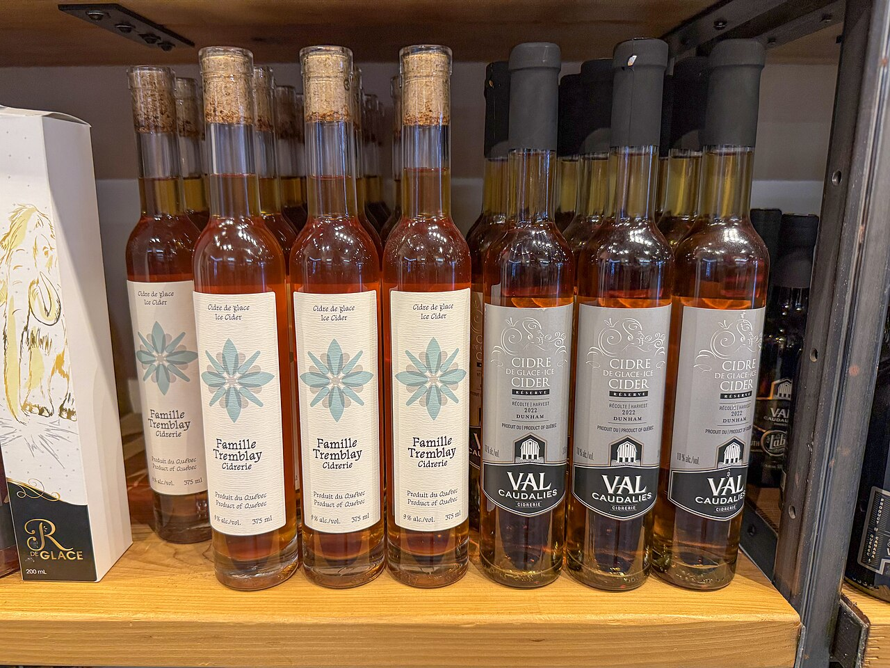

# Ice Cider

A sweet apple cider from Quebec, made by fermenting naturally frozen or freeze-concentrated apple juice; high in both alcohol and sweetness, with apple, caramel, honey and acidity.

Figure: Ice Cider: Quebec Ice Cider (Wikimedia Commons). Image: Hayden Soloviev, CC BY 4.0, via Wikimedia Commons ([source page](https://commons.wikimedia.org/wiki/File:Quebec_Ice_Cider.jpg)).

## Definition and boundaries

Ice cider, or cidre de glace, is a sweet cider developed in Quebec. It is made from apples frozen on the tree or after harvest, or from freeze-concentrated juice, then fermented to roughly 7–13% ABV with high residual sugar and high acidity. The flavour centres on cooked apple, caramel, honey and dried apricot rather than on fresh cider sharpness.

It is not apple juice with alcohol added, and it is not ice wine. Ice wine uses grapes; ice cider uses apples. Its difference from ordinary cider is concentration and residual sugar, not later sweetening. Quebec’s Cidre de glace has an IGP, while producers in other provinces, Vermont and New York use similar names under different rules and sweetness levels.

The defining process is freeze concentration. Water freezes out of the juice or fruit, leaving sugar and acid behind; fermentation then starts from a denser must and stops with sugar still present. A product made by simple fortification or by adding sugar after fermentation may be sold as a sweet cider, but it is not the same category.

## History and naming

Quebec has a long winter and a short apple ripening season. In the 1980s, local cider makers borrowed the freeze-concentration logic of ice wine: apples were left on the tree or picked and frozen, water crystallised, and the concentrated juice was fermented slowly. The result was a sweet, acidic cider with a distinctly northern identity.

By the 1990s ice cider had become a signature Quebec product. The IGP later codified raw material, freezing method, fermentation and residual sugar. The word “ice” refers to freeze concentration, not to serving over ice, and “apple ice wine” is a marketing phrase rather than a protected category.

The name also carries a climate story. A cold winter gives deeper concentration and sharper acidity; a warm winter gives riper fruit and heavier caramel. Vintages therefore vary more than in ordinary cider, and a producer’s freezing method is as important as the apple variety.

## Materials and process

The apples are usually high-acid culinary and cider varieties such as McIntosh, Spartan, Cortland and Golden Russet. A single variety or a blend changes the aroma, but acidity is essential: without it, the concentrated sugar tastes flat. Fruit may be left on the tree into winter or picked and stored cold until freezing.

After freezing, pressing yields a concentrated juice that can reach 30–40 °Brix. Fermentation starts slowly because the sugar is high and the temperature low; a hardy yeast is needed. Fermentation runs at 10–15°C for weeks or months and is stopped by chilling or filtration while substantial sugar remains. Some producers mature the cider briefly in oak to add vanilla and nutty notes.

Quebec’s IGP favours natural freezing or freeze concentration and sets limits for residual sugar, alcohol and origin. Outside Quebec, producers may use cryoconcentration or reverse osmosis, and the label should say which. Natural freezing is weather-dependent; artificial concentration is more consistent but gives a different texture and aromatic profile.

The two main routes are therefore orchard freezing and juice freezing. In the first, apples freeze outdoors and only the concentrated juice is pressed; in the second, pressed juice is frozen and ice crystals are removed. The first is more variable and more expensive; the second is easier to control. Both can make good cider, but they are not interchangeable in a technical description.

## Style and palate

The cider is gold to amber and slightly viscous. Aroma brings cooked apple, caramel, honey, dried apricot and citrus peel; the entry is sweet but an acidic spine keeps it from tasting like syrup. The finish has apple skin and spice. Alcohol is 7–13%, and sweetness ranges from off-dry to luscious.

Compared with ice wine, ice cider is usually higher in acidity and lighter in body, with apple rather than grape aroma. Compared with ordinary cider, it is far sweeter and more concentrated and is not a thirst-quenching drink. Typicality depends on freeze concentration and the balance of sugar and acid, not on the absence of added flavour.

Quebec versions often carry 130–250 g/L residual sugar and 6–10 g/L acidity. Vermont examples can be drier and more apple-skin driven. The balance matters more than the absolute sugar number: a high-sugar cider with low acidity tastes cloying, while a high-acid example can carry more sweetness.

## Representative regions and brands

Quebec is the core region. Neige and Domaine L’Orpailleur are the most visible export brands; Domaine de la Pomanière and other estates also make ice cider, with wide differences in sweetness and apple varieties. The names are useful reference points, not a quality ranking.

Other Canadian provinces, Vermont and New York also produce the style, often as “ice cider” or “apple ice wine”. EU classification for these sweet apple drinks is not uniform, so the producing country’s label and residual-sugar statement matter more than the English name.

When comparing, choose bottles from the same vintage and similar alcohol, then look at residual sugar and acidity. A Quebec IGP bottle, a Vermont ice cider and a Quebec estate bottling can show three different balances without leaving the category.

## How to drink and pair

Serve at 6–8°C in a small dessert glass or tulip, with a 60–80 ml pour. Too cold hides caramel and honey; too warm pushes alcohol forward. Blue cheese, foie gras, apple tart, crème caramel and nuts are natural partners, and the cider can also stand in for a sweet wine with spicy dishes.

After opening, refrigerate and finish within two to three weeks. High residual sugar and moderate alcohol make it more stable than ordinary wine, but oxidation eventually brings apple-sauce and woody notes. Do not add ice; melting dilutes the acidity and structure that keep the drink fresh.

A bottle that develops bubbles after opening may be undergoing a second fermentation. Keep it cold and drink it soon. Sediment is normal in unfiltered examples; pour carefully and leave the last portion in the bottle.

## Buying, storage and misreadings

Look for “Cidre de glace” or “Ice cider”, the origin and a residual-sugar figure. A Quebec IGP bottle should carry the relevant mark. A high price may reflect natural freezing and low yields, not necessarily higher sweetness; judge acidity and alcohol as well as sugar.

Common misreadings include treating ice cider as apple juice with alcohol, confusing it with ice wine, and assuming all ice cider comes from Quebec. The core is freeze concentration followed by fermentation, not added sugar or added ice.

Vintage variation is real. A cold winter can give sharper acidity and deeper concentration; a warm winter can give riper fruit and heavier caramel. Store bottles upright, cool and dark, and check pressure before opening a bottle that has been warm or recently shaken.

## Further reading and see also

A useful comparison is a Quebec ice cider, a Vermont ice cider and a dry apple cider at similar alcohol. Record residual sugar, acidity, apple varieties and freezing method; those variables explain the texture better than the label alone.

- [Cider](ref:cider): the base category of fermented apple drinks.
- [Apple](ref:apple): varieties, acidity and aroma.
- [Fermentation](ref:fermentation): sugar conversion to alcohol.
- [Canada](ref:canada): Quebec’s regional background.
- [Dessert wine](ref:dessert-wine): sweet-wine categories and residual sugar.
