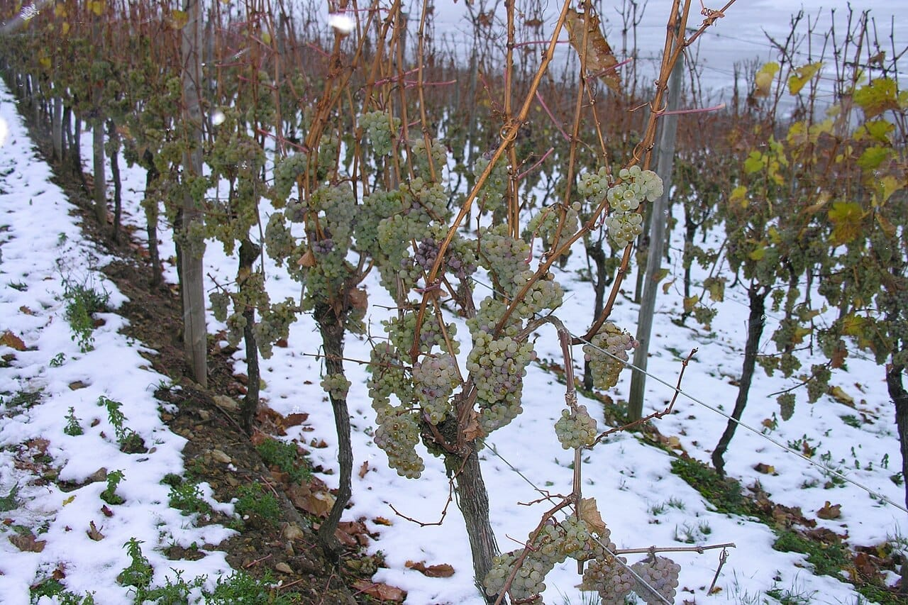

# Ice Wine

Ice wine, called Eiswein in German, is a sweet [wine](ref:wine) made from grapes that freeze naturally on the vine, and it belongs to the wider family of [dessert wine](ref:dessert-wine). The fruit is left on the vine until winter temperatures fall below freezing; it is then picked and pressed while still frozen. Water stays in the press as ice, and only a small amount of highly concentrated juice runs off. The sweetness comes neither from added sugar nor from botrytis but from physical dehydration and freezing. Understanding ice wine means understanding temperature, timing and risk.

Figure: Ice Wine. Image: Mya, CC BY 2.0, via Wikimedia Commons ([source page](https://commons.wikimedia.org/wiki/File:Frozen_grapes_in_Luxembourg.jpg)).

## Concentration that happens on the vine

Most sweet wines obtain sugar through botrytis, drying or stopping fermentation. Ice wine relies on winter. Grapes ripen normally in autumn but are not picked, a deliberate extension of [late harvest](ref:late-harvest); they hang on the vine while water slowly evaporates and sugar, acidity and flavour compounds concentrate together. Once the temperature is low enough, the berries freeze inside, and picking and pressing must happen within the same cold window, or the ice melts and the concentration is lost.

Because the harvest waits for winter, both yield and vintage consistency are highly uncertain.

## -7°C and -8°C: two legal lines

[Germany](ref:germany) is the traditional home of ice wine, and its rules require harvest and pressing at no higher than -7°C; in practice the work is often done between -10°C and -12°C. Ontario's VQA system in Canada requires -8°C or lower, with harvest monitored under the certification scheme. The one-degree difference reflects different national agricultural and labelling systems, not a difference in quality.

At EU level, ice wine belongs to the category of specially harvested grapes, and the use of the name is governed by geographical indications and product specifications. Only compliant wine may carry names such as Eiswein or Icewine; wine made from artificially frozen grapes, or from grapes frozen after picking, cannot use them.

## The night of pressing

Ice wine is usually pressed late at night or early in the morning, when temperatures are at their lowest. Grapes go from vine to press without thawing and cannot be left standing. Pressing is slower and gentler than for ordinary white wine, so that ice crystals stay behind and only concentrated juice escapes.

The resulting juice is extremely high in sugar, and fermentation is slow: yeast struggles in such a concentrated osmotic environment, and fermentation can take months. The finished wine usually keeps a large amount of [residual sugar](ref:residual-sugar) with modest alcohol and bright acidity.

## Riesling, Vidal and others

Germany most often uses [Riesling](ref:riesling), which is late-ripening, high in acidity and thick-skinned, so it can hang into winter without rotting easily. Riesling ice wine tends to be lighter, with citrus, green apple and mineral notes and a blade-like acidity. Ontario commonly uses Vidal, a cold-hardy hybrid with thick skins and intense aroma, producing a fuller ice wine with apricot, pineapple and honey.

Variety sets the aromatic direction, but the core structure of ice wine remains the contest between high sugar and high acid.

## A gamble with the weather

Making ice wine is a gamble. Grapes must hang for two or three extra months, exposed to rain, hail, birds, mould and rot; if winter is not cold enough, the entire crop can be lost. German industry figures suggest that, on average, only 5%–10% of the original harvest is finally bottled as ice wine, with the rest cut away or destroyed by weather.

In 1830, growers in Dromersheim in Rhine-Hesse reportedly discovered in February that frozen grapes could yield intensely sweet juice, one of the earliest documented ice wine harvests. The style was gradually regulated in Germany and Austria, and in the late twentieth century it became a large-scale industry in Canada.

## Sugar against acid

Ice wine aromas usually centre on honey, apricot, pineapple, citrus peel and white flowers, with a viscous texture that should still finish clean. When sugar is this high, acidity is the only counterweight; a low-acid ice wine tastes like syrup after two sips. A useful test is whether the wine seems to flow in the mouth: a good example is rich without being heavy, with a citrus or mineral finish rather than plain sweetness.

Temperature also affects balance. Too cold and the aroma closes down and the sweetness is suppressed; too warm and alcohol and sugar swell. 6–8°C is a reliable range where both aroma and sweetness hold.

## How to drink it, and with what

Serve ice wine in a small tulip glass, pour a little, and let it warm. It can be an after-dinner wine on its own or paired with fruit tarts, almond biscuits, blue cheese or foie gras. Do not add ice: it dilutes the aroma.

A bottle keeps for several days to a week in the fridge, though the aroma fades. Ice wine should not be stored on an ordinary wine rack; keep it dark and at a stable temperature. Excessive drinking is harmful, and minors should not drink.

## Word games on the label

First, in Canada "Icewine" is a regulated single word, while "Ice Wine" written separately may be only a style description. Second, German Eiswein and Canadian Icewine follow different rules and are not interchangeable. Third, a bottle labelled with "ice wine flavour" may simply be a sweetened white wine. Fourth, ice wine is not better for being sweeter; acidity is its backbone. Fifth, ice wine is not botrytised wine: both may be sweet, but the cause is completely different.

**Short definition:** A sweet wine made from grapes that freeze naturally on the vine and are pressed while frozen; German Eiswein and Canadian Icewine apply different harvest-temperature rules, Riesling and Vidal are common varieties, and yields are tiny while sugar and acidity are highly concentrated. 

To read Ice Wine, start with the production rule, then the strength, then the usual serving; no single check settles it.

Start with [Dessert Wine](ref:dessert-wine) for legal definition, then read [Germany](ref:germany) for materials and process. Seeing both keeps Ice Wine from being confused with a neighbouring idea.

**Key facts.**

| Item | Detail |
| --- | --- |
| In one line | A sweet wine made from grapes that freeze naturally on the vine and are pressed while frozen; German Eiswein and Canadian Icewine apply different harvest-temperature rules, Riesling and Vidal are common varieties, and yi… |
| Parent style | Wine |
| Aroma family | Honey / tropical fruit / citrus |

**Sources and limits.** The key claims about Ice Wine are checked against the following sources: Deutsches Weininstitut (DWI) (German harvest temperatures, history and the share of ice wine in the crop; no original text is reproduced), VQA Ontario (the Ontario VQA origin and production framework; no original text is reproduced), European Union (wine categories, geographical indications and labelling; no original text is reproduced) and 4 sources in total. Prices, batches and status change; the body is project-written and does not reproduce source text.

## Related images

Image: Category image for Germany. Credit: Renardo la vulpo, CC0, via Wikimedia Commons ([source page](https://commons.wikimedia.org/wiki/File:M%C3%BCnchen,_Oktoberfest_2022,_Fischer-Vroni_v_S,_1.jpeg)). Related image for Ice Wine.
