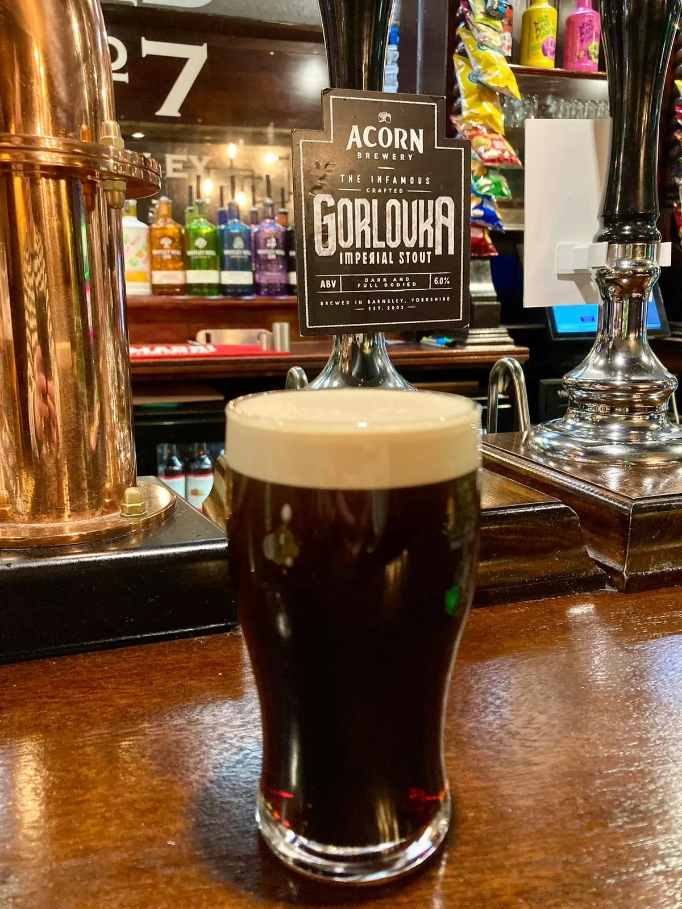

# Imperial Stout

Imperial stout is the strongest branch of the [stout](ref:stout) family within [beer](ref:beer). It descends from the strong, heavily hopped black beer that Britain exported to the Russian court and the Baltic markets in the 18th century, which is why it is often written as Russian Imperial Stout. Four things draw its boundary: deeply roasted grain, a full body, obvious alcohol warmth, and enough bitterness and acidity to support years of cellaring.

Figure: Imperial Stout. Image: 55belgianbeerfan, CC0, via Wikimedia Commons ([source page](https://commons.wikimedia.org/wiki/File:A_Pint_of_English_Imperial_Stout.png)).

## From the London docks to the Russian court

London brewers were already making porter and stout from dark malt in the 18th century. The version sent to Russia needed more alcohol and more hops to survive a long journey and a cold climate, so brewers raised the malt concentration and extended both the boil and the maturation. In the English-speaking world this beer became known as Russian imperial stout and later simply imperial stout.

In the 20th century dry stout and sweet stout took over the everyday market, and imperial stout retreated to a handful of traditional breweries. In the 1990s the American craft movement rediscovered the style and turned it into a high-gravity, heavily roasted flagship built for long keeping. Bourbon, rye and wine barrel versions followed, expanding "imperial stout" from a single historical name into a group of contemporary practices organised around strength and age. The word "imperial" refers to no official imperial standard; it was a 19th-century British trade habit for strong black beer exported to Russia, and today it signals a strength tier rather than an origin or a legal category.

## High-gravity mashing and a long fermentation

[Barley](ref:barley) supplies the base sugar, roasted barley and black malt bring colour and coffee-cocoa flavour, and crystal malt adds caramel and dried-fruit notes. High-gravity mashing means a larger grain bill, longer mashing and sparging, and a longer boil to evaporate surplus water and concentrate fermentable sugar. Mash temperature and yeast choice determine residual sweetness, and therefore whether the body can stay intact under high alcohol.

[Fermentation](ref:fermentation) remains top-fermenting, commonly at 18–22°C. High-gravity wort puts osmotic pressure on yeast, so pitching rate, oxygen and temperature control matter more than in an ordinary stout. After fermentation the beer usually needs weeks to months of conditioning so that rough alcohol and roast bitterness can knit together. Imperial stout commonly runs 8%–12% alcohol and 50–80 IBU, but these figures vary with source and brewery and are not a legal standard; some versions go higher, while others are deliberately made drier.

## Roast, dried fruit and alcohol warmth

The aroma is dominated by dark chocolate, coffee, caramel, molasses and toasted bread, and stronger versions often show plum, raisin or fig-like dried fruit. Barrel-aged versions layer on vanilla, coconut, oak and spirit notes, but these are process additions rather than requirements of the style.

On the palate the body should be full and supported, with roast bitterness and residual sweetness holding each other in check; alcohol warmth should arrive after the swallow rather than stinging at the front. In a good version the roast is clean and the bitterness has layers; burnt, acrid smoke or cardboard usually points to a process or storage fault. Carbonation is usually low, which makes the beer feel still and closer to a fortified wine. As it warms, dried fruit and alcoholic sweetness become more obvious and the roast softens.

## London, America and the northern rim

London is the historical centre of the style, where 18th- and 19th-century export breweries established the template for strong black beer. British breweries still recreate old recipes under the imperial stout name, emphasising malt depth and a bitter backbone. American craft brewing pulled the style in two directions: a strong, heavily barrel-aged sweet version, and a relatively dry modern version with more visible hops. The Nordic and Baltic regions have their own strong black beer traditions, often tied to local port trade.

Representative producers include the London breweries historically known for Russian export and contemporary American and British brands. Baltic porter is close to imperial stout in strength, but it is often cool-fermented and tastes cleaner.

## Where imperial stout ends and stout, porter and barleywine begin

Compared with ordinary [stout](ref:stout), imperial stout has more malt concentration, more alcohol and greater ageing potential; dry stout aims for lightness and a dry finish, while imperial stout aims for thickness and a long aftertaste. Compared with [porter](ref:porter), it shares dark malt and top fermentation, but its strength and depth of roast are usually more extreme. Compared with strong barleywine, the key to imperial stout is the coffee and cocoa of roasted grain, while barleywine relies more on malt sweetness and hops.

[Bitterness](ref:ibu) is not a case of more being better. Imperial stout needs enough bitterness to balance residual sugar and alcohol, but a sharp edge can spoil the roundness of the body. The best test of balance is to taste again after the beer has warmed, because cold suppresses sweetness and makes bitterness seem harder.

## Barrels, temperature and the table

Imperial stout is best served at about 12–16°C. Too cold closes the aroma and hides sweetness; too warm lets alcohol overwhelm the roast. A tulip or a snifter gathers aroma. Barrel-aged versions can be opened ahead of time to let volatile alcohol and oak notes blow off.

With food, imperial stout suits dark chocolate desserts, blue cheese, grilled meat and rich braised dishes; it can also be served on its own as an after-dinner drink. Strong versions can be cellared for years away from light in a cool, stable place, but not every version improves with age: hop aroma fades and barrel character can loosen.

Read Imperial Stout through the production rule, then the strength, and finally the usual serving. The sequence matters.

[Stout](ref:stout) explains legal definition; [Beer](ref:beer) adds materials and process. Put Imperial Stout between them before deciding what it is.

**Key facts.**

| Item | Detail |
| --- | --- |
| In one line | The strongest branch of the stout family, descended from the high-alcohol, heavily hopped black beer that Britain exported to Russia in the 18th century; its boundaries are deep roasted grain, a full body, alcohol warmth… |
| Parent style | Stout |
| Aroma family | Roasted malt and alcohol |

**Sources and limits.** The key claims about Imperial Stout are checked against the following sources: Beer Judge Certification Program, Brewers Association, Oxford University Press and 4 sources in total. Prices, batches and status change; the body is project-written and does not reproduce source text.

**Read alongside.** Put Imperial Stout next to Stout, Porter, Beer: the first fixes identity and boundary, the others provide a region, process or peer comparison. Read this style first, then return to those entries; the links become coordinates, not decoration.

## Related images

Image: Stout. Credit: 55belgianbeerfan, CC0, via Wikimedia Commons ([source page](https://commons.wikimedia.org/wiki/File:A_Pint_of_English_Imperial_Stout.png)). Related image for Imperial Stout.
