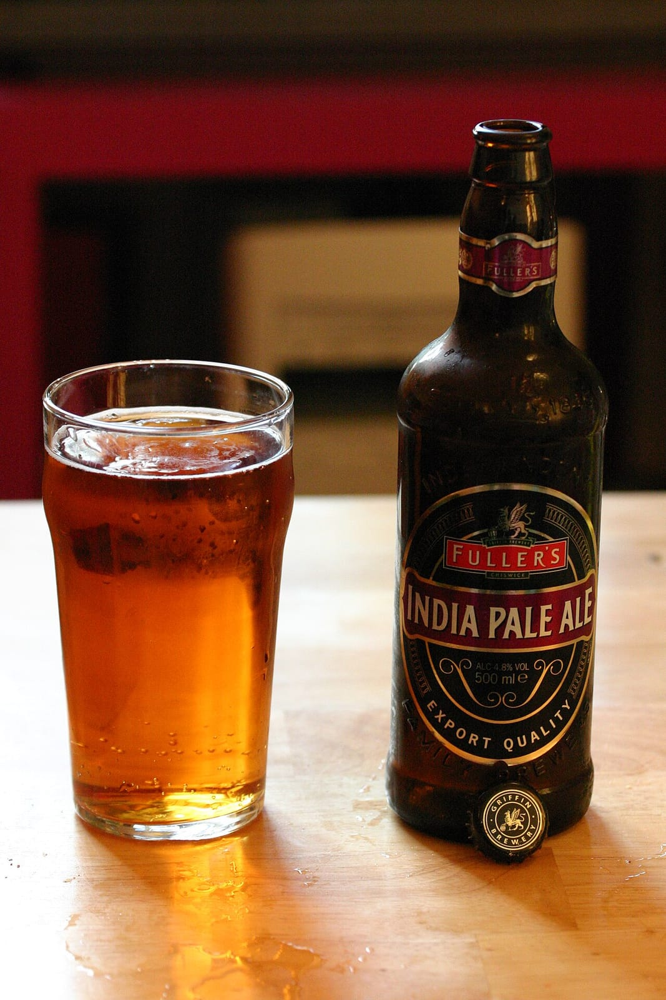

# India pale ale

India pale ale (IPA) is a top-fermented beer family defined by prominent hop aroma and bitterness. It grew out of the British trade in beer exported to India, took a stable form in Burton and elsewhere in the 19th century, and was redefined by American craft brewing in the late 1970s, spawning American IPA, double IPA and hazy IPA. The key to understanding IPA is to treat bitterness as a tunable parameter, not a quality grade.

Figure: India pale ale. Image: Wikimedia Commons contributor, CC BY-SA 3.0, via Wikimedia Commons ([source page](https://commons.wikimedia.org/wiki/File:Fuller%27s_India_pale_ale.jpg)).

## Definition and standards

IPA is not a single style but a family. Style guidelines usually split it into English IPA, American IPA, double IPA and hazy IPA, each with its own ranges for strength, bitterness and colour. What they share is hop expression ahead of malt sweetness, top fermentation and a fairly dry finish. It is an offshoot of the [English ale](ref:english-ale) tradition and sits alongside today's [beer](ref:beer) style system.

For English IPA, typical alcohol content is around 5.0–7.5% and bitterness around 40–60 IBU; American IPA has similar or slightly higher ranges, but its aroma leans more towards citrus and pine. These ranges are descriptive tools for judging whether a beer lands within its target style, not a ranking of beers.

## Origin and history

In the late 18th century the Hodgson brewery in London supplied India, and other [United Kingdom](ref:united-kingdom) breweries soon joined the trade. In the 19th century Burton upon Trent became an important export centre thanks to its sulphate-rich water, which made local hop bitterness seem drier and sharper. Export beers generally raised both hopping rates and alcohol so that they would keep on long sea voyages.

The traditional account reduces this to “more hops for preservation”, but recent beer history warns that the explanation is incomplete: the structure of trade, the purchasing power of consumers in India and the already high hopping rates of British beer were all factors. Saying that IPA was invented in India is a clear myth.

In the 20th century English IPA was partly overshadowed by pale ale and bitter, and its bitterness grew more restrained. In the late 1970s the [American](ref:usa) [craft beer](ref:craft-beer) movement reinterpreted the name, using local high-alpha hops for a more extroverted aroma, and IPA became one of the most recognisable styles in craft brewing.

## Ingredients and process

[Barley](ref:barley) is mostly pale ale malt, providing enough fermentable sugar and a clean malt backbone. A little specialty malt can add biscuit or caramel notes, but should not overpower the hops. Hop variety sets the aromatic direction: English Goldings and Fuggles lean herbal, earthy and floral; American Cascade, Citra and Mosaic lean citrus, pine and tropical fruit.

Dry hopping adds hops late in fermentation or during conditioning, mainly extracting aroma rather than bitterness. Early-boil additions contribute bitterness, while late and whirlpool additions contribute flavour and aroma. Water chemistry also changes expression: sulphate accentuates bitterness, chloride rounds the mouthfeel. Hazy IPA often adds wheat or oats to raise proteins and polysaccharides and deliberately keeps suspended solids.

[Fermentation](ref:fermentation) uses brewer's yeast at temperatures that keep esters under control. Warmer runs bring pronounced fruit, even solvent notes; cooler runs are cleaner and let the hops lead. Controlling oxidation after fermentation matters just as much, because hop aroma is the first thing to go.

## Flavour profile

The first impression of an IPA should be aroma, not a bitterness number. English IPA commonly shows herbal, earthy and floral notes over a dry malt backbone; American IPA shows citrus, grapefruit, pine and tropical fruit; hazy IPA is more aromatic still, with a rounder mouthfeel and often gentler bitterness.

The quality of bitterness matters more than its strength. Good bitterness is clean, supported by malt and leaves a pleasant aftertaste rather than a sharp or lingering astringency. [Bitterness](ref:ibu) measures the concentration of isomerised alpha acids and does not fully represent perceived bitterness: malt sweetness, carbonation, temperature and body all change the experience. Two beers both labelled 60 IBU can taste very different.

## Tasting and serving

IPA rewards freshness and is best served at around 6–10°C. Too cold suppresses aroma; too warm lets alcohol dominate. The glass should gather aroma, and a tulip or a dedicated IPA glass works well. Keeping a layer of foam when pouring slows the release of aroma.

Store away from light in a cool place; unfiltered and unpasteurised products usually need refrigeration. Once opened, drink it soon, because escaping carbon dioxide and oxidation change the flavour quickly. With food, higher bitterness cuts through fat and suits grilled meat, fried food and strong cheese; with lighter dishes, choose a gentler version.

## Common misconceptions

First, believing IPA was invented in India. It developed in Britain for the export market to India.
Second, believing more bitterness is better. Bitterness needs malt and aroma for support; raising IBU alone unbalances the beer.
Third, treating IBU as a quality score. It is an analytical measure, not a measure of how good a beer tastes.
Fourth, treating hazy IPA as a process failure. Its haze comes from the interaction of proteins, polysaccharides and hop polyphenols, and is part of the design.
Fifth, believing IPA must be high in alcohol. Low-alcohol session IPA belongs to the same family.

**Short definition:** A top-fermented beer family defined by prominent hop aroma and bitterness, rooted in British export trade to India and now split into English, American and hazy branches, where bitterness is a variable rather than a grade.

For India pale ale, begin with the production rule. Then look at the strength, and finally ask the usual serving. The answers point to different choices, not to a single score.

[Beer](ref:beer) explains legal definition; [United Kingdom](ref:united-kingdom) adds materials and process. Put India pale ale between them before deciding what it is.

**Key facts.**

| Item | Detail |
| --- | --- |
| In one line | A top-fermented beer family defined by prominent hop aroma and bitterness, rooted in British export trade to India and now split into English, American and hazy branches, where bitterness is a variable rather than a grad… |
| Parent style | Beer |
| Aroma family | Hops |

**Sources and limits.** The key claims about India pale ale are checked against the following sources: Beer Judge Certification Program (strength, bitterness and aroma boundaries for English, American and hazy IPA; no original text is reproduced), Brewers Association (public US craft industry statements on IPA and its variants; no original wording is reproduced), Campaign for Real Ale (the British beer tradition and the historical context of English IPA; no original text is reproduced) and 4 sources in total. Prices, batches and status change; the body is project-written and does not reproduce source text.

## Further reading

- [Beer](ref:beer): the overall classification and process framework for beer.
- [English ale](ref:english-ale): the British top-fermenting tradition IPA grew out of.
- [United Kingdom](ref:united-kingdom): the export trade and Burton brewing background.
- [United States](ref:usa): the home of modern American IPA and the craft movement.
- [Craft beer](ref:craft-beer): the market context in which IPA was redefined.
- [Bitterness](ref:ibu): what IBU means, how it is measured and where it stops.
- [Barley](ref:barley): the malt backbone that balances the hops.
- [Fermentation](ref:fermentation): how top-fermentation temperature shapes aroma.

## Related images

Image: Craft beer. Credit: Bernt Rostad, CC BY 2.0, via Wikimedia Commons ([source page](https://commons.wikimedia.org/wiki/File:Zachariasbryggen_Microbrewery.jpg)). Related image for India pale ale.
