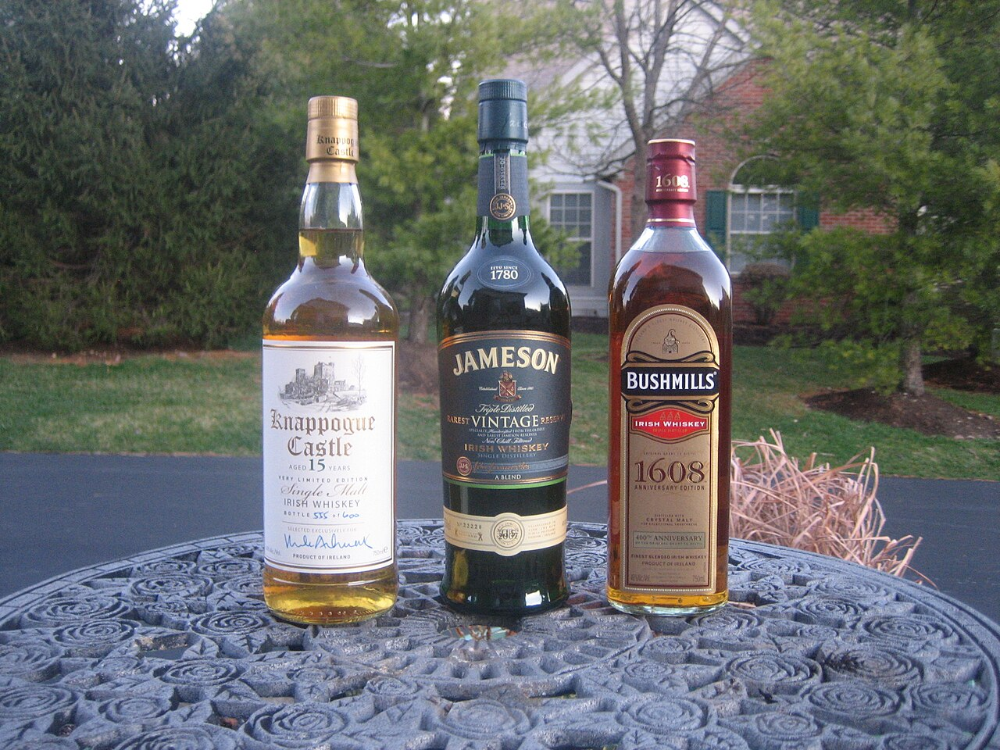

# Irish whiskey

Irish whiskey is one of Ireland's oldest distilled drinks. It is protected as a geographical indication in the European Union, and its name carries an extra "e" that separates it in spelling from Scotch and Japanese whisky. The legal framework is compact: cereal grains, fermentation and distillation, at least three years in wooden casks, bottling at no less than 40% ABV, and distillation below 94.8% ABV. What gives Irish whiskey its own character is a pair of traditions: single pot still distillation and triple distillation.

Figure: Irish whiskey. Image: Hammersbach, CC BY-SA 3.0, via Wikimedia Commons ([source page](https://commons.wikimedia.org/wiki/File:GoodIrishWhiskeys.jpg)).

## Definition and legal rules

Under EU spirit-drinks law and the Irish technical file, Irish whiskey must be distilled and matured on the island of Ireland, including both the Republic of Ireland and Northern Ireland. It is made from cereal grains, fermented and distilled, then matured in wooden casks for at least three years. The distillate must be below 94.8% ABV, and the bottled spirit must be at least 40% ABV. Nothing may be added except water and caramel colouring.

"Irish Whiskey" is a protected geographical indication. It is not a synonym for "whiskey bottled in Ireland": both distillation and maturation must take place on the island. The rules also govern the category names, so single malt, single pot still, single grain and blended each have their own material and distillation requirements.

## Why "whiskey" with an e

The official name is Irish whiskey, while Scotch and most Japanese producers write whisky. The difference is not a legal requirement but a long-standing convention reinforced by the geographical name; American whiskey also uses the "e". On a label, the spelling is a useful clue to origin, but it cannot be reversed into a style claim: a bottle spelled whiskey need not be Irish, and the back label remains the decisive source.

Chinese sources render the name phonetically, and formal writing should keep the English name alongside the transcription so that the spelling difference is not mistaken for a quality difference.

## History: from monasteries to modern distilleries

Distilling in Ireland goes back to medieval monasteries. The Gaelic phrase uisce beatha, "water of life", is the ancestor of the word whiskey. By the nineteenth century, large distilleries had appeared around Dublin and Cork, and Irish whiskey was a major export. Dublin-style pot still whiskey used a mixed mash of malted and unmalted barley, giving a thick body and a strong spice character.

The late nineteenth and twentieth centuries brought a long contraction. The First World War, trade friction after Irish independence, American Prohibition and competition from blended Scotch all damaged export markets. A small number of distilleries kept production alive in the later twentieth century, and new distilleries followed. Single pot still and older expressions regained attention. Today production is more widely distributed than in the historic peak, but Dublin, Cork and Bushmills in Northern Ireland remain traditional reference points.

## Raw materials and distillation

The main raw material is [barley](ref:barley), though maize and wheat may also be used. Barley is malted, and some distilleries keep unmalted barley in the mash to add cereal and spice. After mashing, yeast ferments the wort, and the wash goes to [distillation](ref:distillation). Pot stills are the Irish tradition; column stills are used for grain whiskey.

Triple distillation is the most frequently cited Irish technical feature. A third pass gives the spirit more contact with copper, removes sulphur compounds more thoroughly and produces a lighter, cleaner, softer result. But triple distillation is not a legal requirement. Several distilleries distil twice, keeping more cereal oil and weight. Treating "Irish whiskey" as a synonym for triple distillation turns a tradition into a false rule.

## The four categories

Single Malt Irish Whiskey is made from 100% malted barley at one distillery in pot stills. Single Pot Still Irish Whiskey is made at one distillery in pot stills from a mash containing at least 30% malted barley and at least 30% unmalted barley, with no more than 5% other cereals. Single Grain Irish Whiskey comes from one distillery and is made in a column still from cereals, often maize or wheat. Blended Irish Whiskey combines two or more of these whiskeys.

The categories are not a quality ladder. Blended whiskey holds most of the market and aims at consistency and balance. Single pot still stresses the cereal and spice of unmalted barley. Single malt highlights malt and distillery character. Single grain often provides the backbone of a blend but can also be bottled alone to show the clean character of column distillation.

## Style and flavour

Irish whiskey is often described as smooth, rounded and approachable. Aromas commonly include green apple, pear, citrus, vanilla, honey and cereal sweetness. The palate ranges from light grain whiskey to a thick pot still whiskey. Triple-distilled products tend to be cleaner and finer; double-distilled products carry more oil and spice. The unmalted barley in single pot still brings a complex mix of green apple, clove, nutmeg and toasted bread.

Peat is not a general Irish characteristic. Most Irish whiskey uses malt dried without peat, so smoke is absent or very light. A few distilleries deliberately make peated versions as a contrast. Equating Irish whiskey with "always unpeated" ignores those exceptions, while treating peat as typically Irish misreads the majority of production.

## Regions and traditional centres

Irish whiskey has no legally defined sub-regions comparable to Scotch. The geographical indication covers the whole island, and place names on labels are usually distillery locations or traditional descriptions rather than legal grades. Dublin was the historic centre of pot still whiskey. Midleton in County Cork is home to a large distillery complex. Bushmills in Northern Ireland is known for malt whiskey, and Cooley in County Louth helped drive the modern revival of single malt and peated styles.

These are industrial landmarks, not flavour guarantees. One distillery can run several product lines with different raw materials, distillation counts and cask types, and a new distillery in the same county may take a completely different technical route. For the wider setting, see [Ireland](ref:ireland).

## Examples

Common examples include Jameson, Bushmills, Tullamore D.E.W., Powers, Redbreast, Green Spot, Kilbeggan and Connemara. They cover blended, single malt, single pot still and peated styles. The category, cask type and age of a particular bottle should be read from its label; this page does not rank brands or batches.

When buying, read the category first, then whether the whiskey is from a single distillery, its raw-material structure and its distillation method, and finally its age, cask type and strength. Blended whiskey suits everyday drinking and mixing; single pot still rewards attention to cereal and spice; single malt is useful for comparing distillery styles; cask-strength versions benefit from a little water.

## Maturation and oak

Maturation must take place in wooden casks for at least three years, as discussed under [oak ageing](ref:oak-ageing). Irish whiskey commonly uses oak casks that previously held bourbon, sherry or other drinks. Previous contents, toast level and the number of fills bring vanilla, coconut, dried fruit, chocolate and spice. Some products use new or specially treated casks to add sweetness and layers.

An age statement gives the age of the youngest whiskey in the bottle. A 12-year-old blend may contain older whiskey, but none younger than 12 years. Longer maturation is not automatically better: if the base spirit lacks structure, wood and bitterness can overwhelm the cereal character.

## Tasting and serving

Neat is the best way to judge the balance of cereal, fruit, spice and cask. A few drops of water reduce alcohol burn and open the aroma, but too much dilutes the body. Ice suits stronger products, though cold suppresses delicate notes. Irish whiskey is also a common base for hot drinks and cocktails: Irish coffee combines whiskey, coffee, sugar and cream, while a hot toddy uses hot water, sugar and spice.

Smell the still aroma first, then take a small sip and watch sweetness, body, cereal character and the finish. Excessive drinking is harmful to health, and minors should not drink.

## Common misconceptions

First, assuming Irish whiskey must be triple distilled. Triple distillation is a tradition, not a legal requirement, and double distillation is equally valid.

Second, treating the "e" in whiskey as uniquely Irish. American whiskey also uses it; spelling is only a clue.

Third, equating Irish whiskey with single malt. Blended whiskey holds most of the market, and single pot still is a distinctively Irish category.

Fourth, assuming all Irish whiskey is unpeated. Most is, but deliberately peated versions exist.

Fifth, confusing single pot still with single malt. Single pot still uses a mixed mash of malted and unmalted barley, so the raw-material structure differs.

Sixth, treating age as a guarantee of quality. Maturation depends on cask, warehouse and climate, and the structure of the base spirit matters just as much.

## Further reading

- [Whisky](ref:whisky): the wider classification and process.
- [Distillation](ref:distillation): pot stills, column stills and triple distillation.
- [Oak ageing](ref:oak-ageing): how cask type and time shape flavour.
- [Barley](ref:barley): the main cereal of Irish whiskey.
- [Ireland](ref:ireland): the country's food and drink background.
