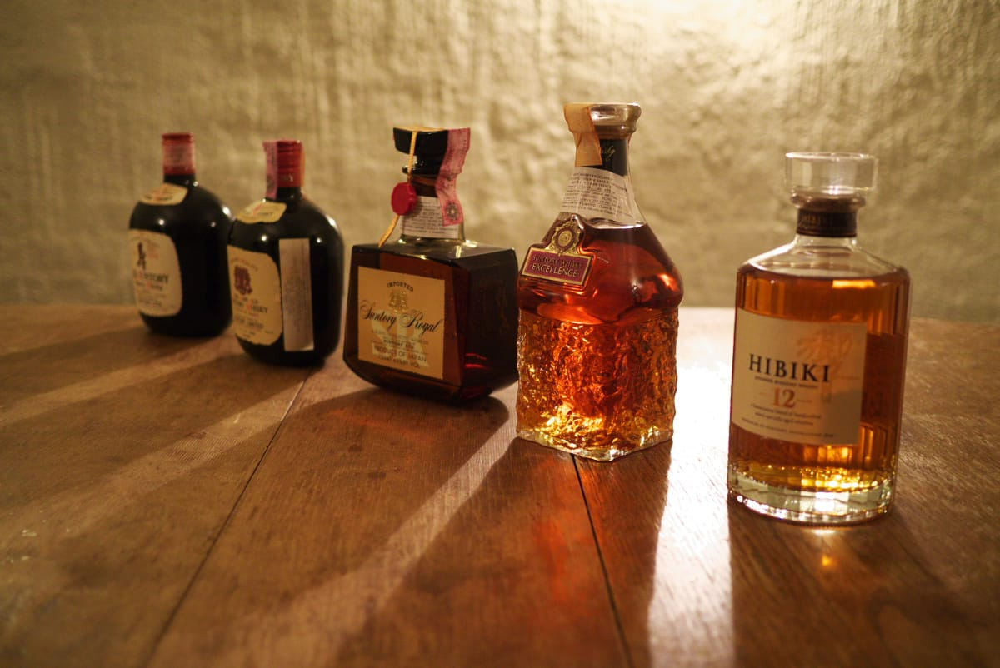

# Japanese whisky

Japanese whisky has a history of less than a century, yet it has acquired a clear international identity. It began by copying Scotland, then developed its own mix of stills, yeast management and mizunara oak. More recently, an industry labelling standard that took effect in 2021 turned "Japanese whisky" from an easily abused origin impression into a set of conditions that can be checked line by line.

Figure: Japanese whisky. Image: Mikael Leppä, CC BY 2.0, via Wikimedia Commons ([source page](https://commons.wikimedia.org/wiki/File:Vintage_Suntory_Tasting.jpg)).

> **Quick verdict**
> **In one line:** This style places Japanese whisky on the flavour map, and helps you choose and serve it.
>
> - **Best for:** Anyone comparing Japanese whisky with other styles before buying or ordering.
> - **Not for:** If you want want a single “best” ranking and reject stylistic difference.
> - **Check first:**
>   - The usual starting point is 1923, when Suntory built a malt whisky distillery at Yamazaki on the border of Kyoto and Osaka prefectures.
>   - For neat drinking, use a tulip-shaped glass.

## Definition and regulation

In February 2021 the Japan Spirits & Liqueurs Makers Association published a labelling standard for Japanese whisky. It took effect on 1 April 2021, with a transition period running to 31 March 2024. To carry the name "Japanese Whisky" or "Japan Whisky", a product must meet the following conditions: the raw materials must be malted grains, grains or potatoes; mashing, fermentation and distillation must all take place in Japan; the distillate must be below 95% ABV; maturation must last at least three years in wooden casks no larger than 700 litres, in Japan; bottling must happen in Japan at no less than 40% ABV; and plain caramel colouring is permitted.

This is a voluntary standard set by an industry association, not an act of parliament, but it binds member companies and is reinforced by market scrutiny. Japan's National Tax Agency oversees liquor labelling in general, while the industry standard narrows how this particular name may be used within that framework. Compared with the statutory rules behind [Scotch whisky](ref:scotch-whisky), the Japanese route is closer to a combination of self-regulation and administrative oversight.

## History

The usual starting point is 1923, when Suntory built a malt whisky distillery at Yamazaki on the border of Kyoto and Osaka prefectures. Masataka Taketsuru was central to the project. He had studied brewing in Scotland and brought back ideas about pot stills, yeast and maturation. In 1934 he founded Nikka's Yoichi distillery in Hokkaido, creating an early two-centre map of Yamazaki and Yoichi.

After the war, Japanese whisky became a mass-market drink, with blended products dominating. From the 2000s Japanese single malts attracted attention in international competitions, and demand grew sharply in the 2010s, at times outstripping stocks of aged spirit. The boom also exposed a problem: some products with Japanese place names or Japanese-style packaging contained whisky distilled abroad. The 2021 labelling standard was the industry's institutional answer.

## Raw materials and process

The main material is [barley](ref:barley), much of it imported peated malt, alongside unpeated grain used for grain whisky. Water is treated as a stylistic element: Yamazaki, Hakushu, Yoichi and Miyagikyo each draw on different sources, and hardness and mineral content shape fermentation and the spirit that follows.

After mashing and fermentation the wash goes to [distillation](ref:distillation). Japanese distilleries often keep several pot stills of different shapes — some with long lyne arms, some direct-fired, some steam-heated. Different reflux ratios produce spirits ranging from light and fruity to thick and oily. Distillers then fine-tune with yeast strain, fermentation time and the point at which they cut the run. This internal library of styles is the technical reason Japanese blended whisky can show real depth.

## Categories and labelling

Under the voluntary standard, the common categories are single malt Japanese whisky, single grain Japanese whisky and blended Japanese whisky. Single malt requires spirit from one distillery, all mashed, fermented, distilled, matured and bottled in Japan; single grain follows the same logic; blended combines malt and grain. Every component of a "Japanese whisky" must meet the origin and maturation conditions, so imported bulk whisky cannot be dressed up with a Japanese label.

Age statements follow the youngest-liquid rule. A 12-year-old bottling may contain older spirit, but none younger than 12. Japan has no Scottish-style protected regions and no official ranking that puts single malt above blended; the categories describe composition, not quality.

## Sensory profile

Japanese whisky is often described as clean, precise and balanced: apple, pear, citrus and white flowers, with honey, malt sugar and a light peat smoke. Colder northern sites such as Yoichi mature slowly and often show more oiliness and smoke, while Yamazaki and Hakushu lean toward fruit, spice and a clear wood tone.

Mizunara is the most recognisable Japanese element. Japanese oak is dense and porous, difficult to cooperate and prone to leakage, but it can bring sandalwood, incense, coconut and spice. More mizunara is not automatically better: at high proportions the wood can overwhelm the fruit, so most producers use it as one component of a blend rather than the whole cask programme.

## Regions

Japan has no legally defined whisky regions in the Scottish sense; "Japanese whisky" is a national name. Production nevertheless clusters in a few places: Yamazaki in Shimamoto, Osaka; Hakushu in Hokuto, Yamanashi; Yoichi in Yoichi, Hokkaido; and Miyagikyo in Sendai, Miyagi. Smaller distilleries also operate at Chichibu, Akkeshi and Shizuoka.

The climates differ sharply. Hokkaido has long, cold winters and slow maturation, which tends to tighten the spirit; central Honshu is hot and humid in summer, so barrels extract faster and aromas are more extroverted. Because there is no statutory regional system, a place name on a label points mainly to the distillery site rather than to a protected style tier.

## Representative bottles

Yamazaki is known for single malts with fruit, spice and mizunara notes; Hakushu is fresher, with grass, citrus and light smoke; Yoichi is associated with direct-fired stills and a fuller body; Miyagikyo tends toward soft, sweet fruit. Hibiki represents blended whisky and the balance of several distilleries. Newer producers such as Chichibu have drawn attention through small batches and single-cask releases.

These bottles cover single malt, single grain and blended routes and show the "many styles under one roof" character of Japanese whisky. They sit in different combinations of raw material, still and maturation strategy rather than on a single ladder.

## Tasting and serving

For neat drinking, use a tulip-shaped glass. Smell the fruit and malt first, then look for peat, mizunara and cask. A little water opens the aroma but also changes the body. Japanese drinking culture also offers mizuwari, in which ice and water dilute the whisky, and the highball, which adds soda; the first softens the alcohol and lifts sweetness, the second suits food and warm weather.

Temperature matters. Chilling suppresses delicate floral notes and suits heavier versions; room temperature is better for judging structure. Whatever the serve, keep consumption moderate; excessive drinking is harmful to health and minors should not drink.

## Common misconceptions

First, that every bottle carrying a Japanese brand is distilled in Japan. Since the 2021 standard, a product labelled Japanese whisky must complete the key steps in Japan, and old stock cannot keep the name after the transition period. Second, that the industry standard is law. It is written by an association and relies on member compliance and market pressure. Third, that older is always better. Maturation depends on climate, cask and warehouse position, and long ageing only amplifies wood when the base spirit lacks structure. Fourth, that a higher proportion of mizunara means a higher grade. It brings a distinctive aroma but is easy to unbalance. Fifth, that Japan has statutory whisky regions. It does not; place names mainly mark distillery sites. Sixth, that the spelling difference between "whisky" and "whiskey" is a legal distinction. Both spellings are covered by the standard.

To read Japanese whisky, start with the production rule, then the strength, then the usual serving; no single check settles it.

Japanese whisky is not a single style: malt and grain whiskies from different distilleries are blended, and the label's distillery and composition are the practical guide.

## Further reading

- [Scotch whisky](ref:scotch-whisky): the earliest and most important technical and regulatory reference for Japanese whisky.
- [Distillation](ref:distillation): how different pot stills and cuts shape the new spirit.
- [Oak ageing](ref:oak-ageing): the differences between bourbon, sherry and mizunara casks.
- [Barley](ref:barley): the main cereal behind Japanese whisky.
- [Japan](ref:japan): the geographical and industrial setting.
