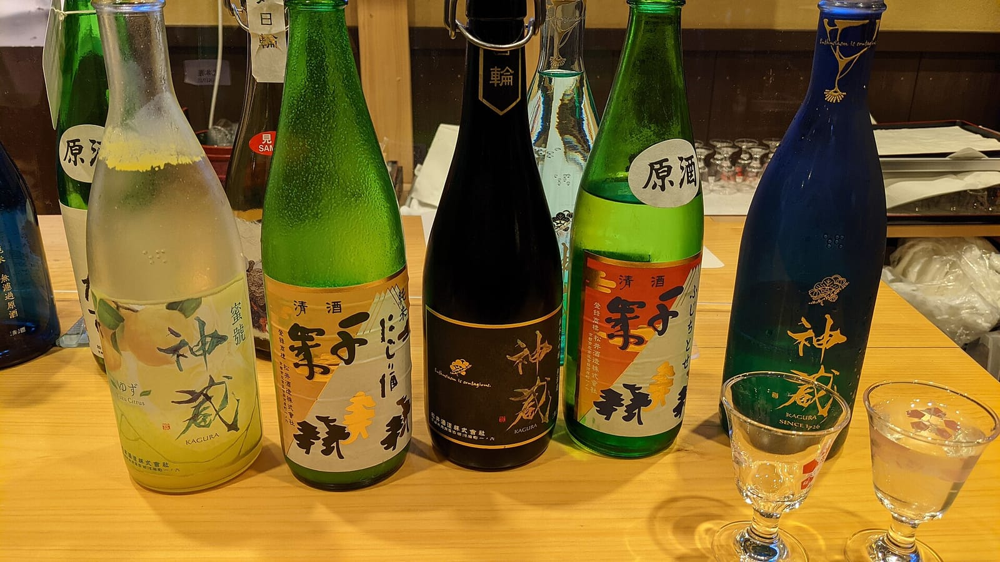

# Junmai sake

Junmai sake is a category of [sake](ref:sake) made only from rice, rice koji and water, with no added brewing alcohol. Its sub-categories, junmai ginjo and junmai daiginjo, correspond to lower polishing ratios and longer fermentation at lower temperatures. Understanding junmai means separating the raw-material rule from the polishing-ratio rule.

Figure: Related photograph of Junmai sake. Image: Nisiguti, CC BY-SA 4.0, via Wikimedia Commons ([source page](https://commons.wikimedia.org/wiki/File:Matsui_Sake_Brewery%27s_Sake_20211122.jpg)).

## Definition and legal conditions

Junmai sake is limited to rice, rice koji and water. No brewing alcohol is added, and no sugars, acidulants or colourings are added. Japan's labelling system for named sake categories treats junmai as a separate class, and the word junmai on a label refers to these material conditions rather than to a taste description.

Note that junmai itself has no single polishing-ratio cap. The figures 60% or 50% appear only when the ginjo or daiginjo condition is added. Reading junmai as automatically high-polished is a common mistake.

## Polishing ratio and sub-categories

The [polishing ratio](ref:polishing-ratio) is the proportion of rice grain remaining. Junmai ginjo has a polishing cap of 60%, and junmai daiginjo of 50%. Both sub-categories require the junmai material rule together with ginjo-style long, cool fermentation.

Polishing removes protein and fat from the outer grain, reducing sources of off-flavour and letting koji reach the centre more easily. A lower ratio usually means higher cost and more broken grains, cleaner aroma, and possibly less of the rice's own umami. Low polishing is therefore a style choice, not a quality score.

## Flavour and palate

Junmai sake is usually fuller than categories with added alcohol, with more rice aroma, umami and acidity. Junmai ginjo keeps rice flavour while adding apple, pear and banana-like esters; junmai daiginjo is more focused in aroma and finer in texture. Rice variety, water and sake mother all create differences, so one template cannot cover the category.

Temperature matters greatly. Chilled serving highlights freshness and aroma, while warming to roughly 40 to 55°C amplifies rice aroma and umami and makes alcohol more obvious. Ginjo types usually suit cooler serving, while junmai and yamahai styles are often recommended warm.

## Brewing points

The sake flow is polishing, washing, steeping, steaming, [koji making](ref:qu-making), sake mother, three-stage addition, fermentation, pressing, clarification, heating and storage. Junmai has no added alcohol to adjust the body, so sake-mother management, steaming and fermentation temperature shape the final flavour more directly.

The sake mother may be sokujo, [kimoto or yamahai](ref:kimoto-yamahai). Sokujo is stable and short, while kimoto and yamahai rely on natural lactic acid bacteria, take longer and give more complexity. Combining junmai with these mothers produces expressions from clean to rich.

## Ginjo aroma and polishing

Ginjo aroma is usually described as apple, pear and banana fruitiness and comes mainly from esters such as isoamyl acetate and ethyl caproate. It needs long cool fermentation, a suitable yeast and low fermentation temperatures, and a low [polishing ratio](ref:polishing-ratio) to reduce interference from off-flavours.

The link is a condition rather than a cause. A low polishing ratio gives more aromatic potential, but if fermentation is too warm or the yeast is unsuitable, the aroma still does not appear. Conversely, a product with a higher ratio can still be clean and fresh. Equating low polishing with ginjo aroma ignores the process.

## Labels and buying

Junmai labels usually show junmai, junmai ginjo or junmai daiginjo together with the polishing number. Buyers should first read the category word, then the polishing ratio, rice variety, sake meter value and whether the sake is unpasteurised. Category words are legal concepts and the polishing ratio is one condition; neither replaces the other.

One brewery may make junmai, honjozo and ginjo products at the same time. Comparison should combine category, polishing ratio, strength and price band rather than judging by the word junmai alone.

## Common misconceptions

First, treating junmai as a higher grade. It is a raw-material category, not a quality ranking.
Second, assuming junmai must have a very low polishing ratio. Junmai has no single cap, and low ratios come from ginjo or daiginjo conditions.
Third, setting junmai against ginjo. Junmai ginjo is the intersection, with no added alcohol and ginjo-style brewing.
Fourth, assuming all junmai should be warmed. Temperature depends on the product, and ginjo types usually suit cooler serving.
Fifth, attributing ginjo aroma to polishing alone. Aroma comes from yeast, temperature and process, with polishing only one precondition.

Junmai is made from water, rice and rice koji and adds no brewing alcohol; that is the essential difference from honjozo. Junmai ginjo and junmai daiginjo add tighter polishing limits, but the polishing ratio indicates how much of the grain was removed, not how sweet or how refined the finished sake will be. Junmai can be rich or lean depending on yeast, temperature and the moto management.

For Junmai sake, begin with the production rule. Then look at the strength, and finally ask the usual serving. The answers point to different choices, not to a single score.

**Short definition:** A sake category made only from rice, rice koji and water, with no added brewing alcohol. Junmai ginjo and junmai daiginjo also carry 60% and 50% polishing caps.

A common mistake is to treat Junmai sake as a particular brand. Start with what it is, then check what the label says. If they conflict, trust the more specific source.

Sources for Junmai sake include Japan Sake and Shochu Makers Association, National Tax Agency of Japan, Oxford University Press.

Junmai is defined by ingredients: rice, rice koji and water, with no added brewing alcohol. The polishing ratio is separate, so a junmai can be made from 70% or 60% polished rice; junmai ginjo and junmai daiginjo add the 60% and 50% caps. The term says nothing about sweetness or quality, which depend on the sake meter value and the brewer's style.

**Key facts.**

| Item | Detail |
| --- | --- |
| In one line | A sake category made only from rice, rice koji and water, with no added brewing alcohol. Junmai ginjo and junmai daiginjo also carry 60% and 50% polishing caps. |
| Parent style | Sake |
| Aroma family | rice aroma |

**Sources and limits.** The key claims about Junmai sake are checked against the following sources: Japan Sake and Shochu Makers Association (Used to check sake classification and labelling), National Tax Agency of Japan (raw materials, polishing ratios and labelling rules for named sake categories), Oxford University Press (Consulted for entries on junmai, ginjo aroma and sake brewing; Migrated from the former reference list at the end of the article; access date not re-verified). Prices, batches and status change; the body is project-written and does not reproduce source text.

For Junmai sake, this style was last checked in 2026; prices, batches and availability change, so confirm them against the sources below.

## Further reading

- [Sake](ref:sake): the category system and brewing framework.
- [Polishing ratio](ref:polishing-ratio): polishing degree and its relation to named categories.
- [Koji making](ref:qu-making): the role of rice koji in saccharification.
- [Rice](ref:rice): the difference between sake rice and table rice.
- [Kimoto and yamahai](ref:kimoto-yamahai): sake-mother routes often paired with junmai.
- [Japan](ref:japan): the regional and national background.

## Related images

Image: Qu making. Credit: Uranassbandit, CC BY-SA 3.0, via Wikimedia Commons ([source page](https://commons.wikimedia.org/wiki/File:Hongqu_3.jpg)). Related image for Junmai sake.
