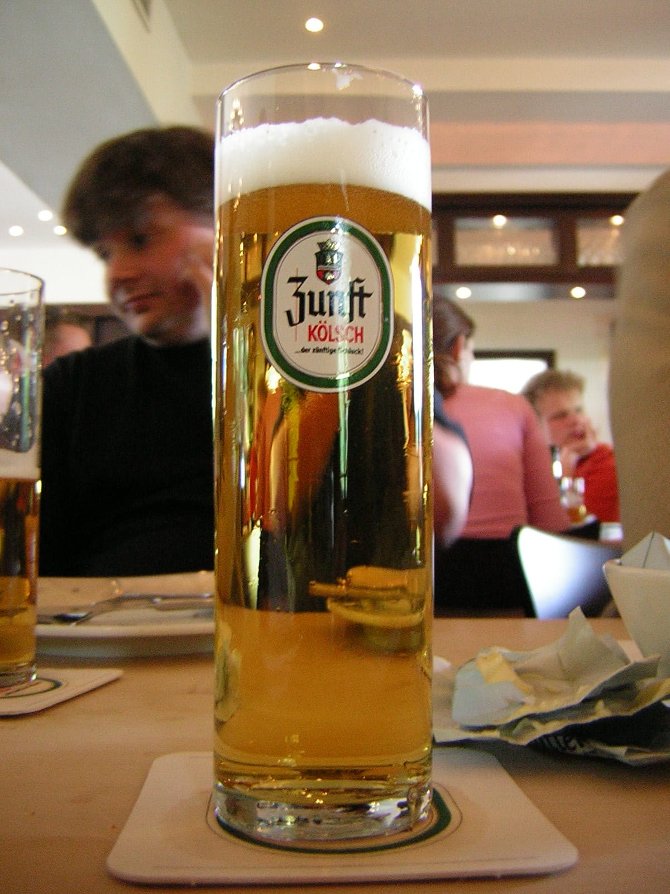

# Kölsch

Kölsch is a pale, top-fermented beer from Cologne (Köln) in Germany, cold-conditioned and filtered, with a light body, a dry finish and a delicate fruitiness balanced by clear hop bitterness. Technically it is an ale; sensorially it sits close to lager. That combination of warm primary fermentation and cold storage is the key to understanding it, and the name is protected by a geographical indication, so not every pale ale may be called Kölsch.

Figure: Kölsch. Image: User:Trexer, CC BY-SA 3.0, via Wikimedia Commons ([source page](https://commons.wikimedia.org/wiki/File:Zunft-K%C3%B6lsch_Glas.JPG)).

## A language you can drink

Cologne drinkers like to say that Kölsch is the only language you can drink. The phrase points to the double meaning of the name: both the dialect and the beer. Brewing in Cologne goes back to the Middle Ages, when brewhouses along the Rhine supplied the surrounding region; when bottom fermentation arrived in the 19th century, local breweries deliberately kept top fermentation to distinguish themselves from Pilsner-style lager.

Within the classification of [beer](ref:beer), Kölsch is usually placed among pale top-fermented beers, but it is not an English pale ale. English ale emphasises malt-hop balance, cellar-temperature service and cask conditioning; Kölsch pursues cleanliness, brightness and stability at low temperature, aiming closer to the drinkability of lager. Understanding this prevents its fruitiness from being read as a fault.

## The line drawn in 1986

On 6 March 1986, breweries in and around Cologne signed the Kölsch Convention (Kölsch Konvention), with 16 articles. It requires Kölsch to be top-fermented, pale, filtered and clearly hop-forward, and restricts brewing to the city of Cologne and its immediate surroundings, with an exemption for breweries already using the name outside the area. This voluntary agreement later became the basis for EU geographical protection, and Kölsch now carries protected geographical indication status.

The geographical scope is often misreported as anywhere you can see Cologne Cathedral. The real boundary is defined by the convention and the EU registration, not by a sightline. Protection is not only about place but about a minimum consensus on process and sensory profile: pale, filtered, top-fermented, hop-clear. Reading the scope too broadly drains the name of its power to distinguish.

## Top-fermented, yet cold like a lager

The grist is usually pale barley malt, with some breweries adding a little [wheat](ref:wheat) for foam and texture; hops are mostly German noble varieties such as Hallertau or Tettnang, emphasising herbs and spice rather than tropical fruit. Mashing is typically single-infusion or stepped, aiming for clean malt sweetness rather than caramel.

[Fermentation](ref:fermentation) uses ale [yeast](ref:yeast) at roughly 15–20°C, producing a little pear and apple ester; the beer then moves to a storage phase near 0–4°C for several weeks. Cold storage drops the yeast, reduces diacetyl, dries the palate and leaves the filtered beer stable. The process resembles lager in its cold stage, but the yeast and primary temperature differ, which is why a slight fruitiness remains.

Filtration matters: Kölsch is meant to be bright, and removing yeast also removes some aroma precursors, so breweries trade aroma against stability. Unfiltered versions, sometimes called naturally hazy, fall outside the convention's definition and should be discussed separately.

## Pale gold, dry, with a touch of fruit

A typical beer is pale straw to light gold, bright and clear, with fine white foam. The aroma rests on grain and light bread, layered with pear, apple and white-flower esters and herbal hops; low sulphur is acceptable and diacetyl should be very low. The palate is light to medium, carbonation medium-high, bitterness clear but not coarse, the finish dry and more hop-led than malt-sweet.

The figures are only a guide: alcohol is commonly about 4.4%–5.2%, [bitterness](ref:ibu) about 18–30 IBU and [original gravity](ref:original-gravity) about 11–12.5 °P. Breweries adjust for local taste; export versions are sometimes stronger. Obvious banana or clove suggests a warm fermentation or a different yeast; a beer with no bitterness and a sweet finish has left the style.

## The 0.2-litre Stange in a Cologne pub

Traditional service uses the slim, straight 0.2-litre Stange, carried on a tray by the Köbes, who replaces empty glasses without being asked until the guest covers the glass. The small glass keeps the beer cold and fresh and keeps conversation from being interrupted by large rounds. Serve at about 6–8°C in clean glassware; grease destroys the foam.

Food follows Rhineland home cooking: Himmel un Ääd (apple, potato mash and blood sausage), Halver Hahn (rye bread with cheese) and sour beef all match the dry, lightly bitter profile. Heavy cream or very sweet dishes overwhelm it, because the bitterness cannot cut the fat. Freshness matters too; Kölsch aroma fades quickly, so choose locally produced bottles or kegs with fast turnover.

Cologne service has its own etiquette: the server brings a new glass when one is empty, and the guest covers the glass to stop. This speeds turnover and demands a light, fresh beer. Outside Cologne the same beer usually appears in bottles, with a more restrained aroma; that is the cost of transport, not a change in recipe.

## Distance from Pilsner, saison and wheat beer

Compared with [Pilsner](ref:pilsner), Kölsch is top-fermented, fruitier, usually softer in bitterness and rounder in body. Compared with [wheat beer](ref:wheat-beer), it is clear, filtered and free of banana and clove, with restrained yeast character. Compared with [saison](ref:saison), it is lower in alcohol, with less pepper and farmhouse character, and reads as an urban everyday beer rather than a farmhouse one. Compared with American pale ale, its hop load and aroma intensity are far lower.

These differences show that style boundaries are set by yeast, temperature, filtration and service, not by colour alone. Calling every pale beer Kölsch is inaccurate and weakens the geographical indication. Breweries elsewhere in [Germany](ref:germany) may borrow the process, but they may not use the name.

Begin with the production rule, move on to the strength, and finish with the usual serving. That order keeps the reading of Kölsch practical.

[Beer](ref:beer) and [Wheat beer](ref:wheat-beer) are the two useful reference points for Kölsch. [Beer](ref:beer) sets out legal definition; [Wheat beer](ref:wheat-beer) brings in materials and process. Read them together.

**Key facts.**

| Item | Detail |
| --- | --- |
| In one line | Cologne's pale top-fermented beer, cold-conditioned and filtered, marked by clean fruit, soft bitterness and service in 0.2-litre Stangen, with a geographically protected name. |
| Parent style | Beer |
| Aroma family | Malt and hops |

**Sources and limits.** The key claims about Kölsch are checked against the following sources: Beer Judge Certification Program (the strength, bitterness, colour and fermentation description of Kölsch; no original text is reproduced), Privatbrauerei Gaffel, Deutscher Brauer-Bund e.V. (public statements on German beer variety and regional style protection; no original text is reproduced) and 4 sources in total. Prices, batches and status change; the body is project-written and does not reproduce source text.
