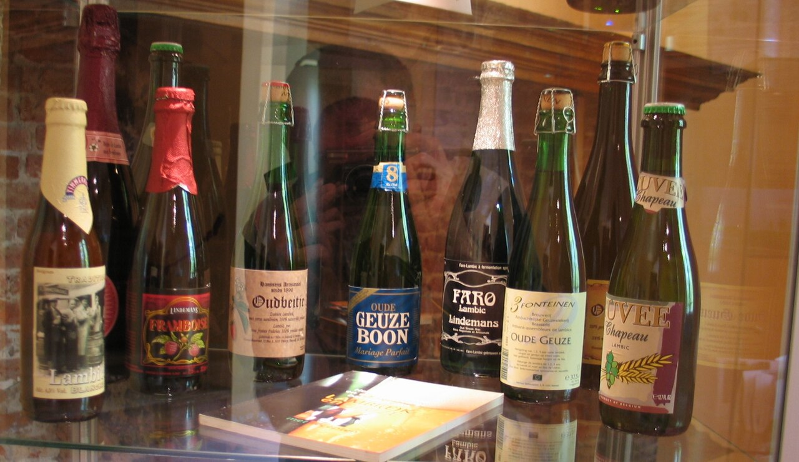

# Lambic

Lambic (Dutch: lambiek) is a traditional beer of the Pajottenland and Senne (Zenne) valley around Brussels, fermented spontaneously by wild yeast and bacteria from the air rather than by pitching a commercial yeast. It is sour, dry and funky, often bottled as a blend of aged and young lambic called gueuze, with fruit versions such as kriek and framboise.

Figure: Lambic. Image: Paul Hermans at Dutch Wikipedia, CC BY-SA 3.0, via Wikimedia Commons ([source page](https://commons.wikimedia.org/wiki/File:Bieren_uit_de_streek_rond_brussel.jpg)).

## Definition and standards

Lambic has no single parameter table. Alcohol commonly runs 5.0–6.5%, gueuze commonly 5.0–8.0%, and fruit lambic commonly 5.0–7.0%. Colour ranges from pale gold to amber, and the beer is usually hazy; bitterness is very low, usually no more than 10 IBU. Style guidelines list lambic, gueuze and fruit lambic separately, but they share one base: the same spontaneous fermentation and long ageing process.

The names form a hierarchy. Gueuze is a blend of lambic from different years, refermented in the bottle; it is not a separate fermentation method from lambic. Kriek and framboise add cherries or raspberries to a lambic base. Treating gueuze as a mere brand name for lambic misses the blending and bottle fermentation that define it.

## Origin and history

Lambic brewing is centred on the Pajottenland west and south of Brussels, and the water and airborne microbes of the Senne valley are regarded as important to the style's character. The area had established lambic and gueuze production by the 18th and 19th centuries, output shrank sharply in the late 20th century, and the tradition later recovered through the efforts of breweries and enthusiasts.

At EU level, traditional names such as Oude Geuze and Oude Kriek have held guaranteed traditional speciality (TSG) protection since 1997; whether lambic as a whole is a protected geographical indication should be checked against the official EU register and should not be claimed broadly. Today lambic is still made mainly by small breweries in [Belgium](ref:belgium), in limited volumes.

## Ingredients and process

[Barley](ref:barley) malt forms the base, and [wheat](ref:wheat) is often used unmalted at 30–40% of the grist, providing nutrients for the body and the microbes. Hops are aged: after long storage the alpha acids fall, antimicrobial properties remain and bitterness becomes very low, which is why lambic is so lightly bittered.

Mashing uses a turbid mash, keeping dextrins and unmalted starch to give bacteria and yeast a slow food source. The wort cools overnight in an open coolship, taking up yeasts and bacteria from the environment, and then goes into oak barrels for [ageing](ref:oak-ageing) of one to three years. [Fermentation](ref:fermentation) is not the work of a single organism: brewer's yeast, Brettanomyces, lactic acid bacteria and pediococci act in sequence, creating complex acidity and aroma.

Blending is central to gueuze: young lambic supplies fermentable sugar, while old lambic supplies acidity, aroma and structure; the blend is bottled and refermented to produce fine bubbles. Fruit versions add whole fruit or pulp during ageing, and the sugar is consumed by the microbes, changing flavour and acidity.

## Flavour profile

Lambic is pale gold to amber and usually hazy. The aroma is dominated by sourness, citrus, green apple, hay, barnyard and horse blanket, possibly with oak, honey and spice; the palate is dry, clearly acidic, very lightly bitter and clean in the finish. Gueuze has bubbles from the second fermentation, with more concentrated acidity and aroma layers; fruit versions add cherry or raspberry fruit and acidity.

The acidity of a good lambic should be bright rather than harsh, and the wild character complex rather than rotten. Heavy vinegar, cardboard or obvious solvent notes usually point to oxidation, hygiene or barrel-management problems rather than to the style itself.

## Tasting and serving

Lambic and gueuze are best at around 8–12°C. A tulip or narrowing glass helps concentrate aroma; gueuze should be poured slowly to avoid disturbing the sediment. With food they suit hard cheese, seafood, poultry and distinctly sour dishes, and can also serve as an aperitif.

Bottled lambic should be stored upright, away from light and in a cool place to limit oxygen ingress. High acidity and low alcohol mean an opened bottle does not keep well; aged gueuze continues to change, but not every version rewards long cellaring, so brewery advice is worth checking at purchase.

## Common misconceptions

First, equating lambic with ordinary sour beer. Spontaneous fermentation, a specific region and long oak ageing are its core.
Second, assuming sourness means spoiled beer. Lambic's acidity comes from controlled microbial activity.
Third, assuming all lambic contains fruit. Fruit versions are only one group.
Fourth, assuming lambic improves indefinitely with age. Acidity, barrel character and bubbles need balance, and excessive oxidation destroys flavour.
Fifth, assuming lambic can easily be reproduced anywhere. Its character is closely tied to the local environment, hop treatment and the microbes of the barrel room.

**At a glance:** A traditional beer of Belgium's Pajottenland and Senne valley, fermented spontaneously by wild yeast and bacteria; it uses a turbid mash, aged hops and long oak ageing, and is often blended from young and old lambic into gueuze, with cherry and raspberry fruit versions. 

Read Lambic through the production rule, then the strength, and finally the usual serving. The sequence matters.

It is a mistake to read Lambic as a particular brand; that also distorts its identity and use. Keep what it is separate from how it is used.

Lambic is fermented by wild yeast and bacteria in the Senne valley, then aged in oak and blended; gueuze is a blend of young and old lambic.

**Key facts.**

| Item | Detail |
| --- | --- |
| In one line | A traditional beer of Belgium's Pajottenland and Senne valley, fermented spontaneously by wild yeast and bacteria; it uses a turbid mash, aged hops and long oak ageing, and is often blended from young and old lambic into… |
| Parent style | Beer |
| Aroma family | Sour and wild yeast |

**Sources and limits.** The key claims about Lambic are checked against the following sources: Brasserie Cantillon, Beer Judge Certification Program, Oxford University Press and 4 sources in total. Prices, batches and status change; the body is project-written and does not reproduce source text.

**Read alongside.** Put Lambic next to Beer, Belgium, Wheat: the first fixes identity and boundary, the others provide a region, process or peer comparison. Read this style first, then return to those entries; the links become coordinates, not decoration.

For Lambic, this style was last checked in 2026; prices, batches and availability change, so confirm them against the sources below.

## Further reading

- [Beer](ref:beer): where lambic sits in the beer style system.
- [Belgium](ref:belgium): the Pajottenland and Senne valley background.
- [Wheat](ref:wheat): the role of unmalted wheat in the lambic grist.
- [Barley](ref:barley): the source of base malt for lambic.
- [Fermentation](ref:fermentation): the mixed fermentation driven by wild yeast and bacteria.
- [Oak ageing](ref:oak-ageing): how long barrel ageing shapes acidity and aroma.
- [Craft beer](ref:craft-beer): the background for lambic's revival and modern sour beer trends.

## Related images

Image: Category image for Belgium. Credit: Falk2, CC BY-SA 4.0, via Wikimedia Commons ([source page](https://commons.wikimedia.org/wiki/File:J33_542_Walplein,_%C2%BBDe_halve_Maan%C2%AB.jpg)). Related image for Lambic.
