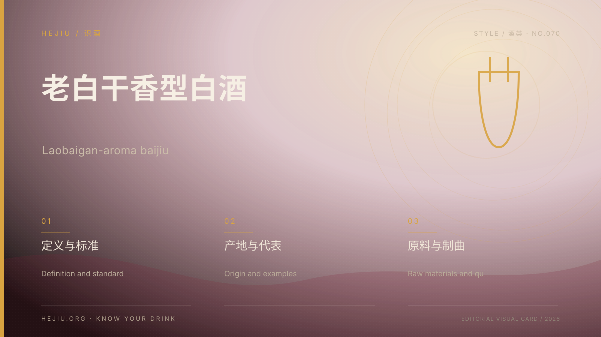

# Laobaigan-aroma baijiu

Laobaigan-aroma baijiu is one of the aroma styles within [baijiu](ref:baijiu), represented above all by Hengshui Laobaigan in Hebei. The national standard GB/T 10781.10-2024, Quality requirements for baijiu — Part 10: Laobaiganxiangxing baijiu, was published on 2024-11-28 and took effect on 2025-12-01, fully replacing GB/T 20825-2007. It uses [sorghum](ref:sorghum) as the main material, wheat-based clear-branch qu as the saccharifying starter, and is commonly described as using ground-jar fermentation and separate steaming of grain and mash.

Figure: thematic illustration for Laobaigan-aroma baijiu. Image: AI-assisted illustration generated with Doubao Seedream 5.0 (project-owned); not a photograph of the subject.

## Definition and standard

Within the baijiu aroma spectrum, Laobaigan aroma sits alongside strong, sauce, light, rice and other styles. The terminology framework is set out in GB/T 15109-2021, Terminology of baijiu industry, while product requirements follow GB/T 10781.10-2024. During the changeover, bottles marked with GB/T 20825-2007 may still be on sale; the declared standard should be read together with the production date.

An aroma style is a classification, not a quality grade. A “Laobaigan aroma” label says which family a bottle belongs to; it does not say the bottle is purer, more traditional or better than another style.

## Origin and examples

The main origin is Hengshui in Hebei. The representative product is Hengshui Laobaigan, with strong expressions such as [Hengshui Laobaigan Gufa 20](ref:laobaigan-gufa). Company materials link the regional story to local water, climate and a long tradition of workshops.

An origin name is not a quality guarantee. Within one aroma style, producers differ in material ratios, qu type, fermentation vessels and storage, and products range from crisp to full-bodied. Treating “Hengshui” as a fixed flavour ignores the layers within a producer's range.

## Raw materials and qu

The main material is [sorghum](ref:sorghum); [wheat](ref:wheat) is used for qu, and rice husks are often steamed before use as a filler. The filler keeps the solid mash loose and permeable during fermentation and distillation, and steaming it is meant to reduce off-flavours from the auxiliary material.

See [qu making](ref:qu-making) for the general principles. Clear-branch qu stresses low temperature, clean steaming and a clean culturing environment, aiming for a stable saccharifying and fermenting starter with few off-flavours. Qu quality sets the base for fermentation start-up and aroma precursors; older is not automatically better.

## Process features

The usual process description for Laobaigan aroma is ground-jar fermentation with separate steaming of grain and mash: the mash ferments in pottery jars sunk into the ground, and distillation handles grain and fermented mash separately so that grain aromas are less masked by the cooking step. Different workshops also use specific routes such as the five-plement method or three-round clean steaming; the details belong to the producer's technical scope.

A ground jar is not a [mud pit](ref:fermentation-pit). A jar is a vessel that stresses isolation and temperature buffering; a pit is a cellar that stresses the long-term culture of pit mud. Confusing the two misreads where flavour comes from. See [fermentation](ref:fermentation) and [distillation](ref:distillation) for the underlying principles.

## Flavour profile

Industry and company descriptions commonly run “elegant aroma, full and mellow body, clean and crisp finish”. Compared with [light-aroma baijiu](ref:light-aroma), Laobaigan aroma usually shows a fuller body and more obvious grain aroma; compared with [strong-aroma baijiu](ref:strong-aroma), it lacks the pronounced cellar aroma and ethyl hexanoate dominance.

These descriptions are coordinates, not scores. Temperature, glass shape, resting time and personal thresholds all change perception, and the same bottle can show different layers in different states.

## Tasting and serving

Start with the still aroma and judge the ratio of grain, qu and ester notes, then add a little water and see whether the aroma opens. On the palate, watch the balance of sweet, sour and bitter notes and the body, then the cleanliness of the finish. Strong products are best sipped from small cups rather than drunk quickly.

Pair with dishes that have concentrated flavour and moderate fat. After opening, keep the bottle sealed, dark and cool, and finish lower-strength products sooner. Excessive drinking is harmful to health, and minors should not drink.

## Common misconceptions

First, equating Laobaigan aroma with light aroma. Both use separate steaming and ground-jar fermentation, but materials, qu and flavour goals differ.
Second, treating “Laobaigan” only as a brand name. It is also an aroma-style name and a customary name for this kind of liquor.
Third, treating ground-jar fermentation as mud-pit fermentation. Vessels and microbial sources differ, and so does the flavour path.
Fourth, treating an aroma style as a quality grade. A style is a classification and cannot replace judging a specific product.
Fifth, treating company claims such as “no hangover” or “low fusel oil” as established science. Such claims need independent testing and evidence.

[Baijiu](ref:baijiu) and [Strong-aroma baijiu](ref:strong-aroma) answer different questions about Laobaigan-aroma baijiu: legal definition and materials and process. Read them as a pair, not as alternatives.

**In brief:** A baijiu aroma style centred on Hengshui in Hebei; GB/T 10781.10-2024, in force from 2025-12-01, fully replaces GB/T 20825-2007, and ground-jar fermentation with separate steaming of grain and mash is the usual process description. 

For Laobaigan-aroma baijiu, begin with the production rule. Then look at the strength, and finally ask the usual serving. The answers point to different choices, not to a single score.

A frequent error is to treat Laobaigan-aroma baijiu as a particular brand. Establish what it is, then what the label claims. Neither answer settles the question alone.

The entry on Laobaigan-aroma baijiu draws on State Administration for Market Regulation, Standardization Administration of China, Hengshui Laobaigan, Hengshui Laobaigan Distillery Group, Oxford University Press.

**Key facts.**

| Item | Detail |
| --- | --- |
| In one line | A baijiu aroma style centred on Hengshui in Hebei; GB/T 10781.10-2024, in force from 2025-12-01, fully replaces GB/T 20825-2007, and ground-jar fermentation with separate steaming of grain and mash is the usual process d… |
| Parent style | Baijiu |
| Aroma family | Laobaigan aroma |

**Sources and limits.** The key claims about Laobaigan-aroma baijiu are checked against the following sources: State Administration for Market Regulation, Standardization Administration of China (the old standard number, effective date and withdrawal date; no original text is reproduced; baijiu, aroma-style and process terminology; no original text is reproduced), Hengshui Laobaigan, Hengshui Laobaigan Distillery Group and 7 sources in total. Prices, batches and status change; the body is project-written and does not reproduce source text.

## Further reading

- [Baijiu](ref:baijiu): the overall classification and process framework.
- [Light-aroma baijiu](ref:light-aroma) and [strong-aroma baijiu](ref:strong-aroma): the two styles most often compared with Laobaigan aroma.
- [Sorghum](ref:sorghum) and [wheat](ref:wheat): the base materials.
- [Qu making](ref:qu-making): the role of clear-branch qu as a saccharifying starter.
- [Fermentation](ref:fermentation) and [distillation](ref:distillation): where ground-jar fermentation and separate steaming sit in the process.
- [Hengshui Laobaigan Gufa 20](ref:laobaigan-gufa): a concrete product example.
