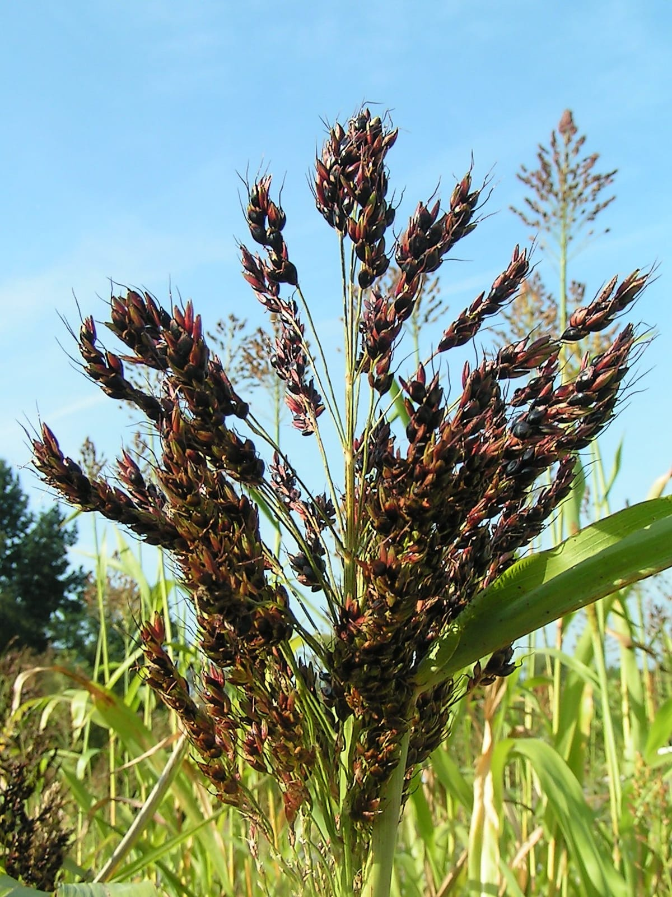

# Light aroma baijiu

Light aroma baijiu is a baijiu aroma style led by ethyl acetate, with a clean, crisp and short finish. Its typical process uses separate steaming, earthen-jar fermentation and a second clean steaming, and its best-known area is Xinghuacun near Fenyang in Shanxi.

Figure: Light aroma baijiu. Image: Xiaomage de, CC BY-SA 4.0, via Wikimedia Commons ([source page](https://commons.wikimedia.org/wiki/File:Vertreter_der_vier_Baijiu_Kategorien.jpg)).

## Definition and standard

The current quality requirement is GB/T 10781.2-2022, Baijiu quality requirements, Part 2, Light aroma baijiu. The standard describes the style through sensory, physicochemical and hygiene indices and sets labelling and testing rules. Aroma style is a classification system, not a quality grade; products within one style still differ in level.

The word light refers to clean aroma and process, not low strength or lack of flavour. The style can be high in alcohol and can show clear grain and qu notes. Reading light aroma as a mild taste misses the strict process requirements behind it.

The standard has also moved: the current GB/T 10781.2-2022 replaces the 2006 edition and adjusts sensory and physicochemical indices and terminology. The name Erguotou comes from the old still-house cut: the head condensed by the first cooling water is discarded, and the middle cut from the second cooling water is taken; the name records a process, not a brand.

## Regions and examples

Xinghuacun in Fenyang, Shanxi, is the best-known light aroma region, with Fenjiu as its representative product. Erguotou from Beijing and some products from Hebei and Inner Mongolia also follow light aroma or closely related process routes. Raw materials, qu type and storage conditions in each region bring stylistic differences.

Light aroma can be divided by qu type into daqu, xiaoqu and fuqu variants. Daqu light aroma shows fuller grain and qu notes, xiaoqu is softer, and fuqu has lower cost and a shorter fermentation cycle. These categories describe process routes, not a ranking.

## Raw materials and qu

Light aroma baijiu uses [sorghum](ref:sorghum) as its main material, and qu is commonly made from barley, peas or wheat. Separately steaming raw materials aims to reduce off-notes and keep the final aroma clean. [Qu making](ref:qu-making) sets saccharification capacity and qu aroma, and qu quality directly affects the fermentation start.

The starch structure, tannin and protein content of sorghum affect yield and flavour. Grind size, moistening water temperature and steaming time must work together for stable fermentation. Good raw material is necessary but not sufficient.

## Process

The typical route is separate steaming of materials and auxiliary materials, a second clean steaming, and fermentation and distillation carried out in two rounds, with no contact between fermenting grain and pit mud. Fermentation usually takes place in earthen jars set flush with the ground, so the jar wall isolates the grain from soil and avoids the pit-mud notes of a [fermentation pit](ref:pit).

Jar fermentation makes temperature easier to control and makes the microbial source depend more on qu and the working environment. [Fermentation](ref:fermentation) time, starting temperature and moisture decide yield and aroma, while head and tail cuts during [distillation](ref:distillation) decide cleanliness and body. Only good execution produces the clean all-through style.

Taking the daqu light-aroma route around Fenyang as an example, “separate steaming twice clean” means sorghum and husk are steamed separately, fermented in earthen jars for about 28 days, distilled, then fermented and distilled a second time; the grain never touches pit mud, so pit microbes cannot rewrite the aroma. Jars flatten temperature swings, letting the operator steer fermentation through starting temperature, moisture and qu dose.

## Flavour profile

Light aroma is led by ethyl acetate, often with green apple, floral and grain notes. It enters crisp, with a relatively clean body and a shorter finish. Compared with the pit aroma of strong aroma or the roasted notes of sauce aroma, light aroma stresses purity and directness rather than layered complexity.

Aroma intensity is not quality. The difficulty of light aroma is cleanliness: few off-notes, correct aroma and a body that is not hollow. Pushing aroma concentration can bring alcohol heat and sharpness, while pushing softness too far can make the spirit thin.

## Tasting and serving

Taste from a small cup, first still, then with a gentle swirl, checking for clear ethyl acetate fruit and grain notes. On the palate, judge the balance of sweet, sour and bitter and the thickness of body, then the length and cleanliness of the finish. Too cold suppresses aroma, too warm highlights alcohol.

Light aroma suits light dishes, noodles and white meat, and is also used for infused liquors and mixing. High-strength products should be sipped slowly from small cups, and low-strength products should not be kept open for long. Judge strength by the label and the actual taste, not by aroma style.

## Common misconceptions

First, treating light aroma as a low-strength product. Aroma style describes aroma and process, not alcohol.
Second, treating light as no flavour. Light aroma has clear grain and qu notes.
Third, treating aroma style as a quality grade. It is only a classification.
Fourth, assuming jar fermentation is always better than a pit. The two aim at different styles.
Fifth, treating all Erguotou as one process. Raw materials, qu and product lines differ widely.

[Baijiu](ref:baijiu) and [Qu making](ref:qu-making) answer different questions about Light aroma baijiu: legal definition and materials and process. Read them as a pair, not as alternatives.

**At a glance:** A baijiu aroma style led by ethyl acetate, made with separate steaming and earthen-jar fermentation for a clean, crisp profile; GB/T 10781.2-2022 applies, and aroma style is not a quality grade. 

For Light aroma baijiu, begin with the production rule. Then look at the strength, and finally ask the usual serving. The answers point to different choices, not to a single score.

**Key facts.**

| Item | Detail |
| --- | --- |
| In one line | A baijiu aroma style led by ethyl acetate, made with separate steaming and earthen-jar fermentation for a clean, crisp profile; GB/T 10781.2-2022 applies, and aroma style is not a quality grade. |
| Parent style | Baijiu |
| Aroma family | Light aroma |

**Sources and limits.** The key claims about Light aroma baijiu are checked against the following sources: State Administration for Market Regulation, Standardization Administration of China (Searchable by standard number in the National Standards Full-Text Public System; Used to check the scope, terminology and classification of GB/T 10781.2-2022; no text copied), Oxford University Press (Consulted for entries on Chinese baijiu and aroma styles; no original text is reproduced). Prices, batches and status change; the body is project-written and does not reproduce source text.

## Further reading

- [Baijiu](ref:baijiu): the overall classification and process framework for baijiu.
- [Sorghum](ref:sorghum): the main raw material for light aroma baijiu.
- [Qu making](ref:qu-making): how qu type and qu aroma shape light aroma.
- [Fermentation](ref:fermentation): jar fermentation and temperature management.
- [Distillation](ref:distillation): head and tail cuts in relation to cleanliness.
- [Fermentation pit](ref:pit): the alternative container to earthen jars.

## Related images

Image: Sorghum. Credit: No machine-readable author provided. Pethan assumed (based on copyright claims)., CC BY-SA 3.0, via Wikimedia Commons ([source page](https://commons.wikimedia.org/wiki/File:Sorghum_bicolor03.jpg)). Related image for Light aroma baijiu.
