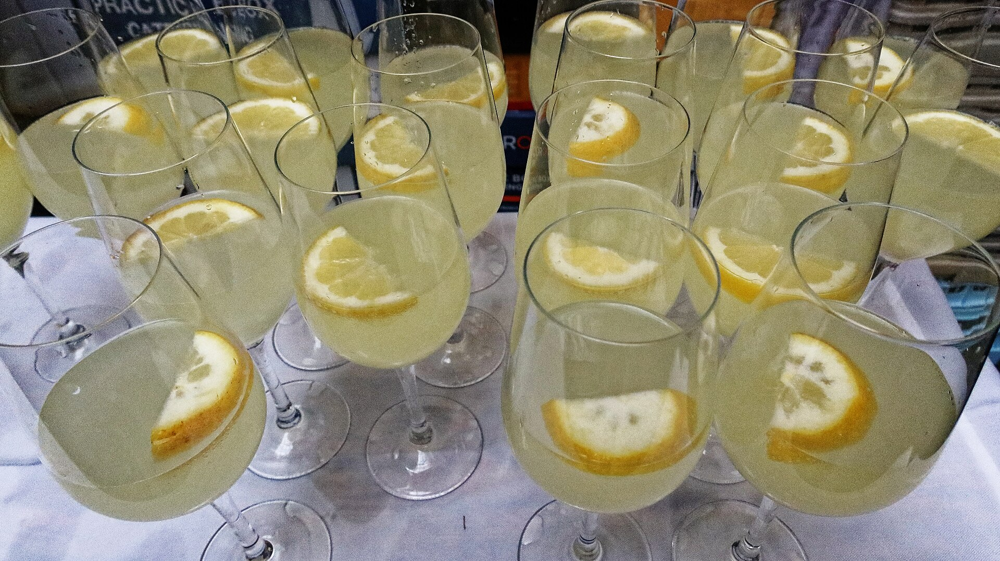

# Limoncello

Limoncello is southern [Italy](ref:italy)'s lemon-peel liqueur: fresh yellow zest is steeped in neutral spirit so that oils and aroma dissolve, then blended with sugar syrup to produce a bright yellow, sweet, oily after-dinner drink. It takes its flavour from peel rather than juice and is never fermented, so it tastes less like lemonade and more like lemon peel held up by sugar. In Sorrento, Amalfi and Capri it is often kept in the freezer and served in small, ice-cold glasses.

Figure: Related photograph of Limoncello. Image: Burkhard Mücke, CC BY-SA 4.0, via Wikimedia Commons ([source page](https://commons.wikimedia.org/wiki/File:Limoncello_Spritz_mit_Prosecco.jpg)).

## The Lemon Peel of Southern Italy

Limoncello needs only three things: lemon peel, alcohol and sugar. The peel must be the yellow outer layer only, avoiding the white pith that brings bitterness; the alcohol is usually neutral grain or grape spirit; the sugar is added as syrup and determines sweetness and viscosity. Traditional family recipes steep the mixture in a cool place for several weeks, then filter, sweeten and bottle, with no special equipment required.

Its geographical identity is tied to lemon growing rather than to a single legal recipe. The Sorrento peninsula and Amalfi Coast produce aromatic oval lemons, while Capri has turned limoncello into a tourist emblem. As a result, the style ranges from rough home-made versions to stable commercial bottlings far more widely than many protected drinks.

## A Liqueur in Law, a Lemon in Flavour

In EU law, limoncello belongs to the category of [liqueur](ref:liqueur): at least 15% ABV and at least 100 grams of sugar per litre. The regulation sets no single recipe for "limoncello" and gives the drink itself no EU geographical indication; what is protected are lemon names such as Limone di Sorrento and Limone Costa d'Amalfi. A label may therefore say Sorrento lemon without the whole bottle being governed by origin law.

Commercial limoncello usually sits between 25% and 32% ABV, with sugar often between 200 and 350 grams per litre. Too little alcohol makes the lemon aroma watery; too much lets spirit overwhelm the peel. Sugar decides whether the result reads as a liqueur or as syrup. Some producers add a little lemon juice or acidity regulator for a fresher profile, while traditionalists argue that this muddies the purity of the oil.

## From Family Kitchen to Bottle

The modern popularity of limoncello is often traced to early twentieth-century homes in Sorrento and Capri, although similar lemon-peel infusions existed around the Mediterranean much earlier. From the 1980s onward, Italian tourism pushed the homemade drink into restaurants and souvenir shops, and commercial production expanded quickly. Today it is both a family-table liqueur and one of Italy's most common airport gifts.

Commercial success produced two routes: one emphasises handwork, small batches and local lemons; the other emphasises consistency, low price and year-round supply. The first usually looks more natural and smells more of peel oil; the second may be sweeter, clearer and more candy-like. Both are legal; the difference lies in the choice of raw material and process.

## Peel, Not Juice

To make limoncello, lemons are washed and dried and only the yellow zest is removed, leaving as much pith behind as possible. The peel goes into neutral alcohol of 90% or more for ten days to a month; a cooler, slower steep gives a cleaner aroma. The solids are filtered out, and the infusion is diluted with mineral water and sugar syrup to the target strength. Most producers do not [distil](ref:distillation) again, preserving the lighter peel aromatics; a few distil lightly for clarity.

The key is infusion, not boiling. Heat damages the delicate terpenes in lemon peel and pulls out bitterness at the same time. The syrup should be cool before mixing so that the aroma is not driven off, and the blend usually rests for one to two weeks so that alcohol, sugar and water integrate before filtration and bottling. The colour comes from the peel itself; authentic limoncello needs no added dye.

## Cold, Sweet and Bright

In a small glass, limoncello is usually opaque bright yellow, sometimes with a green reflex. The nose is fresh lemon peel, lemon blossom, candy and a faint resinous note; the entry is sweet, followed by alcoholic warmth and the oily thickness of peel, with low acidity and a slightly bitter finish. A good version keeps a clear line between sweetness and bitterness instead of collapsing into sugar water.

Temperature is half the experience. Frozen, the liquid becomes thicker and more viscous, the aroma is held back, and sweetness arrives before alcohol; at room temperature the nose opens but sweetness and spirit feel sharper. Judge it on three points: whether the colour looks like real peel, whether the aroma has oil, and whether sweetness covers the lemon's bitter edge.

## Sorrento, Amalfi and Capri

The Sorrento peninsula is known for the oval Ovale di Sorrento lemon, thick-skinned and rich in oil, which suits a long steep; Amalfi lemons are smaller and more fragrant and often appear in family recipes; Capri has bound limoncello to island tourism and a sweeter, easier-drinking style. All three treat the drink as a local point of pride, but recipes and sweetness are not standardised.

Among brands, Pallini and Luxardo offer stable, widely available commercial versions, Villa Massa stresses its Sorrento roots, and DICAPRI builds its identity on Sorrento PGI lemons and a traditional recipe. Small workshops sell locally with labels naming the lemon variety, steeping time and sugar level. Origin and raw material tell you more than a flag on the label.

## How to Serve It Frozen

The classic serve is to keep the bottle in the freezer and pour into a matching frozen small glass, then drink it in one or two sips. Cold makes the body thicker and the sweetness more concentrated while muting the alcohol. It suits the end of a meal, lemon desserts, almond biscuits or fresh berries, and it can also be lengthened with soda and ice.

In cocktails, limoncello can replace part of the lemon juice and syrup, but because it is already sweet, the [residual sugar](ref:residual-sugar) elsewhere in the recipe must come down. It mixes well with tonic, prosecco or iced tea, and pouring it over ice cream is a simple Italian family habit. Avoid heating it, as the aroma disappears quickly.

## The Difference from Limoncino and Lemon Juice

"Limoncino" is used in Liguria and Tuscany as a synonym for limoncello, though in some areas it means a lower-strength, sweeter home version. "Crema di limone" is a cream liqueur with dairy, thicker in texture and shorter in shelf life. Lemon juice contains no alcohol and cannot replace limoncello; lemon-flavoured vodka or liqueur may be compounded from flavourings and lack the oily depth of a peel infusion.

It is not lemon wine either. Fruit wine gains alcohol through fermentation, while limoncello extracts aroma with added spirit; the former is more acidic and lower in alcohol, the latter sweeter and more stable. Confusing the two makes the acid-sugar balance of a recipe go wrong.

## Buying and Storage

Read the ingredient order: peel, alcohol, sugar and water near the front suggests a traditional approach; a long list with several flavourings and colours usually points to a more candy-like product. A fluorescent colour or a clarity more typical of lemon soda is not necessarily a virtue. After opening, return the bottle to the freezer to extend its life, but tighten the cap each time so that it does not pick up freezer odours.

For home-made versions, use unwaxed fruit with no pesticide residue, and let the alcohol and syrup rest before filtering, or a haze will form in the bottle. High sugar and alcohol make limoncello relatively durable, but the aroma flattens with time, so it is best finished within a year.

Further reading: [Abbey beer](ref:c-extra-1).
