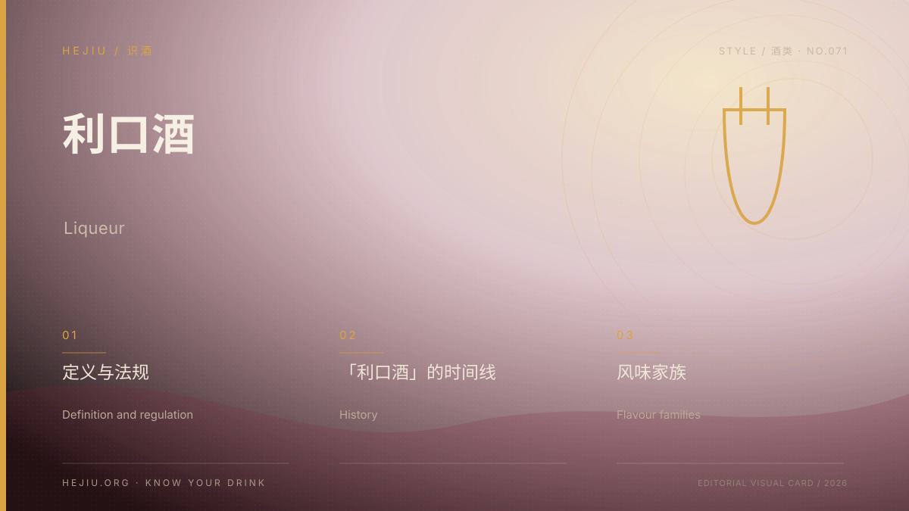

# Liqueur

Liqueur is a sweetened spirit made by adding sugar and flavouring materials such as fruit, herbs, nuts or cream to a base spirit. Its structure can be summarised as "base spirit plus flavour extraction plus sweetening", and differences in those three stages decide whether the product is a clear citrus cordial, a thick cream liqueur or a bittersweet herbal drink.

Figure: thematic illustration for Liqueur. Image: AI-assisted illustration generated with Doubao Seedream 5.0 (project-owned); not a photograph of the subject.

## Definition and regulation

EU regulation defines liqueur as a sweetened spirit with a minimum strength of 15% ABV and a sugar content of at least 100 g/l expressed as invert sugar. Sub-categories built on bitterness, acidity or a specific raw material may depart from that sugar floor; names in the "crème de" family require more sugar, and crème de cassis, for example, has a regulatory minimum of 250 g/l. National rules can be more detailed, and the category word, strength and sugar declaration on the label are the basis for judgment.

Liqueur and bitters are not the same category. Bitters are usually very low in sugar and used in dashes as a seasoning, while liqueurs are made for drinking and carry far more sugar and flavour concentration. This boundary matters in a recipe: using bitters as the sweetener produces a drink that is markedly bitter and dry.

## History

Liqueur descends from medieval European medicinal syrups and "cordials". Monasteries and apothecaries steeped herbs in alcohol and preserved them with sugar for digestion and daily health. In the 17th and 18th centuries these recipes entered courts and commercial production and moved from the pharmacy to the table. In the 19th century, distillation, filtration and sweetening became stable, and brands such as Chartreuse, Grand Marnier and Cointreau formed flavour lineages that are still clearly recognisable today.

In the 20th century liqueurs split into two routes: rich products for after-dinner sipping, and high-concentration flavour ingredients for mixing. The latter became more important during the cocktail revival, because a small measure can give a clear direction of citrus, coffee, almond or herbs.

## Flavour families

- **Fruit**: citrus, cherry, peach, blackcurrant and raspberry, usually extracted by maceration or distillation, high in sugar and common in sweet cocktails.
- **Herbal and bitter**: Chartreuse, Campari and Aperol, ranging from bittersweet to complex herbal, drinkable neat and also useful as a structural ingredient.
- **Nut**: almond, hazelnut and walnut, often with a marzipan character, suited to after-dinner drinking and desserts.
- **Cream**: made with dairy and emulsifiers, thick in texture, requiring careful storage and allergen labelling.
- **Coffee**: coffee-bean infusions or blends, the core sweet and bitter element in the White Russian and espresso martini.
- **Floral and honey**: elderflower, violet and honey, light in aroma and suited to fresher drinking.

Family labels are only a finding aid; real products often cross them, for example citrus with herbs, or coffee with cream.

## Production

There are four common routes: maceration, percolation, distillation and compounding. Maceration puts the material into the liquid so that aroma and colour dissolve; percolation lets the liquid pass slowly through a bed of material for a more even extraction; distillation passes macerated liquid or steam through the material for a clearer, more concentrated aroma; compounding mixes essences, syrup and base spirit, which is cheaper but integrates differently.

After [distillation](ref:distillation) the producer usually adjusts strength, adds sugar or syrup, filters and rests the liquid. Resting lets aroma and sugar merge and reduces sharpness. Cream liqueurs also need homogenisation so that the dairy fat stays suspended. The producer's core task is to keep base spirit, flavour and sweetness from masking one another.

## Sugar, strength and storage

Strength varies widely: lighter products may sit around 15% ABV, while rich ones can exceed 40% ABV. Sugar varies just as much, from a little over one hundred grams per litre to several hundred. High-sugar, low-alcohol products are more stable after opening; cream liqueurs contain dairy and should be refrigerated and finished quickly once opened. All liqueurs should avoid heat and direct light, which degrade aroma and colour.

Three things are worth checking when buying: whether the category word is explicit, whether sugar and strength are declared, and whether the product contains dairy or nuts as allergens. High sugar does not mean low quality, but it changes how the product is drunk and how much is used in a recipe.

## Flavour and tasting

Temperature and quantity are the key to tasting a liqueur. A small glass, a small pour, room temperature or light chilling is enough; too cold mutes the aroma and too warm amplifies the alcohol. Smell for the direction of the flavour, then judge whether sugar and alcohol are balanced, and finally whether the finish is clean.

Each family is judged differently: fruit liqueurs on whether the aroma resembles real fruit rather than candy; herbal ones on whether the bitterness has layers and whether sugar hides the plant detail; cream ones on whether dairy and body integrate without greasiness; coffee ones on roast level and the bitter-sweet ratio. Compared with a sipping spirit such as [brandy](ref:brandy), liqueur is judged more on the balance of flavour concentration and sweetness.

## Drinking and pairing

Liqueurs can be served neat, over ice, with soda or milk, and are often the sweet and aromatic element of a cocktail. Because they already contain sugar, a recipe usually reduces or omits syrup; when a liqueur replaces syrup, the acidity often needs adjusting at the same time. The classic [Negroni](ref:negroni) uses Campari for both bitterness and sweetness, an example of a liqueur carrying a structural role.

After a meal they pair with dark chocolate, nuts, cheese and desserts; cream liqueurs suit coffee and chocolate, fruit liqueurs suit tarts and berries. Before a meal, lower-sugar, bitter or sparkling products work better. High-sugar liqueurs with very sweet desserts quickly become cloying, so the measure should be smaller.

## Common misconceptions

First, treating liqueur as "a low-alcohol drink". Its strength can be high; what matters is sugar and serving size.
Second, assuming sweeter means inferior. Sweetness is part of the category design, and the real question is balance.
Third, mixing up bitters and liqueurs. Bitters have little sugar and are used in small amounts, and substituting one for the other changes the structure of a recipe.
Fourth, ignoring storage for cream products. Refrigeration after opening is a basic requirement for anything containing dairy.
Fifth, treating British "cordial" and American "liqueur" as synonyms. In British English cordial often means a concentrated fruit syrup, so the context changes the meaning.

Start with [Distillation](ref:distillation) for legal definition, then read [Negroni](ref:negroni) for materials and process. Seeing both keeps Liqueur from being confused with a neighbouring idea.

**At a glance:** A sweetened spirit flavoured with fruit, herbs, nuts, cream or coffee; bitters are a separate, less sweet category. 

## Further reading

- [Distillation](ref:distillation): the key step for flavour extraction and a clear body.
- [Brandy](ref:brandy): a grape distillate often used as the base of liqueurs.
- [Negroni](ref:negroni): an example of a liqueur carrying a structural role in a classic recipe.
